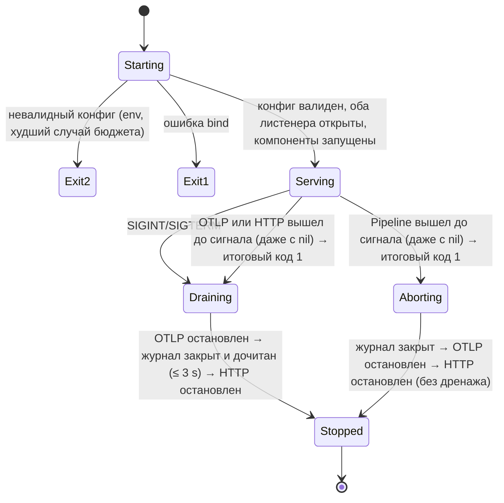

# Шаг 1 — ходячий скелет: дизайн-контракт и спека

| Поле | Значение |
|---|---|
| Шаг плана | 1 (9–15 ноября 2026), [`development-plan.md`](../development-plan.md) |
| Требования (частично) | FR-ING-001 (traces, gRPC), FR-ING-005 (backpressure), FR-TOP-001 (уровень сервиса), FR-API-001 (gRPC + Connect, без gRPC-Web), FR-API-002 (без фильтров и `at`), FR-API-007 (дедлайн 30 s; `GetGraph` — исключение из пагинации), FR-TOP-002 (только признак ошибки вызова, без окон и латентности), FR-CLI-002 (dot, json) |
| Термины | [`glossary.md`](../glossary.md) — единый словарь для плана, требований и дизайна |
| Статус | на апрув (ред. 4 — третий круг ревью pocock / osmani / pstack по решениям доменного эксперта) |

Цель: тонкий сквозной путь, который **ходит целиком**: `OTel Demo в kind → OTLP/gRPC → ingest → журнал в памяти → сопоставление спанов → граф → GetGraph → faultctl graph export`. Это один процесс `faultline all` в одном образе, задеплоенный в kind и воспроизводимый командой `make demo-1`.

**Сознательно НЕ входит в шаг 1** (приходит позже, а не «забыто»):
- окна, RED-метрики, событийное время с watermark (шаг 2);
- NATS и durability журнала (шаг 3);
- ClickHouse (шаг 4);
- чекпоинты, позиции журнала, поток `graph watch` (шаг 5);
- метрики Prometheus, Helm, readiness по зависимостям (шаг 6);
- внешние узлы (БД, внешние API) и спаны PRODUCER/CONSUMER, то есть **рёбра через брокер наблюдаемого приложения** (в OTel Demo это его собственная Kafka между checkout и accounting/fraud-detection; к транспорту faultline — NATS — отношения не имеет) (шаг 10);
- уровни workload/namespace/pod (шаг 10);
- токены приёма, OIDC, тенанты (шаг 18);
- фильтры графа, `at`, пагинация, gRPC-Web, Mermaid в CLI;
- OTLP/HTTP;
- усечение атрибутов (FR-ING-006): в шаге 1 атрибуты не хранятся. Строки идентичности (`service.name`, namespace, pod) не усекаются, а **ограничиваются**: спан с длинной или невалидной строкой отклоняется (см. «Валидация»);
- durability-подтверждение (ack по позиции журнала): в шаге 1 `Delivery.Release` только освобождает кредит памяти (см. «Форма порта»).

---

## Поток данных и слои

```
interfaces/otlp.TraceReceiver ──► application/ingest.AcceptBatch ──► [spanJournal] ◄── infrastructure/memjournal
   (pdata → []ingest.SpanInput)       (span.New, ReceivedAt = clock.Now())              │
                                                                                                 ▼
application/processing.Pipeline ◄── [spanFeed] ── []Delivery{Batch, Release} ◄────────── memjournal.Journal
   │  (до 64 доступных пакетов за итерацию → один снимок)
   │  topology.Builder.Apply(batch)  — доменный фасад, владеет порядком:
   │     ├ matcher.Matcher      (половинки → Call, tombstones, истёкшие caller-половинки, учёт I1)
   │     └ graph.Graph          (Call + узлы + вызовы без ответа → ревизия)
   │  topology.Builder.Snapshot()   → Snapshot{граф, PairingStats, ревизия}
   ▼
[graphPublisher] ──► infrastructure/memgraph.Store (atomic.Pointer[topology.Snapshot]) ──► [graphReader]
                                                          │
                                         cmd/faultline: лог pipeline.stats раз в 30 s (читает снимок)
                                                                                                 │
interfaces/connectapi.GraphHandler ◄── application/query.GetGraph ◄─────────────────────────────┘
   (Snapshot → faultline.v1.Graph)                   ▲
                                                     │ ConnectRPC (gRPC / Connect-JSON / Connect-proto)
cmd/faultctl → internal/cli: graph export -o dot|json
```

`[…]` — consumer-side порты, объявленные в пакете того use case, который их вызывает.

### Пакеты

| Пакет | Содержит | Импортирует (энфорсится depguard) |
|---|---|---|
| `internal/domain/telemetry/ids` | `TraceID`, `SpanID`, `CallKey` | stdlib |
| `internal/domain/telemetry/kind` | `Kind` (вид спана по OTLP, `Normalized`) | stdlib |
| `internal/domain/telemetry/resource` | `Resource` (валидация строк идентичности), `ServiceRef` (VO), `ErrInvalid` | stdlib |
| `internal/domain/telemetry/response` | `Attributes`: признак ошибки по коду ответа, вызов внешней системы | stdlib |
| `internal/domain/telemetry/span` | `Span` (VO) + `New` с валидацией, `Fields`, `ErrInvalid` | `ids`, `kind`, `resource`, `response` |
| `internal/domain/telemetry/batch` | `Batch` (VO: спаны + `ReceivedAt`) + `New`, `Footprint`, `ErrEmpty` | `span` |
| `internal/domain/topology` | `Builder` (фасад), `Snapshot`, `Limits`, `ErrInvalidLimits` | `telemetry/*`, `topology/*` |
| `internal/domain/topology/role` | `Role` (caller/callee/unpairable/ignored), `Of` | `telemetry/*` |
| `internal/domain/topology/call` | `Party`, `Call` (`Between`), `Unanswered` | `resource` |
| `internal/domain/topology/clock` | `Monotonic`: время, которое не идёт назад | stdlib |
| `internal/domain/topology/tombstone` | `Set` (ring + map), `Scope` | `ids`, `role` |
| `internal/domain/topology/matcher` | `Matcher` (буфер ожидания), `Stats` (I1), `Limits` | `telemetry/*`, `call`, `clock`, `role`, `tombstone` |
| `internal/domain/topology/graph` | `Graph` (агрегат), `Change`, `View`, `Node`, `Edge`, `Stats` | `resource`, `call`, `clock` |
| `internal/application/ingest` | `AcceptBatch`; команда `SpanInput`, результат `AcceptResult`; порты `spanJournal`, `clock`; `ErrOverloaded`, `ErrBatchTooLarge`, `ErrUnavailable` | `telemetry` |
| `internal/application/processing` | `Pipeline`; порты `spanFeed`, `graphPublisher`; `Delivery`; `ErrFeedClosed` | `telemetry`, `topology` |
| `internal/application/query` | `GetGraph`, порт `graphReader` | `topology` |
| `internal/infrastructure/memjournal` | очередь пакетов в памяти, ограниченная по байтам (`Batch.Footprint()`) и по числу пакетов | `telemetry`, `ingest`, `processing` (sentinel'ы портов) |
| `internal/infrastructure/memgraph` | последний снимок графа (atomic) | `topology` |
| `internal/interfaces/otlp` | OTLP gRPC `TraceService`, маппинг pdata → `SpanInput` и `AcceptResult` → `partial_success`, карта ошибок, recovery-интерсептор | `application/ingest` |
| `internal/interfaces/connectapi` | `GraphService`, маппинг domain → proto, дедлайн-интерсептор | `application/query`, `topology` (только типы снимка для маппинга), `internal/gen` |
| `internal/cli` | команды `faultctl`, рендереры dot/json | `internal/gen` и stdlib; `internal/domain`, `internal/application`, `internal/infrastructure` запрещены |
| `cmd/faultline`, `cmd/faultctl` | composition root, конфиг, сигналы, жизненный цикл | всё |

depguard дополнительно запрещает импорт одного use case другим (`application/query` ↛ `application/ingest` и т. д.): общий код идёт в `domain`, а не в соседний сценарий.

`internal/cli` вынесен из `internal/interfaces`. `interfaces` — это входящие адаптеры сервера, а CLI — клиент другого бинарника, который ходит в API по сети.

Тонкие use case `AcceptBatch` и `GetGraph` в шаге 1 почти пробрасывают вызов. Они существуют, потому что `interfaces` по правилу слоёв зовёт только `application`. Содержимое у них уже есть: `AcceptBatch` валидирует спаны через доменный конструктор, собирает отказы, ставит `ReceivedAt` и отбрасывает пустой пакет. В шагах 3 и 18 добавятся подтверждение после записи, тенант и scope запроса.

---

## Модель сопоставления спанов (ядро шага)

Ребро «A → B» появляется, когда найдена пара: **client-спан** сервиса A и **server-спан** сервиса B того же вызова. Признак пары — `server.parent_span_id == client.span_id` в одном `trace_id`. Половинки приходят в разных OTLP-пакетах, от разных сервисов, в любом порядке. Поэтому нужен буфер ожидания с TTL, как в servicegraph-коннекторе OTel Collector.

### Роль спана: факты — в `telemetry`, политика — в `topology`

`span.Span` хранит только факты о себе в публичных полях: `Kind`, `TraceID`, `SpanID`, `ParentSpanID`, `Failed`, `CallsExternalSystem` (есть `db.system.name`, устаревший `db.system` или `messaging.system`). Решение «участвует ли спан в сопоставлении и какой стороной» — политика графа, она живёт в `topology` (`role.Of(span) (ids.CallKey, role.Role)`). В шаге 10 внешние узлы (FR-TOP-003) меняют только эту функцию, `telemetry` не трогается.

| Спан | Результат `role.Of` |
|---|---|
| `CLIENT` без внешней системы | `CallKey{trace, span_id}`, сторона caller |
| `SERVER` с ненулевым `parent_span_id` | `CallKey{trace, parent_span_id}`, сторона callee |
| `CLIENT` с `db.system.name` / `db.system` / `messaging.system` (пары не будет никогда: БД, брокер) | `false`, учитывается как `unpairable` |
| `SERVER` без родителя (корень трейса, вход извне) | `false`, учитывается как `unpairable` |
| `INTERNAL`, `PRODUCER`, `CONSUMER`, `UNSPECIFIED` | не участвуют в сопоставлении и не входят в `observed` |

### `matcher.Matcher` — контракт

Время для TTL — это `Batch.ReceivedAt`: его ставит `AcceptBatch` при приёме, и он хранится в записи журнала. Время обработки не используется. Поэтому повторный прогон того же журнала (replay в шаге 5) даёт тот же результат. В шаге 2 источником времени станет watermark по событийному времени, а сигнатура `Match(span, now)` не изменится. Пакеты от параллельных хэндлеров могут встать в журнал чуть не по порядку, поэтому матчер приводит время к монотонному: `now = max(now, lastNow)`. Известное ограничение: прыжок стенных часов вперёд на Δ сдвигает `lastNow`, и истечение «замирает» на Δ (половинки живут дольше `ttl`, учёт I1 не нарушается). В шаге 1 `ReceivedAt` несёт монотонное показание Go и прыжков не видит; после сериализации (шаг 3) показание теряется, но в шаге 2 источником времени уже станет watermark.

`matcher.Matcher.Match(span, now) (call.Call, bool)` — проверки идут строго в этом порядке:
1. Ключ есть в **tombstones** (пара уже сопоставлена не раньше чем `tombstoneTTL` назад) → `duplicate`. Это защищает от повтора батча, в котором лежат обе половинки (Collector склеивает спаны разных сервисов в один Export).
2. Ожидает та же сторона того же ключа → `duplicate`. «Та же половинка» — это совпадение `(CallKey, Side)`, а не `span_id`. Второй server-спан с тем же родителем тоже `duplicate`.
3. Ожидает противоположная сторона → пара удаляется из буфера, ключ уходит в tombstones, возвращается `call{caller, callee, failed}`.
4. Иначе половинка встаёт в ожидание до `now + ttl`. Если буфер полон, сначала **вытесняется старейшая** ожидающая половинка (`evicted`). Вытеснение старейших, а не отбрасывание новых, выбрано сознательно: при насыщении буфер забит половинками, у которых шанс найти пару ниже всего.

`matcher.Matcher.Expire(now) []call.Unanswered` вычищает просроченные половинки (`expired`, из них caller-половинки — ещё и в `expired_caller`) и tombstones и возвращает истёкшие caller-половинки (сервис и `failed`) для учёта на узле. `Builder` вызывает его в начале каждого пакета, тикера нет. Без трафика половинки остаются в `pending`, I1 при этом выполняется. Это принятое упрощение: `pending` в простое не уменьшается.

**Структура данных.** `map[CallKey]*list.Element` плюс `container/list` в порядке истечения. TTL одинаковый, а `now` монотонно, поэтому порядок вставки совпадает с порядком истечения. При совпадении элемент удаляется из списка за O(1). Ленивого удаления нет, поэтому длина списка не превышает `maxPending`. Вставка в map и в список делается одной функцией без промежуточных выходов, и запись не может оказаться только в одном из них.

**Tombstones — своё окно и свой лимит.** Их задача — поймать повтор OTLP-запроса, который уже был принят (клиент не дождался ответа и прислал запрос снова). Такой повтор приходит не раньше «таймаут экспортёра Collector (5 s) + backoff (`initial_interval` 5 s ± 50 %)», то есть через 7,5–12,5 s и позже, а при включённом `retry_on_failure` Collector продолжает попытки до `max_elapsed_time` (300 s по умолчанию). Поэтому окно tombstones не может быть равно `ttl` буфера ожидания (10 s):
- `tombstoneTTL = 60 s` по умолчанию: покрывает первые 3–4 попытки, на которые приходится подавляющее большинство повторов;
- лимит `maxTombstones = 1 000 000`: правило размера `maxTombstones ≥ rate_matched × tombstoneTTL` при меньшем лимите ломается уже на 17k вызовов/с. Структура легче буфера ожидания: ring-буфер `[]tombstone.Entry{Key, Deadline}` в порядке истечения плюс индекс `map[ids.CallKey]tombstone.Scope`, без `container/list` и без значения половинки. Бенчмарк «heap на элемент»: ≈ 88 B на запись (≈ 84 MiB);
- tombstone ставится и на **истёкший caller-ключ** и гасит только повтор той же caller-стороны. Иначе повтор OTLP-запроса с одной caller-половинкой, пришедший после её истечения (повтор через 7,5–12,5 s при `ttl` 10 s — обычный случай), посчитал бы один вызов без ответа дважды. Опоздавшая server-половинка этим tombstone не гасится и сама истекает как `expired`;
- при переполнении вытесняется старейший tombstone и растёт `tombstone_evicted` (не корзина I1: спаны не теряются, страдает только точность дедупликации).

Остаточный риск записан честно: повтор позже `tombstoneTTL` или после вытеснения tombstone посчитает вызов второй раз. Дедупликация OTLP-повторов — **best effort**; точная идемпотентность приёма (FR-ING-004) требует ключа на стороне отправителя и появится с агентом (шаг 8).

**`failed` — по коду ответа, с обеих сторон** (FR-TOP-002). Ошибку видит иногда только одна сторона:
- callee упал или недоступен — server-спана нет или он не дошёл до обработки, а у caller `UNAVAILABLE`;
- callee ответил слишком поздно — у callee `OK`, а caller уже сдался с `DEADLINE_EXCEEDED`.

Если смотреть только на callee, в обоих случаях ребро «зеленеет» ровно тогда, когда зависимость сломана. Поэтому `Call.failed = caller.Failed() || callee.Failed()`, как в servicegraph-коннекторе Collector и в Tempo.

Опасение, что client-спан помечается ошибкой на 4xx и `NOT_FOUND`, снимается тем, что решение принимается **по коду ответа, а не по статусу спана**. Правило `span.New` для поля `Span.Failed` одинаково для обеих сторон, первое найденное побеждает:
1. `rpc.response.status_code` (строка с именем кода, semconv ≥ v1.39, проверено по `go.opentelemetry.io/otel@v1.47.0/semconv/v1.39.0`) или устаревший `rpc.grpc.status_code` (число, semconv ≤ v1.38) → ошибка, если код не входит в {`OK`, `NOT_FOUND`, `ALREADY_EXISTS`, `CANCELLED`};
2. `http.response.status_code` или устаревший `http.status_code` → ошибка, если код ≥ 500; строковое значение разбирается как число, нечисловое игнорируется;
3. только если кода ответа нет вообще (ни п. 1, ни п. 2): есть `error.type` (например, `connection refused`, `timeout`) → ошибка. Если код есть, `error.type` игнорируется: новый SDK кладёт в `error.type` и имя кода (`NOT_FOUND`), и без этого правила п. 1 обходился бы;
4. иначе статус спана `ERROR` → ошибка.

Набор имён атрибутов подтверждается на дампе в срезе 0 (A3).

Имена кодов сравниваются с каноническими именами gRPC (`CANCELLED` с двумя L; в FR-TOP-002 исправлено).

**Вызовы без ответа.** Caller-половинка, у которой пара не нашлась за `ttl`, — это не мусор, а сигнал. Причин три, и по одному спану они неразличимы: callee не ответил (упал, недоступен), callee не инструментирован, или server-спан callee опоздал больше чем на `ttl`. Поэтому поле называется честно — «без ответа в пределах `ttl`», а не «callee упал». `matcher.Matcher.Expire(now)` возвращает истёкшие caller-половинки, и `graph` учитывает их **на узле вызывающего**: `unanswered_calls` и `unanswered_failed_calls` (по `caller.Failed()`). Отличить причины помогает второй сигнал: `unanswered_failed_calls` (у caller был код ошибки — скорее отказ) против `unanswered_calls` без ошибки (скорее опоздание или отсутствие инструментации), плюс `expired` callee-половинок в `pipeline.stats` (растёт при опозданиях). Фантомное ребро не рисуется: куда шёл вызов, без server-спана достоверно не известно. В шаге 10 такие вызовы станут рёбрами к виртуальному узлу по `server.address` / `peer.service` (FR-TOP-003). Истёкшие callee-половинки только считаются в `expired`.

Известное занижение: **вытесненные** при переполнении буфера caller-половинки (`evicted_caller`) в `unanswered_calls` не попадают — вытеснение говорит о нехватке памяти, а не о поведении callee. При насыщении сигнал «без ответа» занижен; это видно по росту `evicted_caller`.

**Self-loop.** Если client- и server-спан одного сервиса, получается ребро A → A. Это реальный вызов, оно сохраняется. `telemetrygen traces`, по нашему допущению, даёт именно такое ребро (A6).

Параметры по умолчанию: `ttl = 10 s`, `maxPending = 100 000` половинок, `tombstoneTTL = 60 s`, `maxTombstones = 1 000 000`.

### `matcher.Stats` (`Snapshot.PairingStats`) — счётчики I1

`PairingStats` (VO): `observed`, `matched`, `duplicate`, `unpairable`, `evicted`, `expired`, `pending` (корзины I1), а также `expired_caller` (часть `expired`, вход I3 для вызовов без ответа), `evicted_caller` (часть `evicted`) и `tombstone_evicted` (вне формулы).

`GraphStats` (VO) — дом для счётчиков I3: `graph_overflow` (вызовы, не вошедшие в рёбра из-за `maxNodes`/`maxEdges`), `unanswered_overflow` (истёкшие caller-половинки, чей узел не создан из-за `maxNodes`), `node_overflow` (число **спанов**, для сервиса которых узел не создан; считаются события, а не различные сервисы — множество отклонённых сервисов не хранится, I5).

Оба VO **входят в `Snapshot`**: `Builder` кладёт копии в каждый снимок. Поэтому лог `pipeline.stats` и тесты читают счётчики из опубликованного снимка, а не из состояния горутины Pipeline (иначе гонка данных: `Builder` — single-writer). Тесты I1 и I3 проверяют формулы по `Snapshot` из `Builder`, а не через внутренние методы матчера.

### `Builder` — один владелец порядка «истечь → сопоставить → применить»

Порядок `Expire → Match → graph.apply` — доменное правило: на нём держатся I1 и I3, и при панике между шагами они ломаются вместе. Поэтому порядок живёт не в `Pipeline` (слой application), а в доменном фасаде `topology.Builder`:

```go
func (b *Builder) Apply(received batch.Batch) // Expire(received.ReceivedAt) → Match каждого спана → Graph.Apply(&graph.Change{…})
func (b *Builder) Snapshot() *Snapshot // граф + PairingStats + GraphStats + ревизия; view пересобирается, только если граф изменился
```

`generated_at` снимка — `ReceivedAt` последнего пакета, изменившего граф, а не часы процесса. Так replay того же журнала (тест сейчас, шаг 5 потом) даёт тот же `generated_at`, и отдельный порт `clock` в `processing` не нужен.

`Snapshot.Nodes` отсортированы по id, рёбра несут **id** узлов (поля `Edge.Source`, `Edge.Target`). Индексы — оптимизация формата передачи, их строит `connectapi` при маппинге (позиция узла в `Snapshot.Nodes`); домен про индексы не знает.

`matcher.Matcher` и `graph.Graph` **не сливаются**: у них разные данные и разный срок жизни (короткоживущие половинки по трейсам против долгоживущих рёбер), и склеенный тип к шагу 10 стал бы «богом». Так же устроены servicegraph-коннектор и Tempo: хранилище сопоставления с TTL отдельно, агрегация отдельно, склеивает их один процессор.

Что это даёт дальше по плану:
- шаг 2: watermark становится источником `now` для `Builder`, сигнатуры матчера не меняются;
- шаг 5: чекпоинт должен сохранить половинки и граф **согласованно** — это `Builder.Checkpoint()` у единственного владельца обоих;
- шаг 10: рёбра через брокер наблюдаемого приложения (PRODUCER/CONSUMER через span links) — второй матчер (Strategy), который кормит тот же `graph`.

Тесты I1, I3, оракул пар и таблицы сопоставления идут через `Builder` как чёрный ящик: на вход пакеты, на выход снимок со статистикой, без фейка журнала. `matcher` и `graph` — отдельные доменные Go-пакеты внутри `topology` с публичными полями. Обход порядка «истечь → сопоставить → применить» не закрыт видимостью, его сторожат два линтера: depguard запрещает `application` импортировать `topology/matcher`, `graph`, `tombstone`, `clock`, а forbidigo (`analyze-types`) запрещает вне `topology` обращаться к полям `Builder.Matcher` и `Builder.Graph`. Структурные проверки, не видимые через снимок (`len(Ring) == Limit`, порядок истечения), — тесты этих Go-пакетов.

---

## 1. Задача и инварианты

**Задача:** принять OTLP-трейсы, построить граф вызовов «сервис → сервис» и отдать его через API и CLI.

**Инварианты** (каждый проверяется тестом напрямую; все действуют в пределах жизни процесса, потому что состояние шага 1 в памяти):

- **I1 — учёт каждого спана.** Каждый принятый CLIENT/SERVER-спан попадает ровно в одну корзину:
  `observed = 2·matched + duplicate + unpairable + evicted + expired + pending`.
  Ни один спан не пропадает молча. Проверка — property-based тест со случайным порядком, дубликатами, повторами целых пакетов и временем прихода.
- **I2 — атомарность снимка.** Читатель видит граф либо до пакета, либо после, но никогда не видит пакет применённым частично. Единица атомарности — итерация Pipeline (до 64 пакетов): все её пакеты видны вместе или не видны совсем. Поля `Snapshot` публичные (стиль проекта), но срезы `Nodes` и `Edges` — собственная копия каждого снимка (`slices.Clone` в `Builder.Snapshot`): читатель, изменивший свой снимок, не портит граф и следующие снимки. Ревизия строго монотонна и растёт **только если итерация изменила граф**. «Изменила граф» = появился узел или ребро **или изменился любой счётчик узла или ребра** (`calls`, `failed_calls`, `unanswered_calls`, `unanswered_failed_calls`). Поэтому одна ревизия всегда означает одни и те же данные графа. `PairingStats` и `GraphStats` в снимке обновляются каждую итерацию и ревизию не двигают: это диагностика конвейера, а не данные графа.
- **I3 — согласованность ребра.** Σ `edge.calls` = `matched − graph_overflow`, где `graph_overflow` — вызовы, не вошедшие в граф из-за лимита узлов или рёбер (I5). `edge.failedCalls ≤ edge.calls`. Вызовы без ответа: Σ `node.unanswered_calls` = `expired_caller − unanswered_overflow` (caller-узел не создан из-за `maxNodes`), `node.unansweredFailedCalls ≤ node.unansweredCalls`. Узлы сверх `maxNodes` считаются в `node_overflow` (спан учтён в I1, узел не создан).
- **I4 — нет тихой потери после ответа.** Успешный ответ OTLP ⇒ все валидные спаны запроса поставлены в журнал, и при штатной остановке они будут обработаны до выхода, **если дренаж уложился в 3 s**; иначе недочитанное явно фиксируется Error-логом `lifecycle.drain_incomplete` с числом спанов (см. «Жизненный цикл»). Перегрузка ⇒ `RESOURCE_EXHAUSTED` **с `RetryInfo`**, и из запроса ничего не поставлено (всё или ничего). Ограничение шага 1: при **падении** процесса теряются журнал, ожидающие половинки и граф. Durability появляется в шаге 3 (NATS R3) и становится полной с чекпоинтами в шаге 5.
- **I5 — ограниченная память** (в байтах, а не в пакетах). Каждая структура ограничена, итог задан формулой в разделе «Бюджет памяти»:
  - журнал ≤ `journalMaxBytes` (по `Batch.Footprint()`) и ≤ `journalMaxBatches` пакетов;
  - каждая строка идентичности ограничена по длине при валидации, поэтому байты спана, половинки и узла конечны;
  - буфер ожидания ≤ `maxPending`, tombstones ≤ `maxTombstones`;
  - граф ≤ `maxNodes` узлов и ≤ `maxEdges` рёбер; одновременно живут не более 6 снимков (опубликованный, строящийся и по одному на каждый из ≤ 4 одновременных `GetGraph`);
  - в полёте ≤ `maxConns × maxStreams` декодируемых запросов по ≤ 4 МиБ.

## 2. Владелец каждого мутируемого состояния

| Состояние | Единственный писатель | Как исключаются конкуренты |
|---|---|---|
| `topology.Builder` и всё внутри него: буфер `matcher.Matcher` (pending, tombstones, списки), `graph.Graph` (узлы, рёбра, ревизия) | горутина `Pipeline.Run` | single-writer: `Builder` не покидает горутину, мьютекс не нужен; ревизию назначает сам `graph`, поэтому немонотонная ревизия невозможна по построению |
| последний `Snapshot` | `Pipeline` через `graphPublisher.Publish` | `atomic.Pointer` на неизменяемый снимок: писатель подменяет указатель, читатели (API, лог `pipeline.stats`) читают без блокировок |
| очередь пакетов и кредит байтов | `memjournal.Journal` — владелец канала и семафора | писатели (OTLP-хэндлеры) под `RLock` проверяют `closed`, берут кредит `semaphore.Weighted.TryAcquire(batch.Footprint())` и делают неблокирующую отправку. `Close()` под `Lock` ставит `closed` и закрывает канал **один раз**, только владелец. Читатель (`Pipeline`) возвращает кредит через `Delivery.Release` |
| состояние жизненного цикла | горутина `run` в `cmd/faultline` | автомат Starting → Serving → Draining/Aborting → Stopped (см. «Жизненный цикл»), переходы делает только `run` |

## 3. Форма каждого порта

Все методы портов с I/O принимают `ctx` первым параметром, даже если реализация в памяти: в шагах 3–5 за ними будут NATS и ClickHouse.

| Порт (пакет) | Метод | Форма и контракт |
|---|---|---|
| `spanJournal` (ingest) | `Append(ctx, telemetry.Batch) error` | Атомарно для всего пакета: либо поставлен целиком, либо `ErrOverloaded` (сейчас нет кредита байтов или места в очереди — повтор имеет смысл), `ErrBatchTooLarge` (`Footprint()` больше **полной** ёмкости журнала — повтор не поможет никогда), `ErrUnavailable` (журнал закрыт при остановке) или ошибка ctx. Не блокируется (fail-fast). Пустой пакет сюда не приходит |
| `clock` (ingest) | `Now() time.Time` | Источник `Batch.ReceivedAt`; в тестах фейковые часы |
| `spanFeed` (processing) | `Receive(ctx, max int) ([]Delivery, error)` | Блокируется, пока не появится хотя бы один пакет, затем **без ожидания** забирает ещё уже готовые, всего не больше `max`. Так Pipeline строит один снимок на несколько пакетов: под нагрузкой пачки крупнее, в простое задержка видимости — один пакет. Когда журнал закрыт и пуст, возвращает `ErrFeedClosed`: это штатный конец дренажа |
| `Delivery` (processing) | `Batch() telemetry.Batch`; `Release()` | **Освобождение кредита памяти**, а не подтверждение доставки. Pipeline вызывает `Release` после `Publish` снимка, в который вошёл пакет, — так очередь не принимает новое, пока старое не видно читателям. Durability-подтверждение в шаге 3 так не сделать: после `Publish` половинки пакета могут ещё ждать пару в памяти, и ack «по доставке» потерял бы их при падении. Правильная граница — ack по позиции журнала вместе с чекпоинтом состояния матчера и графа (шаг 5); тогда порт расширится методом позиции, а `Release` останется для кредита |
| `graphPublisher` (processing) | `Publish(ctx, *topology.Snapshot) error` | Публикует неизменяемый снимок. Проверки ревизии нет: монотонность гарантирует `graph` |
| `graphReader` (query) | `Latest(ctx) (topology.Snapshot, error)` | Всегда возвращает снимок; до первого изменения графа — пустой с ревизией 0 и `generated_at` момента старта |

Ownership-scope и тенанты в шаге 1 не применимы: один тенант, аутентификации нет (FR-SEC-* позже). Узлы уже несут namespace, чтобы шаг 18 (FR-SEC-003) не менял идентичность узла.

### Валидация спана и `ServiceRef`

Разделение обязанностей между адаптером и use case:
- **Адаптер** (`interfaces/otlp`) только переводит формат: pdata → `[]ingest.SpanInput` (плоская команда из примитивов, без решений), `AcceptResult` → `partial_success`, ошибки → gRPC-коды. Синтаксис (protobuf, размер 4 МиБ) проверяет gRPC.
- **`AcceptBatch(ctx, []SpanInput) (AcceptResult, error)`** вызывает доменный конструктор `span.New(resource, fields) (span.Span, error)` для каждого спана, собирает отказы (`span.ErrInvalid` с причиной) в `AcceptResult{Accepted, Rejected, Reasons}` и ставит валидные спаны в журнал.

Зачем так: OTLP/HTTP (FR-ING-001) и приём от агента (шаг 8) — ещё два адаптера. Каждый из них только маппит свой формат в `SpanInput`, а правила отказа и подсчёт `rejected` живут в одном месте. Цена — одна копия плоской структуры на спан (входит в бенчмарк A4). Use case никогда не принимает pdata или proto.

Выход (`GetGraph`) симметричной прослойки не получает: use case возвращает неизменяемый `Snapshot`, хэндлер маппит его в proto. DTO в `application` появится, только если форма ответа разойдётся с доменной (обезличка `external-tenant`, FR-SEC-003).

| Условие | Решение |
|---|---|
| `trace_id` или `span_id` нулевой | reject (ложные совпадения `CallKey`) |
| нет `service.name` в ресурсе или пустой | reject |
| строка идентичности — невалидный UTF-8 | reject: proto3-строка с невалидным UTF-8 не маршалится, и один такой спан навсегда сломал бы `GetGraph` для всех |
| `service.name` > 255 B, `service.namespace` > 255 B, `k8s.namespace.name` > 63 B, `k8s.pod.name` > 253 B (лимиты Kubernetes для имён) | reject: иначе байты спана, половинки и узла не ограничены (I5) |
| управляющие символы (`U+0000–U+001F`, `U+007F`) в строке идентичности | reject: ломают логи, DOT и терминал оператора |
| `service.name = unknown_service:*` (фолбэк SDK) | accept как есть: узел `unknown_service:…` виден оператору как проблема конфигурации |
| `SERVER` без `parent_span_id` | accept, `unpairable` (корень) |
| вид `INTERNAL`/`PRODUCER`/`CONSUMER`/`UNSPECIFIED` | accept, в журнал попадает, в сопоставлении не участвует |
| неизвестный вид (> 5, вне OTLP) | accept как `UNSPECIFIED`: в журнал попадает, в сопоставлении не участвует |

Отклонённые спаны (`AcceptResult.Rejected`) → `partial_success{rejected_spans: N, error_message: "<первая причина>; …"}`, код ответа OK (так требует спецификация OTLP partial success). Причины — **без сырых значений** из запроса (`service.name: invalid UTF-8`, `service.name: 300 bytes > 255`, но не само имя): невалидный UTF-8 в `error_message` сломал бы маршалинг ответа `Export`, а длинное значение раздуло бы ответ и логи. Сообщение ограничено 1 KiB.

`ServiceRef = {namespace, name}`:
- `name` = `service.name`;
- `namespace` = `k8s.namespace.name`, иначе `service.namespace`, иначе `""`. Сначала `k8s.namespace.name`, потому что это граница тенанта (FR-SEC-003).

`k8s.pod.name` в шаге 1 только валидируется и в `span.Span` не хранится; в идентичность узла он не входит: уровни workload и pod (FR-TOP-001) появятся в шаге 10 как отдельный уровень с собственным id узла.

### Внешний контракт — `api/proto/faultline/v1/graph.proto`

```proto
syntax = "proto3";

package faultline.v1;

import "google/protobuf/timestamp.proto";

service GraphService {
  rpc GetGraph(GetGraphRequest) returns (GetGraphResponse);
}

message GetGraphRequest {}

message GetGraphResponse {
  Graph graph = 1;
}

message Graph {
  uint64 revision = 1;                          // монотонна в пределах процесса; сбрасывается при рестарте до шага 5
  google.protobuf.Timestamp generated_at = 2;
  repeated Node nodes = 3;                      // отсортированы по id
  repeated Edge edges = 4;                      // отсортированы по (source_index, target_index)
}

message Node {
  string id = 1;                                // "svc:" + esc(namespace) + "/" + esc(name), esc = url.PathEscape; префикс уровня — под шаг 10
  ServiceRef service = 2;
  uint64 unanswered_calls = 3;                  // caller-половинки этого узла без пары за ttl: callee не ответил или не инструментирован
  uint64 unanswered_failed_calls = 4;
}

message ServiceRef {
  string namespace = 1;
  string name = 2;
}

message Edge {
  uint32 source_index = 1;                      // индекс в Graph.nodes (caller)
  uint32 target_index = 2;                      // индекс в Graph.nodes (callee)
  uint64 calls = 3;                             // накопительно с начала жизни процесса
  uint64 failed_calls = 4;                      // caller.Failed() || callee.Failed()
}
```

**`GetGraph` — чтение снимка, а не коллекции; курсорной пагинации у него нет и не будет** (исключение из FR-API-007, записано в requirements):
- страницы графа из разных ревизий несовместимы: страница рёбер ревизии 42 ссылалась бы на узел, которого нет на странице узлов ревизии 41; лечится это только удержанием старых снимков под курсор (AIP-158) — сложность ради сценария, которого нет;
- добавить пагинацию к существующему RPC позже — ломающее изменение (AIP-158): старый клиент молча получит первую страницу. Поэтому решение принимается сейчас;
- большой граф сужается фильтрами FR-API-002 (namespace, окрестность узла), а не страницами; так же отдают граф Kiali и Tempo;
- ограничение FR-API-007 «тяжёлый запрос не деградирует систему» выполняется тремя мерами: лимитами графа (`maxNodes`/`maxEdges`, их диапазоны сверены с размером ответа — см. «Конфигурация»), дедлайном 30 s и **ограничением одновременных `GetGraph`** до 4 (`semaphore.Weighted.TryAcquire` в хэндлере; пятый получает `RESOURCE_EXHAUSTED` + `RetryInfo{1s}` сразу, а не ждёт). Без этого N медленных клиентов держали бы N разных старых снимков и N буферов маршалинга, и бюджет памяти ничем не ограничен.

**Размер ответа.** Рёбра ссылаются на узлы индексом, а не строковым id: 100 000 рёбер ≈ 2 MiB при любых строках (со строковыми id — ≈ 10 MiB при типичных id в 50 B и ≈ 300 MiB при худших). Узел при худших строках: id после `url.PathEscape` растёт до 3× (≈ 1,5 KiB) плюс `ServiceRef` (≈ 0,5 KiB) — ≈ 2 KiB. При максимально допустимом конфиге (20 000 узлов, 100 000 рёбер) ответ ≤ 40 MiB + 2 MiB. Поэтому: сервер — Connect `SendMaxBytes = 48 MiB` (gRPC и Connect-протоколы идут через один Connect-хэндлер); `faultctl` — `connect.WithReadMaxBytes(48 MiB)`. Для `grpcurl` на больших графах нужен флаг `-max-msg-sz` (документируется в `deploy/dev/README.md`). Тест: граф при **максимально допустимом** конфиге с худшими строками маршалится, укладывается в 48 MiB и проходит через `faultctl`.

Правила эволюции (NFR-MAINT-003):
- Фильтры, `at`, `level` (FR-API-002), RED-метрики (шаг 2), признак виртуального узла (шаг 10) добавляются **новыми полями**. Это совместимо по `buf breaking FILE`, поэтому заранее объявлять их не нужно (YAGNI).
- Новое поле обязано по умолчанию сохранять старое поведение. Например, `level` не задан = уровень сервиса. Разбиение рёбер по протоколу и операции (FR-TOP-001) включается флагом запроса, а не меняет смысл `Edge` для старых клиентов.
- Удалённые поля только `reserved`. Переименование и перенумерация запрещены.
- Узлы: все `ServiceRef`, от которых пришёл хотя бы один валидный CLIENT/SERVER-спан, включая сервисы без рёбер.
- **Id узла — контракт** (стабилен между ревизиями и рестартами, UI будет хранить его в ссылках; индекс узла — нет, он действителен только внутри одного ответа). Обе части экранируются `url.PathEscape`, поэтому `/` внутри `service.namespace` не склеивает разные сервисы: `{a/b, c}` → `svc:a%2Fb/c`, `{a, b/c}` → `svc:a/b%2Fc`. Правило фиксируется тестом на коллизии и не меняется после тега.
- **JSON-формат `faultctl -o json`** — protojson сообщения `Graph` с `protojson.MarshalOptions{EmitUnpopulated: true, UseProtoNames: true}`: пустой граф выводится как `{"revision":"0","generated_at":…,"nodes":[],"edges":[]}`, а не `{}`; имена полей — snake_case как в proto; `uint64` по правилам protojson — строки. Рёбра в JSON несут индексы, как в proto; DOT-рендерер разрешает их в id узлов. Контракт по закону Хайрума, закреплён golden-тестом.
- **`generated_at`** — `ReceivedAt` последнего пакета, изменившего граф (см. `Builder`). Меняется только вместе с ревизией и не зависит от часов процесса: снимок с теми же данными несёт то же время, replay того же журнала даёт то же время, golden-тесты детерминированы. До первого изменения — момент старта процесса.
- **Индексы рёбер действительны только внутри одного ответа.** Всё, что переживает ответ, ссылается на узлы по **id**: поток изменений `graph watch` (FR-API-003, шаг 5) — отдельное сообщение дельты с `source_id`/`target_id` (дельты маленькие, экономия на строках там не нужна), ссылки UI, эталоны демо. Индексы — только формат передачи полного снимка: при максимально допустимом конфиге (100 000 рёбер, худшие id ≈ 1,5 KiB) строковые id в рёбрах дали бы ≈ 300 MiB на ответ против ≈ 2 MiB с индексами. Для людей и `jq` `faultctl -o dot` выводит id; `-o json` — контракт API, его диффы по ревизиям делаются по `nodes`, а не по позициям рёбер.

Gateway: `connectrpc.com/grpcreflect` включён, поэтому приёмка FR-API-001 работает через `grpcurl` без `-proto`.

## 4. Бюджет дедлайнов

Исходящих внешних вызовов из сервера в шаге 1 нет. Есть входящие запросы и остановка.

| Где | Бюджет | Механизм |
|---|---|---|
| OTLP `Export` | дедлайн клиента (SDK по умолчанию 10 s); наша работа O(спанов) без блокировок | `Append` неблокирующий |
| gRPC-сервер OTLP | `MaxRecvMsgSize = 4 MiB`, `MaxConcurrentStreams = 16`, `keepalive.EnforcementPolicy{MinTime: 10s}`, `ConnectionTimeout = 10s`; листенер обёрнут `netutil.LimitListener(…, 2)` | FR-ING-006, ограничение памяти в полёте (I5). Collector шлёт по одному соединению до `sending_queue.num_consumers = 10` запросов параллельно: при 4 потоках лишние запросы ждали бы квоту на клиенте и перегрузка проявлялась бы таймаутами клиента, а не `RESOURCE_EXHAUSTED`, которого ждёт приёмка FR-ING-005. 16 потоков покрывают Collector с запасом; память в полёте та же: 2 × 16 вместо 8 × 4 |
| API, unary | Connect-интерсептор `context.WithTimeout(ctx, 30s)` → `DEADLINE_EXCEEDED`; ctx хэндлера отменяется | FR-API-007. Серверный `WriteTimeout` **не** используется: он не отменяет ctx и оборвёт поток `graph watch` в шаге 5 |
| HTTP-сервер API | `ReadHeaderTimeout 5s`, `ReadTimeout 30s`, `WriteTimeout 0`, `IdleTimeout 120s`; Connect `ReadMaxBytes = 1 MiB` | защита от Slowloris |
| `faultctl` | `--timeout` (по умолчанию 10 s) → `context.WithTimeout` на весь вызов | |
| Остановка | ≤ 10 s суммарно, этапы последовательно: OTLP 5 s → дренаж 3 s → HTTP 2 s | см. «Жизненный цикл» |

## 5. Классификация ретраев

| Вызов | Идемпотентен? | Политика |
|---|---|---|
| OTLP `Export` (входящий) | Нет: у OTLP нет ключа идемпотентности | Мы ретраи не делаем. Retryable-ответы: `RESOURCE_EXHAUSTED` **с `RetryInfo{RetryDelay: 1s}`** и `UNAVAILABLE`. Без `RetryInfo` otel-go и Collector **не** повторяют `RESOURCE_EXHAUSTED` (A1); Collector берёт задержку как максимум из `RetryInfo` и собственного backoff. При обоих кодах ничего не поставлено (I4), поэтому повтор безопасен. Неретраемый ответ: `INVALID_ARGUMENT` на `ErrBatchTooLarge` — повтор такого запроса не прошёл бы никогда и зациклил бы очередь Collector. **Повтор после успешной постановки** (клиент оборвал вызов по своему таймауту): дубли уходят в `duplicate` благодаря pending и tombstones (`tombstoneTTL` 60 s), рёбра не растут. Остаточный риск — повтор позже окна tombstones (best effort, см. «Tombstones») |
| `faultctl` → `GetGraph` | Да (чтение) | Без автоматического ретрая: CLI падает быстро с понятной ошибкой, пользователь перезапускает |

**Карта ошибок OTLP** — одна функция в `interfaces/otlp`:

| Ошибка | gRPC-код |
|---|---|
| `ingest.ErrOverloaded` | `RESOURCE_EXHAUSTED` + `errdetails.RetryInfo{RetryDelay: 1s}` |
| `ingest.ErrBatchTooLarge` | `INVALID_ARGUMENT` (без `RetryInfo`), Error-лог `otlp.export.too_large` с размером. При валидированном конфиге недостижим: нижняя граница `journalMaxBytes` больше максимального `Footprint()` запроса 4 МиБ; код — защита на случай ошибки в этой арифметике |
| `ingest.ErrUnavailable` | `UNAVAILABLE` |
| `context.Canceled` / `context.DeadlineExceeded` | `CANCELLED` / `DEADLINE_EXCEEDED` |
| паника хэндлера (recovery-интерсептор) | `INTERNAL`, Error-лог со стеком; процесс жив |
| прочее | `INTERNAL` |

Circuit breaker не нужен: исходящих зависимостей нет.

## 6. Порядок «ресурс → state» и компенсация

Денег и внешних побочных эффектов нет. Есть два порядка:
1. Приём: «поставить пакет в журнал → ответить OK». Сбой между шагами (обрыв соединения) разобран в п. 5.
2. Обработка, одна итерация: `Receive(≤ 64) → Builder.Apply каждого пакета (внутри: Expire → Match → graph.apply) → Builder.Snapshot → Publish → Release всех пакетов итерации`. `Release` идёт последним: кредит памяти возвращается только после того, как результат виден читателям. Это **не** at-least-once: durability-граница появится только с чекпоинтом состояния (шаг 5), см. порт `Delivery`.

Транзакционных границ в шаге 1 нет: всё в памяти, single-writer.

**Паника.**
- **В Pipeline `recover` нет.** Паника в ядре — детерминированный баг: после `recover` она повторится на следующем похожем пакете, а состояние матчера останется наполовину изменённым (пары удалены из буфера и учтены в `matched`, но не применены к графу; это ломает I1 и I3). Процесс падает, k8s его перезапускает. Состояние шага 1 всё равно живёт только в памяти.
- **В RPC-хэндлерах `recover` есть:** gRPC unary-интерсептор для OTLP и `connect.WithRecover` для API. Там всё состояние живёт в пределах одного запроса, и паника на кривом входе не роняет процесс.

## 7. Что проверит тест

| Что | Как |
|---|---|
| I1 (учёт каждого спана) | Property-based: ручной генератор на `math/rand/v2` с фиксированным seed, ≥ 10⁴ сценариев. Перестановки, дубликаты, **повтор целого пакета с обеими половинками** (в пределах и за пределами `tombstoneTTL`), сдвиги времени больше и меньше `ttl`, насыщение буфера и tombstones. Проверка формулы по `PairingStats` из `Snapshot`, построенного `Builder`; `Pending.Len() ≤ MaxPending` — property-тест Go-пакета `topology/matcher` |
| Правильность пар (оракул) | Тот же генератор знает истинные пары вызовов. Свойство: без вытеснения и истечения итоговый граф **совпадает с эталоном генератора** (`cmp.Diff` по рёбрам и счётчикам `calls`/`failed_calls`) при любой перестановке и любом числе повторов пакетов в пределах `tombstoneTTL`. Формула I1 сходится и при неверно спаренных половинках — этот тест ловит именно такую ошибку |
| Реальная форма данных (replay) | Дамп OTLP из OTel Demo `test/demo/otel-demo/traces.otlp.json.gz` (срез 0) → маппинг `ptrace` → `AcceptBatch` → `Builder`. Тест живёт в `test/replay` (не в `domain`: `layer-domain` запрещает `go.opentelemetry.io` и в тестах) и появляется в срезе 4b, когда есть весь конвейер. Модель времени: одна строка дампа = один Export-пакет (границы сохраняются), `ReceivedAt` = максимальный `end_time` спанов строки, приведённый к монотонному. Проверка **точная**: replay детерминирован, поэтому рёбра, `calls`, `failed_calls` и `unanswered_*` сравниваются с golden `test/demo/otel-demo/replay.golden.json` через `cmp.Diff`. Отдельно: множество рёбер replay ⊆ `required ∪ optional` и ⊇ `required` — связь с эталоном демо. Гоняется в `make verify` |
| Сопоставление | Таблица: client→server, server→client, дубликат той же стороны, второй server-спан с тем же родителем, повтор после сопоставления (tombstone), истечение TTL, вытеснение старейшей при полном буфере, вторая половинка при полном буфере **сопоставляется**, server без родителя, client с `db.system`, internal-спан, self-loop, немонотонный `now` |
| `failed` | Таблица по FR-TOP-002 для **обеих** сторон: gRPC `NOT_FOUND` → не ошибка; `UNAVAILABLE` → ошибка; `rpc.response.status_code` строкой и `rpc.grpc.status_code` числом дают одно и то же; `rpc.response.status_code=NOT_FOUND` + `error.type=NOT_FOUND` → **не** ошибка; HTTP 404 → нет, 503 → да, `http.status_code` (устаревший) = `http.response.status_code`; client со статусом `ERROR` и кодом 404 → **не** ошибка (код побеждает статус); только `error.type` → ошибка; только статус `ERROR` → ошибка. Пары: client `DEADLINE_EXCEEDED` + server `OK` → ошибка ребра; client `OK` + server 503 → ошибка |
| Вызовы без ответа | Caller-половинка с `UNAVAILABLE` без пары → после `ttl` `unanswered_calls` и `unanswered_failed_calls` caller-узла +1, ребра нет; истёкшая server-половинка на узлы не влияет; I3 для `unanswered` |
| Размер ответа и конкурентность API | Граф при максимально допустимом конфиге (20 000 узлов с худшими строками, 100 000 рёбер) маршалится в proto и protojson, ≤ 48 MiB, проходит через `faultctl` с `WithReadMaxBytes`; 5-й одновременный `GetGraph` → `RESOURCE_EXHAUSTED` с `RetryInfo`, первые 4 отвечают |
| I2 (атомарность снимка) | Через интерфейс `Pipeline` (фейковый feed → настоящий `memgraph`). Фейк выдаёт пакеты, каждый из которых даёт **ровно k = 7 новых вызовов** на одном ребре. K читателей во время работы проверяют на каждом снимке: Σ`calls` mod k == 0 (частично применённый пакет дал бы остаток), Σ`calls` = `stats.matched − graph_overflow` по счётчикам **того же снимка**, ревизия монотонна; пакет без изменений графа не меняет ревизию. Цель `make test-stress`: `-race -count=200` для этого пакета (не входит в `make verify`, гоняется в CI отдельной job по ночам и перед тегом) |
| I3 | Через `Builder`: неизменяемость снимка после последующих `Apply`; лимиты `maxNodes`/`maxEdges` → `graph_overflow`, `node_overflow`; новое ребро между существующими узлами при полном `maxEdges` → `graph_overflow` |
| I4 (всё или ничего, retryable) | `TraceReceiver` с настоящим `memjournal`: кредит исчерпан → `RESOURCE_EXHAUSTED`, **в `status.Details()` есть `RetryInfo`**, журнал не изменился; пакет больше остатка кредита отклонён целиком; пакет больше **полной** ёмкости → `INVALID_ARGUMENT` без `RetryInfo`; журнал закрыт → `UNAVAILABLE` |
| I4 при остановке | В журнале N = 1000 пакетов, приходит сигнал: все N учтены в графе до выхода процесса (а не один пакет — иначе тест не отличит дренаж от удачного тайминга). Отдельно: дренаж не успел за 3 s (медленный фейк) → `lifecycle.drain_incomplete` с точным числом спанов |
| Снимок под нагрузкой | Бенчмарк итерации Pipeline на графе 50 000 рёбер: аллокации на итерацию и пропускная способность пакетов/с; дренаж полного журнала укладывается в 3 s |
| Валидация (`AcceptBatch`) | Таблица на use case: каждое правило таблицы валидации → точные `AcceptResult.Rejected` и причины, включая невалидный UTF-8, превышение длины на 1 байт и границу ровно в лимит; пакет из одних невалидных спанов в журнал не попадает |
| Маппинг OTLP | Запрос через `ptrace` → `[]SpanInput`: виды спанов, атрибуты статуса, `service.name`, `k8s.namespace.name` против `service.namespace`; `AcceptResult` → `partial_success`; fuzz-тест маппинга (NFR-SEC-004): любой принятый спан проходит до `GetGraph`, и ответ маршалится в proto и protojson без ошибки |
| Id узла | Таблица коллизий: `{a/b, c}` и `{a, b/c}`, `%` в имени, пустой namespace — id различаются и обратимы |
| Паника в хэндлере | Паникующий фейк `spanJournal` → `INTERNAL`, процесс и следующий запрос живы |
| I5, память | Бенчмарк декодирования запроса 4 МиБ: прирост heap ≤ 3 × wire (проверяет допущение A4); тест `spanFixedBytes` (`unsafe.Sizeof(span.Span)`) ≤ 256 B; тест `Batch.Footprint()`: фиксированная часть × N + длины **различных** строк идентичности (строки ресурса общие для всех спанов ресурса и считаются один раз); бенчмарк-вывод нижней границы `journalMaxBytes` из запроса 4 МиБ минимальных спанов |
| Жизненный цикл | `goleak.VerifyTestMain` в `processing`, `memjournal`, `cmd/faultline`. e2e `run` на `:0` (адреса из листенеров): OTLP-пара → `GetGraph` видит ребро A→B → отмена → выход ≤ 10 s. Сигнал **не** отменяет ctx Pipeline (тест: сигнал при непустом журнале → все пакеты дочитаны). Неожиданный выход Pipeline (`nil` до сигнала) → журнал закрыт **до** остановки OTLP, следующий `Export` получает `UNAVAILABLE`, процесс завершается с кодом 1 без ожидания дренажа. Занятый порт → ошибка до старта компонентов, в сообщении адрес. Невалидный env → табличный тест сообщений |
| API | `GetGraph` через gRPC и Connect-JSON даёт семантически одинаковый ответ (`cmp.Diff` после unmarshal); интерсептор → `DEADLINE_EXCEEDED` |
| Рендеринг CLI | Golden-тесты DOT и JSON (JSON: protojson → `json.Indent` для стабильного вида); DOT разбирается `gonum`; golden-кейс со «злыми» именами (`"`, `\`, перевод строки, `]; x [URL=…`): число узлов совпадает, инъекции нет |

Реальная БД в шаге 1 не нужна: in-memory реализации и есть продовые реализации этого шага, а не тест-дубли. Реальные данные OTel Demo проверяются дважды: офлайн — golden-дамп из среза 0 (в `make verify`, A2, A3, A7 видны уже в первый день), и вживую — демо в kind (A5, сквозной путь).

---

## Жизненный цикл `faultline all`



**Starting** (синхронно в `main`, до запуска горутин):
1. Разбор и валидация env (таблица ниже). Ошибка → exit 2, в сообщении имя переменной, значение и ожидаемый формат: `FAULTLINE_PAIRING_TTL: invalid duration "10", want e.g. 10s`.
2. `net.Listen` для OTLP и API. Ошибка → exit 1 с адресом: `listen otlp 127.0.0.1:4317: address already in use`.
3. `run(ctx, cfg, otlpLis, apiLis) error`. Тест передаёт листенеры на `:0` и знает реальные адреса.

**Чей ctx у какого компонента.** Это главное правило остановки, его легко нарушить «обычным» wiring'ом:
- `signalCtx` от `signal.NotifyContext` слушает **только** `run`. Ни один компонент его не получает.
- OTLP- и HTTP-серверы останавливаются явными вызовами (`GracefulStop`, `Shutdown`), а не отменой ctx.
- `Pipeline.Run(pipelineCtx)`: `pipelineCtx, cancelPipeline := context.WithCancel(context.WithoutCancel(signalCtx))` — значения ctx (логгер, трейсинг) сохраняются, а отмена сигнала **не** наследуется. `context.Background()` не используется: его отметил бы `contextcheck`, и цепочка ctx оборвалась бы. Его отменяет только `run`: по дедлайну дренажа (3 s) или при аварийном выходе. Штатный конец работы Pipeline — `ErrFeedClosed` после `memjournal.Close()`, а не отмена.
- Компоненты запускаются через `sync.WaitGroup.Go` плюс канал `exited` **ёмкостью по числу компонентов** (3), куда каждый компонент неблокирующе пишет своё имя и ошибку при выходе; `run` читает первое событие. Ёмкость гарантирует, что поздние компоненты не зависнут на отправке и `goleak` чист. Не `errgroup.WithContext`: отмена ctx группы при выходе любого компонента оборвала бы дренаж. Порядок остановки ведёт `run`.

Если бы Pipeline получил `signalCtx`, по SIGTERM `Receive` сразу вернул бы `context.Canceled`, Pipeline вышел бы с `nil` до этапа дренажа, а пакеты, получившие OK, пропали бы — ровно то нарушение I4, которое дренаж должен предотвратить.

**Serving.** Обёртка компонента превращает выход без команды остановки от `run` (в том числе `nil`) в `errUnexpectedExit`. Иначе Pipeline мог бы умереть молча, а приём продолжал бы отвечать OK в журнал без читателя («зомби»). `GET /healthz` на порту API: 200 в Serving, 503 в Draining и Aborting. Это readiness для манифеста.

**Draining после сигнала** (последовательно, у каждого этапа свой ctx с дедлайном, сумма ≤ 10 s):
1. `stop()` от `signal.NotifyContext`: второй SIGINT/SIGTERM убивает процесс сразу (поведение по умолчанию).
2. OTLP: `GracefulStop` с дедлайном 5 s, потом `Stop()`. Новые RPC получают `UNAVAILABLE`.
3. `memjournal.Close()`: новых `Append` нет (после `Stop` поздние хэндлеры получат `ErrUnavailable`), канал закрыт владельцем.
4. Дренаж: Pipeline дочитывает журнал до `ErrFeedClosed`. Если за 3 s не успел, `run` отменяет `pipelineCtx`; недочитанное → Error-лог `lifecycle.drain_incomplete` с числом спанов. Число точное по построению: Pipeline при отмене **не** вызывает `Release` для пакетов, полученных, но не вошедших в опубликованный снимок, поэтому остаток = все неосвобождённые кредиты журнала (и в очереди, и на руках у Pipeline).
5. HTTP: `Shutdown` с дедлайном 2 s.

**Aborting — неожиданный выход Pipeline** (порядок другой — читателя уже нет):
1. Сначала `memjournal.Close()`: с этого момента `Append` возвращает `ErrUnavailable`, и OTLP отвечает `UNAVAILABLE` (клиент повторит позже), а не OK в журнал без читателя.
2. OTLP: `GracefulStop` 5 s → `Stop()`.
3. Дренаж пропускается; остаток журнала → `lifecycle.drain_incomplete`.
4. HTTP: `Shutdown` 2 s. Итоговый код 1.

Неожиданный выход OTLP- или HTTP-сервера идёт по обычному порядку (Pipeline жив и дренирует), итоговый код 1.

`Pipeline.Run` возвращает `nil` на `ErrFeedClosed` и на `context.Canceled` (отмена — только от `run` по дедлайну дренажа), остальные ошибки возвращает как есть.

Модель жизненного цикла проверена вручную по путям нарушений (pstack, statechart). TLA+-спека прогоняется через TLC, когда на машине будет Java (Открытый вопрос 4).

## Бюджет памяти (I5)

Строки идентичности ограничены валидацией (сумма лимитов `service.name` + `service.namespace` + `k8s.namespace.name` + `k8s.pod.name` ≤ 826 B), поэтому у каждой структуры есть **худший случай**, а не только типичный. Строки ресурса общие для всех его спанов (Go-строки не копируются при присваивании), поэтому типичный случай намного меньше худшего.

Оценки на элемент — верхние оценки по структуре данных (map + элемент списка + значение), а не `unsafe.Sizeof`: `map[CallKey]*list.Element` плюс `list.Element` (48 B) плюс значение половинки дают ≈ 180 B. Точные числа даёт бенчмарк «heap на элемент» (100 000 половинок, 1 000 000 tombstones, граф на лимитах) в срезах 1–2; таблица обновляется измеренными значениями до среза 5.

| Структура | Лимит (по умолчанию) | Оценка на элемент | Типично | Худший случай |
|---|---|---|---|---|
| журнал | `journalMaxBytes` = 64 MiB по `Batch.Footprint()` | учёт точный: фиксированная часть спана ≤ 256 B (тест) + различные строки | 64 MiB | 64 MiB |
| буфер ожидания | 100 000 половинок | ≈ 180 B + строки (≤ 826 B, если у каждой половинки уникальный сервис) | ≈ 17 MiB | ≈ 96 MiB |
| tombstones | 1 000 000 ключей | ≈ 88 B, измерено бенчмарком (ring-буфер + `map[CallKey]Scope`) | ≈ 84 MiB | ≈ 84 MiB |
| граф | 10 000 узлов, 50 000 рёбер | ≈ 247 B на ребро вместе с его узлами и view, измерено бенчмарком; плюс строки и id узла ≤ 2 KiB | ≈ 12 MiB | ≈ 30 MiB |
| снимки | ≤ 6 одновременно живых: опубликованный, строящийся и по одному у каждого из ≤ 4 одновременных `GetGraph` | ≈ 5 MiB на снимок: строки общие с графом, копируются только структуры | ≈ 30 MiB | ≈ 30 MiB |
| маршалинг ответов API | ≤ 4 одновременных `GetGraph` × размер ответа (protojson до 2× proto) | | ≈ 8 MiB | ≈ 170 MiB |
| декодирование в полёте | 2 соединения × 16 потоков × 4 MiB wire × 3 (A4) | | ≈ 384 MiB | ≈ 384 MiB |
| **итого** | | | **≈ 599 MiB** | **≈ 862 MiB** |

Нижняя граница `journalMaxBytes` = 48 MiB: запрос 4 МиБ вмещает около 140 000 минимальных спанов (~30 B на проводе), это ≈ 35 MiB фиксированной части плюс ≤ 4 MiB строк. Поэтому при валидированном конфиге любой одиночный запрос помещается в пустой журнал, и `ErrBatchTooLarge` недостижим. Граница подтверждается бенчмарком в срезе 4a (строка «I5, память» в таблице тестов).

В манифесте: `GOMEMLIMIT=1280MiB`, limits 2 GiB / 2 CPU (как в NFR-PERF-001). Худший случай при конфиге по умолчанию (≈ 862 MiB) ниже порога валидатора 0,85 × `GOMEMLIMIT` (≈ 1088 MiB) с запасом ≈ 226 MiB. При `GOMEMLIMIT=1GiB` запас был бы ≈ 8 MiB, а измеренные tombstones и граф оказались тяжелее оценок, поэтому лимит поднят. Между `GOMEMLIMIT` и лимитом пода остаётся 768 MiB на перерасход GC, стеки горутин и память вне кучи.

**Конфиг не может выйти за бюджет.** Валидатор конфига (`cmd/faultline`, этап Starting) считает по формуле этой таблицы худший случай памяти и худший размер ответа `GetGraph` для заданных лимитов и отказывается стартовать (exit 2 с перечнем вкладов), если память > 0,85 × `GOMEMLIMIT` или ответ > 48 MiB (`SendMaxBytes`). Поэтому поднять `FAULTLINE_GRAPH_MAX_NODES` так, что `GetGraph` навсегда перестанет помещаться в ответ, нельзя: процесс просто не запустится с понятным сообщением. Перегрузка проявляется как `RESOURCE_EXHAUSTED`, а не как OOMKill (FR-ING-005). Соединения сверх 2 ждут в backlog листенера. В шаге 1 единственный клиент — Collector OTel Demo (одно соединение).

## Наблюдаемость

Вопросы дежурного и сигналы, которые на них отвечают:

| Вопрос | Сигнал в шаге 1 |
|---|---|
| Доходят ли спаны и сколько отклонено? | `pipeline.stats.ingest`: накопительные `accepted_spans`, `rejected_spans`, `overloaded_responses`, `too_large_responses` (атомарные счётчики в `AcceptBatch` и `memjournal`; `observed` считает только CLIENT/SERVER и на этот вопрос не отвечает); Warn-лог `otlp.export.rejected` с `rejected_spans` и первой причиной — не чаще 1 раза в 10 s, пропущенные суммируются в следующей записи |
| Почему нет ребра: истекло, вытеснено или нет пары? | `pipeline.stats`: `expired`, `evicted`, `unpairable`, `pending`, `node_overflow`, `graph_overflow` |
| Не задваиваются ли вызовы из-за повторов OTLP? | `pipeline.stats.duplicate`, `tombstone_evicted` (рост последнего — окно дедупликации мало для трафика) |
| Насыщен ли журнал? | `pipeline.stats.journal_bytes`, `journal_batches`; Warn-лог `otlp.export.overloaded` (не чаще 1 раза в 10 s) |
| Жив ли конвейер? | `/healthz`, `lifecycle.state`, неожиданный выход компонента → код 1 |

Решения:
- **Логи:** `slog.NewJSONHandler` в stderr (FR-OPS-004), уровень из `FAULTLINE_LOG_LEVEL`, стабильные имена событий (`pipeline.stats`, `otlp.export.rejected`, `otlp.export.overloaded`, `lifecycle.state`, `lifecycle.drain_incomplete`, `otlp.export.too_large`, `api.graph.busy`, `rpc.panic`). Ошибки логируются только на границах: интерсепторы, Pipeline, `run`. Корреляция: `trace_id` входящего `traceparent` (если есть) в атрибутах лога RPC.
- **`pipeline.stats`:** Info-лог раз в 30 s со всеми счётчиками `PairingStats` и `GraphStats` (`graph_overflow`, `unanswered_overflow`, `node_overflow`), ingest-счётчиками, ревизией и глубиной журнала. Пишет его отдельная горутина в `cmd/faultline` (тикер + `ctx.Done()`), которая читает **опубликованный снимок** через `memgraph` и ingest-счётчики и глубину журнала через атомарные счётчики `AcceptBatch` и `memjournal`; состояние горутины Pipeline она не трогает, поэтому гонки нет и лог идёт и в простое. Метрики Prometheus — шаг 6.
- **Self-tracing:** спаны стартуют только на пути API (`GetGraph`). Путь приёма и обработки (`Export`, `AcceptBatch`, `Pipeline`) **не трассируется** вовсе: иначе каждый принятый пакет порождал бы новые спаны, и при экспорте через Collector, который шлёт трейсы обратно в faultline, возникла бы петля с самоусилением. Сравнение адресов (`localhost` против `127.0.0.1`, DNS сервиса, Collector посередине) петлю не ловит, поэтому защита — в отсутствии спанов на пути приёма, а не в валидации адреса. По умолчанию глобальный `TracerProvider` — no-op; экспорт включается через `FAULTLINE_SELF_TRACING_ENDPOINT`.

---

## Конфигурация (env, 12-factor; читается и валидируется только в `cmd/`)

| Переменная | По умолчанию | Допустимо |
|---|---|---|
| `FAULTLINE_OTLP_GRPC_ADDR` | `127.0.0.1:4317` | `host:port`; в манифесте `0.0.0.0:4317` |
| `FAULTLINE_API_ADDR` | `127.0.0.1:8080` | `host:port`; в манифесте `0.0.0.0:8080` |
| `FAULTLINE_JOURNAL_MAX_BYTES` | `64MiB` | 48 MiB … 512 MiB (нижняя граница больше `Footprint()` любого запроса 4 МиБ, см. «Бюджет памяти») |
| `FAULTLINE_JOURNAL_MAX_BATCHES` | `4096` | 1 … 1 000 000 |
| `FAULTLINE_PAIRING_TTL` | `10s` | `time.ParseDuration`, 1 s … 5 min |
| `FAULTLINE_PAIRING_MAX_PENDING` | `100000` | 1 … 1 000 000 |
| `FAULTLINE_TOMBSTONE_TTL` | `60s` | `time.ParseDuration`, не меньше `FAULTLINE_PAIRING_TTL`, ≤ 10 min |
| `FAULTLINE_TOMBSTONE_MAX` | `1000000` | 1 … 5 000 000 |
| `FAULTLINE_GRAPH_MAX_NODES` | `10000` | 1 … 20 000 |
| `FAULTLINE_GRAPH_MAX_EDGES` | `50000` | 1 … 100 000 |
| `FAULTLINE_LOG_LEVEL` | `info` | `debug`, `info`, `warn`, `error` |
| `FAULTLINE_SELF_TRACING_ENDPOINT` | пусто (no-op) | `host:port`; трассируется только путь API (см. «Self-tracing») |

Диапазоны — грубая граница для каждой переменной; комбинацию дополнительно проверяет валидатор худшего случая (см. «Бюджет памяти»). Тест: табличный, включая комбинацию, где каждая переменная в диапазоне, а сумма вкладов превышает 0,85 × `GOMEMLIMIT` → exit 2.

По умолчанию бинарник слушает `127.0.0.1`: без аутентификации (до шага 18) порты на ноутбуке не должны быть открыты в локальную сеть.

## `faultctl` — интерфейс

`faultctl graph export -o dot|json [--server URL] [--timeout 10s]`
- `--server`, env `FAULTCTL_SERVER`, по умолчанию `http://127.0.0.1:8080`; протокол Connect (protobuf) поверх HTTP.
- Данные в stdout, ошибки в stderr. Код выхода: 0 — успех, 1 — ошибка вызова (с причиной; недоступный сервер виден за ≤ `--timeout`), 2 — ошибка использования.
- Пустой граф: валидный пустой DOT (`digraph faultline {}`) и `{"revision":"0","generated_at":…,"nodes":[],"edges":[]}` в JSON (см. «Внешний контракт»).
- DOT: все id в кавычках с экранированием `\`, `"` и переводов строк. Из данных выводится только экранированный `label`, другие атрибуты из данных не выводятся.

## Демо и путь деплоя (DoD №3)

`make demo-1` — одна команда, идемпотентная:
1. `kind-up` (профиль `deploy/kind/kind-config.yaml`; если OTel Demo не помещается в Docker VM, то однонодовый `deploy/kind/kind-config-demo.yaml`, Открытый вопрос 1). Образ kind-ноды закреплён по digest в обоих профилях; если существующий кластер создан с другим профилем, `kind-up` пересоздаёт его, а не переиспользует молча.
2. `make image`: многостадийный `Dockerfile`, `CGO_ENABLED=0`, `gcr.io/distroless/static-debian12:nonroot`, тег `faultline:dev`; `kind load docker-image`.
3. `kubectl apply -k deploy/dev/skeleton`: Namespace `faultline`, Deployment `faultline all` (`runAsNonRoot`, `readOnlyRootFilesystem`, `allowPrivilegeEscalation: false`, `capabilities.drop: [ALL]`, `seccompProfile: RuntimeDefault`, limits 2Gi/2CPU, `GOMEMLIMIT=1280MiB`, readiness `GET /healthz`), Service с портами 4317/8080.
4. `helm upgrade --install -n otel-demo --create-namespace` OTel Demo **зафиксированной версии чарта** с `deploy/dev/otel-demo-values.yaml`:
   - выключены Jaeger, Grafana, Prometheus, OpenSearch;
   - в Collector добавлен экспортер `otlp/faultline`: `endpoint: faultline.faultline.svc:4317`, `tls.insecure: true`, `timeout: 5s` (явно, чтобы окно повторов было известно, см. «Tombstones»), `retry_on_failure.enabled: true`, `sending_queue.enabled: true`;
   - load-generator включён с автостартом (проверяется в срезе 0).
5. `kubectl wait` готовности Deployment демо (≤ 10 min), `kubectl port-forward` 8080, затем **опрос**: каждые 10 s `faultctl graph export -o json`, пока не появятся все рёбра `required`, но не дольше 5 min. Таймаут → провал с перечнем недостающих рёбер.
6. `hack/demo-check.sh` проверяет итоговый граф: `required ⊆ рёбра ⊆ required ∪ optional`.
   - **`required`** — рёбра, которые load-generator проходит в каждом прогоне; их отсутствие — провал.
   - **`optional`** — рёбра редких сценариев (например, ветки, до которых генератор может не дойти за 5 минут); их наличие допустимо, отсутствие — тоже.
   - Любое ребро вне обоих списков — провал: это фантом (NFR-ACC-005 требует ни одного лишнего ребра). Проверка «эталон ⊆ граф» такие баги не ловит, а точное совпадение падает случайно на редких сценариях.
   - Дополнительно разбирается последний `pipeline.stats` из логов пода: формула I1 сходится.
7. Всё, что нужно для воспроизведения и проверки, версионируется вне `docs/` (локальная документация не публикуется, см. `.gitignore`):
   - `test/demo/otel-demo/required-edges.txt`, `optional-edges.txt` — эталон;
   - `test/demo/otel-demo/traces.otlp.json.gz` и `replay.golden.json` — урезанный дамп и golden replay-теста;
   - `deploy/dev/otel-demo-values.yaml`, `hack/demo-check.sh`;
   - `deploy/dev/README.md` — инструкция демо шага (бывший `docs/demo/step-1.md`): команды, ожидаемый вывод, `grpcurl -max-msg-sz`, разбор провала проверки.

**Формат файлов эталона.** Заголовок-комментарий: версия чарта OTel Demo, namespace, дата и способ получения. Затем одна строка на ребро: `<source_id> <target_id>` в формате id узла (`svc:otel-demo/checkout svc:otel-demo/payment`). В `optional-edges.txt` после ребра через ` # ` — **обязательное** письменное обоснование, почему ребро может не появиться (редкий сценарий генератора, условный вызов). Строка без обоснования — ошибка разбора в `demo-check.sh`.

**Namespace демо зафиксирован:** `helm upgrade --install … -n otel-demo --create-namespace`. Namespace входит в id узла (`k8s.namespace.name`); при установке в другой namespace все рёбра были бы «фантомами», поэтому `demo-check.sh` первым делом проверяет namespace релиза.

**Опрос начинается после готовности демо:** сначала `kubectl wait --for=condition=available deployment --all -n otel-demo --timeout=10m` (подъём ~20 образов занимает минуты), и только потом отсчёт 5 минут опроса графа.

**Откуда эталон** (срез 0). Только по исходникам его не собрать: схема демо показывает, кто кого вызывает, но не кто пишет спаны. Например, Envoy в `frontend-proxy` пишет client-спаны на исходящие вызовы (`spawn_upstream_span: true`), поэтому ребро `frontend-proxy → frontend` есть, хотя из кода это не очевидно. Наш код **не участвует** в построении эталона: иначе фантомное ребро от бага сопоставления попало бы в кандидата, при разметке ушло бы в `optional` и было бы легализовано навсегда. Порядок:
1. Collector демо с дополнительным `file`-экспортером пишет OTLP-дамп ≥ 10 минут трафика.
2. Кандидат рёбер строит **только независимый судья** — servicegraph-коннектор Collector на том же трафике (`deploy/dev/otel-demo-capture-values.yaml`); `hack/servicegraph-edges.sh` оставляет рёбра без `connection_type` (виртуальные узлы, БД и messaging отбрасываются), чтобы правило совпадало с нашим шагом 1.
3. Кандидат вручную сверяется со схемой и исходниками демо зафиксированной версии (requirements, допущение A-14), каждое ребро размечается `required`/`optional` с обоснованием. Рёбра через брокер демо (PRODUCER/CONSUMER — шаг 10) и рёбра в БД/кэш не входят.
4. Урезание дампа (`go run hack/trimdump/main.go`) — **только целыми трейсами** (по `trace_id`, иначе у пар пропадают половинки) с сохранением границ и порядка Export-пакетов. Скрипт урезания проверяет, что у каждого `required`-ребра осталась хотя бы одна полная пара.
5. Наш replay (срез 4b) сравнивается с размеченными списками и сам их не порождает. Каждое расхождение с судьёй разбирается и записывается в заголовок эталона.

Версии внешних инструментов фиксируются в `hack/versions.env` и проверяются в начале `make demo-1`: kind, образ kind-ноды, kubectl, helm, чарт OTel Demo, grpcurl, telemetrygen. В CI добавляется шаг `docker build` (BUILD-гейт). Демо в kind в CI не гоняется.

---

## Допущения

| # | Допущение | Статус |
|---|---|---|
| A1 | otel-go и Collector повторяют `RESOURCE_EXHAUSTED` только с `RetryInfo` | **проверено**: `otlptracegrpc@v1.43.0/client.go:294-296` |
| A2 | Collector склеивает спаны разных сервисов в один Export | **опровергнуто** (срез 0, 2 × 10 min): 0 из 2523 экспортов. Tombstones остаются: они защищают от повтора OTLP-запроса, а не только от склейки |
| A3 | Спаны выставляют код ответа (`rpc.response.status_code` / `rpc.grpc.status_code` / `http.response.status_code`) | **подтверждено с поправкой** (срез 0): в одном демо одновременно встречаются старые и новые имена — `rpc.grpc.status_code` (числом) и `rpc.response.status_code` (строкой), `http.status_code` и `http.response.status_code`. Правило поля `Span.Failed` читает обе формы. Живой пример OR сторон: `recommendation → flagd`, client `DEADLINE_EXCEEDED`, server `OK` |
| A4 | Декодирование запроса 4 МиБ даёт прирост heap ≤ 3 × wire | проверяется бенчмарком в срезе 4b; при провале пересчитать бюджет памяти |
| A5 | OTel Demo без observability-стека помещается в Docker VM вместе с faultline | **подтверждено** (срез 0): профиль `deploy/dev/otel-demo-values.yaml` (без Jaeger/Prometheus/Grafana/OpenSearch и браузерного трафика) работает в однонодовом kind; Docker VM 16 GiB (сумма limits демо ≈ 6.9 GiB + нода + faultline 2 GiB) |
| A6 | `telemetrygen traces` кладёт client- и server-спан в один `service.name` | не проверено; на результат не влияет (self-loop допустим) |
| A7 | У server-спана демо родитель — CLIENT-спан вызывающего | **подтверждено для рёбер** (срез 0): наше правило пар и servicegraph-коннектор дали одно и то же множество из 20 рёбер. Шум, который даст `expired`/`unpairable`, но не ложные рёбра: вложенные SERVER → SERVER у `flagd` и `frontend`; корневые server-спаны; трейсы, где `frontend` потерял свои спаны (server-половинки `product-catalog` и `recommendation` без пары); load-generator не экспортирует свои спаны, поэтому рёбер от него нет. `agent` делает CLIENT-вызовы `ChatLLM.chat` к LLM без server-спанов — живой случай `unanswered_calls` |
| A8 | Обе половинки вызова обогащены одинаково | **нарушено и исправлено конфигом** (срез 0): SDK .NET (`cart`, `accounting`) и PHP (`quote`) пишут в `container.id` id pod sandbox; k8sattributes сопоставлял по `container.id` первым, промахивался и не пробовал другие правила — сервисы теряли `k8s.namespace.name` и `service.namespace` (узел стал бы `svc:/cart`). Values ставят `container.id` последним правилом `pod_association`; после этого обогащены все 17 сервисов. `hack/trimdump` строит id из атрибутов ресурса и падает, если обогащение пропало. При смешанных источниках (шаг 8) правило нормализации идентичности узла решается в шаге 10 |

## Команды

| Цель | Команда |
|---|---|
| Всё, что гоняет CI | `make verify` (mod-check, lint, test-race, cover-check, vuln, proto-lint, gen-check) |
| Стресс конкурентности | `make test-stress` (`-race -count=200` для `processing`, `memjournal`, `memgraph`; ночная job CI и перед тегом) |
| Генерация proto | `make generate` |
| Совместимость API | `make proto-breaking` (против последнего тега `v*`) |
| Локальный запуск | `go run ./cmd/faultline all` |
| Экспорт графа | `go run ./cmd/faultctl graph export -o dot` |
| Ручная нагрузка | `telemetrygen traces --otlp-insecure --traces 100` |
| Образ | `make image` |
| Демо шага | `make demo-1` |

## Границы

- **Всегда:**
  - `make verify` зелёный перед коммитом;
  - `ctx` первым параметром в портах;
  - новые поля proto — только добавлением;
  - тест на каждое правило таблиц сопоставления и валидации.
- **Сначала спросить:**
  - новая зависимость вне таблицы ниже;
  - изменение proto после тега `v0.1.1`;
  - изменение лимитов бюджета памяти.
- **Никогда:**
  - `recover` в Pipeline;
  - спаны self-tracing на пути приёма и обработки;
  - ctx Pipeline, производный от сигнала или от `errgroup`;
  - `WriteTimeout` на API-сервере;
  - типы pdata/grpc/connect в `domain` и `application`;
  - закрытие канала журнала не владельцем.

## Открытые вопросы

1. Память Docker VM: сейчас ~7.75 GiB, план — поднять до 20 GiB. Помещается ли OTel Demo с 4-нодовым kind или нужен однонодовый профиль демо? Отвечает срез 0.
2. В каком шаге появляются рёбра через брокер наблюдаемого приложения (PRODUCER/CONSUMER): в шаге 10 вместе с внешними узлами или раньше?
3. Как UI и DOT показывают self-loop A → A: обычным ребром или отдельной меткой?
4. Прогон TLA+-спеки жизненного цикла через TLC: нужна Java (через `mise`). Ставить ли её на машину?

**Закрыто в ред. 3** (разбор доменного эксперта):
- сверка демо — `required ⊆ граф ⊆ required ∪ optional`, опрос 10 s / 5 min, эталон из дампа;
- `failed` — OR обеих сторон по коду ответа; вызовы без пары учитываются на узле caller (`unanswered_*`);
- `GetGraph` — чтение снимка вне курсорной пагинации FR-API-007, рёбра по индексам узлов;
- входные данные тестов — в `test/demo/`, `docs/` остаётся локальной документацией;
- `matcher.Matcher` и `graph.Graph` не сливаются, порядком владеет доменный фасад `Builder`.

**Известные упрощения шага 1, которые решаются позже:**
- корневые server-спаны (вход извне) — `unpairable`; в шаге 10 они станут рёбрами от виртуального узла `user`, как в Tempo и servicegraph-коннекторе (признак виртуального узла — новое поле `Node`).

## Срезы и контрольные точки (risk-first)

Каждый срез заканчивается зелёным `make verify`. Размер S или M. Главный риск шага — форма реальных данных OTel Demo, поэтому она встречается с кодом в первый день (срез 0), а не в последний.

| # | Срез | Проверка |
|---|---|---|
| 0 ✔ 05.11 | **Спайк на реальных данных:** OTel Demo в kind (`-n otel-demo`, Collector с `file`-экспортером), дамп ≥ 10 min трафика; кандидат эталона от servicegraph-коннектора, ручная разметка `required`/`optional` с обоснованиями, урезание целыми трейсами | A2, A3, A5, A7, A8 и имена атрибутов закрыты фактами; дамп и списки в `test/demo/otel-demo/`. Код faultline не нужен и в эталоне не участвует. Можно начать до 9.11 |
| 1 | `telemetry` (`Span`, `NewSpan` с лимитами строк и UTF-8, `ServiceRef`, `Batch.Footprint`) + `matcher.Matcher` с tombstones и вытеснением | I1 property, таблица сопоставления, `failed` обеих сторон |
| 2 | `graph.Graph`, `Builder`, `Snapshot` (публичные поля, id в рёбрах), `GraphStats`, ревизия, лимиты, `unanswered_*` | I3, оракул пар, ревизия при изменении любого счётчика, бенчмарк heap на элемент |
| 3 | `graph.proto` + buf + `connectapi.GetGraph` + `memgraph` + grpcreflect | `buf lint`; gRPC и Connect-JSON дают одинаковый ответ; размер ответа на лимитах |
| 4a | `ingest.AcceptBatch` + `memjournal` (кредит байтов, `Receive(max)`, `Release`) | валидация, I4 «всё или ничего» на уровне use case, `ErrBatchTooLarge`, бенчмарк нижней границы журнала |
| 4b | `otlp.TraceReceiver`: маппинг pdata, карта ошибок, recovery, параметры gRPC-сервера; **replay-тест дампа** в `test/replay` | I4 с `RetryInfo`, `INVALID_ARGUMENT`, fuzz до маршалинга ответа, бенчмарк A4, replay = golden |
| 5a | `processing.Pipeline` (итерации до 64 пакетов, `Publish` → `Release`) | I2 «k вызовов на пакет» под `test-stress`, бенчмарк итерации на 50 000 рёбер, goleak |
| ✔ | **Контрольная точка 1:** OTLP → журнал → Pipeline → `GetGraph` в одном процессе (тест на настоящих компонентах, без `cmd/`) | |
| 5b | `cmd/faultline`: конфиг, ctx-модель, жизненный цикл (Draining/Aborting), `/healthz`, лог `pipeline.stats` | e2e на `:0`, дренаж 1000 пакетов, `drain_incomplete`, неожиданный выход Pipeline → `UNAVAILABLE`, goleak |
| 6 | `faultctl` + рендереры | golden DOT/JSON (`EmitUnpopulated`), злые имена, коды выхода, `WithReadMaxBytes` |
| 7 | Dockerfile, манифесты, `make demo-1`, `hack/demo-check.sh` (ожидание готовности, опрос, списки, разбор `pipeline.stats`), `deploy/dev/README.md` | демо в kind проходит `required ⊆ граф ⊆ required ∪ optional` |
| ✔ | **Контрольная точка 2 (15.11):** скелет ходит в kind | |

## Критерии приёмки (Definition of Done шага)

**Гейты качества**
- [ ] `make verify` зелёный в CI, включая `cover-check` (≥ 70 % по пакетам шага, ≥ 80 % для `internal/domain/topology`; без `cmd/` и `internal/gen`) и шаг `docker build`.
- [ ] depguard-правила слоёв действуют: временный импорт grpc в `internal/domain` ломает `make lint`.
- [ ] `buf lint` по `graph.proto`; `make proto-breaking` работает против последнего тега.

**Ядро**
- [ ] I1: property-тест ≥ 10⁴ сценариев, включая повтор пакета с обеими половинками.
- [ ] Таблицы сопоставления, `failed` и валидации покрыты построчно.
- [ ] Оракул правильности пар: граф совпадает с эталоном генератора при перестановках и повторах.
- [ ] I2: тест «k вызовов на пакет» под `make test-stress`, ревизия растёт только при изменении графа.
- [ ] I3 с лимитами графа, `node_overflow`.
- [ ] Id узла: тест коллизий с `/` и `%`.

**Приём**
- [ ] Перегрузка → `RESOURCE_EXHAUSTED` с `RetryInfo`, всё или ничего; закрытый журнал → `UNAVAILABLE`; пакет больше полной ёмкости → `INVALID_ARGUMENT` без `RetryInfo`.
- [ ] Лимит журнала в байтах по `Footprint()`; бюджет памяти и нижняя граница `journalMaxBytes` подтверждены бенчмарками.
- [ ] Невалидные спаны (включая UTF-8 и длины строк) → точное `partial_success.rejected_spans`; fuzz: любой принятый спан маршалится в ответе `GetGraph`.
- [ ] Паника в хэндлере → `INTERNAL`, процесс жив.

**API и CLI**
- [ ] `GetGraph` семантически одинаков через `grpcurl` (reflection) и `curl -H 'Content-Type: application/json'`.
- [ ] Unary-дедлайн 30 s → `DEADLINE_EXCEEDED`.
- [ ] `faultctl graph export -o dot|json`: golden-тесты, DOT разбирается gonum, ошибки → stderr и код 1.

**Жизненный цикл**
- [ ] Невалидный env → код 2 с именем переменной и форматом; занятый порт → код 1 с адресом, до старта компонентов.
- [ ] e2e на `:0`: ребро A→B видно, выход ≤ 10 s, goleak чистый.
- [ ] Остановка: сигнал при 1000 пакетах в журнале → все учтены; дренаж дольше 3 s → `drain_incomplete` с точным числом; второй сигнал убивает сразу.
- [ ] Неожиданный выход Pipeline → журнал закрыт до остановки OTLP (`UNAVAILABLE`, не OK), код 1; выход другого компонента → код 1 с дренажом.

**Наблюдаемость**
- [ ] JSON-логи, `pipeline.stats` раз в 30 s из опубликованного снимка (в том числе в простое); `demo-check.sh` разбирает последний `pipeline.stats` и проверяет формулу I1.
- [ ] Self-tracing: no-op по умолчанию; на пути приёма и обработки спанов нет (тест).

**Ходячий скелет**
- [ ] `make demo-1`: за ≤ 5 min выполняется `required ⊆ граф ⊆ required ∪ optional` по `test/demo/otel-demo/*-edges.txt`; формула I1 по последнему `pipeline.stats` сходится.
- [ ] Replay дампа OTel Demo в `make verify` точно совпадает с `replay.golden.json` (рёбра и счётчики) и укладывается в `required ⊆ … ⊆ required ∪ optional`.
- [ ] `failed` по обеим сторонам; вызовы без пары видны в `unanswered_calls` caller-узла.
- [ ] Версии инструментов зафиксированы в `hack/versions.env`.
- [ ] Матрица трассировки (requirements §9): FR-ING-001, FR-ING-005, FR-ING-006 (лимит 4 MiB, `partial_success`), FR-TOP-001, FR-TOP-002 (признак ошибки вызова), FR-API-001, FR-API-002, FR-API-007 (дедлайн 30 s, исключение `GetGraph`), FR-CLI-002 отмечены «частично, шаг 1» с перечнем непокрытого.
- [ ] Тег `v0.1.1` на `dev`.

---

## Зависимости, добавляемые в `go.mod`

| Модуль | Лицензия | Зачем |
|---|---|---|
| `go.opentelemetry.io/collector/pdata` | Apache 2.0 | Декодирование OTLP, `ptraceotlp.RegisterGRPCServer` |
| `google.golang.org/grpc` | Apache 2.0 | gRPC-сервер OTLP (порт 4317), `errdetails` для `RetryInfo` (через `google.golang.org/genproto/googleapis/rpc`) |
| `connectrpc.com/connect` | Apache 2.0 | API (порт 8080); HTTP/2 без TLS — штатный `http.Protocols` (Go 1.24+), без `x/net/h2c` |
| `connectrpc.com/grpcreflect` | Apache 2.0 | Reflection для `grpcurl` (FR-API-001) |
| `golang.org/x/net/netutil` | BSD-3 | `LimitListener` для OTLP (I5) |
| `golang.org/x/sync` (`semaphore`) | BSD-3 | Кредит байтов журнала (жизненный цикл — `sync.WaitGroup.Go`, без `errgroup`, см. «Жизненный цикл») |
| `go.opentelemetry.io/otel` (+ `sdk`, `otlptracegrpc`) | Apache 2.0 | Self-tracing, по умолчанию no-op |
| `github.com/spf13/cobra` | Apache 2.0 | CLI `faultline`, `faultctl` |
| `github.com/google/go-cmp`, `go.uber.org/goleak` | BSD-3 / MIT | Тесты |
| `gonum.org/v1/gonum/graph/encoding/dot` | BSD-3 | Только тесты: проверка, что DOT разбирается |

## Риски шага

| Риск | Что делаем |
|---|---|
| Спаны одного вызова приходят с разницей > TTL (батчинг SDK по 5 s + сеть) | TTL 10 s с запасом; `expired` в `pipeline.stats`; в шаге 6 станет метрикой |
| Сервисы без server-спанов (БД, внешние API) не дают рёбер | Client-спаны с `db.system.name`/`db.system`/`messaging.system` не занимают буфер (`unpairable`); прочие вызовы без пары видны в `unanswered_calls` caller-узла; внешние узлы — шаг 10 (FR-TOP-003) |
| Повтор OTLP-пакета после таймаута клиента | Tombstones с окном 60 s: дубли → `duplicate`, рёбра не растут (п. 5). Повтор позже окна посчитается дважды — best effort, виден по `tombstone_evicted` |
| Насыщение буфера под нагрузкой | Вытеснение старейших; правило размера `maxPending ≥ rate × ttl`, `maxTombstones ≥ rate_matched × tombstoneTTL`; `evicted`, `tombstone_evicted` в `pipeline.stats` |
| Пересборка снимка съедает CPU на большом графе | Один снимок на итерацию до 64 пакетов; бенчмарк итерации на 50 000 рёбер в срезе 5a |
| Мусорные `service.name` навсегда занимают `maxNodes` (аутентификации нет) | `node_overflow` в `pipeline.stats`; вытеснение неактивных узлов появится с окнами (шаг 2); до шага 18 порт приёма слушает только внутри кластера |
| Неверная оценка памяти декодирования | Бенчмарк A4 в срезе 4b до деплоя |
| OTel Demo не помещается в Docker VM | Values без observability-стека, однонодовый kind, Открытый вопрос 1 |
| Объём шага на одну неделю | Срезы risk-first; срез 0 (без кода) начинается до 9.11. **Запасной DoD:** если к 15.11 не готов срез 7, тег `v0.1.1` ставится на срезах 0–6 с зелёным replay-тестом на реальном дампе (сквозной путь доказан офлайн), а демо в kind переносится первым пунктом шага 2 и отмечается в матрице трассировки как долг |
| Эталон рёбер неполон или содержит фантом | Эталон из дампа + второй судья (servicegraph-коннектор) + ручная разметка; редкие сценарии — в `optional`, а не в `required` |
