# Шаг 1 — ходячий скелет: дизайн-контракт и спека

| Поле | Значение |
|---|---|
| Шаг плана | 1 (9–15 ноября 2026), [`development-plan.md`](../development-plan.md) |
| Требования (частично) | FR-ING-001 (traces, gRPC), FR-ING-005 (backpressure), FR-TOP-001 (уровень сервиса), FR-API-001 (gRPC + Connect, без gRPC-Web), FR-API-002 (без фильтров и `at`), FR-API-007 (дедлайн 30 s; `GetGraph` — исключение из пагинации), FR-TOP-002 (только признак ошибки вызова, без окон и латентности), FR-CLI-002 (dot, json) |
| Термины | [`glossary.md`](../glossary.md) — единый словарь для плана, требований и дизайна |
| Статус | на апрув (ред. 4 — третий круг ревью pocock / osmani / pstack по решениям доменного эксперта) |

Цель: тонкий сквозной путь, который **ходит целиком**: `OTel Demo в kind → OTLP/gRPC → ingest → журнал в памяти → сопоставление спанов → граф → GetGraph → faultctl graph export`. Это один процесс `faultline all` в одном образе, задеплоенный в kind и воспроизводимый командой `make demo-1`.

**Сознательно НЕ входит в шаг 1** (приходит позже, а не «забыто»):
- окна, RED-метрики, событийное время с watermark (шаг 2);
- NATS и durability журнала (шаг 3);
- ClickHouse (шаг 4);
- чекпоинты, позиции журнала, поток `graph watch` (шаг 5);
- метрики Prometheus, Helm, readiness по зависимостям (шаг 6);
- внешние узлы (БД, внешние API) и спаны PRODUCER/CONSUMER, то есть **рёбра через брокер наблюдаемого приложения** (в OTel Demo это его собственная Kafka между checkout и accounting/fraud-detection; к транспорту faultline — NATS — отношения не имеет) (шаг 10);
- уровни workload/namespace/pod (шаг 10);
- токены приёма, OIDC, тенанты (шаг 18);
- фильтры графа, `at`, пагинация, gRPC-Web, Mermaid в CLI;
- OTLP/HTTP;
- усечение атрибутов (FR-ING-006): в шаге 1 атрибуты не хранятся. Строки идентичности (`service.name`, namespace, pod) не усекаются, а **ограничиваются**: спан с длинной или невалидной строкой отклоняется (см. «Валидация»);
- durability-подтверждение (ack по позиции журнала): в шаге 1 `Delivery.Release` только освобождает кредит памяти (см. «Форма порта»).

---

## Поток данных и слои

```
interfaces/otlp.TraceReceiver ──► application/ingest.AcceptBatch ──► [spanJournal] ◄── infrastructure/memjournal
   (pdata → ingest.SpanSource)        (span.New, ReceivedAt = clock.Now())              │
                                                                                                 ▼
application/processing.Pipeline ◄── [spanFeed] ── []Delivery{Batch, Release} ◄────────── memjournal.Journal
   │  (до 64 доступных пакетов за итерацию → один снимок)
   │  topology.Builder.Apply(batch)  — доменный фасад, владеет порядком:
   │     ├ matcher.Matcher      (половинки → Call, tombstones, истёкшие caller-половинки, учёт I1)
   │     └ graph.Graph          (Call + узлы + вызовы без ответа → ревизия)
   │  topology.Builder.Snapshot()   → Snapshot{граф, PairingStats, ревизия}
   ▼
[graphPublisher] ──► infrastructure/memgraph.Store (atomic.Pointer[topology.Snapshot]) ──► [graphReader]
                                                          │
                                         cmd/faultline: лог pipeline.stats раз в 30 s (читает снимок)
                                                                                                 │
connectapi/graphservice.Handler ◄───── application/query.GetGraph ◄─────────────────────────────┘
   (Snapshot → faultline.v1.Graph)                   ▲
                                                     │ ConnectRPC (gRPC / Connect-JSON / Connect-proto)
cmd/faultctl → internal/cli: graph export -o dot|json
```

`[…]` — consumer-side порты, объявленные в пакете того use case, который их вызывает.

### Пакеты

| Пакет | Содержит | Импортирует (энфорсится depguard) |
|---|---|---|
| `internal/domain/telemetry/ids` | `TraceID`, `SpanID`, `CallKey` | stdlib |
| `internal/domain/telemetry/kind` | `Kind` (вид спана по OTLP, `Normalized`) | stdlib |
| `internal/domain/telemetry/resource` | `Resource` (валидация строк идентичности), `ServiceRef` (VO), `ErrInvalid` | stdlib |
| `internal/domain/telemetry/response` | `Attributes`: признак ошибки по коду ответа, вызов внешней системы | stdlib |
| `internal/domain/telemetry/span` | `Span` (VO) + `New` с валидацией, `Fields`, `ErrInvalid` | `ids`, `kind`, `resource`, `response` |
| `internal/domain/telemetry/batch` | `Batch` (VO: спаны + `ReceivedAt`) + `New`, `Footprint`, `ErrEmpty` | `span` |
| `internal/domain/topology` | `Builder` (фасад), `Snapshot`, `Limits`, `ErrInvalidLimits` | `telemetry/*`, `topology/*` |
| `internal/domain/topology/role` | `Role` (caller/callee/unpairable/ignored), `Of` | `telemetry/*` |
| `internal/domain/topology/call` | `Party`, `Call` (`Between`), `Unanswered` | `resource` |
| `internal/domain/topology/clock` | `Monotonic`: время, которое не идёт назад | stdlib |
| `internal/domain/topology/tombstone` | `Set` (ring + map), `Scope` | `ids`, `role` |
| `internal/domain/topology/matcher` | `Matcher` (буфер ожидания), `Stats` (I1), `Limits` | `telemetry/*`, `call`, `clock`, `role`, `tombstone` |
| `internal/domain/topology/graph` | `Graph` (агрегат), `Change`, `View`, `Node`, `Edge`, `Stats` | `resource`, `call`, `clock` |
| `internal/application/ingest` | `AcceptBatch` (+ `Stats`); вход `SpanSource`, результат `AcceptResult`, `MaxReasons`; порты `spanJournal`, `clock`; `ErrOverloaded`, `ErrBatchTooLarge`, `ErrUnavailable` | `telemetry` |
| `internal/application/processing` | `Pipeline`; порты `spanFeed`, `graphPublisher`; `Delivery`; `ErrFeedClosed` | `telemetry`, `topology` |
| `internal/application/query` | `GetGraph`, порт `graphReader` | `topology` |
| `internal/infrastructure/memgraph` | `Store` (`atomic.Pointer[topology.Snapshot]`), `ErrNilSnapshot`, `ErrNoSnapshot` | `topology` |
| `internal/interfaces/connectapi` | `NewMux` (хэндлер + grpcreflect, `limit` на `GetGraph` и на каждой версии reflection), `Options`, `DefaultOptions` | `gen`, `connectapi/*` |
| `internal/interfaces/connectapi/graphservice` | `Handler` (`GetGraph`, карта ошибок в коды, лог `INTERNAL`), порт `graphQuery`, `ErrInternal` | `topology`, `gen`, `graphmap` |
| `internal/interfaces/connectapi/limit` | HTTP-обёртка: ≤ N одновременных запросов, отказ `RESOURCE_EXHAUSTED` + `RetryInfo` и Warn `api.busy`, дедлайны чтения и записи | `connect`, `semaphore` |
| `internal/interfaces/connectapi/recovery` | `Handler` для `connect.WithRecover`: паника → `INTERNAL` с общим текстом `ErrPanic`, Error-лог со стеком | `connect` |
| `internal/interfaces/connectapi/graphmap` | `Graph`: `Snapshot` → `faultline.v1.Graph`, `ErrDanglingEdge` | `topology`, `gen` |
| `internal/interfaces/connectapi/timeout` | `Interceptor`: unary-дедлайн | `connect` |
| `internal/infrastructure/memjournal` | `Journal`: очередь пакетов в памяти, ограниченная по байтам (`Batch.Footprint()`) и по числу пакетов; `Limits`, `Stats`, `ErrInvalidLimits`, `ErrInvalidMax` | `telemetry`, `ingest`, `processing` (sentinel'ы портов) |
| `internal/interfaces/otlp` | OTLP gRPC `TraceService`, маппинг pdata → `SpanSource` (`otlp/spanmap`) и `AcceptResult` → `partial_success`, карта ошибок, recovery-интерсептор | `application/ingest` |
| `internal/cli` | команды `faultctl`, рендереры dot/json | `internal/gen` и stdlib; `internal/domain`, `internal/application`, `internal/infrastructure` запрещены |
| `cmd/faultline`, `cmd/faultctl` | composition root, конфиг, сигналы, жизненный цикл | всё |

depguard дополнительно запрещает импорт одного use case другим (`application/query` ↛ `application/ingest` и т. д.): общий код идёт в `domain`, а не в соседний сценарий.

`internal/cli` вынесен из `internal/interfaces`. `interfaces` — это входящие адаптеры сервера, а CLI — клиент другого бинарника, который ходит в API по сети.

Тонкие use case `AcceptBatch` и `GetGraph` в шаге 1 почти пробрасывают вызов. Они существуют, потому что `interfaces` по правилу слоёв зовёт только `application`. Содержимое у них уже есть: `AcceptBatch` валидирует спаны через доменный конструктор, собирает отказы, ставит `ReceivedAt` и отбрасывает пустой пакет. В шагах 3 и 18 добавятся подтверждение после записи, тенант и scope запроса.

---

## Модель сопоставления спанов (ядро шага)

Ребро «A → B» появляется, когда найдена пара: **client-спан** сервиса A и **server-спан** сервиса B того же вызова. Признак пары — `server.parent_span_id == client.span_id` в одном `trace_id`. Половинки приходят в разных OTLP-пакетах, от разных сервисов, в любом порядке. Поэтому нужен буфер ожидания с TTL, как в servicegraph-коннекторе OTel Collector.

### Роль спана: факты — в `telemetry`, политика — в `topology`

`span.Span` хранит только факты о себе в публичных полях: `Kind`, `TraceID`, `SpanID`, `ParentSpanID`, `Failed`, `CallsExternalSystem` (есть `db.system.name`, устаревший `db.system` или `messaging.system`). Решение «участвует ли спан в сопоставлении и какой стороной» — политика графа, она живёт в `topology` (`role.Of(span) (ids.CallKey, role.Role)`). В шаге 10 внешние узлы (FR-TOP-003) меняют только эту функцию, `telemetry` не трогается.

| Спан | Результат `role.Of` |
|---|---|
| `CLIENT` без внешней системы | `CallKey{trace, span_id}`, сторона caller |
| `SERVER` с ненулевым `parent_span_id` | `CallKey{trace, parent_span_id}`, сторона callee |
| `CLIENT` с `db.system.name` / `db.system` / `messaging.system` (пары не будет никогда: БД, брокер) | `false`, учитывается как `unpairable` |
| `SERVER` без родителя (корень трейса, вход извне) | `false`, учитывается как `unpairable` |
| `INTERNAL`, `PRODUCER`, `CONSUMER`, `UNSPECIFIED` | не участвуют в сопоставлении и не входят в `observed` |

### `matcher.Matcher` — контракт

Время для TTL — это `Batch.ReceivedAt`: его ставит `AcceptBatch` при приёме, и он хранится в записи журнала. Время обработки не используется. Поэтому повторный прогон того же журнала (replay в шаге 5) даёт тот же результат. В шаге 2 источником времени станет watermark по событийному времени, а сигнатура `Match(span, now)` не изменится. Пакеты от параллельных хэндлеров могут встать в журнал чуть не по порядку, поэтому матчер приводит время к монотонному: `now = max(now, lastNow)`. Известное ограничение: прыжок стенных часов вперёд на Δ сдвигает `lastNow`, и истечение «замирает» на Δ (половинки живут дольше `ttl`, учёт I1 не нарушается). В шаге 1 `ReceivedAt` несёт монотонное показание Go и прыжков не видит; после сериализации (шаг 3) показание теряется, но в шаге 2 источником времени уже станет watermark.

`matcher.Matcher.Match(span, now) (call.Call, bool)` — проверки идут строго в этом порядке:
1. Ключ есть в **tombstones** (пара уже сопоставлена не раньше чем `tombstoneTTL` назад) → `duplicate`. Это защищает от повтора батча, в котором лежат обе половинки (Collector склеивает спаны разных сервисов в один Export).
2. Ожидает та же сторона того же ключа → `duplicate`. «Та же половинка» — это совпадение `(CallKey, Side)`, а не `span_id`. Второй server-спан с тем же родителем тоже `duplicate`.
3. Ожидает противоположная сторона → пара удаляется из буфера, ключ уходит в tombstones, возвращается `call{caller, callee, failed}`.
4. Иначе половинка встаёт в ожидание до `now + ttl`. Если буфер полон, сначала **вытесняется старейшая** ожидающая половинка (`evicted`). Вытеснение старейших, а не отбрасывание новых, выбрано сознательно: при насыщении буфер забит половинками, у которых шанс найти пару ниже всего.

`matcher.Matcher.Expire(now) []call.Unanswered` вычищает просроченные половинки (`expired`, из них caller-половинки — ещё и в `expired_caller`) и tombstones и возвращает истёкшие caller-половинки (сервис и `failed`) для учёта на узле. `Builder` вызывает его в начале каждого пакета, тикера нет. Без трафика половинки остаются в `pending`, I1 при этом выполняется. Это принятое упрощение: `pending` в простое не уменьшается.

**Структура данных.** `map[CallKey]*list.Element` плюс `container/list` в порядке истечения. TTL одинаковый, а `now` монотонно, поэтому порядок вставки совпадает с порядком истечения. При совпадении элемент удаляется из списка за O(1). Ленивого удаления нет, поэтому длина списка не превышает `maxPending`. Вставка в map и в список делается одной функцией без промежуточных выходов, и запись не может оказаться только в одном из них.

**Tombstones — своё окно и свой лимит.** Их задача — поймать повтор OTLP-запроса, который уже был принят (клиент не дождался ответа и прислал запрос снова). Такой повтор приходит не раньше «таймаут экспортёра Collector (5 s) + backoff (`initial_interval` 5 s ± 50 %)», то есть через 7,5–12,5 s и позже, а при включённом `retry_on_failure` Collector продолжает попытки до `max_elapsed_time` (300 s по умолчанию). Поэтому окно tombstones не может быть равно `ttl` буфера ожидания (10 s):
- `tombstoneTTL = 60 s` по умолчанию: покрывает первые 3–4 попытки, на которые приходится подавляющее большинство повторов;
- лимит `maxTombstones = 1 000 000`: правило размера `maxTombstones ≥ rate_matched × tombstoneTTL` при меньшем лимите ломается уже на 17k вызовов/с. Структура легче буфера ожидания: ring-буфер `[]tombstone.Entry{Key, Deadline}` в порядке истечения плюс индекс `map[ids.CallKey]tombstone.Scope`, без `container/list` и без значения половинки. Бенчмарк «heap на элемент»: ≈ 88 B на запись (≈ 84 MiB);
- tombstone ставится и на **истёкший caller-ключ** и гасит только повтор той же caller-стороны. Иначе повтор OTLP-запроса с одной caller-половинкой, пришедший после её истечения (повтор через 7,5–12,5 s при `ttl` 10 s — обычный случай), посчитал бы один вызов без ответа дважды. Опоздавшая server-половинка этим tombstone не гасится и сама истекает как `expired`;
- при переполнении вытесняется старейший tombstone и растёт `tombstone_evicted` (не корзина I1: спаны не теряются, страдает только точность дедупликации).

Остаточный риск записан честно: повтор позже `tombstoneTTL` или после вытеснения tombstone посчитает вызов второй раз. Дедупликация OTLP-повторов — **best effort**; точная идемпотентность приёма (FR-ING-004) требует ключа на стороне отправителя и появится с агентом (шаг 8).

**`failed` — по коду ответа, с обеих сторон** (FR-TOP-002). Ошибку видит иногда только одна сторона:
- callee упал или недоступен — server-спана нет или он не дошёл до обработки, а у caller `UNAVAILABLE`;
- callee ответил слишком поздно — у callee `OK`, а caller уже сдался с `DEADLINE_EXCEEDED`.

Если смотреть только на callee, в обоих случаях ребро «зеленеет» ровно тогда, когда зависимость сломана. Поэтому `Call.failed = caller.Failed() || callee.Failed()`, как в servicegraph-коннекторе Collector и в Tempo.

Опасение, что client-спан помечается ошибкой на 4xx и `NOT_FOUND`, снимается тем, что решение принимается **по коду ответа, а не по статусу спана**. Правило `span.New` для поля `Span.Failed` одинаково для обеих сторон, первое найденное побеждает:
1. `rpc.response.status_code` (строка с именем кода, semconv ≥ v1.39, проверено по `go.opentelemetry.io/otel@v1.47.0/semconv/v1.39.0`) или устаревший `rpc.grpc.status_code` (число, semconv ≤ v1.38) → ошибка, если код не входит в {`OK`, `NOT_FOUND`, `ALREADY_EXISTS`, `CANCELLED`};
2. `http.response.status_code` или устаревший `http.status_code` → ошибка, если код ≥ 500; строковое значение разбирается как число, нечисловое игнорируется;
3. только если кода ответа нет вообще (ни п. 1, ни п. 2): есть `error.type` (например, `connection refused`, `timeout`) → ошибка. Если код есть, `error.type` игнорируется: новый SDK кладёт в `error.type` и имя кода (`NOT_FOUND`), и без этого правила п. 1 обходился бы;
4. иначе статус спана `ERROR` → ошибка.

Набор имён атрибутов подтверждается на дампе в срезе 0 (A3).

Имена кодов сравниваются с каноническими именами gRPC (`CANCELLED` с двумя L; в FR-TOP-002 исправлено).

**Вызовы без ответа.** Caller-половинка, у которой пара не нашлась за `ttl`, — это не мусор, а сигнал. Причин три, и по одному спану они неразличимы: callee не ответил (упал, недоступен), callee не инструментирован, или server-спан callee опоздал больше чем на `ttl`. Поэтому поле называется честно — «без ответа в пределах `ttl`», а не «callee упал». `matcher.Matcher.Expire(now)` возвращает истёкшие caller-половинки, и `graph` учитывает их **на узле вызывающего**: `unanswered_calls` и `unanswered_failed_calls` (по `caller.Failed()`). Отличить причины помогает второй сигнал: `unanswered_failed_calls` (у caller был код ошибки — скорее отказ) против `unanswered_calls` без ошибки (скорее опоздание или отсутствие инструментации), плюс `expired` callee-половинок в `pipeline.stats` (растёт при опозданиях). Фантомное ребро не рисуется: куда шёл вызов, без server-спана достоверно не известно. В шаге 10 такие вызовы станут рёбрами к виртуальному узлу по `server.address` / `peer.service` (FR-TOP-003). Истёкшие callee-половинки только считаются в `expired`.

Известное занижение: **вытесненные** при переполнении буфера caller-половинки (`evicted_caller`) в `unanswered_calls` не попадают — вытеснение говорит о нехватке памяти, а не о поведении callee. При насыщении сигнал «без ответа» занижен; это видно по росту `evicted_caller`.

**Self-loop.** Если client- и server-спан одного сервиса, получается ребро A → A. Это реальный вызов, оно сохраняется. `telemetrygen traces`, по нашему допущению, даёт именно такое ребро (A6).

Параметры по умолчанию: `ttl = 10 s`, `maxPending = 100 000` половинок, `tombstoneTTL = 60 s`, `maxTombstones = 1 000 000`.

### `matcher.Stats` (`Snapshot.PairingStats`) — счётчики I1

`PairingStats` (VO): `observed`, `matched`, `duplicate`, `unpairable`, `evicted`, `expired`, `pending` (корзины I1), а также `expired_caller` (часть `expired`, вход I3 для вызовов без ответа), `evicted_caller` (часть `evicted`) и `tombstone_evicted` (вне формулы).

`GraphStats` (VO) — дом для счётчиков I3: `graph_overflow` (вызовы, не вошедшие в рёбра из-за `maxNodes`/`maxEdges`), `unanswered_overflow` (истёкшие caller-половинки, чей узел не создан из-за `maxNodes`), `node_overflow` (число **спанов**, для сервиса которых узел не создан; считаются события, а не различные сервисы — множество отклонённых сервисов не хранится, I5).

Оба VO **входят в `Snapshot`**: `Builder` кладёт копии в каждый снимок. Поэтому лог `pipeline.stats` и тесты читают счётчики из опубликованного снимка, а не из состояния горутины Pipeline (иначе гонка данных: `Builder` — single-writer). Тесты I1 и I3 проверяют формулы по `Snapshot` из `Builder`, а не через внутренние методы матчера.

### `Builder` — один владелец порядка «истечь → сопоставить → применить»

Порядок `Expire → Match → graph.apply` — доменное правило: на нём держатся I1 и I3, и при панике между шагами они ломаются вместе. Поэтому порядок живёт не в `Pipeline` (слой application), а в доменном фасаде `topology.Builder`:

```go
func (b *Builder) Apply(received batch.Batch) // Expire(received.ReceivedAt) → Match каждого спана → Graph.Apply(&graph.Change{…})
func (b *Builder) Snapshot() *Snapshot // граф + PairingStats + GraphStats + ревизия; view пересобирается, только если граф изменился
```

`generated_at` снимка — `ReceivedAt` последнего пакета, изменившего граф, а не часы процесса. Так replay того же журнала (тест сейчас, шаг 5 потом) даёт тот же `generated_at`, и отдельный порт `clock` в `processing` не нужен.

`Snapshot.Nodes` отсортированы по id, рёбра несут **id** узлов (поля `Edge.Source`, `Edge.Target`). Индексы — оптимизация формата передачи, их строит `connectapi` при маппинге (позиция узла в `Snapshot.Nodes`); домен про индексы не знает.

`matcher.Matcher` и `graph.Graph` **не сливаются**: у них разные данные и разный срок жизни (короткоживущие половинки по трейсам против долгоживущих рёбер), и склеенный тип к шагу 10 стал бы «богом». Так же устроены servicegraph-коннектор и Tempo: хранилище сопоставления с TTL отдельно, агрегация отдельно, склеивает их один процессор.

Что это даёт дальше по плану:
- шаг 2: watermark становится источником `now` для `Builder`, сигнатуры матчера не меняются;
- шаг 5: чекпоинт должен сохранить половинки и граф **согласованно** — это `Builder.Checkpoint()` у единственного владельца обоих;
- шаг 10: рёбра через брокер наблюдаемого приложения (PRODUCER/CONSUMER через span links) — второй матчер (Strategy), который кормит тот же `graph`.

Тесты I1, I3, оракул пар и таблицы сопоставления идут через `Builder` как чёрный ящик: на вход пакеты, на выход снимок со статистикой, без фейка журнала. `matcher` и `graph` — отдельные доменные Go-пакеты внутри `topology` с публичными полями. Обход порядка «истечь → сопоставить → применить» не закрыт видимостью, его сторожат два линтера: depguard запрещает `application` импортировать `topology/matcher`, `graph`, `tombstone`, `clock`, а forbidigo (`analyze-types`) запрещает вне `topology` обращаться к полям `Builder.Matcher` и `Builder.Graph`. Структурные проверки, не видимые через снимок (`len(Ring) == Limit`, порядок истечения), — тесты этих Go-пакетов.

---

## 1. Задача и инварианты

**Задача:** принять OTLP-трейсы, построить граф вызовов «сервис → сервис» и отдать его через API и CLI.

**Инварианты** (каждый проверяется тестом напрямую; все действуют в пределах жизни процесса, потому что состояние шага 1 в памяти):

- **I1 — учёт каждого спана.** Каждый принятый CLIENT/SERVER-спан попадает ровно в одну корзину:
  `observed = 2·matched + duplicate + unpairable + evicted + expired + pending`.
  Ни один спан не пропадает молча. Проверка — property-based тест со случайным порядком, дубликатами, повторами целых пакетов и временем прихода.
- **I2 — атомарность снимка.** Читатель видит граф либо до пакета, либо после, но никогда не видит пакет применённым частично. Единица атомарности — итерация Pipeline (до 64 пакетов): все её пакеты видны вместе или не видны совсем. Поля `Snapshot` публичные (стиль проекта), но срезы `Nodes` и `Edges` — собственная копия каждого снимка (`slices.Clone` в `Builder.Snapshot`): читатель, изменивший свой снимок, не портит граф и следующие снимки. Ревизия строго монотонна и растёт **только если итерация изменила граф**. «Изменила граф» = появился узел или ребро **или изменился любой счётчик узла или ребра** (`calls`, `failed_calls`, `unanswered_calls`, `unanswered_failed_calls`). Поэтому одна ревизия всегда означает одни и те же данные графа. `PairingStats` и `GraphStats` в снимке обновляются каждую итерацию и ревизию не двигают: это диагностика конвейера, а не данные графа.
- **I3 — согласованность ребра.** Σ `edge.calls` = `matched − graph_overflow`, где `graph_overflow` — вызовы, не вошедшие в граф из-за лимита узлов или рёбер (I5). `edge.failedCalls ≤ edge.calls`. Вызовы без ответа: Σ `node.unanswered_calls` = `expired_caller − unanswered_overflow` (caller-узел не создан из-за `maxNodes`), `node.unansweredFailedCalls ≤ node.unansweredCalls`. Узлы сверх `maxNodes` считаются в `node_overflow` (спан учтён в I1, узел не создан).
- **I4 — нет тихой потери после ответа.** Успешный ответ OTLP ⇒ все валидные спаны запроса поставлены в журнал, и при штатной остановке они будут обработаны до выхода, **если дренаж уложился в 3 s**; иначе недочитанное явно фиксируется Error-логом `lifecycle.drain_incomplete` с числом спанов и итоговым кодом выхода 1 (см. «Жизненный цикл»). Перегрузка ⇒ `RESOURCE_EXHAUSTED` **с `RetryInfo`**, и из запроса ничего не поставлено (всё или ничего). Ограничение шага 1: при **падении** процесса теряются журнал, ожидающие половинки и граф. Durability появляется в шаге 3 (NATS R3) и становится полной с чекпоинтами в шаге 5.
- **I5 — ограниченная память** (в байтах, а не в пакетах). Каждая структура ограничена, итог задан формулой в разделе «Бюджет памяти»:
  - журнал ≤ `journalMaxBytes` (по `Batch.Footprint()`) и ≤ `journalMaxBatches` пакетов, ожидающих в очереди (выданные Pipeline, но не освобождённые, держат кредит байтов, поэтому память ограничена и ими);
  - каждая строка идентичности ограничена по длине при валидации, поэтому байты спана, половинки и узла конечны;
  - буфер ожидания ≤ `maxPending`, tombstones ≤ `maxTombstones`;
  - граф ≤ `maxNodes` узлов и ≤ `maxEdges` рёбер; одновременно живут не более 6 снимков (опубликованный, строящийся и по одному на каждый из ≤ 4 одновременных `GetGraph`);
  - в полёте ≤ `maxConns × maxStreams` декодируемых запросов по ≤ 4 МиБ.

## 2. Владелец каждого мутируемого состояния

| Состояние | Единственный писатель | Как исключаются конкуренты |
|---|---|---|
| `topology.Builder` и всё внутри него: буфер `matcher.Matcher` (pending, tombstones, списки), `graph.Graph` (узлы, рёбра, ревизия) | горутина `Pipeline.Run` | single-writer: `Builder` не покидает горутину, мьютекс не нужен; ревизию назначает сам `graph`, поэтому немонотонная ревизия невозможна по построению |
| последний `Snapshot` | `Pipeline` через `graphPublisher.Publish` | `atomic.Pointer` на неизменяемый снимок: писатель подменяет указатель, читатели (API, лог `pipeline.stats`) читают без блокировок |
| очередь пакетов и кредит байтов | `memjournal.Journal` — владелец канала и учёта байтов | один `sync.Mutex` охраняет `closed`, учёт неосвобождённых байтов, пакетов и спанов и неблокирующую отправку в канал. `Append` под мьютексом проверяет `closed`, ctx и кредит (`held.Bytes + Footprint() ≤ MaxBytes`) и делает неблокирующую отправку; `Footprint()` считается до захвата мьютекса и запоминается в записи очереди. `Close()` под тем же мьютексом ставит `closed` и закрывает канал **один раз**, только владелец, поэтому отправки в закрытый канал быть не может. `Receive` ждёт канал без мьютекса. Читатель (`Pipeline`) возвращает кредит через `Delivery.Release` (берёт мьютекс, идемпотентен). Один мьютекс вместо `semaphore.Weighted` + `RWMutex`: проще, и `Stats` всегда согласован; захват — один раз на OTLP-запрос, а не на спан |
| состояние жизненного цикла | горутина `run` в `cmd/faultline` | автомат Starting → Serving → Draining/Aborting → Stopped (см. «Жизненный цикл»), переходы делает только `run` |

## 3. Форма каждого порта

Все методы портов с I/O принимают `ctx` первым параметром, даже если реализация в памяти: в шагах 3–5 за ними будут NATS и ClickHouse.

| Порт (пакет) | Метод | Форма и контракт |
|---|---|---|
| `spanJournal` (ingest) | `Append(ctx, telemetry.Batch) error` | Атомарно для всего пакета: либо поставлен целиком, либо `ErrOverloaded` (сейчас нет кредита байтов или места в очереди — повтор имеет смысл), `ErrBatchTooLarge` (`Footprint()` больше **полной** ёмкости журнала — повтор не поможет никогда), `ErrUnavailable` (журнал закрыт при остановке) или ошибка ctx. Не блокируется (fail-fast). Пустой пакет сюда не приходит |
| `clock` (ingest) | `Now() time.Time` | Источник `Batch.ReceivedAt`; в тестах фейковые часы |
| `spanFeed` (processing) | `Receive(ctx, limit int) ([]Delivery, error)` | Блокируется, пока не появится хотя бы один пакет, затем **без ожидания** забирает ещё уже готовые, всего не больше `limit`. Так Pipeline строит один снимок на несколько пакетов: под нагрузкой пачки крупнее, в простое задержка видимости — один пакет. Когда журнал закрыт и пуст, возвращает `ErrFeedClosed`: это штатный конец дренажа. Возвращает либо непустой срез и `nil`, либо ошибку (при ошибке срез игнорируется); отмена ctx во время ожидания — ошибка ctx (срез 5a, D3) |
| `Delivery` (processing) | `Batch() telemetry.Batch`; `Release()` | **Освобождение кредита памяти**, а не подтверждение доставки. Pipeline вызывает `Release` после `Publish` снимка, в который вошёл пакет, — так очередь не принимает новое, пока старое не видно читателям. Durability-подтверждение в шаге 3 так не сделать: после `Publish` половинки пакета могут ещё ждать пару в памяти, и ack «по доставке» потерял бы их при падении. Правильная граница — ack по позиции журнала вместе с чекпоинтом состояния матчера и графа (шаг 5); тогда порт расширится методом позиции, а `Release` останется для кредита |
| `graphPublisher` (processing) | `Publish(ctx, *topology.Snapshot) error` | Публикует неизменяемый снимок. Проверки ревизии нет: монотонность гарантирует `graph` |
| `graphReader` (query) | `Latest(ctx) (*topology.Snapshot, error)` | Всегда возвращает снимок; до первого изменения графа — пустой с ревизией 0 и `generated_at` момента старта |

Ownership-scope и тенанты в шаге 1 не применимы: один тенант, аутентификации нет (FR-SEC-* позже). Узлы уже несут namespace, чтобы шаг 18 (FR-SEC-003) не менял идентичность узла.

### Валидация спана и `ServiceRef`

Разделение обязанностей между адаптером и use case:
- **Адаптер** (`interfaces/otlp`) только переводит формат: pdata → `ingest.SpanSource` (ленивый обход спанов `pdata` в доменные `Resource` и `span.Fields`, без решений), `AcceptResult` → `partial_success`, ошибки → gRPC-коды. Синтаксис (protobuf, размер 4 МиБ) проверяет gRPC.
- **`AcceptBatch(ctx, SpanSource) (AcceptResult, error)`** вызывает доменный конструктор `span.New(resource, fields) (span.Span, error)` для каждого спана, собирает отказы (`span.ErrInvalid` с причиной) в `AcceptResult{Accepted, Rejected, Reasons}` и ставит валидные спаны в журнал.

Зачем так: OTLP/HTTP (FR-ING-001) и приём от агента (шаг 8) — ещё два адаптера. Каждый из них только отдаёт свой формат как `SpanSource`, а правила отказа и подсчёт `rejected` живут в одном месте. Промежуточного среза на спан нет (срез 4b, решение D1). Use case никогда не принимает pdata или proto.

Выход (`GetGraph`) симметричной прослойки не получает: use case возвращает неизменяемый `Snapshot`, хэндлер маппит его в proto. DTO в `application` появится, только если форма ответа разойдётся с доменной (обезличка `external-tenant`, FR-SEC-003).

| Условие | Решение |
|---|---|
| `trace_id` или `span_id` нулевой | reject (ложные совпадения `CallKey`) |
| нет `service.name` в ресурсе или пустой | reject |
| строка идентичности — невалидный UTF-8 | reject: proto3-строка с невалидным UTF-8 не маршалится, и один такой спан навсегда сломал бы `GetGraph` для всех |
| `service.name` > 255 B, `service.namespace` > 255 B, `k8s.namespace.name` > 63 B, `k8s.pod.name` > 253 B (лимиты Kubernetes для имён) | reject: иначе байты спана, половинки и узла не ограничены (I5) |
| управляющие символы (`U+0000–U+001F`, `U+007F`) в строке идентичности | reject: ломают логи, DOT и терминал оператора |
| `service.name = unknown_service:*` (фолбэк SDK) | accept как есть: узел `unknown_service:…` виден оператору как проблема конфигурации |
| `SERVER` без `parent_span_id` | accept, `unpairable` (корень) |
| вид `INTERNAL`/`PRODUCER`/`CONSUMER`/`UNSPECIFIED` | accept, в журнал попадает, в сопоставлении не участвует |
| неизвестный вид (> 5, вне OTLP) | accept как `UNSPECIFIED`: в журнал попадает, в сопоставлении не участвует |

Отклонённые спаны (`AcceptResult.Rejected`) → `partial_success{rejected_spans: N, error_message: "<первая причина>; …"}`, код ответа OK (так требует спецификация OTLP partial success). Причины — **без сырых значений** из запроса (`service.name: invalid UTF-8`, `service.name: 300 bytes > 255`, но не само имя): невалидный UTF-8 в `error_message` сломал бы маршалинг ответа `Export`, а длинное значение раздуло бы ответ и логи. Сообщение ограничено 1 KiB.

`ServiceRef = {namespace, name}`:
- `name` = `service.name`;
- `namespace` = `k8s.namespace.name`, иначе `service.namespace`, иначе `""`. Сначала `k8s.namespace.name`, потому что это граница тенанта (FR-SEC-003).

`k8s.pod.name` в шаге 1 только валидируется и в `span.Span` не хранится; в идентичность узла он не входит: уровни workload и pod (FR-TOP-001) появятся в шаге 10 как отдельный уровень с собственным id узла.

### Внешний контракт — `api/proto/faultline/v1/graph.proto`

```proto
syntax = "proto3";

package faultline.v1;

import "google/protobuf/timestamp.proto";

service GraphService {
  rpc GetGraph(GetGraphRequest) returns (GetGraphResponse);
}

message GetGraphRequest {}

message GetGraphResponse {
  Graph graph = 1;
}

message Graph {
  uint64 revision = 1;                          // монотонна в пределах процесса; сбрасывается при рестарте до шага 5
  google.protobuf.Timestamp generated_at = 2;
  repeated Node nodes = 3;                      // отсортированы по id
  repeated Edge edges = 4;                      // отсортированы по (source_index, target_index)
}

message Node {
  string id = 1;                                // "svc:" + esc(namespace) + "/" + esc(name), esc = url.PathEscape; префикс уровня — под шаг 10
  ServiceRef service = 2;
  uint64 unanswered_calls = 3;                  // caller-половинки этого узла без пары за ttl: callee не ответил или не инструментирован
  uint64 unanswered_failed_calls = 4;
}

message ServiceRef {
  string namespace = 1;
  string name = 2;
}

message Edge {
  uint32 source_index = 1;                      // индекс в Graph.nodes (caller)
  uint32 target_index = 2;                      // индекс в Graph.nodes (callee)
  uint64 calls = 3;                             // накопительно с начала жизни процесса
  uint64 failed_calls = 4;                      // caller.Failed() || callee.Failed()
}
```

**`GetGraph` — чтение снимка, а не коллекции; курсорной пагинации у него нет и не будет** (исключение из FR-API-007, записано в requirements):
- страницы графа из разных ревизий несовместимы: страница рёбер ревизии 42 ссылалась бы на узел, которого нет на странице узлов ревизии 41; лечится это только удержанием старых снимков под курсор (AIP-158) — сложность ради сценария, которого нет;
- добавить пагинацию к существующему RPC позже — ломающее изменение (AIP-158): старый клиент молча получит первую страницу. Поэтому решение принимается сейчас;
- большой граф сужается фильтрами FR-API-002 (namespace, окрестность узла), а не страницами; так же отдают граф Kiali и Tempo;
- ограничение FR-API-007 «тяжёлый запрос не деградирует систему» выполняется тремя мерами: лимитами графа (`maxNodes`/`maxEdges`, их диапазоны сверены с размером ответа — см. «Конфигурация»), дедлайном 30 s и **ограничением одновременных `GetGraph`** до 4 (`semaphore.Weighted.TryAcquire` в HTTP-обёртке `connectapi/limit` вокруг Connect-хэндлера: слот держится до конца сериализации и отправки ответа, а не только до возврата из `GetGraph`, поэтому та же обёртка ставит дедлайны чтения и записи (`http.ResponseController.SetReadDeadline` и `SetWriteDeadline` на `RequestTimeout + SendTimeout` = 30 s + 30 s от начала запроса; дедлайн записи обязан быть позже дедлайна ctx, иначе ответ `DEADLINE_EXCEEDED` обрывается и клиент видит `INTERNAL`): клиент, который не читает ответ, освобождает слот по дедлайну, а не держит его вечно; обёртка висит только на процедуре `GetGraph`, а не на всём сервисе, чтобы поток `graph watch` из шага 5 не делил слоты и не обрывался по дедлайну; пятый получает `RESOURCE_EXHAUSTED` + `RetryInfo{1s}` сразу, а не ждёт, в формате протокола клиента через `connect.ErrorWriter`). Без этого N медленных клиентов держали бы N разных старых снимков и N буферов маршалинга, и бюджет памяти ничем не ограничен. Reflection (bidi-поток) ограничен той же обёрткой: `MaxConcurrentReflection = 2` потока на каждую версию (v1 и v1alpha), сообщение ≤ `ReadMaxBytes`. Слот берётся до чтения тела запроса, поэтому дедлайн чтения нужен: клиент, который медленно шлёт тело, отпускает слот по тому же дедлайну, не дожидаясь серверного `ReadTimeout`. Молчащий поток reflection отпускает слот по тому же дедлайну.

**Размер ответа.** Рёбра ссылаются на узлы индексом, а не строковым id: 100 000 рёбер ≈ 2 MiB при любых строках (со строковыми id — ≈ 10 MiB при типичных id в 50 B и ≈ 300 MiB при худших). Узел при худших строках: id после `url.PathEscape` растёт до 3× (≈ 1,5 KiB) плюс `ServiceRef` (≈ 0,5 KiB) — ≈ 2 KiB. Измерено в срезе 3 (`connectapi_test`, худшая строка — `"`: `url.PathEscape` даёт 3×, protojson — 2×): при максимально допустимом конфиге (20 000 узлов, 100 000 рёбер, счётчики `MaxUint64`) proto ≈ 42,4 MiB, protojson ≈ 61,4 MiB. Замер без gzip: Connect сравнивает `SendMaxBytes` с размером после сжатия, поэтому худший случай — клиент без `Accept-Encoding: gzip`. Поэтому: сервер — Connect `SendMaxBytes = 80 MiB` (≈ 30 % запаса над худшим JSON; gRPC и Connect-протоколы идут через один Connect-хэндлер); `faultctl` — `connect.WithReadMaxBytes(80 MiB)`. Для `grpcurl` на больших графах нужен флаг `-max-msg-sz` (документируется в `deploy/dev/README.md`). Тест: граф при **максимально допустимом** конфиге с худшими строками маршалится, укладывается в `SendMaxBytes` в proto и в JSON и проходит через `faultctl`.

Правила эволюции (NFR-MAINT-003):
- Фильтры, `at`, `level` (FR-API-002), RED-метрики (шаг 2), признак виртуального узла (шаг 10) добавляются **новыми полями**. Это совместимо по `buf breaking FILE`, поэтому заранее объявлять их не нужно (YAGNI).
- Новое поле обязано по умолчанию сохранять старое поведение. Например, `level` не задан = уровень сервиса. Разбиение рёбер по протоколу и операции (FR-TOP-001) включается флагом запроса, а не меняет смысл `Edge` для старых клиентов.
- Удалённые поля только `reserved`. Переименование и перенумерация запрещены.
- Узлы: все `ServiceRef`, от которых пришёл хотя бы один валидный CLIENT/SERVER-спан, включая сервисы без рёбер.
- **Id узла — контракт** (стабилен между ревизиями и рестартами, UI будет хранить его в ссылках; индекс узла — нет, он действителен только внутри одного ответа). Обе части экранируются `url.PathEscape`, поэтому `/` внутри `service.namespace` не склеивает разные сервисы: `{a/b, c}` → `svc:a%2Fb/c`, `{a, b/c}` → `svc:a/b%2Fc`. Правило фиксируется тестом на коллизии и не меняется после тега.
- **JSON-формат `faultctl -o json`** — protojson сообщения `Graph` с `protojson.MarshalOptions{EmitUnpopulated: true, UseProtoNames: true}`, нормализованный `json.Indent` (пробелы protojson намеренно нестабильны, срез 6 D9): пустой граф выводится как `{"revision":"0","generated_at":…,"nodes":[],"edges":[]}`, а не `{}`; имена полей — snake_case как в proto; `uint64` по правилам protojson — строки. Рёбра в JSON несут индексы, как в proto; DOT-рендерер разрешает их в id узлов. Контракт по закону Хайрума, закреплён golden-тестом.
- **`generated_at`** — `ReceivedAt` последнего пакета, изменившего граф (см. `Builder`). Меняется только вместе с ревизией и не зависит от часов процесса: снимок с теми же данными несёт то же время, replay того же журнала даёт то же время, golden-тесты детерминированы. До первого изменения — момент старта процесса.
- **Индексы рёбер действительны только внутри одного ответа.** Всё, что переживает ответ, ссылается на узлы по **id**: поток изменений `graph watch` (FR-API-003, шаг 5) — отдельное сообщение дельты с `source_id`/`target_id` (дельты маленькие, экономия на строках там не нужна), ссылки UI, эталоны демо. Индексы — только формат передачи полного снимка: при максимально допустимом конфиге (100 000 рёбер, худшие id ≈ 1,5 KiB) строковые id в рёбрах дали бы ≈ 300 MiB на ответ против ≈ 2 MiB с индексами. Для людей и `jq` `faultctl -o dot` выводит id; `-o json` — контракт API, его диффы по ревизиям делаются по `nodes`, а не по позициям рёбер.

Gateway: `connectrpc.com/grpcreflect` включён, поэтому приёмка FR-API-001 работает через `grpcurl` без `-proto`.

## 4. Бюджет дедлайнов

Исходящих внешних вызовов из сервера в шаге 1 нет. Есть входящие запросы и остановка.

| Где | Бюджет | Механизм |
|---|---|---|
| OTLP `Export` | дедлайн клиента (SDK по умолчанию 10 s); наша работа O(спанов) без блокировок | `Append` неблокирующий |
| gRPC-сервер OTLP | `MaxRecvMsgSize = 4 MiB`, `MaxConcurrentStreams = 10`, `keepalive.EnforcementPolicy{MinTime: 10s}`, `keepalive.ServerParameters{Time: 30s, Timeout: 10s, MaxConnectionIdle: 1m}`, `ConnectionTimeout = 10s`, распаковка gzip; листенер обёрнут `netutil.LimitListener(…, 1)` | FR-ING-006, ограничение памяти в полёте (I5). Collector шлёт по одному соединению до `sending_queue.num_consumers = 10` запросов параллельно: 10 потоков — ровно столько, перегрузка видна как `RESOURCE_EXHAUSTED`, а не как ожидание квоты на клиенте. Keepalive не даёт мёртвому или простаивающему соединению держать единственный слот. Числа и замер — срез 4b (D2, D3) |
| API, unary | Connect-интерсептор `context.WithTimeout(ctx, 30s)` → `DEADLINE_EXCEEDED`; ctx хэндлера отменяется | FR-API-007. Серверный `WriteTimeout` **не** используется: он не отменяет ctx и оборвёт поток `graph watch` в шаге 5. Вместо него `connectapi/limit` ставит дедлайн записи только на `GetGraph` и reflection: `RequestTimeout + SendTimeout` = 60 s от начала запроса, то есть 30 s на маршалинг и отправку после дедлайна ctx. Медленный клиент получает обрыв потока, слот освобождается |
| HTTP-сервер API | `ReadHeaderTimeout 5s`, `ReadTimeout 30s`, `WriteTimeout 0`, `IdleTimeout 120s`; Connect `ReadMaxBytes = 1 MiB` | защита от Slowloris |
| `faultctl` | `--timeout` (по умолчанию 10 s) → `context.WithTimeout` на весь вызов | |
| Остановка | ≤ 10 s суммарно, этапы последовательно: OTLP 4,5 s (+ 0,1 s после `Stop`) → дренаж 3 s (2,5 s чтения + ≤ 0,5 s на выход итерации после отмены) → HTTP 2 s → ожидание выходов 0,1 s → сброс self-tracing 0,2 s (срез 5b-3, D7) | см. «Жизненный цикл» |

## 5. Классификация ретраев

| Вызов | Идемпотентен? | Политика |
|---|---|---|
| OTLP `Export` (входящий) | Нет: у OTLP нет ключа идемпотентности | Мы ретраи не делаем. Retryable-ответы: `RESOURCE_EXHAUSTED` **с `RetryInfo{RetryDelay: 1s}`** и `UNAVAILABLE`. Без `RetryInfo` otel-go и Collector **не** повторяют `RESOURCE_EXHAUSTED` (A1); Collector берёт задержку как максимум из `RetryInfo` и собственного backoff. При обоих кодах ничего не поставлено (I4), поэтому повтор безопасен. Неретраемый ответ: `INVALID_ARGUMENT` на `ErrBatchTooLarge` — повтор такого запроса не прошёл бы никогда и зациклил бы очередь Collector. **Повтор после успешной постановки** (клиент оборвал вызов по своему таймауту): дубли уходят в `duplicate` благодаря pending и tombstones (`tombstoneTTL` 60 s), рёбра не растут. Остаточный риск — повтор позже окна tombstones (best effort, см. «Tombstones») |
| `faultctl` → `GetGraph` | Да (чтение) | Без автоматического ретрая: CLI падает быстро с понятной ошибкой, пользователь перезапускает |

**Карта ошибок OTLP** — одна функция в `interfaces/otlp`:

| Ошибка | gRPC-код |
|---|---|
| `ingest.ErrOverloaded` | `RESOURCE_EXHAUSTED` + `errdetails.RetryInfo{RetryDelay: 1s}` |
| `ingest.ErrBatchTooLarge` | `INVALID_ARGUMENT` (без `RetryInfo`), Error-лог `otlp.export.too_large` с размером. При валидированном конфиге недостижим: нижняя граница `journalMaxBytes` больше максимального `Footprint()` запроса 4 МиБ; код — защита на случай ошибки в этой арифметике |
| `ingest.ErrUnavailable` | `UNAVAILABLE` |
| `context.Canceled` / `context.DeadlineExceeded` | `CANCELLED` / `DEADLINE_EXCEEDED` |
| паника хэндлера (recovery-интерсептор) | `INTERNAL`, Error-лог со стеком; процесс жив |
| прочее | `INTERNAL` |

**Коды ошибок API.** Ошибки use case переводит одна функция `graphservice.connectError` (строки ctx и «прочее»); лимит отвечает сам из `connectapi/limit`, размеры — Connect, паники — `connectapi/recovery`:

| Ошибка | Код |
|---|---|
| `context.Canceled` / `context.DeadlineExceeded` | `CANCELLED` / `DEADLINE_EXCEEDED` с голым текстом ошибки ctx, без внутренней цепочки обёрток |
| 5-й одновременный `GetGraph` или 3-й поток reflection одной версии (`connectapi/limit`) | `RESOURCE_EXHAUSTED` + `RetryInfo{1s}`, Warn `api.busy` |
| запрос > `ReadMaxBytes` или ответ > `SendMaxBytes` (Connect) | `RESOURCE_EXHAUSTED` |
| паника хэндлера (`connectapi/recovery`) | `INTERNAL` с общим текстом, Error-лог `api.panic` со стеком; процесс жив |
| прочее (`memgraph.ErrNoSnapshot`, `graphmap.ErrNilSnapshot`, `graphmap.ErrDanglingEdge`) | `INTERNAL` с общим текстом `ErrInternal`, причина только в Error-логе `api.get_graph_failed` |

Circuit breaker не нужен: исходящих зависимостей нет.

## 6. Порядок «ресурс → state» и компенсация

Денег и внешних побочных эффектов нет. Есть два порядка:
1. Приём: «поставить пакет в журнал → ответить OK». Сбой между шагами (обрыв соединения) разобран в п. 5.
2. Обработка, одна итерация: `Receive(≤ 64) → Builder.Apply каждого пакета (внутри: Expire → Match → graph.apply) → Builder.Snapshot → Publish → Release всех пакетов итерации`. `Release` идёт последним: кредит памяти возвращается только после того, как результат виден читателям. Это **не** at-least-once: durability-граница появится только с чекпоинтом состояния (шаг 5), см. порт `Delivery`.

Транзакционных границ в шаге 1 нет: всё в памяти, single-writer.

**Паника.**
- **В Pipeline `recover` нет.** Паника в ядре — детерминированный баг: после `recover` она повторится на следующем похожем пакете, а состояние матчера останется наполовину изменённым (пары удалены из буфера и учтены в `matched`, но не применены к графу; это ломает I1 и I3). Процесс падает, k8s его перезапускает. Состояние шага 1 всё равно живёт только в памяти.
- **В RPC-хэндлерах `recover` есть:** gRPC unary-интерсептор для OTLP и `connect.WithRecover` для API. Там всё состояние живёт в пределах одного запроса, и паника на кривом входе не роняет процесс.

## 7. Что проверит тест

| Что | Как |
|---|---|
| I1 (учёт каждого спана) | Property-based: ручной генератор на `math/rand/v2` с фиксированным seed, ≥ 10⁴ сценариев. Перестановки, дубликаты, **повтор целого пакета с обеими половинками** (в пределах и за пределами `tombstoneTTL`), сдвиги времени больше и меньше `ttl`, насыщение буфера и tombstones. Проверка формулы по `PairingStats` из `Snapshot`, построенного `Builder`; `Pending.Len() ≤ MaxPending` — property-тест Go-пакета `topology/matcher` |
| Правильность пар (оракул) | Тот же генератор знает истинные пары вызовов. Свойство: без вытеснения и истечения итоговый граф **совпадает с эталоном генератора** (`cmp.Diff` по рёбрам и счётчикам `calls`/`failed_calls`) при любой перестановке и любом числе повторов пакетов в пределах `tombstoneTTL`. Формула I1 сходится и при неверно спаренных половинках — этот тест ловит именно такую ошибку |
| Реальная форма данных (replay) | Дамп OTLP из OTel Demo `test/demo/otel-demo/traces.otlp.json.gz` (срез 0) → маппинг `ptrace` → `AcceptBatch` → `Builder`. Тест живёт в `test/replay` (не в `domain`: `layer-domain` запрещает `go.opentelemetry.io` и в тестах) и появляется в срезе 4b, когда есть весь конвейер. Модель времени: одна строка дампа = один Export-пакет (границы сохраняются), `ReceivedAt` = максимальный `end_time` спанов строки, приведённый к монотонному. Проверка **точная**: replay детерминирован, поэтому рёбра, `calls`, `failed_calls` и `unanswered_*` сравниваются с golden `test/demo/otel-demo/replay.golden.json` через `cmp.Diff`. Отдельно: множество рёбер replay ⊆ `required ∪ optional` и ⊇ `required` — связь с эталоном демо. Гоняется в `make verify` |
| Сопоставление | Таблица: client→server, server→client, дубликат той же стороны, второй server-спан с тем же родителем, повтор после сопоставления (tombstone), истечение TTL, вытеснение старейшей при полном буфере, вторая половинка при полном буфере **сопоставляется**, server без родителя, client с `db.system`, internal-спан, self-loop, немонотонный `now` |
| `failed` | Таблица по FR-TOP-002 для **обеих** сторон: gRPC `NOT_FOUND` → не ошибка; `UNAVAILABLE` → ошибка; `rpc.response.status_code` строкой и `rpc.grpc.status_code` числом дают одно и то же; `rpc.response.status_code=NOT_FOUND` + `error.type=NOT_FOUND` → **не** ошибка; HTTP 404 → нет, 503 → да, `http.status_code` (устаревший) = `http.response.status_code`; client со статусом `ERROR` и кодом 404 → **не** ошибка (код побеждает статус); только `error.type` → ошибка; только статус `ERROR` → ошибка. Пары: client `DEADLINE_EXCEEDED` + server `OK` → ошибка ребра; client `OK` + server 503 → ошибка |
| Вызовы без ответа | Caller-половинка с `UNAVAILABLE` без пары → после `ttl` `unanswered_calls` и `unanswered_failed_calls` caller-узла +1, ребра нет; истёкшая server-половинка на узлы не влияет; I3 для `unanswered` |
| Размер ответа и конкурентность API | Граф при максимально допустимом конфиге (20 000 узлов с худшими строками, 100 000 рёбер) маршалится в proto и protojson, ≤ `SendMaxBytes` (80 MiB), проходит через `faultctl` с `WithReadMaxBytes`; 5-й одновременный `GetGraph` → `RESOURCE_EXHAUSTED` с `RetryInfo`, первые 4 отвечают; запрос > 1 MiB (Connect-JSON и reflection) и ответ при маленьком `SendMaxBytes` → `RESOURCE_EXHAUSTED`; клиент, не читающий ответ, освобождает слот по дедлайну записи (HTTP/2 и HTTP/1.1, проверяется, что ответ действительно застрял до дедлайна); 3-й поток reflection → `RESOURCE_EXHAUSTED`; молчащие потоки reflection и медленное тело запроса (HTTP/1.1) отпускают слот по дедлайну; каждый метод `GraphService` из дескриптора проходит через `limit` |
| I2 (атомарность снимка) | Через интерфейс `Pipeline` (фейковый feed → настоящий `memgraph`). Фейк выдаёт пакеты, каждый из которых даёт **ровно k = 7 новых вызовов** на одном ребре. K читателей во время работы проверяют на каждом снимке: Σ`calls` mod k == 0 (частично применённый пакет дал бы остаток), Σ`calls` = `stats.matched − graph_overflow` по счётчикам **того же снимка**, ревизия монотонна; пакет без изменений графа не меняет ревизию. Цель `make test-stress`: `-race -count=200` для этого пакета (не входит в `make verify`, гоняется в CI отдельной job по ночам и перед тегом) |
| I3 | Через `Builder`: неизменяемость снимка после последующих `Apply`; лимиты `maxNodes`/`maxEdges` → `graph_overflow`, `node_overflow`; новое ребро между существующими узлами при полном `maxEdges` → `graph_overflow` |
| I4 (всё или ничего, retryable) | `TraceReceiver` с настоящим `memjournal`: кредит исчерпан → `RESOURCE_EXHAUSTED`, **в `status.Details()` есть `RetryInfo`**, журнал не изменился; пакет больше остатка кредита отклонён целиком; пакет больше **полной** ёмкости → `INVALID_ARGUMENT` без `RetryInfo`; журнал закрыт → `UNAVAILABLE` |
| I4 при остановке | В журнале N = 1000 пакетов, приходит сигнал: все N учтены в графе до выхода процесса (а не один пакет — иначе тест не отличит дренаж от удачного тайминга). Отдельно: дренаж не успел за 2,5 s (медленный фейк) → `lifecycle.drain_incomplete` с `exact: true` и точным числом спанов, код 1 (фейк выходит по отмене за < 0,5 s, иначе `goleak` в e2e упадёт); итерация фейка дольше 0,5 s после отмены → `drain_incomplete` с `exact: false`, HTTP остановлен, `run` вернул ошибку (код 1); после проверки тест отпускает фейк и дожидается его выхода, поэтому `goleak` применим (срез 5b-2, тест порядка остановки) |
| Снимок под нагрузкой | Бенчмарк итерации Pipeline на графе 50 000 рёбер: аллокации на итерацию и пропускная способность пакетов/с; дренаж полного журнала (по числу пакетов и по байтам) укладывается в 2,5 s, итерация после отмены — в 0,5 s |
| Валидация (`AcceptBatch`) | Таблица на use case: каждое правило таблицы валидации → точные `AcceptResult.Rejected` и причины, включая невалидный UTF-8, превышение длины на 1 байт и границу ровно в лимит; пакет из одних невалидных спанов в журнал не попадает |
| Маппинг OTLP | `ptrace` → `SpanSource`: виды спанов, атрибуты статуса, `service.name`, `k8s.namespace.name` против `service.namespace`; `AcceptResult` → `partial_success`; fuzz-тест маппинга (NFR-SEC-004): любой принятый спан проходит до `GetGraph`, и ответ маршалится в proto и protojson без ошибки |
| Id узла | Таблица коллизий: `{a/b, c}` и `{a, b/c}`, `%` в имени, пустой namespace — id различаются и обратимы |
| Паника в хэндлере | Паникующий фейк `spanJournal` → `INTERNAL`, процесс и следующий запрос живы |
| I5, память | Тест A4 через gRPC: 10 одновременных запросов 4 МиБ, удерживаемых в хэндлере, ≤ `otlp.ExportHeapRatio` × wire на запрос (срез 4b); тест `spanFixedBytes` (`unsafe.Sizeof(span.Span)`) ≤ 256 B; тест `Batch.Footprint()`: фиксированная часть × N + длины **различных** строк идентичности (строки ресурса общие для всех спанов ресурса и считаются один раз); тест нижней границы `journalMaxBytes` на самом большом запросе минимальных спанов |
| Жизненный цикл | `goleak.VerifyTestMain` в `processing`, `memjournal`, `cmd/faultline`. e2e `run` на `:0` (адреса из листенеров): OTLP-пара → `GetGraph` видит ребро A→B → отмена → выход ≤ 10 s. Сигнал **не** отменяет ctx Pipeline (тест: сигнал при непустом журнале → все пакеты дочитаны). Неожиданный выход Pipeline (`nil` до сигнала) → журнал закрыт **до** остановки OTLP, следующий `Export` получает `UNAVAILABLE`, процесс завершается с кодом 1 без ожидания дренажа. Занятый порт → ошибка до старта компонентов, в сообщении адрес. Невалидный env → табличный тест сообщений |
| API | `GetGraph` через gRPC и Connect-JSON даёт семантически одинаковый ответ (`cmp.Diff` после unmarshal); интерсептор → `DEADLINE_EXCEEDED`; паника в хэндлере → `INTERNAL` без значения паники, следующий запрос отвечает; при соотношении таймаутов по умолчанию (ctx = дедлайн записи − `SendTimeout`) клиент без своего дедлайна получает `DEADLINE_EXCEEDED`, а не обрыв, по gRPC, Connect-JSON/HTTP2 и Connect-JSON/HTTP1.1 |
| Рендеринг CLI | Golden-тесты DOT и JSON (JSON: protojson → `json.Indent` для стабильного вида); DOT разбирается `gonum`; golden-кейс со «злыми» именами (`"`, `\`, перевод строки, `]; x [URL=…`): число узлов совпадает, инъекции нет |

Реальная БД в шаге 1 не нужна: in-memory реализации и есть продовые реализации этого шага, а не тест-дубли. Реальные данные OTel Demo проверяются дважды: офлайн — golden-дамп из среза 0 (в `make verify`, A2, A3, A7 видны уже в первый день), и вживую — демо в kind (A5, сквозной путь).

---

## Жизненный цикл `faultline all`

```mermaid
stateDiagram-v2
  [*] --> Starting
  Starting --> Exit2: невалидный конфиг (env, худший случай бюджета)
  Starting --> Exit1: сбой сборки компонентов или ошибка bind
  Starting --> Serving: конфиг валиден, оба листенера открыты, компоненты запущены
  Serving --> Draining: SIGINT/SIGTERM
  Serving --> Draining: OTLP или HTTP вышел до сигнала (даже с nil) → итоговый код 1
  Serving --> Aborting: Pipeline вышел до сигнала (даже с nil) → итоговый код 1
  Draining --> Stopped: OTLP остановлен → журнал закрыт и дочитан (≤ 3 s) → HTTP остановлен; drain_incomplete → итоговый код 1
  Aborting --> Stopped: журнал закрыт → OTLP остановлен → HTTP остановлен (без дренажа)
  Stopped --> [*]
```



**Starting** (синхронно в `main`, до запуска горутин):
1. Разбор и валидация env (таблица ниже). Ошибка → exit 2, в сообщении имя переменной, значение и ожидаемый формат: `FAULTLINE_PAIRING_TTL: invalid duration "10", want e.g. 10s`.
2. Предел памяти и проверка бюджета (срез 5b-1) → логгер → `newSystem` (сбор компонентов). Ошибка `newSystem` → exit 1.
3. `listen(cfg)`: `net.Listen` для OTLP (обёрнут `otlp.LimitListener`) и API. Ошибка → exit 1 с адресом: `listen otlp 127.0.0.1:4317: address already in use`; уже открытый листенер закрывается.
4. `run(ctx, stop, sys, listeners, budget) error` (срез 5b-2, D3); ошибка → exit 1. Тест передаёт листенеры на `:0` и знает реальные адреса.

**Чей ctx у какого компонента.** Это главное правило остановки, его легко нарушить «обычным» wiring'ом:
- `signalCtx` от `signal.NotifyContext` слушает **только** `run`. Ни один компонент его не получает.
- OTLP- и HTTP-серверы останавливаются явными вызовами (`GracefulStop`, `Shutdown`), а не отменой ctx.
- `Pipeline.Run(pipelineCtx)`: `pipelineCtx, cancelPipeline := context.WithCancel(context.WithoutCancel(signalCtx))` — значения ctx (логгер, трейсинг) сохраняются, а отмена сигнала **не** наследуется. `context.Background()` не используется: его отметил бы `contextcheck`, и цепочка ctx оборвалась бы. Его отменяет только `run`: по дедлайну дренажа (2,5 s, ещё ≤ 0,5 s на выход текущей итерации) или при аварийном выходе. Штатный конец работы Pipeline — `ErrFeedClosed` после `memjournal.Close()`, а не отмена.
- Компонентами владеет супервизор `components` (срез 5b-2, D4): у каждого свой канал `done` и флаг «остановка запрошена»; общий канал `exits` **ёмкостью по числу компонентов** (4: OTLP, API, Pipeline и репортёр `pipeline.stats`, срез 5b-3) получает ровно одно событие от каждого обычной отправкой (не блокирует: ёмкость = число отправителей) и служит только для обнаружения первого выхода; непрочитанные события `run` проверяет в конце. Не `errgroup.WithContext`: отмена ctx группы при выходе любого компонента оборвала бы дренаж. Порядок остановки ведёт `run`.

Если бы Pipeline получил `signalCtx`, по SIGTERM `Receive` сразу вернул бы `context.Canceled`, Pipeline вышел бы с `nil` до этапа дренажа, а пакеты, получившие OK, пропали бы — ровно то нарушение I4, которое дренаж должен предотвратить.

**Serving.** Обёртка компонента превращает выход без команды остановки от `run` (в том числе `nil`) в `errUnexpectedExit`. Иначе Pipeline мог бы умереть молча, а приём продолжал бы отвечать OK в журнал без читателя («зомби»). `GET /healthz` на порту API: 200 в Serving, 503 в Draining и Aborting. Это readiness для манифеста.

**Draining после сигнала** (последовательно, у каждого этапа свой ctx с дедлайном, сумма ≤ 10 s):
1. Если причина — сигнал, `stop()` от `signal.NotifyContext`: второй SIGINT/SIGTERM убивает процесс сразу (поведение по умолчанию). Если причина — выход OTLP или HTTP, `stop()` вызывается в конце: иначе первый SIGTERM от k8s во время такого дренажа убил бы процесс.
2. OTLP: `GracefulStop` с дедлайном 4,5 s, потом `Stop()` (срез 5b-2, D9). Новые RPC получают `UNAVAILABLE`.
3. `memjournal.Close()`: новых `Append` нет (после `Stop` поздние хэндлеры получат `ErrUnavailable`), канал закрыт владельцем.
4. Дренаж: Pipeline дочитывает журнал до `ErrFeedClosed`. Если за 2,5 s не успел, `run` отменяет `pipelineCtx` и ждёт выхода `Run` ещё ≤ 0,5 s (отмена не прерывает текущую итерацию: до 64 `Apply` и один снимок; замер 5a — итерация на графе 50 000 рёбер ≈ 17 ms плюс `Apply`), и только после выхода читает `memjournal.Stats()` (исключение — `exact: false` ниже: тогда `Stats()` читается при живом Pipeline, `memjournal` это допускает) (худшая итерация — до 91 ms `Apply` + 17 ms снимок ≈ 110 ms, запас ≈ 4,5×). Если `Run` не вышел и за 0,5 s, `run` больше не ждёт: пишет `drain_incomplete` с `exact: false` (число — верхняя граница: итерация в полёте может ещё опубликоваться), продолжает остановку HTTP и завершается с кодом 1, не дожидаясь горутины Pipeline (её `done` не ждётся; OTLP и HTTP ждутся всегда); она умирает вместе с процессом. Недочитанное → Error-лог `lifecycle.drain_incomplete` с числом спанов. Любой `drain_incomplete` (точный или `exact: false`) — потеря принятых спанов, итоговый код выхода 1. Когда `Run` вышел, число точное (`exact: true`) по построению: Pipeline при отмене **не** вызывает `Release` для пакетов, полученных, но не вошедших в опубликованный снимок, поэтому остаток = все неосвобождённые кредиты журнала (и в очереди, и на руках у Pipeline).
5. HTTP: `Shutdown` с дедлайном 2 s; не уложился — `Close()` (Warn `lifecycle.forced_stop`, код не меняется).

Если Pipeline выходит неожиданно, пока идёт шаг 2, `run` сразу закрывает журнал (как в Aborting), доводит остановку OTLP и пропускает дренаж: остаток → `drain_incomplete` с `exact: true` (срез 5b-2, D7).

**Aborting — неожиданный выход Pipeline** (порядок другой — читателя уже нет):
1. Сначала `memjournal.Close()`: с этого момента `Append` возвращает `ErrUnavailable`, и OTLP отвечает `UNAVAILABLE` (клиент повторит позже), а не OK в журнал без читателя.
2. OTLP: `GracefulStop` 4,5 s → `Stop()`.
3. Дренаж пропускается; остаток журнала → `lifecycle.drain_incomplete`.
4. HTTP: `Shutdown` 2 s. Итоговый код 1.

Неожиданный выход OTLP- или HTTP-сервера идёт по обычному порядку (Pipeline жив и дренирует), итоговый код 1.

`Pipeline.Run` возвращает `nil` на `ErrFeedClosed` и на `context.Canceled` (отмена — только от `run` по дедлайну дренажа), остальные ошибки возвращает обёрнутыми через `%w` (срез 5a, D3).

Модель жизненного цикла проверена вручную по путям нарушений (pstack, statechart). TLA+-спека прогоняется через TLC, когда на машине будет Java (Открытый вопрос 4).

## Бюджет памяти (I5)

Строки идентичности ограничены валидацией (сумма лимитов `service.name` + `service.namespace` + `k8s.namespace.name` + `k8s.pod.name` ≤ 826 B), поэтому у каждой структуры есть **худший случай**, а не только типичный. Строки ресурса общие для всех его спанов (Go-строки не копируются при присваивании), поэтому типичный случай намного меньше худшего.

Оценки на элемент — верхние оценки по структуре данных (map + элемент списка + значение), а не `unsafe.Sizeof`: `map[CallKey]*list.Element` плюс `list.Element` (48 B) плюс значение половинки дают ≈ 180 B. Точные числа даёт бенчмарк «heap на элемент» (100 000 половинок, 1 000 000 tombstones, граф на лимитах) в срезах 1–2; таблица обновляется измеренными значениями до среза 5.

Худший случай считает формула, а не эта таблица: каждый пакет отдаёт свой вклад (`WorstCaseHeapBytes`), `cmd/faultline` складывает их и сравнивает с пределом при старте (срез 5b-1, D1). Стоимости элементов измерены в установившемся режиме с вытеснением и закреплены пробами в своих пакетах. Вклады при конфиге по умолчанию:

| Вклад | Лимит (по умолчанию) | Худший случай |
|---|---|---|
| журнал | `journalMaxBytes` = 64 MiB по `Batch.Footprint()` + канал на 4096 записей | 64,4 MiB |
| буфер ожидания | 100 000 половинок × (240 + 512) B | 71,7 MiB |
| tombstones | 1 000 000 × (104 + 16) B | 114,4 MiB |
| граф | 10 000 узлов, 50 000 рёбер (248 B на ребро, 2 264 B на узел со строками) | 33,4 MiB |
| снимки | 3 view: второй view графа на время `CurrentView`, опубликованный (`memgraph`), строящийся (Pipeline); в сообщении об отказе старта второй view графа входит в строку «pairing and graph» (его считает `topology`), а «snapshots» — два остальных | 8,7 MiB |
| `Builder.Apply` | самый большой пакет ≈ 148 000 спанов × 104 B | 14,7 MiB |
| ответы API | 4 одновременных `GetGraph` × (удерживаемый снимок + дерево + 2,5 × ответ JSON на худших строках) | 343,3 MiB |
| запросы в полёте | 1 соединение × 10 потоков × 4 MiB × `ExportHeapRatio` 11 (срез 4b, D3) | 440 MiB |
| self-tracing (только при заданном endpoint) | очередь 512 спанов + пакет 512 в экспорте × 2 KiB (срез 5b-3, D10) | 2 MiB (по умолчанию 0) |
| **итого** | | **≈ 1 090,7 MiB** |

Типичный случай на демо — ≈ 300 MiB: строки короткие, граф 14 узлов, ответ — килобайты.

Нижняя граница `journalMaxBytes` = 48 MiB: самый большой запрос минимальных спанов ≤ 4 МиБ — 123 360 спанов по 34 B на проводе (замер 4b), `Footprint()` = 30,1 MiB. Поэтому при валидированном конфиге любой одиночный запрос помещается в пустой журнал, и `ErrBatchTooLarge` недостижим. Граница подтверждается тестом в `test/ingest` (срез 4b).

В манифесте: `GOMEMLIMIT=1408MiB`, limits 2 GiB / 2 CPU (как в NFR-PERF-001). Худший случай при конфиге по умолчанию (≈ 1 090,7 MiB) ниже порога валидатора 0,85 × `GOMEMLIMIT` (≈ 1 197 MiB). При 1280 MiB порог (≈ 1 088 MiB) был бы превышен, поэтому предел поднят (срез 5b-1, D5). Между `GOMEMLIMIT` и лимитом пода остаётся 640 MiB: превышение мягкого предела под давлением GC, бинарник и память вне Go (стеки уже внутри `GOMEMLIMIT`). Без `GOMEMLIMIT` процесс ставит предел сам: `memory.max × 1408 / 2048` в контейнере, 1408 MiB вне его; `GOMEMLIMIT=off` и `GOMEMLIMIT` больше `memory.max` — отказ старта.

**Конфиг не может выйти за бюджет.** Валидатор конфига (`cmd/faultline`, этап Starting) складывает вклады пакетов для заданных лимитов и отказывается стартовать (exit 2 с перечнем вкладов по убыванию), если память > 0,85 × `GOMEMLIMIT`. Размер ответа `GetGraph` при старте не проверяется: диапазоны `FAULTLINE_GRAPH_MAX_NODES` и `FAULTLINE_GRAPH_MAX_EDGES` выбраны так, что худший ответ (62 MiB) меньше `SendMaxBytes` (80 MiB), и это закрепляет тест (срез 5b-1, D4). Перегрузка проявляется как `RESOURCE_EXHAUSTED`, а не как OOMKill (FR-ING-005). Соединения сверх одного ждут в backlog листенера; мёртвые и простаивающие закрывает серверный keepalive (срез 4b, D2). В шаге 1 единственный клиент — Collector OTel Demo (одно соединение).

## Наблюдаемость

Вопросы дежурного и сигналы, которые на них отвечают:

| Вопрос | Сигнал в шаге 1 |
|---|---|
| Доходят ли спаны и сколько отклонено? | `pipeline.stats`, группа `ingest`: накопительные `accepted_spans`, `rejected_spans`, `overloaded_responses`, `too_large_responses` (атомарные счётчики `AcceptBatch`; `observed` считает только CLIENT/SERVER и на этот вопрос не отвечает); Warn-лог `otlp.export.rejected` с `rejected_spans` и первой причиной — не чаще 1 раза в 10 s, пропущенные суммируются в следующей записи |
| Почему нет ребра: истекло, вытеснено или нет пары? | `pipeline.stats`: `pairing.expired`, `pairing.evicted`, `pairing.unpairable`, `pairing.pending`, `graph.node_overflow`, `graph.graph_overflow` |
| Не задваиваются ли вызовы из-за повторов OTLP? | `pipeline.stats`: `pairing.duplicate`, `pairing.tombstone_evicted` (рост последнего — окно дедупликации мало для трафика) |
| Насыщен ли журнал? | `pipeline.stats`: `journal.bytes`, `journal.batches`; Warn-лог `otlp.export.overloaded` (не чаще 1 раза в 10 s) |
| Жив ли конвейер? | `/healthz`, `lifecycle.state`, неожиданный выход компонента → код 1 |

Решения:
- **Логи:** `slog.NewJSONHandler` в stderr (FR-OPS-004), уровень из `FAULTLINE_LOG_LEVEL`, стабильные имена событий (`pipeline.stats`, `otlp.export.rejected`, `otlp.export.overloaded`, `lifecycle.state`, `lifecycle.drain_incomplete`, `lifecycle.component_exit`, `lifecycle.forced_stop`, `lifecycle.start_failed`, `config.memory_limit`, `pipeline.stats_failed`, `self_tracing.export_failed`, `otlp.export.too_large`, `otlp.export.failed`, `otlp.export.decode_rejected`, `rpc.panic`, `api.panic`, `api.get_graph_failed`, `api.busy`, `api.reject_write_failed`, `api.io_deadline_unsupported`). Ошибки логируются только на границах: интерсепторы, Pipeline, `run`. Корреляция: `trace_id` входящего `traceparent` (если есть) в атрибутах лога RPC.
- **`pipeline.stats`:** Info-лог раз в 30 s со всеми счётчиками `PairingStats` и `GraphStats` (`graph_overflow`, `unanswered_overflow`, `node_overflow`), ingest-счётчиками, ревизией и глубиной журнала (формат — срез 5b-3, D2; при остановке — финальная запись `final: true`). Пишет его отдельный компонент в `cmd/faultline` (тикер + `ctx.Done()`), который читает **опубликованный снимок** через `memgraph`, атомарные счётчики `AcceptBatch` и `memjournal.Stats()` под его мьютексом; состояние горутины Pipeline она не трогает, поэтому гонки нет и лог идёт и в простое. Метрики Prometheus — шаг 6.
- **Self-tracing:** спаны стартуют только на пути API (`GetGraph`). Путь приёма и обработки (`Export`, `AcceptBatch`, `Pipeline`) **не трассируется** вовсе: иначе каждый принятый пакет порождал бы новые спаны, и при экспорте через Collector, который шлёт трейсы обратно в faultline, возникла бы петля с самоусилением. Сравнение адресов (`localhost` против `127.0.0.1`, DNS сервиса, Collector посередине) петлю не ловит, поэтому защита — в отсутствии спанов на пути приёма, а не в валидации адреса. По умолчанию провайдер — no-op; экспорт включается через `FAULTLINE_SELF_TRACING_ENDPOINT`. Глобальный провайдер OTel не ставится, запрет трассировки на пути приёма держит depguard (срез 5b-3, D4–D6).

---

## Конфигурация (env, 12-factor; читается и валидируется только в `cmd/`)

| Переменная | По умолчанию | Допустимо |
|---|---|---|
| `FAULTLINE_OTLP_GRPC_ADDR` | `127.0.0.1:4317` | `host:port`; в манифесте `0.0.0.0:4317` |
| `FAULTLINE_API_ADDR` | `127.0.0.1:8080` | `host:port`; в манифесте `0.0.0.0:8080` |
| `FAULTLINE_JOURNAL_MAX_BYTES` | `64MiB` | 48 MiB … 512 MiB (нижняя граница больше `Footprint()` любого запроса 4 МиБ, см. «Бюджет памяти») |
| `FAULTLINE_JOURNAL_MAX_BATCHES` | `4096` | 1 … 1 000 000 |
| `FAULTLINE_PAIRING_TTL` | `10s` | `time.ParseDuration`, 1 s … 5 min |
| `FAULTLINE_PAIRING_MAX_PENDING` | `100000` | 1 … 1 000 000 |
| `FAULTLINE_TOMBSTONE_TTL` | `60s` | `time.ParseDuration`, не меньше `FAULTLINE_PAIRING_TTL`, ≤ 10 min |
| `FAULTLINE_TOMBSTONE_MAX` | `1000000` | 1 … 5 000 000 |
| `FAULTLINE_GRAPH_MAX_NODES` | `10000` | 1 … 20 000 |
| `FAULTLINE_GRAPH_MAX_EDGES` | `50000` | 1 … 100 000 |
| `FAULTLINE_LOG_LEVEL` | `info` | `debug`, `info`, `warn`, `error` |
| `FAULTLINE_SELF_TRACING_ENDPOINT` | пусто (no-op) | `host:port`, не равный `FAULTLINE_OTLP_GRPC_ADDR`; без TLS — только внутри кластера; трассируется только путь API (см. «Self-tracing», срез 5b-3) |
| `GOMEMLIMIT` (рантайм Go) | `memory.max × 1408 / 2048` в контейнере, иначе `1408MiB` | число с единицей рантайма; `off` и значение больше `memory.max` — отказ старта (срез 5b-1, D5) |

Диапазоны — грубая граница для каждой переменной; комбинацию дополнительно проверяет валидатор худшего случая (см. «Бюджет памяти»). Тест: табличный, включая комбинацию, где каждая переменная в диапазоне, а сумма вкладов превышает 0,85 × `GOMEMLIMIT` → exit 2.

По умолчанию бинарник слушает `127.0.0.1`: без аутентификации (до шага 18) порты на ноутбуке не должны быть открыты в локальную сеть.

## `faultctl` — интерфейс

`faultctl graph export -o dot|json [--server URL] [--timeout 10s]`
- `--server`, env `FAULTCTL_SERVER`, по умолчанию `http://127.0.0.1:8080`; протокол Connect (protobuf) поверх HTTP.
- Данные в stdout, ошибки в stderr. Код выхода: 0 — успех, 1 — ошибка вызова (с причиной; недоступный сервер виден за ≤ `--timeout`), 2 — ошибка использования.
- Пустой граф: валидный пустой DOT (`digraph faultline {` и `}` на отдельных строках) и `{"revision": "0", "generated_at": …, "nodes": [], "edges": []}` в JSON (см. «Внешний контракт», срез 6 D8–D9).
- DOT: все id в кавычках с экранированием `\`, `"` и переводов строк, прочие управляющие символы заменяются на `U+FFFD`. Из данных выводится только экранированный `label`, другие атрибуты из данных не выводятся (срез 6, D8).

## Демо и путь деплоя (DoD №3)

`make demo-1` — одна команда, идемпотентная:
1. Кластер `faultline-demo` из однонодового `deploy/kind/kind-config-demo.yaml` (Открытый вопрос 1 закрыт срезом 0; срез 7, D1). Образ kind-ноды закреплён по digest; кластер из другого образа или с другим числом нод пересоздаётся, а не переиспользуется молча. Все вызовы `kubectl`/`helm` идут с контекстом `kind-faultline-demo`.
2. `make image`: многостадийный `deploy/dev/Dockerfile`, `CGO_ENABLED=0`, `gcr.io/distroless/static-debian12:nonroot`, обе базы по multi-arch digest, тег `faultline:dev` (≈ 29 MB); `make kind-load`.
3. `kubectl apply -k deploy/dev/skeleton`: Namespace `faultline`, Deployment `faultline all` (`runAsNonRoot`, `readOnlyRootFilesystem`, `allowPrivilegeEscalation: false`, `capabilities.drop: [ALL]`, `seccompProfile: RuntimeDefault`, limits 2Gi/2CPU, `GOMEMLIMIT=1408MiB`, readiness `GET /healthz`), Service с портами 4317/8080.
4. `helm upgrade --install -n otel-demo --create-namespace` OTel Demo **зафиксированной версии чарта** с `deploy/dev/otel-demo-values.yaml`:
   - выключены Jaeger, Grafana, Prometheus, OpenSearch;
   - overlay `deploy/dev/otel-demo-faultline-values.yaml` добавляет экспортер `otlp_grpc/faultline`: `endpoint: faultline.faultline.svc:4317`, `tls.insecure: true`, `timeout: 5s` (явно, чтобы окно повторов было известно, см. «Tombstones»), `retry_on_failure.enabled: true`, `sending_queue: {enabled: true, num_consumers: 10}`;
   - load-generator включён с автостартом (проверяется в срезе 0).
5. `kubectl wait` готовности Deployment демо и `rollout status` DaemonSet collector (≤ 15 min), `kubectl port-forward` API на `127.0.0.1:$DEMO_PORT` (по умолчанию 18080), затем **опрос**: каждые 10 s `faultctl graph export -o json`, пока не появятся все рёбра `required`, но не дольше 5 min. Таймаут → провал с перечнем недостающих рёбер.
6. `hack/democheck` (Go, срез 7, D6) проверяет итоговый граф: `required ⊆ рёбра ⊆ required ∪ optional`.
   - **`required`** — рёбра, которые load-generator проходит в каждом прогоне; их отсутствие — провал.
   - **`optional`** — рёбра редких сценариев (например, ветки, до которых генератор может не дойти за 5 минут); их наличие допустимо, отсутствие — тоже.
   - Любое ребро вне обоих списков — провал: это фантом (NFR-ACC-005 требует ни одного лишнего ребра). Проверка «эталон ⊆ граф» такие баги не ловит, а точное совпадение падает случайно на редких сценариях.
   - Дополнительно разбирается последний `pipeline.stats` из логов пода: формула I1 сходится, а при той же ревизии — и I3.
7. Всё, что нужно для воспроизведения и проверки, версионируется вне `docs/` (локальная документация не публикуется, см. `.gitignore`):
   - `test/demo/otel-demo/required-edges.txt`, `optional-edges.txt` — эталон;
   - `test/demo/otel-demo/traces.otlp.json.gz` и `replay.golden.json` — урезанный дамп и golden replay-теста;
   - `deploy/dev/Dockerfile`, `deploy/dev/Dockerfile.dockerignore`, `deploy/dev/skeleton/`, `deploy/dev/otel-demo-values.yaml`, `deploy/dev/otel-demo-faultline-values.yaml`, `hack/demo-1.sh`, `hack/lib.sh`, `hack/democheck/`, `test/demo/reference/`;
   - `deploy/dev/README.md` — инструкция демо шага (бывший `docs/demo/step-1.md`): команды, ожидаемый вывод, `grpcurl -max-msg-sz`, разбор провала проверки.

**Формат файлов эталона.** Заголовок-комментарий: версия чарта OTel Demo, namespace, дата и способ получения. Затем одна строка на ребро: `<source_id> <target_id>` в формате id узла (`svc:otel-demo/checkout svc:otel-demo/payment`). В `optional-edges.txt` после ребра через ` # ` — **обязательное** письменное обоснование, почему ребро может не появиться (редкий сценарий генератора, условный вызов). Строка без обоснования — ошибка разбора в `test/demo/reference` (её используют и replay-тест, и `hack/democheck`).

**Namespace демо зафиксирован:** `helm upgrade --install … -n otel-demo --create-namespace`. Namespace входит в id узла (`k8s.namespace.name`); при установке в другой namespace все рёбра были бы «фантомами», поэтому `hack/democheck` отдельно сообщает, если ни один узел графа не лежит в `svc:otel-demo/`.

**Опрос начинается после готовности демо:** сначала `kubectl wait --for=condition=available deployment --all -n otel-demo --timeout=10m` (подъём ~20 образов занимает минуты), и только потом отсчёт 5 минут опроса графа.

**Откуда эталон** (срез 0). Только по исходникам его не собрать: схема демо показывает, кто кого вызывает, но не кто пишет спаны. Например, Envoy в `frontend-proxy` пишет client-спаны на исходящие вызовы (`spawn_upstream_span: true`), поэтому ребро `frontend-proxy → frontend` есть, хотя из кода это не очевидно. Наш код **не участвует** в построении эталона: иначе фантомное ребро от бага сопоставления попало бы в кандидата, при разметке ушло бы в `optional` и было бы легализовано навсегда. Порядок:
1. Collector демо с дополнительным `file`-экспортером пишет OTLP-дамп ≥ 10 минут трафика.
2. Кандидат рёбер строит **только независимый судья** — servicegraph-коннектор Collector на том же трафике (`deploy/dev/otel-demo-capture-values.yaml`); `hack/servicegraph-edges.sh` оставляет рёбра без `connection_type` (виртуальные узлы, БД и messaging отбрасываются), чтобы правило совпадало с нашим шагом 1.
3. Кандидат вручную сверяется со схемой и исходниками демо зафиксированной версии (requirements, допущение A-14), каждое ребро размечается `required`/`optional` с обоснованием. Рёбра через брокер демо (PRODUCER/CONSUMER — шаг 10) и рёбра в БД/кэш не входят.
4. Урезание дампа (`go run hack/trimdump/main.go`) — **только целыми трейсами** (по `trace_id`, иначе у пар пропадают половинки) с сохранением границ и порядка Export-пакетов. Скрипт урезания проверяет, что у каждого `required`-ребра осталась хотя бы одна полная пара.
5. Наш replay (срез 4b) сравнивается с размеченными списками и сам их не порождает. Каждое расхождение с судьёй разбирается и записывается в заголовок эталона.

Версии внешних инструментов фиксируются в `hack/versions.env`; в начале `make demo-1` `hack/check-versions.sh` сверяет kind, kubectl и helm (расхождение — предупреждение), образ kind-ноды проверяется при выборе кластера, версия чарта передаётся `helm --version`. В CI добавляется шаг `docker build` (BUILD-гейт). Демо в kind в CI не гоняется.

---

## Допущения

| # | Допущение | Статус |
|---|---|---|
| A1 | otel-go и Collector повторяют `RESOURCE_EXHAUSTED` только с `RetryInfo` | **проверено**: `otlptracegrpc@v1.43.0/client.go:294-296` |
| A2 | Collector склеивает спаны разных сервисов в один Export | **опровергнуто** (срез 0, 2 × 10 min): 0 из 2523 экспортов. Tombstones остаются: они защищают от повтора OTLP-запроса, а не только от склейки |
| A3 | Спаны выставляют код ответа (`rpc.response.status_code` / `rpc.grpc.status_code` / `http.response.status_code`) | **подтверждено с поправкой** (срез 0): в одном демо одновременно встречаются старые и новые имена — `rpc.grpc.status_code` (числом) и `rpc.response.status_code` (строкой), `http.status_code` и `http.response.status_code`. Правило поля `Span.Failed` читает обе формы. Живой пример OR сторон: `recommendation → flagd`, client `DEADLINE_EXCEEDED`, server `OK` |
| A4 | Декодирование запроса 4 МиБ даёт прирост heap ≤ 3 × wire | **опровергнуто** (срез 4b): 2,85× на спанах демо, 8,67× на минимальных спанах, до 107× на специально собранном запросе. Дерево ограничено до декодирования (`MaxDecodedBytes`, D5), бюджет пересчитан по построению (`ExportHeapRatio` 11), потоков 10, соединение одно; тест следит, что вес элементов — верхняя оценка структур `pdata` |
| A5 | OTel Demo без observability-стека помещается в Docker VM вместе с faultline | **подтверждено** (срез 0): профиль `deploy/dev/otel-demo-values.yaml` (без Jaeger/Prometheus/Grafana/OpenSearch и браузерного трафика) работает в однонодовом kind; Docker VM 16 GiB (сумма limits демо ≈ 6.9 GiB + нода + faultline 2 GiB) |
| A6 | `telemetrygen traces` кладёт client- и server-спан в один `service.name` | не проверено; на результат не влияет (self-loop допустим) |
| A7 | У server-спана демо родитель — CLIENT-спан вызывающего | **подтверждено для рёбер** (срез 0): наше правило пар и servicegraph-коннектор дали одно и то же множество из 20 рёбер. Шум, который даст `expired`/`unpairable`, но не ложные рёбра: вложенные SERVER → SERVER у `flagd` и `frontend`; корневые server-спаны; трейсы, где `frontend` потерял свои спаны (server-половинки `product-catalog` и `recommendation` без пары); load-generator не экспортирует свои спаны, поэтому рёбер от него нет. `agent` делает CLIENT-вызовы `ChatLLM.chat` к LLM без server-спанов — живой случай `unanswered_calls` |
| A8 | Обе половинки вызова обогащены одинаково | **нарушено и исправлено конфигом** (срез 0): SDK .NET (`cart`, `accounting`) и PHP (`quote`) пишут в `container.id` id pod sandbox; k8sattributes сопоставлял по `container.id` первым, промахивался и не пробовал другие правила — сервисы теряли `k8s.namespace.name` и `service.namespace` (узел стал бы `svc:/cart`). Values ставят `container.id` последним правилом `pod_association`; после этого обогащены все 17 сервисов. `hack/trimdump` строит id из атрибутов ресурса и падает, если обогащение пропало. При смешанных источниках (шаг 8) правило нормализации идентичности узла решается в шаге 10 |

## Команды

| Цель | Команда |
|---|---|
| Всё, что гоняет CI | `make verify` (mod-check, lint, test-race, test-probes, cover-check, vuln, proto-lint, gen-check) |
| Пробы памяти OTLP | `make test-probes` (`!race`, входит в `make verify`) |
| Стресс конкурентности | `make test-stress` (`-race -count=200` для `ingest`, `processing`, `memjournal`, `memgraph`; ночная job CI и перед тегом) |
| Генерация proto | `make generate` |
| Совместимость API | `make proto-breaking` (против последнего тега `v*`) |
| Локальный запуск | `go run ./cmd/faultline all` |
| Экспорт графа | `go run ./cmd/faultctl graph export -o dot` |
| Ручная нагрузка | `telemetrygen traces --otlp-insecure --traces 100` |
| Образ | `make image` |
| Демо шага | `make demo-1` |

## Границы

- **Всегда:**
  - `make verify` зелёный перед коммитом;
  - `ctx` первым параметром в портах;
  - новые поля proto — только добавлением;
  - тест на каждое правило таблиц сопоставления и валидации.
- **Сначала спросить:**
  - новая зависимость вне таблицы ниже;
  - изменение proto после тега `v0.1.1`;
  - изменение лимитов бюджета памяти.
- **Никогда:**
  - `recover` в Pipeline;
  - спаны self-tracing на пути приёма и обработки;
  - ctx Pipeline, производный от сигнала;
  - `WriteTimeout` на API-сервере;
  - типы pdata/grpc/connect в `domain` и `application`;
  - закрытие канала журнала не владельцем.

## Открытые вопросы

1. Память Docker VM: сейчас ~7.75 GiB, план — поднять до 20 GiB. Помещается ли OTel Demo с 4-нодовым kind или нужен однонодовый профиль демо? Отвечает срез 0.
2. В каком шаге появляются рёбра через брокер наблюдаемого приложения (PRODUCER/CONSUMER): в шаге 10 вместе с внешними узлами или раньше?
3. Как UI и DOT показывают self-loop A → A: обычным ребром или отдельной меткой?
4. Прогон TLA+-спеки жизненного цикла через TLC: нужна Java (через `mise`). Ставить ли её на машину?

**Закрыто в ред. 3** (разбор доменного эксперта):
- сверка демо — `required ⊆ граф ⊆ required ∪ optional`, опрос 10 s / 5 min, эталон из дампа;
- `failed` — OR обеих сторон по коду ответа; вызовы без пары учитываются на узле caller (`unanswered_*`);
- `GetGraph` — чтение снимка вне курсорной пагинации FR-API-007, рёбра по индексам узлов;
- входные данные тестов — в `test/demo/`, `docs/` остаётся локальной документацией;
- `matcher.Matcher` и `graph.Graph` не сливаются, порядком владеет доменный фасад `Builder`.

**Известные упрощения шага 1, которые решаются позже:**
- корневые server-спаны (вход извне) — `unpairable`; в шаге 10 они станут рёбрами от виртуального узла `user`, как в Tempo и servicegraph-коннекторе (признак виртуального узла — новое поле `Node`).

## Срезы и контрольные точки (risk-first)

Каждый срез заканчивается зелёным `make verify`. Размер S или M. Главный риск шага — форма реальных данных OTel Demo, поэтому она встречается с кодом в первый день (срез 0), а не в последний.

| # | Срез | Проверка |
|---|---|---|
| 0 ✔ 05.11 | **Спайк на реальных данных:** OTel Demo в kind (`-n otel-demo`, Collector с `file`-экспортером), дамп ≥ 10 min трафика; кандидат эталона от servicegraph-коннектора, ручная разметка `required`/`optional` с обоснованиями, урезание целыми трейсами | A2, A3, A5, A7, A8 и имена атрибутов закрыты фактами; дамп и списки в `test/demo/otel-demo/`. Код faultline не нужен и в эталоне не участвует. Можно начать до 9.11 |
| 1 | `telemetry` (`Span`, `NewSpan` с лимитами строк и UTF-8, `ServiceRef`, `Batch.Footprint`) + `matcher.Matcher` с tombstones и вытеснением | I1 property, таблица сопоставления, `failed` обеих сторон |
| 2 | `graph.Graph`, `Builder`, `Snapshot` (публичные поля, id в рёбрах), `GraphStats`, ревизия, лимиты, `unanswered_*` | I3, оракул пар, ревизия при изменении любого счётчика, бенчмарк heap на элемент |
| 3 | `graph.proto` + buf + `connectapi.GetGraph` + `memgraph` + grpcreflect | `buf lint`; gRPC и Connect-JSON дают одинаковый ответ; размер ответа на лимитах |
| 4a | `ingest.AcceptBatch` + `memjournal` (кредит байтов, `Receive(limit)`, `Release`) | валидация, I4 «всё или ничего» на уровне use case, `ErrBatchTooLarge`, кредит возвращается при любой ошибке |
| 4b | `otlp.TraceReceiver`: маппинг pdata, карта ошибок, recovery, параметры gRPC-сервера; **replay-тест дампа** в `test/replay` | I4 с `RetryInfo`, `INVALID_ARGUMENT`, fuzz до маршалинга ответа, бенчмарк A4, бенчмарк нижней границы журнала, replay = golden |
| 5a | `processing.Pipeline` (итерации до 64 пакетов, `Publish` → `Release`) | I2 «k вызовов на пакет» под `test-stress`, бенчмарк итерации на 50 000 рёбер, goleak |
| ✔ | **Контрольная точка 1:** OTLP → журнал → Pipeline → `GetGraph` в одном процессе (тест на настоящих компонентах, без `cmd/`) | |
| 5b-1 | `cmd/faultline`: конфиг из env, валидатор худшего случая памяти и размера ответа | таблица сообщений, golden вкладов, пробы модели, коды 0/2 |
| 5b-2 | `run`, ctx-модель, жизненный цикл (Draining/Aborting), `/healthz`, коды выхода, `lifecycle.state` | e2e на `:0`, дренаж 1000 пакетов, `drain_incomplete`, неожиданный выход Pipeline → `UNAVAILABLE`, goleak |
| 5b-3 | лог `pipeline.stats`, self-tracing no-op | фейковые часы, запись в простое, нет спанов на пути приёма |
| 6 | `faultctl` + рендереры | golden DOT/JSON (`EmitUnpopulated`), злые имена, коды выхода, `WithReadMaxBytes` |
| 7 | Dockerfile, манифесты, `make demo-1`, `hack/demo-check.sh` (ожидание готовности, опрос, списки, разбор `pipeline.stats`), `deploy/dev/README.md` | демо в kind проходит `required ⊆ граф ⊆ required ∪ optional` |
| ✔ | **Контрольная точка 2 (15.11):** скелет ходит в kind | |

### Срез 4a — Go-API (контракт тестов)

Тесты среза написаны до прод-кода и компилируются только против этих имён. Изменение имени или сигнатуры — правка тестов в том же коммите.

**`internal/application/ingest`**

```go
var (
	ErrOverloaded    = errors.New(…) // нет кредита байтов или места в очереди: повтор имеет смысл
	ErrBatchTooLarge = errors.New(…) // Footprint() больше полной ёмкости журнала: повтор не поможет
	ErrUnavailable   = errors.New(…) // журнал закрыт
)

const MaxReasons = 16

type SpanSource interface {
	Len() int
	All() iter.Seq2[resource.Resource, span.Fields]
}

type AcceptResult struct {
	Accepted int
	Rejected int
	Reasons  []string
}

type Stats struct {
	AcceptedSpans       int64
	RejectedSpans       int64
	OverloadedResponses int64
	TooLargeResponses   int64
}

type spanJournal interface {
	Append(ctx context.Context, received batch.Batch) error
}

type clock interface {
	Now() time.Time
}

func NewAcceptBatch(journal spanJournal, clock clock) *AcceptBatch
func (a *AcceptBatch) Execute(ctx context.Context, spans SpanSource) (AcceptResult, error)
func (a *AcceptBatch) Stats() Stats
```

Контракт `Execute`:
- каждый вход проходит `span.New`; валидные спаны в порядке входа — один `batch.NewOwning(valid, clock.Now())` и один `Append`. `NewOwning` забирает срез без копии (`batch.New` = копия + `NewOwning`): срез `valid` собран заново и use case его больше не трогает, а копия стоила ≈ 10 MB на запрос из 140 000 спанов. Правило «пустой пакет запрещён» живёт только в домене (`batch.ErrEmpty`);
- `Reasons` — `err.Error()` отказов `span.New`, без повторов, в порядке первого появления, не больше `MaxReasons`; `Rejected` считает все отказы. Дедупликация — `slices.Contains` по срезу ≤ `MaxReasons`, а не `lo.Uniq`: замер на 140 000 отказах — 0,6 µs и 0,5 KiB против 2,4 ms и 9 MiB у `lo.Uniq` (map на весь вход);
- ни одного валидного спана (в том числе пустой вход) → `Append` не вызывается, ошибки нет;
- ошибка `Append` → нулевой `AcceptResult` и ошибка с `%w`: из запроса ничего не поставлено, спаны запроса не входят ни в `AcceptedSpans`, ни в `RejectedSpans` (клиент повторит весь запрос);
- `Stats` — атомарные счётчики `int64` (как `partial_success.rejected_spans` в OTLP; переход `int → int64` без проверки переполнения, в отличие от `uint64`): `AcceptedSpans`/`RejectedSpans` растут только при успешном ответе, `OverloadedResponses` — на `ErrOverloaded`, `TooLargeResponses` — на `ErrBatchTooLarge`. Безопасен для конкурентных `Execute`. Каждое поле атомарно, но `Stats` в целом — не согласованный снимок: для лога этого достаточно.

**`internal/application/processing`** (в срезе 4a — только то, что нужно журналу)

```go
var ErrFeedClosed = errors.New(…)

type Delivery interface {
	Batch() batch.Batch
	Release()
}
```

**`internal/infrastructure/memjournal`**

```go
var (
	ErrInvalidLimits = errors.New(…)
	ErrInvalidMax    = errors.New(…)
)

type Limits struct {
	MaxBytes   int64
	MaxBatches int
}

type Stats struct {
	Bytes   int64
	Batches int
	Spans   int
}

func New(limits Limits) (*Journal, error)
func (j *Journal) Append(ctx context.Context, received batch.Batch) error
func (j *Journal) Receive(ctx context.Context, limit int) ([]processing.Delivery, error)
func (j *Journal) Close()
func (j *Journal) Stats() Stats
```

Контракт:
- `New`: `MaxBytes < 1` или `MaxBatches < 1` → `ErrInvalidLimits`. Диапазоны из таблицы «Конфигурация» проверяет `cmd/`, не журнал;
- `Append` не блокируется. Порядок проверок: `Footprint() > MaxBytes` → `ingest.ErrBatchTooLarge`; закрыт → `ingest.ErrUnavailable`; ошибка ctx; нет кредита байтов или очередь полна (`MaxBatches` ограничивает **ожидающие в очереди** пакеты) → `ingest.ErrOverloaded`. При любой ошибке кредит возвращён, журнал не изменился;
- `Receive(ctx, limit)`: `limit < 1` → `ErrInvalidMax`; ждёт хотя бы один пакет, затем без ожидания забирает уже готовые, всего ≤ `limit`, в порядке `Append`; отмена ctx во время ожидания → ошибка ctx; закрыт и пуст → `processing.ErrFeedClosed`, а закрыт и не пуст — сначала остаток;
- `Release` возвращает кредит байтов; повторный `Release` той же доставки ничего не делает (не паникует и не возвращает кредит дважды);
- `Close` идемпотентен, безопасен параллельно с `Append`: каждый `Append`, вернувший `nil`, будет выдан `Receive` до `ErrFeedClosed`;
- `Stats` — **неосвобождённые** пакеты (в очереди и выданные без `Release`): байты по `Footprint()`, число пакетов, число спанов. Это и глубина журнала для `pipeline.stats`, и точный остаток для `lifecycle.drain_incomplete`.

Бенчмарк нижней границы `journalMaxBytes` («запрос 4 МиБ минимальных спанов») переносится в срез 4b: число спанов в 4 МиБ даёт только настоящее кодирование OTLP (`pdata`), а `pdata` приходит в 4b.

### Срез 4b — OTLP-приём: решения и Go-API (контракт тестов)

Ред. 6 (по реализации): учтены четыре круга ревью спеки (pocock, osmani, pstack), замер через настоящий gRPC и модель веса, проверенная пробными тестами; уточнения, найденные при реализации, внесены в текст ниже.

**Замер до кода (допущение A4).** Сервер `grpc` v1.85 + кодек `pdata` v1.70, клиент в отдельном процессе, 10 одновременных запросов по 4 МиБ удерживаются в хэндлере, heap после GC:

| Форма запроса | Спанов в 4 МиБ | B/спан на проводе | Heap на запрос в хэндлере (дерево `pdata` + срез валидных спанов) | × wire |
|---|---|---|---|---|
| спаны дампа OTel Demo | 5 663 | 729 | 11,4 MiB | **2,85×** |
| минимальные спаны (`trace_id`, `span_id`, один ресурс) | 123 360 | 34 | 34,7 MiB | **8,67×** |

gzip на удерживаемый heap не влияет: сжатый буфер освобождается до `Unmarshal` (`grpc` `rpc_util.go` `defer compressed.Free()`). Во время декодирования живут кадры запроса и их копия `MaterializeToBuffer` (2 × 4 МиБ) плюс растущее дерево; после возврата кодека кадры освобождаются (`defer data.Free()`), и в хэндлере остаются дерево (25,2 MiB на худший легальный запрос) и срез валидных спанов (≈ 9,5 MiB). `pdata` строки копирует, буфер не держит: пакет в журнале не удерживает запрос.

**Вес элементов после декодирования** (`pdata` v1.70, пустой элемент, 2 B на проводе): `Span` 218 B, `ResourceSpans` 138 B, `ScopeSpans` 122 B, `Link` 90 B, `Event` 74 B, `KeyValue` 45 B, `AnyValue` (элемент массива) 19 B. Отсюда худший случай не «минимальные спаны», а **специально собранный запрос**: 4 МиБ пустых спанов (2 097 120 штук по 2 B) разворачиваются в 429 MiB (107×), одно событие-«бомба» из 2 млн пустых `Event` — в 141 MiB. Валидация в use case приходит слишком поздно: дерево уже построено.

A4 («≤ 3×») держится на реальном трафике и **не держится в худшем случае**. Решения:

- **D1 — приём через источник спанов, без промежуточного среза.** `AcceptBatch.Execute(ctx, spans SpanSource)`: `Len()` — подсказка ёмкости (без неё рост `append` удваивает пик: замер 47 MB аллокаций роста на минимальный запрос); правильность от неё не зависит, неверное значение стоит только аллокаций, а сверху её ограничивает D5, `All()` — ленивый `iter.Seq2[resource.Resource, span.Fields]` прямо по `pdata`. Тип `ingest.SpanInput` удаляется. Контракт порта: `All()` проходится ровно один раз и синхронно, до единственного `Append`; после возврата `Execute` не хранит ни `Resource`, ни `Fields`. Поэтому «всё или ничего» (I4) не меняется.
- **D2 — одно соединение, 10 потоков, серверный keepalive.** `MaxConnections = 1`, `MaxConcurrentStreams = 10` = `sending_queue.num_consumers` Collector по умолчанию (срез 7 пишет это значение в values явно): Collector не ждёт квоту потоков на клиенте, перегрузка остаётся `RESOURCE_EXHAUSTED`. Чтобы единственный слот не держало мёртвое или забытое соединение (`LimitListener` не отказывает, а держит в backlog): `keepalive.ServerParameters{Time: 30s, Timeout: 10s, MaxConnectionIdle: 1m, MaxConnectionAge: 5m, MaxConnectionAgeGrace: 10s}` и `EnforcementPolicy{MinTime: 10s, PermitWithoutStream: true}` — полуоткрытое соединение закрывается по ping-таймауту за ≤ 40 s, простаивающее (ручной `telemetrygen`) — за 1 min, а соединение с зависшим потоком (idle-таймер `grpc` не тикает, пока открыт хоть один поток) — по возрасту за ≤ 5 min 10 s. Grace 10 s больше таймаута экспортёра Collector (5 s), так что ротация не обрывает запросы старого соединения. Новое соединение ждёт в backlog, пока старое не закроется: обычно сразу после завершения его потоков, в худшем случае (зависший поток) до 10 s — экспорты этого окна получат `DEADLINE_EXCEEDED`, Collector их повторит. `PermitWithoutStream` не даёт клиенту с `permit_without_stream: true` получить GOAWAY `too_many_pings`. Ручной `telemetrygen` при подключённом Collector ждёт в backlog — ограничение шага 1, в `deploy/dev/README.md`. Шаг 8 (много клиентов) вводит admission control до декодирования.
- **D3 — бюджет по построению, а не по удачной форме запроса.** Благодаря D5 дерево `pdata` одного запроса не больше `MaxDecodedBytes` = 32 MiB, а валидных спанов не больше `MaxDecodedBytes / 226 B` (208 + 2,25 × 8) ≈ 148 000, их срез ≤ 148 000 × 72 B ≈ 10,2 MiB. Пик на запрос: в кодеке — 2 × 4 МиБ кадров + ≤ 32 MiB дерева = 40 MiB; в хэндлере — ≤ 32 + 10,3 = 42,3 MiB. `ExportHeapRatio = 11` (42,3 / 4 = 10,6 с запасом). Строка «запросы в полёте» = `MaxConnections × MaxConcurrentStreams × MaxRecvMsgBytes × ExportHeapRatio` = 1 × 10 × 4 МиБ × 11 = 440 MiB; итог худшего случая — см. «Бюджет памяти» (срез 5b-1 уточнил модель). Типично (демо, 2,85×) ≈ 114 MiB. Валидатор `cmd/` читает `otlp.MaxConnections`, `otlp.MaxConcurrentStreams`, `otlp.MaxRecvMsgBytes`, `otlp.ExportHeapRatio`, а не их копии.
- **D5 — предел дерева до декодирования.** Серверный кодек (`grpc.ForceServerCodecV2`, только на сервере OTLP) склеивает кадры (`MaterializeToBuffer`, как кодек `pdata`), одним проходом `protowire` без аллокаций считает **вес** запроса — верхнюю оценку heap, который построит `pdata` v1.70, по его настоящему устройству (`generated_proto_*.go`):
  - **собственная аллокация** сообщения, хранимого по указателю, с округлением до класса размеров Go: `ExportTraceServiceRequest` 32, `ResourceSpans` 128, `ScopeSpans` 112, `Span` 208, `SpanEvent` 64, `SpanLink` 80, `EntityRef` 80 B; сообщения по значению (`Resource`, `InstrumentationScope`, `Status`, `KeyValue`, `AnyValue` в массиве) своей аллокации не имеют;
  - **слот в срезе** родителя × 2,25 — запас ёмкости `append` (до 2×) и округление массива-подложки до класса размеров (до 12,5 %): указатель 8 B, `KeyValue` 40 B, `AnyValue` 16 B, строка в `[]string` 16 B;
  - **обёртка oneof** `AnyValue` по виду значения: строка 16, bytes 24, bool/int/double/strindex 8, массив и `kvlist` 32 B;
  - **строки и bytes** — `L + 16` при `L ≤ 256` (классы размеров Go до 256 B идут шагом 16 B), `L + L/4 + 16` при `L > 256` (выше классы реже: 769 B занимает 896 B, +16,5 %; выше 32 KiB аллокация округляется до страниц по 8 KiB). Длина wire отдельно не прибавляется: строки — единственное, что `pdata` копирует из wire, и они уже учтены (в ред. 3–5 они считались дважды, и это маскировало ошибку формулы на 769 B); идентификаторы `trace_id`/`span_id`/`parent_span_id` — массивы фиксированной длины внутри структуры, строкой не считаются;
  - обходятся **все** поля, которые декодирует `pdata` (номера `case`), включая устаревшее `ResourceSpans` 1000 (`DeprecatedScopeSpans`), `Resource.entity_refs` (3) с `id_keys`/`description_keys` и `InstrumentationScope.attributes` (3); неизвестные поля и скаляры `pdata` не аллоцирует, повтор одиночного сообщения сливается на месте (замер),
и при весе > `MaxDecodedBytes` или вложенности `AnyValue` > `MaxNestingDepth` (32) отказывает **до** `pdata`. Иначе вызывает `UnmarshalProto` на том же буфере, второй копии нет. Отказ кодека `grpc` всегда превращает в `INTERNAL` (`failed to unmarshal`): Collector не повторяет такой запрос, и это правильно — повтор того же запроса не пройдёт никогда. Отказ пишется Warn `otlp.export.decode_rejected` (вес, предел; не чаще `LogInterval`). Легальный худший запрос (123 360 минимальных спанов) весит 26,3 MiB (дерево 25,3 MiB) и проходит, демо-запрос 4 МиБ — 16,2 MiB (дерево 11,0 MiB); плотные запросы из крошечных атрибутов около 4 МиБ отклоняются — реальные SDK шлют пачки по 512 спанов, на порядки меньше. Таблица, составленная вручную, трижды пропускала стоимость (ревью ред. 3 и 4: поле 1000, `entity_refs`, обёртки oneof, запас ёмкости срезов и округление строк — до 1,65× на запросе из многих мелких родителей). Поэтому модель проверяют **два пробных теста**, а не внимательность: (1) поля — для каждого сообщения обхода, номеров полей 1–32 и 1000 и двух типов кодирования (пустой length-delimited, varint 0) запрос из 20 000 таких сообщений; (2) формы — для каждого повторяемого поля много родителей × n детей (1, 2, 3, 5, 9, 17, 33, 36, 65, 70) × длина содержимого (0, 1, 9, 17, 33, 49 B), ≈ 1 MiB wire, плюс строки и bytes у границ классов размеров и страниц (129 B … 1 MiB). Все требуют настоящий прирост heap ≤ вес. Модель ред. 3 — 66 нарушений, ред. 4 — до 1,65×, ред. 5 — до 1,11× на строках > 2 KiB и ниже границы на 769 B; текущая — 0 нарушений. 24 мутации модели (каждое поле, каждый вес, рост слота, округление, предел вложенности, ранний останов) тесты убивают. Пробы меряют память и однопоточны, поэтому идут без `-race` (тег `!race`, цель `make test-probes` в `make verify`, 13 s): под `-race` декодирование `pdata` замедляется в разы, а гонок здесь нет. Поле или раскладка, которые `pdata` изменит после обновления, уронят тест раньше, чем бюджет станет ложью.
- **D4 — gzip.** Collector по умолчанию сжимает gzip. Адаптер регистрирует распаковщик (`google.golang.org/grpc/encoding/gzip`). Без него каждый запрос демо получил бы `UNIMPLEMENTED`. Лимит 4 МиБ `grpc` применяет к размеру после распаковки.

**Нижняя граница журнала (перенесено из 4a).** Самый большой запрос минимальных спанов ≤ 4 МиБ — 123 360 спанов (замер), `Footprint()` = 30,1 MiB < 48 MiB. `ErrBatchTooLarge` при валидированном конфиге недостижим.

**Известная цена, без изменения в шаге 1.** `span.New` проверяет ресурс на каждом спане: 0,25 µs/спан при коротких строках, 1,13 µs/спан при строках идентичности на пределе (826 B) — 138 ms на худший запрос 4 МиБ на одном ядре. Пропускная способность с запасом: демо-спаны 2,5 µs/спан (из них декодирование `pdata` 1,8 µs), 50 000 спанов/с ≈ 0,13 ядра. Проверка ресурса один раз на `ResourceSpans` — кандидат оптимизации к нагрузочному тесту NFR-PERF-001 (шаг 6).

**Пакеты**

| Go-пакет | Что внутри | Импортирует |
|---|---|---|
| `internal/interfaces/otlp` | `NewServer(acceptor, options)` — единственный конструктор (ресивер `traceReceiver` неэкспортируемый, встраивает `UnimplementedGRPCServer`; события логов создаются один раз и общие для ресивера и кодека), `LimitListener`, `Options`, порт `spanAcceptor`, таблица исходов `failureOf` (статус + событие), `partial_success`, `trace_id` из `traceparent` | `pdata`, `grpc`, `x/net/netutil`, `ingest`, `otlp/*` |
| `internal/interfaces/otlp/spanmap` | `Source` (`NewSource`): `ptrace.Traces` → `Len`/`All` для `ingest.SpanSource`, только перевод формата | `pdata`, `telemetry/*` |
| `internal/interfaces/otlp/decodelimit` | `Weigher` (`NewWeigher(limits)`, `Weigh(wire) (int64, error)`) — вес будущего дерева одним проходом `protowire`; схема весов строится один раз в `NewWeigher`, глобальных таблиц нет; `Weigh` экспортирован ради пробных тестов: им нужно само число. `Codec` (`NewCodec(weigher, onReject)`) — серверный кодек: вес, затем `UnmarshalProto` того же буфера; ответы кодирует кодек `"proto"` | `protowire`, `grpc/encoding`, `grpc/mem` |
| `internal/interfaces/otlp/otlptest` | построители запросов для тестов (минимальные спаны 4 МиБ, запрос из дампа демо), замер heap | `pdata`, `protowire` |
| `internal/interfaces/otlp/recovery` | `UnaryInterceptor`: паника → `INTERNAL`, Error `rpc.panic` со стеком | `grpc` |
| `internal/interfaces/otlp/throttle` | `Throttle`: не чаще одной записи за интервал, пропущенные суммируются; порт `clock`. Отдельный Go-пакет — чтобы проверять его фейковыми часами через публичный API, а не белым ящиком внутри `otlp` | stdlib |

**`internal/application/ingest` (изменение API 4a)**

```go
type SpanSource interface {
	Len() int
	All() iter.Seq2[resource.Resource, span.Fields]
}

func (a *AcceptBatch) Execute(ctx context.Context, spans SpanSource) (AcceptResult, error)
```

`partition` выделяет `make([]span.Span, 0, spans.Len())` и проходит `spans.All()` один раз.

**`internal/interfaces/otlp`**

```go
const (
	MaxRecvMsgBytes      = 4 << 20
	MaxConcurrentStreams = 10
	MaxConnections       = 1
	ExportHeapRatio      = 11
	MaxDecodedBytes      = 32 << 20
	MaxNestingDepth      = 32
	KeepaliveMinTime     = 10 * time.Second
	KeepaliveTime        = 30 * time.Second
	KeepaliveTimeout     = 10 * time.Second
	MaxConnectionIdle    = time.Minute
	MaxConnectionAge     = 5 * time.Minute
	MaxConnectionAgeGrace = 10 * time.Second
	ConnectionTimeout    = 10 * time.Second
	RetryDelay           = time.Second
	LogInterval          = 10 * time.Second
	MaxErrorMessageBytes = 1 << 10
)

type spanAcceptor interface {
	Execute(ctx context.Context, spans ingest.SpanSource) (ingest.AcceptResult, error)
}

type Keepalive struct {
	Time                  time.Duration
	Timeout               time.Duration
	MaxConnectionIdle     time.Duration
	MaxConnectionAge      time.Duration
	MaxConnectionAgeGrace time.Duration
}

type Options struct {
	Keepalive Keepalive
	Clock     clock
	Logger    *slog.Logger
}

func DefaultOptions(logger *slog.Logger, clock clock) Options
func NewServer(acceptor spanAcceptor, options Options) *grpc.Server
func LimitListener(listener net.Listener) net.Listener
```

В `Options` только то, что тесту нужно ускорить (keepalive), подменить (часы) или перехватить (логгер). Лимиты, которые читает валидатор бюджета, — константы, а не поля: значение не может разойтись с бюджетом. `Options` передаются один раз: логгер событий, кодека и паник один и тот же. `otlp.LimitListener` (`netutil.LimitListener` с `MaxConnections`) живёт рядом со своей константой; `cmd/faultline` (срез 5b) только оборачивает им листенер.

Контракт `Export`:
- `acceptor.Execute(ctx, spanmap.NewSource(request.Traces()))`. Адаптер ничего не решает: валидация, подсчёт отказов и `ReceivedAt` — в use case;
- нет отказов → пустой `ExportResponse`; есть → `partial_success{rejected_spans: int64(Rejected), error_message: …}`, код OK. `error_message` — `Reasons` через `"; "`, причины добавляются целиком, пока сумма ≤ `MaxErrorMessageBytes`; первая причина длиннее лимита обрезается по границе руны. Всегда валидный UTF-8;
- ошибка → gRPC-статус и событие лога по одной таблице `failureOf(err)` (одна классификация на три ошибки журнала, а не два `switch`);
- события: `otlp.export.rejected` (Warn: `rejected_spans`, `reason` — первая причина, `suppressed_requests`, `suppressed_spans`; не чаще `LogInterval`), `otlp.export.overloaded` (Warn: `suppressed_requests`; не чаще `LogInterval`), `otlp.export.too_large` (Error, каждый раз, `error` несёт размер и ёмкость журнала), `otlp.export.failed` (Error, каждый `INTERNAL` из `Execute`). К каждому — `trace_id`, если во входящих метаданных есть валидный `traceparent` W3C: версия `00`, 32 hex в нижнем регистре не из одних нулей, 16 hex parent-id не из нулей, 2 hex флагов, ровно 55 символов. Логируется только разобранный trace id, никогда сырая строка заголовка (защита от инъекции в лог). Пропущенные троттлингом записи за последний интервал при остановке теряются в логах; точные значения — в счётчиках `ingest.Stats`;
- спанов self-tracing на этом пути нет (см. «Self-tracing»).

| Ошибка | gRPC-статус | Текст клиенту | Кто отвечает |
|---|---|---|---|
| `ingest.ErrOverloaded` | `RESOURCE_EXHAUSTED` + `errdetails.RetryInfo{RetryDelay: 1s}` | `span journal overloaded, retry later` | `statusOf` |
| `ingest.ErrBatchTooLarge` | `INVALID_ARGUMENT` без `RetryInfo` | `request exceeds span journal capacity` | `statusOf` |
| `ingest.ErrUnavailable` | `UNAVAILABLE` | `span journal unavailable` | `statusOf` |
| `context.Canceled` / `context.DeadlineExceeded` | `CANCELLED` / `DEADLINE_EXCEEDED` | текст ошибки ctx | `statusOf` |
| прочее из `Execute` | `INTERNAL` | `internal error` | `statusOf` |
| вес дерева > `MaxDecodedBytes`, вложенность > `MaxNestingDepth` или битый protobuf | `INTERNAL` | `grpc: failed to unmarshal …: <причина>` | `decodelimit`, до `pdata` |
| паника хэндлера | `INTERNAL` | `internal error` | `recovery` |
| запрос > 4 МиБ (после распаковки) | `RESOURCE_EXHAUSTED` без `RetryInfo` | текст `grpc` | `grpc`, до хэндлера |
| неизвестное сжатие | `UNIMPLEMENTED` | текст `grpc` | `grpc`, до хэндлера |

Строку `decodelimit` пишет Warn `otlp.export.decode_rejected` (`reason`: `too_heavy` — вместе с `weight` и `limit`; `too_deep` и `malformed` — без них: вес там частичный, до места останова; не чаще `LogInterval`) — через колбэк `onReject`, события логов живут только в `otlp`. Две последние строки отвечает сам `grpc` до хэндлера, поэтому в шаге 1 они не логируются и не считаются: Collector считает их окончательными и не повторяет. Счётчик и лог для них — `stats.Handler` в шаге 6 вместе с метриками. Тесты закрепляют коды.

`NewServer`: `grpc.ForceServerCodecV2(decodelimit.Codec(…))`, `grpc.MaxRecvMsgSize(MaxRecvMsgBytes)`, `grpc.MaxConcurrentStreams(MaxConcurrentStreams)`, `grpc.KeepaliveEnforcementPolicy{MinTime: KeepaliveMinTime, PermitWithoutStream: true}`, `grpc.KeepaliveParams(keepalive.ServerParameters{…})`, `grpc.ConnectionTimeout(ConnectionTimeout)`, `grpc.ChainUnaryInterceptor(recovery.UnaryInterceptor(logger))`, `ptraceotlp.RegisterGRPCServer`. Reflection на порту OTLP нет.

**`internal/interfaces/otlp/spanmap`**

```go
type Source struct{ … }

func NewSource(traces ptrace.Traces) Source
func (s Source) Len() int
func (s Source) All() iter.Seq2[resource.Resource, span.Fields]
```

- возвращается конкретный тип, а не `ingest.SpanSource` (принимай интерфейсы, возвращай структуры): `spanmap` не зависит от `ingest`;
- `Len()` = `traces.SpanCount()`;
- ресурс: строковые атрибуты `service.name`, `service.namespace`, `k8s.namespace.name`, `k8s.pod.name` (`Value.Str()`: нестроковое значение = отсутствует). Приоритет namespace решает домен (`ServiceRef`). `Resource` строится один раз на `ResourceSpans` и отдаётся каждому его спану;
- спан: `TraceID`, `SpanID`, `ParentSpanID` — копия массивов; `Kind`: значение вне `[0, 5]` → `kind.Unspecified` (проверка диапазона до сужения `int32 → uint8`); `StatusError` = `Status().Code() == StatusCodeError`;
- атрибуты: один проход `Attributes().All()`, в `response.Attributes` — только ключи с `response.Relevant(key)` и только **скалярные** значения (строка, число, bool), `Value.AsString()` (число 14 → `"14"`). Массив, `kvlist` и bytes в релевантном ключе считаются отсутствующими: `AsString` строит из них JSON (ревью 4b: массив из 850 000 пустых значений в `error.type` проходил предел веса и аллоцировал ещё 41 MiB вне бюджета), а коды ответа в semconv всегда скаляры. Карта создаётся лениво: у спана без нужных атрибутов — `nil`, без аллокации. **Правка домена:** `response.Relevant(key string) bool` — имена атрибутов уже живут в `response`, адаптер их не дублирует;
- итератор прекращает обход, если `yield` вернул `false`.

**`internal/interfaces/otlp/throttle`**

```go
type Suppressed struct {
	Events int64
	Weight int64
}

func New(interval time.Duration, clock clock) *Throttle
func (t *Throttle) Admit(weight int64) (Suppressed, bool)
```

`Admit` копит пропущенные события и их вес; раз в `interval` возвращает `true` и то, что было **пропущено** с прошлой записи (текущее событие не входит — его пишет вызывающий), затем обнуляет счёт. Поля лога `suppressed_requests` и `suppressed_spans` берутся из `Suppressed` один в один. Первое событие пишется сразу. Безопасен для конкурентных хэндлеров (мьютекс).

**`internal/interfaces/otlp/decodelimit`**

```go
type Limits struct {
	MaxDecodedBytes int64
	MaxNestingDepth int
}

var (
	ErrTooHeavy   = errors.New(…)
	ErrTooDeep    = errors.New(…)
	ErrMalformed  = errors.New(…)
)

func NewWeigher(limits Limits) *Weigher
func (w *Weigher) Weigh(wire []byte) (int64, error)
func NewCodec(weigher *Weigher, onReject func(err error, weight int64)) *Codec
```

- `Weigh` обходит `ExportTraceServiceRequest` → `ResourceSpans` (2 и 1000) → `Resource` (`attributes`, `entity_refs` → `id_keys`/`description_keys`) / `ScopeSpans` → `InstrumentationScope` (`attributes`) / `Span` → `attributes`/`events`/`links`/`status` → `KeyValue` → `AnyValue` → `ArrayValue`/`KeyValueList` по номерам полей OTLP; остальные поля пропускает (`protowire.ConsumeFieldValue`): `pdata` их либо не аллоцирует (неизвестные, скаляры, повтор одиночного сообщения сливается на месте — замер), либо копирует как строку (учтено длиной wire). Вложенность проверяется до рекурсии. Обход прекращается, как только вес превысил предел: время на враждебный запрос не больше, чем на легальный;
- кодек: `Unmarshal(data, v)` — `data.MaterializeToBuffer(mem.DefaultBufferPool())`, `Weigh`, при отказе `onReject` и ошибка, иначе `UnmarshalProto` того же буфера. Ошибка `UnmarshalProto` на байтах, которые `Weigh` принял (например, неверный тип кодирования у известного поля), оборачивается в `ErrMalformed` и тоже вызывает `onReject(err, weight)`: любой отказ кодека пишется одинаково; `Free` в `defer` (для одного буфера `MaterializeToBuffer` только берёт ссылку, `data` освобождает сам `grpc` — двойного освобождения нет). Сообщение без `UnmarshalProto` и `Marshal` — делегат `encoding.GetCodecV2("proto")`, который ищется при вызове, а не при создании (порядок `init` не важен; `grpc` сам регистрирует `"proto"`). `Name()` = `"proto"`. Кодек ставится только на сервер OTLP (`ForceServerCodecV2`), глобальная регистрация кодеков не меняется.

**`internal/interfaces/otlp/recovery`**

```go
func UnaryInterceptor(logger *slog.Logger) grpc.UnaryServerInterceptor
```

Паника → Error `rpc.panic` (`method`, `panic`, `stack`), клиенту `INTERNAL` с текстом `internal error`, без значения паники.

**Тесты**

| Где | Что |
|---|---|
| `ingest` (обновление 4a) | тесты переходят на `SpanSource`; добавляется: `All()` проходится ровно один раз; `Len()` меньше и больше фактического числа не меняет результат |
| `otlp/spanmap` | виды спанов включая `-1`, `6`, `1<<20`; статус; атрибуты строкой и числом, нерелевантные отброшены, спан без них — `nil` и 0 аллокаций; несколько ресурсов и scope; нестроковый `service.name`; `Len()` = `SpanCount()`; ранний выход итератора |
| `otlp/throttle` | первое событие сразу с `Suppressed{}`; события в интервале копятся; запись после интервала несёт ровно пропущенные (без текущего); конкурентные `Admit` под `-race` не теряют событий (фейковые часы) |
| `otlp/decodelimit` | fuzz `FuzzWeighNeverPanics` (паника в кодеке не ловится `recovery`: `grpc` декодирует до цепочки интерсепторов); два пробных теста весов (поля: сообщение × номера 1–32 и 1000 × тип кодирования; формы: повторяемое поле × родители × n детей × длина содержимого; настоящий heap ≤ вес — это тест A4 на структуры `pdata`); вес ≥ настоящего дерева для дампа демо и минимальных спанов; враждебные запросы 4 МиБ (пустые спаны через поле 2 и через 1000, пустые `entity_refs`, массив пустых bytes, многие `ScopeSpans` по 36 атрибутов) отклонены `ErrTooHeavy`, обход остановлен рано; вложенность 32 проходит, 33 → `ErrTooDeep`; обрезанные байты → `ErrMalformed`; легальный худший запрос и дамп проходят; кодек вызывает `onReject` и не зовёт `UnmarshalProto` при отказе; байты, которые `Weigh` принял, а `pdata` отверг, дают `ErrMalformed` и `onReject` |
| `otlp/recovery` | паника → `INTERNAL` без значения паники, Error-лог со стеком; следующий вызов отвечает |
| `otlp` | через `bufconn` и клиент `ptraceotlp`: каждая строка карты ошибок (код, `RetryInfo` есть/нет, текст), включая строку `grpc` «> 4 МиБ» (неизвестное сжатие в одном процессе не проверить: реестр компрессоров у клиента и сервера общий; закреплено поведением `grpc`), строку `decodelimit` (битые байты → `INTERNAL` и `otlp.export.decode_rejected` с `reason: malformed`) и запрос с gzip; `partial_success` с лимитом 1 KiB и UTF-8; события логов (вторая запись в пределах `LogInterval` не пишется); `trace_id` из валидного `traceparent` и отсутствие атрибута для невалидного; паника акцептора → `INTERNAL`, следующий `Export` отвечает; keepalive: простаивающее соединение закрывается по `MaxConnectionIdle`, соединение с зависшим потоком — по `MaxConnectionAge` (короткие интервалы в тесте), второе соединение через `LimitListener(1)` после этого обслуживается; запрос-«бомба» по gRPC → `INTERNAL` без вызова акцептора; A4: 10 одновременных самых больших запросов минимальных спанов проходят настоящий `AcceptBatch` и удерживаются **перед проверкой последнего спана** (источник-обёртка ждёт на последнем элементе: дерево `pdata` ещё живо, срез валидных спанов почти полон — это и есть пик; позже GC уже собирает дерево, и замер на `Append` показал бы 8 MiB вместо 33 MiB), замер 33,4 MiB на запрос, дают heap ≤ `ExportHeapRatio` × 4 МиБ на запрос. Условия замера: клиентский raw-кодек называется `"proto"` и передаётся на вызов (`grpc.ForceCodecV2`), не глобально; клиент шлёт один и тот же заранее закодированный буфер, он входит в базовую линию; heap снимается, когда все 10 хэндлеров уже вошли |
| `test/ingest` (вне `internal`: адаптер + use case + настоящий `memjournal`) | I4 по gRPC: кредит исчерпан → `RESOURCE_EXHAUSTED` с `RetryInfo`, журнал не изменился; пакет больше остатка кредита отклонён целиком; больше полной ёмкости → `INVALID_ARGUMENT` без `RetryInfo`; журнал закрыт → `UNAVAILABLE`; нижняя граница: самый большой запрос минимальных спанов ≤ 4 МиБ даёт `Footprint() ≤ 48 MiB`; пакет в журнале не держит буфер запроса (heap после `Export` и GC ≤ `Footprint()` + 1 MiB) |
| `test/replay` | дамп → `ptrace.JSONUnmarshaler` → `spanmap` → `AcceptBatch` (фейковый журнал) → `topology.Builder` → снимок. Строка дампа = один Export; `ReceivedAt` = max `end_time` строки, приведённый к монотонному. Сравнение с `test/demo/otel-demo/replay.golden.json` через `cmp.Diff` (`FAULTLINE_UPDATE_GOLDEN=1` перезаписывает golden — переменная окружения, а не флаг: флаг требует глобальной переменной); I1 сходится на дампе; рёбра ⊇ `required` и ⊆ `required ∪ optional`. Fuzz `FuzzExportReachesGraph`: любые байты → `ExportRequest.UnmarshalProto` → весь путь → `graphmap` → `proto.Marshal` и `protojson.Marshal` без ошибки (seed — строки дампа) |

**Зависимости:** `go.opentelemetry.io/collector/pdata` v1.70.0, `google.golang.org/grpc` v1.85.0 (`errdetails` из `google.golang.org/genproto/googleapis/rpc` уже есть). `golang.org/x/net/netutil` — в срезе 5b и в тесте keepalive.

### Срез 5a — Pipeline: решения и Go-API (контракт тестов)

Ред. 4 (по реализации): учтены три круга ревью спеки (pocock, osmani, pstack); тесты с настоящими адаптерами перенесены в `test/pipeline`, потому что `layer-application` запрещает импорт `infrastructure` и в тестах; замеры бенчмарка и дренажа внесены.

**Замер до кода (риск «пересборка снимка на большом графе»).** M1 Pro, 250 узлов, 50 000 рёбер:

| Что | Время | Аллокации |
|---|---|---|
| снимок после итерации, изменившей граф (сортировка копий в `graph.CurrentView` + `slices.Clone` в `Builder.Snapshot`) | 16,3–17,2 ms | 4,8 MB |
| снимок без изменения графа (только `slices.Clone` закэшированного view) | 0,45 ms | 2,4 MB |
| дренаж 4096 пакетов по одной паре, итерации по 64 | 1,08 s | — |
| тот же дренаж, если бы итерация брала по 1 пакету | 54,7 s | — |
| худшая итерация по байтам: 2 запроса по 123 360 client-спанов (`Footprint` 2 × 30,1 MiB = почти весь журнал), уникальные ключи, вытеснение из буфера 100 000 половинок, затем снимок | 64–91 ms (два замера; + 17 ms снимок на 50 000 рёбер) | — |

Отсюда:
- бюджет чтения при дренаже 2,5 s держится **только потому, что `Receive` добирает до 64 готовых пакетов** (`memjournal.collect`); тест дренажа это и закрепляет;
- потолок на графе 50 000 рёбер — ≈ 64 пакета за ≈ 17 ms ≈ 3 700 пакетов/с; выше журнал заполняется, и `Append` отвечает `RESOURCE_EXHAUSTED` (перегрузка видна клиенту, память не растёт). Задержка видимости под нагрузкой — одна итерация (≈ 17 ms + `Apply`);
- на графе демо (14 узлов, 20 рёбер) снимок стоит микросекунды.

**Известная цена, без изменения в шаге 1.** На графе 50 000 рёбер под постоянным потоком пересборка снимка занимает до одного ядра и даёт до ≈ 280 MB/с мусора (58 снимков/с × 4,8 MB). Живой heap при этом не растёт: снимок живёт, пока на него ссылаются `memgraph` или `GetGraph` и Pipeline (строка «снимки» в I5, где учтён и второй view графа на время `CurrentView`). Кандидаты оптимизации к нагрузочному тесту NFR-PERF-001 (шаг 6): отсортированный view, поддерживаемый инкрементально; снимок без изменения графа переиспользует срезы предыдущего (сейчас каждый снимок — своя копия, I2).

**Решения**

- **D1 — один писатель `Builder`: соглашение плюс защита `Run`.** `NewPipeline(feed, builder, publisher)` получает `*topology.Builder`; вызывающий (`cmd/`) берёт из него начальный снимок для `memgraph.New` **до** `NewPipeline` и больше его не трогает — это соглашение composition root, а не гарантия типа (поля `Builder` экспортированы). Seam выбран так, а не «Pipeline строит `Builder` из `Limits`», потому что бенчмарку и тесту дренажа нужен заранее заполненный граф, а `memgraph.New` — начальный снимок до `Run`. Сам `Run` одноразовый: второй вызов (параллельный или после выхода) сразу возвращает `ErrAlreadyStarted`, ничего не читая. Две горутины в одном `Builder` — тихая порча I1 и I3, которую `-race` ловит не всегда; защита стоит одного `atomic.Bool.CompareAndSwap`.
- **D2 — итерация.** `Receive(ctx, MaxBatchesPerIteration = 64)` → `builder.Apply(d.Batch())` каждого пакета в порядке выдачи → `builder.Snapshot()` → `publisher.Publish(ctx, snapshot)` — **ровно один раз на `Receive`** → `Release()` каждого пакета итерации. Снимок публикуется каждую итерацию, даже без изменения графа: `PairingStats` и `GraphStats` должны обновляться (I2); ревизию двигает `graph`, а не Pipeline: без изменения графа она та же. `Release` строго после успешного `Publish`.
- **D3 — контракт `spanFeed` и выход.** `Receive(ctx, limit, maxWait)` возвращает срез и `nil` либо ошибку; при `err != nil` срез игнорируется (ни `Apply`, ни `Release`). Пустой срез с `nil` после `maxWait` — законный ответ: итерация пропускает `Apply` и `Publish` (шаг 2, срез 4; в шаге 1 это было нарушением контракта с `ErrEmptyReceive`, теперь удалённым). `Run` возвращает `nil`, если ошибка `Receive` или `Publish` — `processing.ErrFeedClosed` (штатный конец дренажа) или `context.Canceled` **при отменённом ctx самого `Run`** (отмена от `run` по дедлайну дренажа), проверка через `errors.Is`; `Canceled` от порта при живом ctx — сбой порта, а не остановка. Любая другая ошибка, в том числе `context.DeadlineExceeded`, возвращается обёрнутой через `%w` с числом пакетов итерации. Поэтому `pipelineCtx` в `cmd/` — только `WithCancel`, никогда `WithTimeout`: дедлайн превратил бы штатный обрыв дренажа в ошибку поверх `drain_incomplete`. При ошибке `Publish` пакеты итерации **не** освобождаются: их кредит остаётся в журнале, и `memjournal.Stats()` после выхода `Run` — точный остаток для `lifecycle.drain_incomplete` (применённые к `Builder`, но не опубликованные пакеты читатели не видели, они тоже недоставлены). Отмена не прерывает текущую итерацию (`Apply` ctx не смотрит): `Run` выходит после неё, поэтому `run` читает `Stats()` только после выхода `Run` (см. «Жизненный цикл», шаг 4).
- **D4 — без `recover`, логов и часов.** Паника в ядре роняет процесс (см. «Паника»). Ошибки логирует `run` (граница), Pipeline только возвращает их. Время приходит из `Batch.ReceivedAt`, порт `clock` не нужен.

**Пакеты**

| Go-пакет | Что внутри | Импортирует |
|---|---|---|
| `internal/application/processing` | `Pipeline` (`NewPipeline`, `Run`), порты `spanFeed`, `graphPublisher` рядом с `Pipeline`; `Delivery`, `ErrFeedClosed` (из 4a), `ErrAlreadyStarted`, `ErrEmptyReceive`, `MaxBatchesPerIteration` | `telemetry/batch`, `topology` |

**`internal/application/processing`**

```go
var (
	ErrFeedClosed     = errors.New("span feed closed")
	ErrAlreadyStarted = errors.New("pipeline already started")
	ErrEmptyReceive   = errors.New("span feed returned no deliveries")
)

const MaxBatchesPerIteration = 64

type spanFeed interface {
	Receive(ctx context.Context, limit int) ([]Delivery, error)
}

type graphPublisher interface {
	Publish(ctx context.Context, snapshot *topology.Snapshot) error
}

func NewPipeline(feed spanFeed, builder *topology.Builder, publisher graphPublisher) *Pipeline
func (p *Pipeline) Run(ctx context.Context) error
```

**Тесты.** Фейки — в `processing_test`: feed со сценарием выдач (срез ответов `Receive`: пакеты или ошибка) и publisher, который в момент `Publish` записывает Σ`calls`, ревизию и `PairingStats` снимка и сколько доставок уже освобождено, и умеет вернуть заданную ошибку вместо публикации (настоящий `memgraph` здесь недоступен: `layer-application` запрещает `infrastructure` и в тестах; он участвует в `test/pipeline`). Построители пакетов из пар спанов и граф на 50 000 рёбер — в `processing/processingtest`. Счётчик вызовов без проверки состояния не годится: тест должен видеть, что именно опубликовано и что освобождено к этому моменту.

| Где | Что |
|---|---|
| `processing` порядок и выход (`goleak.VerifyTestMain`) | итерация из 3 пакетов: в момент `Publish` ни один не освобождён, а снимок уже содержит вызовы всех трёх; после — освобождены все, ровно по разу; `Publish` ровно один раз на `Receive`; `Receive` всегда получает `limit = 64`. Итерация без изменения графа: ревизия та же, `PairingStats` обновлены. `ErrFeedClosed` после выдач → `nil`, всё применено и освобождено; отмена ctx во время `Receive` → `nil`; ошибка feed → ошибка с `%w`, пакеты, выданные вместе с ошибкой, не применены и не освобождены; пустой срез с `nil` → `ErrEmptyReceive`; `Publish` вернул `context.Canceled` → `nil`, пакеты итерации не освобождены; иная ошибка `Publish` и `context.DeadlineExceeded` → ошибка с `%w`, не освобождены. Второй `Run` после выхода и параллельный → `ErrAlreadyStarted`, ни один пакет не применён вторым вызовом |
| `test/pipeline` I2 (`TestSnapshotAtomicity`, настоящий `memgraph`) | feed выдаёт итерации **по 3–5 пакетов**, каждый пакет — ровно 7 новых вызовов A→B; итоги итерации — `7 × накопленное число пакетов`. 4 читателя во время работы на каждом снимке `memgraph` проверяют: Σ`calls` входит в множество итогов, **вычисленное из сценария до `Run`** (частично видимая итерация дала бы значение между итогами итераций; Σ mod 7 — частный случай); одна ревизия → всегда одно и то же Σ`calls` (ревизия не переиспользуется для других данных); ревизия не убывает; Σ`calls` = `PairingStats.Matched − GraphStats.GraphOverflow` того же снимка. В `make verify` один прогон, в `make test-stress` — `-race -count=200` |
| `processing` копия снимка (`TestPublishedSnapshotIsACopy`, последовательно) | publisher сразу после записи каждого снимка обнуляет его `Edges[i].Calls` и `Nodes[i].UnansweredCalls`; затем итерация, изменившая граф, и итерация без изменений (снимок из закэшированного view — рискованный путь); оба следующих снимка правильные. Отдельно от I2: `memgraph.Latest` отдаёт всем читателям один указатель, поэтому **опубликованный снимок — только для чтения** (контракт для `connectapi`, `pipeline.stats` и тестов), а «своя копия» значит копия на снимок, а не на читателя |
| `test/pipeline` бенчмарк | `BenchmarkIteration50kEdges`: граф 50 000 рёбер, итерация из 64 пакетов по одной паре на **существующем** ребре (новое ребро при полном `maxEdges` ушло бы в `graph_overflow`, граф не изменился бы, и бенчмарк мерил бы дешёвый путь 0,36 ms). Замер: 16,4 ms, 4,85 MB и 264 аллокации на итерацию, 3 912 пакетов/с |
| `test/pipeline` дренаж (`TestDrainFullJournal`, `!race`, в `make test-probes`) | настоящий `memjournal`, заполненный до `MaxBatches` = 4096 пакетов по одной паре на графе 50 000 рёбер, затем `Close()`: `Run` возвращает `nil` за ≤ 2,5 s, `Stats()` журнала нулевой, измеренное время в `t.Log` (запас на M1 Pro ≈ 2,3×). Второй случай — граница по байтам: журнал из 2 запросов по 123 360 client-спанов, тот же предел. Замер (M1 Pro): 1,05 s по числу пакетов, 0,09 s по байтам. Предел — требование продукта (дренаж дольше бюджета теряет принятые пакеты при остановке), поэтому он в `make verify`, а не в ночной job: если CI-раннер его не держит, это сигнал о бюджете, а не флак |
| `test/checkpoint` (контрольная точка 1, настоящие компоненты без `cmd/`) | `otlp.NewServer` на `bufconn` → `AcceptBatch` → `memjournal` → `Pipeline` → `memgraph` → `connectapi` на `httptest`: `Export` пары A→B → `GetGraph` (опрос с дедлайном, без `time.Sleep`) видит ребро A→B с `calls = 1`; остановка в порядке Draining: `GracefulStop` OTLP → `Close()` журнала → `Run` возвращает `nil`; goleak. В срезе 5b его заменит e2e через `run` |

**Makefile:** описание цели `test-probes` → «замеры heap и времени без `-race`»; `STRESS_PACKAGES` += `./internal/application/processing/...` и `./test/pipeline/...`; проба дренажа — отдельным вызовом `go test -count=1 -run TestDrainFullJournal ./test/pipeline/...` после проб `decodelimit`, чтобы они не делили CPU и GC (в `make test` она идёт вместе с остальными пакетами; предел проверяет именно `test-probes`); измеренное на CI время записывается сюда при приёмке среза.

### Срез 5b-1 — конфиг и бюджет памяти: решения и Go-API (контракт тестов)

Ред. 4 (по реализации): пробы поправили две стоимости — узел графа 216 B, а не 200; временные срезы `Apply` теперь выделяются сразу под пакет (104 B на спан, без роста `append`). Ред. 3: учтены три круга ревью спеки (pocock, osmani, pstack) и замер настоящего хэндлера `GetGraph`. Ред. 1 ошиблась в сложении; ред. 2 занизила память ответа API (2 × ответ вместо 2,5 × при замере 2,3 ×) и временные срезы `Apply` (8 вместо 17 MiB) — с исправленной моделью конфиг по умолчанию вышел за порог при `GOMEMLIMIT` = 1280 MiB, поэтому предел поднят до 1408 MiB (решение пользователя, D5).

Срез 5b разрезан на три части по риску: **5b-1** — конфиг из env и валидатор худшего случая памяти (без горутин); **5b-2** — `run`, жизненный цикл, `/healthz`, коды выхода; **5b-3** — `pipeline.stats` и self-tracing (`lifecycle.state` переехал в 5b-2, D11). Каждая заканчивается зелёным `make verify`.

**Замеры до кода.**

| Что | Значение |
|---|---|
| ответ `GetGraph` на худших строках (`"` × 255, счётчики `MaxUint64`), на узел / ребро | JSON 2 675 / 108,9 B; proto 2 072 / 30,3 B; дерево proto-объектов 168 / 72 B |
| живой пик **сервера** на один `GetGraph` (10 000 узлов, 50 000 рёбер, клиент выбрасывает ответ, GC перед каждым отсчётом) | JSON + gzip 75,5 MiB, JSON 74,5 MiB, proto + gzip 27,3 MiB, proto 26,7 MiB — JSON: дерево 5 MiB + 2,3 × ответа (30,7 MiB) |
| половинка в буфере ожидания (без строк), установившийся режим с вытеснением, N = 0,1 M … 1,8 M | до 233 B (бенчмарк без вытеснения — 180,5 B) |
| tombstone, то же | до 102 B (без вытеснения — 87,9 B) |
| ребро графа с view / узел графа (структура) | 247,2 B / ≈ 208 B (проба: 20 000 узлов с худшими строками — 2 256 B на узел вместе со строками) |
| временные срезы `Builder.Apply` на самый большой пакет (≈ 148 000 спанов, срез 4b D3) | было: `participants` (`lo.FilterMap`, `len(spans)` × 32 B) + `calls` через `append` — проба 20,4 MB (138 B на спан: старый и новый массив живут вместе при росте); стало: `calls` выделяется сразу на `len(spans)` — 104 B на спан, 14,7 MiB |

**Решения**

- **D1 — каждый пакет считает только то, что держит сам.** Стоимость элемента живёт рядом со структурой и её пробой (как `otlp.ExportHeapRatio` в 4b); `cmd` только складывает. Ни один пакет не знает, сколько снимков держат другие. Константы — максимум замеров, округлённый вверх с запасом:

  | Пакет | API | Формула |
  |---|---|---|
  | `topology/tombstone` | `WorstCaseHeapBytes(limit int) int64` | `limit × (104 + 16)` — запись плюс слот кольца на время последнего роста |
  | `topology/matcher` | `Limits.WorstCaseHeapBytes() int64` | `MaxPending × (240 + 512)` (половинка хранит только `ServiceRef`, ≤ 2 × 256 B) + tombstones |
  | `topology/graph` | `Limits.WorstCaseHeapBytes() int64`, `Limits.ViewHeapBytes() int64` | граф: `MaxEdges × 248 + MaxNodes × (216 + 2 048)` (строки узла: id после `PathEscape` ≤ 1,5 KiB + `ServiceRef` ≤ 0,5 KiB); один view (копия срезов): `MaxNodes × 64 + MaxEdges × 48` |
  | `topology` | `Limits.WorstCaseHeapBytes() int64`, `ApplyHeapBytes(maxSpans int) int64` | matcher + граф + 1 view (второй view графа на время `CurrentView`); `Apply`: `maxSpans × (32 + 72)` — `calls` выделяется сразу на число спанов пакета, роста `append` нет |
  | `memgraph` | `HeldSnapshots = 1` | опубликованный снимок |
  | `processing` | `HeldSnapshots = 1` | снимок, который Pipeline строит и ещё не опубликовал (старый в это время держит `memgraph`) |
  | `memjournal` | `Limits.WorstCaseHeapBytes() int64` | `MaxBytes + MaxBatches × 56` — канал очереди выделяется сразу на `MaxBatches` записей |
  | `connectapi` | `WorstHeapBytes(maxNodes, maxEdges int, viewBytes int64) int64`, `WorstResponseBytes(maxNodes, maxEdges int) int64` | ответ JSON: `2 688 × N + 112 × E + 1 KiB`; на каждый из `MaxConcurrentGetGraph` запросов: удерживаемый снимок (`viewBytes`) + дерево `176 × N + 80 × E` + `2,5 × ответ` (замер 2,3 ×) |
  | `otlp` | `WorstHeapBytes() int64`, `MaxSpansPerRequest = MaxDecodedBytes / 226` | `MaxConnections × MaxConcurrentStreams × MaxRecvMsgBytes × ExportHeapRatio` |

  `cmd`: `journal + topology + (memgraph.HeldSnapshots + processing.HeldSnapshots) × ViewHeapBytes + connectapi.WorstHeapBytes(N, E, ViewHeapBytes) + ApplyHeapBytes(otlp.MaxSpansPerRequest) + otlp.WorstHeapBytes`. Поднимешь `MaxConcurrentGetGraph` — вырастет только вклад `connectapi`. По умолчанию: журнал 64,4 + буфер ожидания 71,7 + tombstones 114,4 + граф 33,4 + 3 view 8,7 + `Apply` 14,7 + ответы API со снимками 343,3 + запросы в полёте 440 ≈ **1 090,7 MiB** (тест закрепляет 1 143 686 640 B; шаг 2 срез 3b: слот очереди журнала 56 → 64 B из-за флага пульса в `Batch` и 64 KiB на заголовок канала и округление до страниц; срез 4: слот 64 → 80 B — `Batch` хранит наибольший интервал пакета, чтобы `Candidate()` под мьютексом журнала был O(1)) — ниже 0,85 × 1408 MiB ≈ 1 197 MiB, резерв модели ≈ 106 MiB.
- **D2 — что покрывает запас 15 %.** Модель считает **живой heap** (`HeapAlloc` после GC), а `GOMEMLIMIT` ограничивает всю память рантайма. Разницу — фрагментацию спанов, стеки горутин, мусор между циклами GC, пулы буферов `grpc` и gzip, соединения API, ждущие слота, — оплачивает запас 0,15 × `GOMEMLIMIT` ≈ 211 MiB. Резерв модели (≈ 106 MiB) покрывает её неточность, а не память вне модели. Проверка всей памяти процесса под нагрузкой — нагрузочный тест NFR-PERF-001 (шаг 6) и демо в kind (срез 7).
- **D3 — модель проверяют пробы, а не внимательность.** У каждой формулы — проба в своём пакете (`!race`, `TestWorstCaseHeap…`, в `make test-probes`): настоящий прирост `HeapAlloc` ≤ формулы в **установившемся режиме** (вставлено 3 × лимит) при нескольких N (`matcher` и `tombstone`: 1 000 … 1 000 000; `graph`: 1 000 узлов / 5 000 рёбер и 20 000 узлов / 1 ребро с худшими строками; `topology`: живой пик (GC на каждом отсчёте — нижняя граница пика) во время `Apply` пакета из 148 470 server-спанов, закрывающих половинки прошлого пакета, сверх постоянных структур; tombstones держатся в установившемся режиме (маленький лимит, вытеснение с первого пакета) — рост их карты с нуля не часть `Apply` и в рабочем режиме не случается (без этого проба падала в 1–5 прогонах из 20); `memjournal`: пустой журнал с `MaxBatches` = 1 000 000). Проба `connectapi` гоняет **настоящий хэндлер** через HTTP с JSON и `Accept-Encoding: gzip` и с ответом, выброшенным клиентом, на двух видах худших строк — `"` × 255 (самый длинный JSON, сжимается ≈ 1000:1) и случайные печатные символы (плохо сжимаются, буфер gzip наибольший), и сравнивает живой пик сервера с `WorstHeapBytes` на один запрос. Замер: 60–77 MiB на `"` × 255 (разброс между прогонами и машинами) и ≈ 41 MiB на случайных строках при модели 82,9 MiB — запас от 7 %. Проба `otlp` — существующий тест A4 среза 4b (`ExportHeapRatio`); тест `MaxSpansPerRequest`: запрос из `MaxSpansPerRequest + 1` пустых спанов `Weigh` отклоняет как `ErrTooHeavy`.
- **D4 — предел ответа гарантируют диапазоны, а не проверка при старте.** Самый большой допустимый граф (20 000 узлов, 100 000 рёбер) даёт ответ 62 MiB < `SendMaxBytes` (80 MiB), проверка при старте никогда бы не сработала. Вместо неё тест `connectapi.WorstResponseBytes(20 000, 100 000) ≤ SendMaxBytes`: расширят диапазоны — тест упадёт раньше, чем ответ перестанет помещаться.
- **D5 — предел памяти: 1408 MiB.** Манифест: `GOMEMLIMIT=1408MiB` при пределе пода 2 GiB. `GOMEMLIMIT` — мягкий предел всей памяти рантайма Go, включая стеки и метаданные; оставшиеся 640 MiB покрывают его превышение под давлением GC (рантайм не жертвует больше ≈ 50 % CPU на сборку и даёт памяти вырасти), бинарник и память вне Go. `memoryLimit(lookup, readCgroup)` разбирает `GOMEMLIMIT` из `lookup` по синтаксису рантайма (целое с необязательной единицей `B`, `KiB`, `MiB`, `GiB`, `TiB`, или `off`), строже его в двух местах: знак `+` и пустая строка — ошибка, а не число и не «выключено»; доля от `memory.max` считается делением до умножения (без переполнения на огромных значениях) и возвращает значение и источник; `debug.SetMemoryLimit` вызывает `realMain`:
  1. `GOMEMLIMIT` — число → оно; источник `env`;
  2. `GOMEMLIMIT=off` → exit 2: «`GOMEMLIMIT=off` disables the memory budget»;
  3. не задан, предел контейнера известен (cgroup v2 `/sys/fs/cgroup/memory.max` — число) → `memory.max × 1408 / 2048`; источник `cgroup`;
  4. не задан, предела нет (ноутбук, `max`, файла нет, cgroup v1 — шаг 1 требует v2, как kind и современные k8s) → 1408 MiB; источник `default`.

  `GOMEMLIMIT` больше `memory.max` → exit 2: GC не успел бы до OOMKill. Источник и значение пишет Info-лог `config.memory_limit` в 5b-2, когда есть логгер.
- **D6 — разбор env — линейный набор вызовов, ошибки собираются все.** `envReader{lookup}` с типизированными методами (`size`, `count`, `duration`, `address`, `level`, `endpoint`): каждый принимает имя, значение по умолчанию и диапазон и копит ошибки; `Load` — последовательность `cfg.X = reader.kind(name, def, lo, hi)` и `errors.Join(reader.errs...)`. Правила:
  - не задана — значение по умолчанию; задана пустой строкой — ошибка (`value: ""` в Helm — опечатка); исключение — `FAULTLINE_SELF_TRACING_ENDPOINT`, где пусто = выключено;
  - пробелы и регистр не исправляются: `" 10s"`, `"10S"`, `"Info"` — ошибки;
  - целые без `+` и `-`; размер — целое и единица `B`, `KiB`, `MiB`, `GiB`; без единицы — ошибка (`64` вместо `64MiB`); переполнение проверяется **до** умножения (`n > MaxInt64 / unit`);
  - адрес — `host:port` без пробелов, хост непустой (`:4317` молча слушал бы все интерфейсы), порт 1 … 65535 (тесты передают листенеры на `:0` прямо в `run`, а не через env); IPv6 в скобках;
  - перекрёстная проверка `TOMBSTONE_TTL ≥ PAIRING_TTL` — только если обе переменные разобраны;
  - сообщения: `FAULTLINE_PAIRING_TTL: invalid duration "10", want e.g. 10s`; `FAULTLINE_GRAPH_MAX_NODES: 30000 out of range, want 1 … 20000`; `FAULTLINE_JOURNAL_MAX_BYTES: 32MiB out of range, want 48MiB … 512MiB`.
- **D7 — бинарник и передача в 5b-2** (сигнатуры `run` и сборки уточнены срезом 5b-2, D1–D3: `newSystem(*Config)`, `run(ctx, stop, sys, listeners, budget) error`). `faultline all` — единственная подкоманда шага 1 (раздел «Команды»); без подкоманды или с неизвестной — exit 2 и строка использования. `main` = `os.Exit(realMain(process{Args, Lookup: os.LookupEnv, ReadCgroup: readCgroupMemoryMax, SetMemoryLimit: debug.SetMemoryLimit, Stderr: os.Stderr}))`: всё, что трогает процесс, передаётся явно, и тест не меняет предел памяти своего процесса. Порядок, который продолжит 5b-2: подкоманда → `Load` → `memoryLimit` → `debug.SetMemoryLimit` → `checkBudget` → (5b-2: логгер, `net.Listen`, `run(ctx, cfg, …)`). `run` получает `Config` и лимитов не строит, только читает его; `checkBudget` и вклады принимают `*Config` (`gocritic hugeParam`: 120 B) и его не меняют. Коды выхода: 0 — годен, 2 — подкоманда, конфиг, предел памяти или бюджет, 1 — не удалось написать причину в stderr. В 5b-1 `faultline all` с годным конфигом выходит с 0.
- **D8 — `cmd/faultline` под гейтом покрытия.** В `cmd/faultline` остаётся логика (разбор env, выбор предела памяти), поэтому `cover-check` исключает только `cmd/faultline/main.go`, а не весь `cmd/` (≥ 70 %).

**`cmd/faultline` (package main)**

```go
type Config struct {
	OTLPAddr            string
	APIAddr             string
	Journal             memjournal.Limits
	Topology            topology.Limits
	LogLevel            slog.Level
	SelfTracingEndpoint string
}

type process struct {
	Args           []string
	Lookup         func(name string) (string, bool)
	ReadCgroup     func() ([]byte, error)
	SetMemoryLimit func(limit int64) int64
	Stderr         io.Writer
}

func realMain(current process) int
func Load(lookup func(name string) (string, bool)) (Config, error)
func memoryLimit(lookup func(name string) (string, bool), readCgroup func() ([]byte, error)) (limit int64, source string, err error)
func checkBudget(cfg *Config, limit int64) error
```

**Тесты**

| Где | Что |
|---|---|
| `cmd/faultline` конфиг | пустое окружение → значения таблицы «Конфигурация»; на каждую переменную: верное значение записано в нужное поле; неверный формат, пустая строка, пробелы, регистр, знак, единица, переполнение, выход за диапазон с обеих сторон → сообщение точно по D6; несколько ошибок → все в одном ответе; `TOMBSTONE_TTL < PAIRING_TTL` → ошибка, а при неразобранном `PAIRING_TTL` — только его ошибка; адрес без хоста и с портом 0 → ошибка, `[::1]:4317` — годен |
| `cmd/faultline` бюджет | по умолчанию сумма равна выписанному числом итогу (golden — один случай) и проходит при 1408 MiB, а при 1280 MiB — нет; комбинация «каждая переменная в диапазоне, сумма > 0,85 × предела» → ошибка с вкладами в MiB по убыванию; вклады берутся из функций пакетов (тест не повторяет формулы) |
| `cmd/faultline` предел памяти | четыре источника D5, единицы `GOMEMLIMIT`, `off`, `GOMEMLIMIT` > `memory.max` (фейки `lookup` и `readCgroup`) |
| `cmd/faultline` `realMain` | без подкоманды и с неизвестной → 2 и использование в stderr; неверная переменная → 2 и её имя в stderr; годный конфиг → 0. Один тест кода выхода процесса — повторный запуск `os.Args[0]` из `TestMain` с переменной-флагом, без `go build` |
| пакеты D1 | пробы D3; `connectapi.WorstResponseBytes(20 000, 100 000) ≤ SendMaxBytes` (D4) |

**Makefile:** в `test-probes` — строка `go test -count=1 -run 'TestWorstCaseHeap' ./internal/domain/topology/... ./internal/infrastructure/memjournal/... ./internal/interfaces/connectapi/...`; `hack/cover-check.sh` исключает `cmd/faultline/main.go`, а не весь `cmd/`.

### Срез 5b-2 — запуск и жизненный цикл: решения и Go-API (контракт тестов)

Ред. 3: учтены два круга ревью спеки (pocock, osmani, pstack, concurrency-reviewer); ред. 2 учла первый круг и опыт osmani с `grpc` v1.85 и Go 1.27.3: `http.Server` с `Protocols` HTTP/1 + незашифрованный HTTP/2 обслуживает gRPC-клиента (unary и поток); `Shutdown` по дедлайну не закрывает активные HTTP/2-соединения — нужен `Close()`; `GracefulStop` блокирует, пока открыт поток, `Stop()` из другой горутины его отпускает. Модель ctx и порядок остановки — раздел «Жизненный цикл `faultline all`»; здесь — как это ложится в код и как проверяется.

**Решения**

- **D1 — старт и коды выхода решает `realMain`.** `start(process) (startup, error)`: подкоманда → `Load` → `memoryLimit(lookup, readCgroup) (memorySetting, error)` (тип `memorySetting{Bytes int64; Source limitSource}`, `limitSource` — тип, а не строка) → `SetMemoryLimit` → `checkBudget`. Дальше `realMain`: логгер `slog.NewJSONHandler(stderr)` с уровнем `Config.LogLevel` → Info `config.memory_limit` (bytes, source) → `newSystem(&cfg, logger)` (ошибка → код 1) → `listen(cfg) (listeners, error)`: `net.Listen` OTLP, обёрнутый `otlp.LimitListener` (одно соединение, бюджет I5 держится на этом), и API (ошибка → код 1, сообщение `listen otlp 127.0.0.1:4317: …`, уже открытый листенер закрывается, ошибки закрытия — `errors.Join`); e2e открывает листенеры тем же `listen` → `run`; `signal.NotifyContext(SIGINT, SIGTERM)` ставится сразу после логгера (сигнал во время сборки и привязки тоже ловится и не убивает процесс до `run`). Все ошибки после создания логгера пишутся JSON-логом (`lifecycle.start_failed`), до него — строкой в stderr. Коды: 0 — остановка по сигналу без потерь; 1 — `exitFailure`: `run` вернул ошибку, сбой `newSystem` или привязки, не удалось написать в stderr; 2 — `exitConfig`. `realMain` переводит ошибку `run` в код в одном месте.
- **D2 — сборка провайдерами.** `newSystem` — линейно: `provideStorage(cfg)` (`memjournal`, `topology.Builder`, `memgraph` с начальным снимком), `provideIngest(journal, logger)` (`AcceptBatch`, `otlp.NewServer`), `providePipeline(feed, storage)` (`processing.NewPipeline`), `provideAPI(storage, lifecycle, logger)` (`query`, `graphservice`, `connectapi.NewMux` + `GET /healthz` → `connectapi.NewServer`). Каждая ≤ 30 строк. Сборка — `assemble(cfg, logger, feedOf)`: `newSystem` передаёт журнал как feed, e2e — шлюз над `Receive`; одна сборка на прод и тест, новый провайдер тест увидит сам.
- **D3 — `run` зависит от портов.** `cmd/faultline` объявляет `ingestServer{Serve(net.Listener) error; GracefulStop(); Stop()}`, `apiServer{Serve(net.Listener) error; Shutdown(ctx) error; Close() error}`, `spanJournal{Close(); Stats() memjournal.Stats}`, `pipelineRunner{Run(ctx) error}`. Подпись: `run(ctx context.Context, stop context.CancelFunc, sys *system, listeners listeners, budget shutdownBudget) error`; `system{journal, ingest, api, pipeline, store, lifecycle}`, `listeners{OTLP, API net.Listener}`.
- **D4 — супервизор компонентов — отдельный тип.** `components` владеет флагом остановки (`atomic.Bool`) и каналом `done` (закрывается при выходе, ошибка записывается до закрытия) **на каждый компонент**; `WaitGroup` не нужен: ожидание — через `done`, а горутину Pipeline при `exact: false` никто не ждёт по определению, плюс общим каналом `exits` ёмкости по числу компонентов (3 в 5b-2; 4 с репортёром `pipeline.stats`, срез 5b-3) — только для обнаружения первого выхода; каждый компонент пишет в него ровно один раз обычной отправкой (отправка не блокирует). API: `start(name, serve func() error)`, `firstExit() <-chan componentExit`, `stopping(name)` — флаг ставится **до** команды остановки (`GracefulStop`, `journal.Close`, `Shutdown`): `Store` до вызова даёт happens-before, и обёртка не прочтёт «не просили» при выходе по команде; `exited(name) <-chan struct{}` — канал `done` компонента для `select` вместе с другими событиями (этап OTLP в D7 ждёт сразу `stopped`, ctx этапа и выход Pipeline); `wait(ctx, name) bool` — ждёт `done` или конец ctx этапа (один механизм времени — ctx, D6); ошибка и флаг «неожиданно» едут только в событии `exits`, и обёртка **сначала** отправляет событие (ёмкость = число компонентов, не блокирует), **потом** закрывает `done`: кто дождался `done`, найдёт событие в `exits` неблокирующим чтением в конце `run` (иначе падение API во время дренажа или ошибка Pipeline после `journal.Close` терялись бы, ревью кода). Выход без флага (в том числе `nil`) — неожиданный; выход по команде с ошибкой, кроме `grpc.ErrServerStopped`, `http.ErrServerClosed` и `nil`, — тоже сбой (код 1, Error-лог). В конце `run` непрочитанные события `exits` проверяются: любое неожиданное — код 1 (например, API упал, пока шёл дренаж).
- **D5 — машина состояний — тип `lifecycle`.** `transition(state, reason)` пишет `lifecycle.state` (Info) и атомарно хранит только то, что читается снаружи, — готовность: `Ready() bool` — порт `readiness` для `/healthz` (true только в `serving`). Состояния — строковый тип: `serving`, `draining`, `aborting`, `stopped`. Error `lifecycle.component_exit` пишет `run` при разборе события выхода. `/healthz` = 503 в Aborting проверяется тестом `Ready` по всем состояниям: Aborting длится миллисекунды, снаружи его не поймать без гонки.
- **D6 — каждый этап — свой ctx от `context.WithoutCancel`.** К началу остановки ctx сигнала уже отменён; `Shutdown(ctx)` с ним вернулся бы сразу. Каждый этап: `stageCtx, cancel := context.WithTimeout(context.WithoutCancel(ctx), budget.X)`, `defer cancel()`. `pipelineCtx := context.WithCancel(context.WithoutCancel(ctx))` (раздел «Жизненный цикл»), `defer cancelPipeline()` на всех путях.
- **D7 — Draining** (сигнал или неожиданный выход OTLP/API): `transition(draining)`; `stop()` — **только** если причина — сигнал (иначе первый SIGTERM от k8s во время дренажа после сбоя компонента убил бы процесс и дренаж); при выходе компонента `stop` вызывается в `defer` → OTLP: `stopping(otlp)`, горутина `GracefulStop` → `close(stopped)`, `select` на `stopped`, ctx этапа (`OTLPGrace`) и `done` Pipeline; по дедлайну — `Stop()` и `<-stopped` (не зависает: `Stop` отпускает `GracefulStop`, опыт osmani), Warn `lifecycle.forced_stop`; если за это время Pipeline вышел без команды — сразу `journal.Close()` (дальше `Append` → `UNAVAILABLE`), дренаж пропускается, остаток журнала → `drain_incomplete` `exact: true`, ошибка; иначе → `stopping(pipeline)`, `journal.Close()` → `wait(pipeline, Drain)`; нет — `cancelPipeline()`, `wait(pipeline, CancelGrace)`; нет и тогда — `exact: false` → `journal.Stats()`: непустой — Error `lifecycle.drain_incomplete` (`spans`, `batches`, `bytes`, `exact`) → API: `stopping(api)`, `Shutdown(stageCtx HTTPGrace)`; ошибка ctx — `Close()`, Warn `lifecycle.forced_stop` → `wait` OTLP и API с отдельным коротким ctx `ExitGrace` (100 ms; возврат `Shutdown`/`Stop` не гарантирует, что обёртка уже закрыла `done`, а зависший хэндлер не должен съесть бюджет 10 s; не дождались — Warn `lifecycle.forced_stop`, ошибка) и Pipeline, если он вышел; `journal.Stats()` читается при живом Pipeline только в случае `exact: false` — порт требует, чтобы `Stats` был безопасен параллельно (`memjournal` берёт мьютекс); горутина Pipeline в этом случае принадлежит процессу и умирает вместе с ним → `transition(stopped)`. Принудительные `Stop`/`Close` на код не влияют. Результат: `nil`, если причина — сигнал, потерь нет и все выходы штатные; иначе ошибка (`errUnexpectedExit`, `errDrainIncomplete`, ошибка компонента — `errors.Join`).
- **D7a — сигнал и выход Pipeline одновременно.** `select` в Serving выбирает случайно, поэтому после отмены ctx сигнала `run` неблокирующе проверяет `exited(pipeline)`: Pipeline уже вышел — путь Aborting (D8), иначе Draining. Тест принимает оба исхода только там, где они неразличимы по времени.
- **D8 — Aborting** (неожиданный выход Pipeline): `transition(aborting)`, `defer stop()` → `journal.Close()` **до** остановки OTLP (`Append` → `ErrUnavailable` → `UNAVAILABLE`, а не OK в журнал без читателя) → OTLP как в D7 → дренаж пропускается → `drain_incomplete` (`exact: true`: Pipeline уже вышел), если журнал непуст → API как в D7 → `transition(stopped)` → ошибка.
- **D9 — бюджеты времени — значение.** `shutdownBudget{OTLPGrace, Drain, CancelGrace, HTTPGrace, ExitGrace}` = 4,5 s / 2,5 s / 0,5 s / 2 s / 0,1 s (сумма с двумя `ExitGrace` — после `Stop` OTLP и при ожидании выходов — 9,7 s; срез 5b-3 добавляет `TraceFlush` 0,2 s → 9,9 s; остаток до 10 s — на `Stop`, `Close` и логи; раздел «Жизненный цикл» обновлён с 5 s на 4,5 s). Таймеры — через ctx этапов (D6).
- **D10 — HTTP-сервер и `/healthz` — в адаптере.** `connectapi.NewServer(handler http.Handler) *http.Server`: `ReadHeaderTimeout 5s`, `ReadTimeout 30s`, `WriteTimeout 0`, `IdleTimeout 120s` (раздел «Дедлайны»), `Protocols` HTTP/1 + незашифрованный HTTP/2. `connectapi.Health(ready readiness) http.Handler`: 200 `ok` или 503 `not ready`; `readiness` — неэкспортированный порт потребителя: вызывающий передаёт любой тип с `Ready() bool`, имя порта ему не нужно.
- **D11 — `lifecycle.state` и `config.memory_limit` — в 5b-2.** Они описывают старт и машину состояний, которые вводит этот срез; список стабильных событий в «Наблюдаемости» дополнен (`config.memory_limit`, `lifecycle.component_exit`, `lifecycle.forced_stop`, `lifecycle.start_failed`). В 5b-3 остаются `pipeline.stats` и self-tracing.

**`cmd/faultline` (package main)**

```go
type limitSource string

type memorySetting struct {
	Bytes  int64
	Source limitSource
}

type startup struct {
	Config Config
	Memory memorySetting
}

type shutdownBudget struct {
	OTLPGrace   time.Duration
	Drain       time.Duration
	CancelGrace time.Duration
	HTTPGrace   time.Duration
	ExitGrace   time.Duration
}

func memoryLimit(lookup lookupFunc, readCgroup cgroupReader) (memorySetting, error)
func newSystem(cfg *Config, logger *slog.Logger) (*system, error)
func run(ctx context.Context, stop context.CancelFunc, sys *system, listeners listeners, budget shutdownBudget) error
```

**`internal/interfaces/connectapi` (добавление)**

```go
const (
	ReadHeaderTimeout = 5 * time.Second
	ReadTimeout       = 30 * time.Second
	IdleTimeout       = 120 * time.Second
)

func NewServer(handler http.Handler) *http.Server
func Health(ready readiness) http.Handler
```

**Тесты**

| Где | Что |
|---|---|
| `cmd/faultline` порядок остановки (`TestShutdown…`; фейки портов и фейковые листенеры пишут вызовы в общий журнал; случаи с истечением бюджета — в `synctest.Test` с настоящими 4,5 / 2,5 / 0,5 / 2 s; в пузыре нет `net.Listen` и `grpc` — сетевое ожидание не считается блокировкой, и фейковые часы не идут (опыт osmani); все горутины пузыря, включая отпущенный фейк `exact: false`, выходят до его конца) | сигнал: `stop` → `otlp.GracefulStop` → `journal.Close` → Pipeline вышел → `api.Shutdown`, `nil`; неожиданный выход OTLP или API: тот же порядок, `stop` в конце, ошибка; неожиданный выход Pipeline (`nil` и ошибка): `journal.Close` раньше `otlp.GracefulStop`, дренажа нет, ошибка; Pipeline вышел, пока OTLP останавливался по сигналу: `journal.Close` сразу, `drain_incomplete` `exact: true`, ошибка; Pipeline вернул ошибку после `journal.Close` → ошибка; OTLP не остановился за 4,5 s → `Stop`, `nil`; `Shutdown` не уложился в 2 s → `Close`, `nil`; Pipeline не вышел за 2,5 s → отмена его ctx, вышел за 0,5 s → `drain_incomplete` `exact: true` с числами настоящего `memjournal`, ошибка; не вышел и за 0,5 s → `exact: false`, ошибка, `run` вернулся — затем тест открывает канал фейка и дожидается его выхода (goleak); второй компонент упал во время дренажа → ошибка; сигнал во время Aborting не меняет порядок. Каждый случай проверяет и последовательность `lifecycle.state`. Ровно одно событие `exits` на компонент |
| `cmd/faultline` e2e (настоящие компоненты, листенеры через `listen` на `127.0.0.1:0`, goleak) | первый случай собран `newSystem` целиком: `Export` пары A→B → `GetGraph` по gRPC через h2c видит ребро; отмена ctx → `nil`, выход ≤ 10 s. Дренаж 1000 пакетов: feed-шлюз держит Pipeline; 1000 `Export` с разными trace id приняты; отмена ctx; тест ждёт `/healthz` = 503 и только тогда открывает шлюз; после `run` снимок `memgraph` содержит 1000 вызовов, `nil`. Неожиданный выход Pipeline (feed возвращает ошибку) → ошибка, `/healthz` = 503 в Aborting. `/healthz` 200 в Serving по HTTP/1.1 и HTTP/2 без TLS. Второе соединение OTLP ждёт, пока первое открыто: `LimitListener` из `listen`, а не обёрнутый тестом |
| `cmd/faultline` `realMain` | занятый порт OTLP или API (порт занят тестом заранее и передан через env) → код 1, адрес в выводе; после этого адрес первого листенера снова свободен (он закрыт); `config.memory_limit` в логе с источником; второй сигнал — проверяется через то, что `run` вызывает `stop` при Draining по сигналу (порядок остановки), а поведение «второй сигнал убивает» — штатное поведение `signal.NotifyContext` после `stop` |
| `connectapi` | `NewServer`: таймауты и протоколы как в D10; `Health`: 200/503 и тело |

**Makefile:** в `test-stress` — строка `go test -race -count=$(STRESS_COUNT) -run '$(SHUTDOWN_TESTS)' ./cmd/faultline/`, где `SHUTDOWN_TESTS` — тесты на фейках: порядок остановки, остаток журнала, сигнал после выхода Pipeline, одно событие на компонент (e2e и повторный запуск процесса — нет).

### Срез 5b-3 — `pipeline.stats` и self-tracing: решения и Go-API (контракт тестов)

Ред. 3 (по реализации): учтён второй круг ревью (pstack, concurrency-reviewer) — `ExportTimeout` 90 ms, репортёр останавливается до HTTP, `system.stats` и трассировка — порты, depguard шире; замер пробы — 0,8 MiB при модели 2 MiB, 8 из 10 мутаций пойманы, две — эквивалентные (см. ниже). Ред. 2: учтён круг ревью спеки (pocock, osmani, pstack, concurrency-reviewer). Опыт osmani с OTel SDK v1.47: `TracerProvider.Shutdown` по дедлайну ctx возвращается вовремя, но горутины экспортёра живут до его собственного таймаута (10 s) и ретраев (до 1 min) — отсюда короткие таймауты и выключенные ретраи в D4; `otel.SetTracerProvider` навсегда привязывает трейсеры, взятые до него, поэтому подмена глобального провайдера в тесте не откатывается — отсюда depguard вместо неё (D6). Замер до спеки: очередь из 512 мест вместе с пакетом в экспорте держит 1 645 B на место (0,8 MiB).

**Решения**

- **D1 — репортёр `pipeline.stats` — четвёртый компонент супервизора.** `statsReporter{snapshots, ingest, journal, logger, interval}` в `cmd/faultline/stats.go`. Порты потребителя: `snapshotSource{Latest(ctx) (*topology.Snapshot, error)}` (`memgraph.Store`), `ingestCounters{Stats() ingest.Stats}` (`*ingest.AcceptBatch`), `journalGauge{Stats() memjournal.Stats}` (`memjournal.Journal`; отдельный порт — репортёру не нужен `Close`). Читает только опубликованный снимок (он неизменяем, срез 5a), атомики `AcceptBatch` и `memjournal.Stats` под его мьютексом; `Builder` и горутину Pipeline не трогает, гонок нет, в том числе при живом Pipeline (`exact: false`). `Run(ctx) error`: `time.NewTicker(interval)`; тик → `report(ctx, false)`; `ctx.Done()` → **финальная запись** `report(ctx, true)` и `return nil`. `report` читает `Latest` с `context.WithoutCancel(ctx)`: отмена управляет только выходом из цикла, поэтому совпадение тика и отмены не даёт ложного Warn. `statsInterval = 30 * time.Second`; тест передаёт свой. Тикер не зависит от трафика — запись идёт и в простое. Супервизор `components` (срез 5b-2, D4) получает `componentStats`: ёмкость `exits` = 4, выход без `stopping(stats)` — неожиданный, как у остальных (на практике недостижим: `Run` выходит только по ctx).
- **D2 — формат записи.** Info `pipeline.stats`: `final` (bool), `revision`, `nodes`, `edges` и группы `slog.Group` (в JSON — вложенные объекты):
  - `pairing`: `observed`, `matched`, `duplicate`, `unpairable`, `evicted`, `expired`, `pending`, `expired_caller`, `evicted_caller`, `tombstone_evicted`;
  - `graph`: `graph_overflow`, `unanswered_overflow`, `node_overflow`;
  - `ingest`: `accepted_spans`, `rejected_spans`, `overloaded_responses`, `too_large_responses`;
  - `journal`: `bytes`, `batches`, `spans`.

  Формула I1 внутри `pairing` сходится в **каждой** записи: все её поля из одного неизменяемого снимка. Между группами в финальной записи после выхода Pipeline верно только неравенство `ingest.accepted_spans ≥ pairing.observed + journal.spans`: `observed` считает только CLIENT/SERVER, а принятые — все валидные спаны (INTERNAL и messaging тоже); в периодических записях группы читаются в разные моменты, и Pipeline между ними может опубликовать итерацию. При `drain_incomplete exact: false` финальная запись — снимок живого Pipeline; такой прогон всё равно завершается кодом 1. Поэтому `demo-check.sh` (срез 7) проверяет I1 только по `.pairing` последней записи. Ошибка `Latest` → Warn `pipeline.stats_failed` с `error`, запись пропускается, цикл продолжается. Перевод доменных `Stats` в атрибуты лога — в `cmd`: это граница логирования процесса, как `lifecycle.*`.
- **D3 — место в жизненном цикле.** `system.stats` — порт `statsRunner{Run(ctx) error}` (тест подставляет фейк, который не выходит). `startComponents` запускает его с `reportCtx, cancelReport := context.WithCancel(context.WithoutCancel(ctx))`, `defer cancelReport()` в `run` на всех путях. `finish`: `stopping(stats)`, `cancelReport()` **до** `stopAPI` — финальная запись идёт параллельно с этапом HTTP (до 2 s) и не делит 100 ms `ExitGrace` с серверами; счётчики к этому моменту уже не меняются (OTLP остановлен, Pipeline вышел) → `stopAPI` → `awaitExits` ждёт OTLP, API и репортёр одним ctx `ExitGrace` (не дождались → Warn `lifecycle.forced_stop`, ошибка `errNotStopped`, как у серверов) → сброс трассировки (D7). Финальная запись идёт после дренажа или Aborting, поэтому при выходе Pipeline её числа — итог процесса, а `journal` равен остатку из `drain_incomplete`.
- **D4 — self-tracing — адаптер `internal/infrastructure/selftrace`.** Глубокий модуль с двумя конструкторами и двумя методами:
  - `Disabled() *Tracing` — `noop.NewTracerProvider()`, `Shutdown` → `nil`;
  - `New(ctx, endpoint, logger) (*Tracing, error)` — `otlptracegrpc.New(ctx, WithEndpoint, WithInsecure(), WithTimeout(ExportTimeout), WithRetry(RetryConfig{Enabled: false}))`, обёрнутый в декоратор `loggingExporter`, и `sdktrace.NewTracerProvider(WithBatcher(exporter, WithMaxQueueSize(QueueSize), WithMaxExportBatchSize(QueueSize), WithBatchTimeout(BatchTimeout), WithExportTimeout(ExportTimeout)), WithResource(resource.NewSchemaless(service.name = "faultline")))`. `QueueSize = 512`, `BatchTimeout = 5s`, `ExportTimeout = 90ms`: `Shutdown` может дождаться экспорта в полёте и затем экспортировать остаток очереди — 2 × 90 ms укладываются в `TraceFlush` 200 ms (опыт concurrency-reviewer: при 150 ms горутины SDK жили до ≈ 300 ms после начала сброса). Холодный первый экспорт (DNS, рукопожатие HTTP/2) может не уложиться в 90 ms — пакет теряется, это допустимо для self-telemetry.
  - `TracerProvider() trace.TracerProvider`, `Shutdown(ctx) error`.

  `otlptracegrpc.New` не ждёт соединения (замер osmani: 0,8 ms на закрытый порт). Неудачный экспорт **не повторяется**: пакет спанов о себе теряется, следующий пакет пробует снова — для self-telemetry это приемлемо, а ретраи держали бы горутины дольше бюджета остановки. Декоратор `loggingExporter.ExportSpans` при ошибке пишет Warn `self_tracing.export_failed` и возвращает `nil`, поэтому SDK не зовёт глобальный `otel.Handle`; частота ограничена самим SDK: экспорт не чаще раза в `BatchTimeout` или на полную очередь. **Глобального состояния OTel нет**: ни `otel.SetTracerProvider`, ни `otel.SetErrorHandler`; провайдер передаётся только в `connectapi.Options`. Без TLS: в шаге 1 Collector в том же кластере, TLS — вместе с аутентификацией (шаг 18). Реальный `New` не вызывается внутри `synctest`: горутины SDK и сеть не принадлежат пузырю.
- **D5 — interceptor в адаптере API: `connectapi/tracing`.** `tracing.Interceptor(tracer trace.Tracer) connect.UnaryInterceptorFunc`: имя спана — `Procedure` без ведущего `/` (`faultline.v1.GraphService/GetGraph`, конвенция OTel RPC), `WithSpanKind(Server)`, `WithNewRoot()`, атрибуты `rpc.system = "connect_rpc"`, `rpc.service`, `rpc.method`; ошибка → `rpc.connect_rpc.error_code`, статус Error — только для серверных кодов (`unknown`, `deadline_exceeded`, `unimplemented`, `internal`, `unavailable`, `data_loss`), клиентские коды оставляют статус Unset (конвенция OTel для серверных спанов). Входящий `traceparent` не извлекается и `WithNewRoot` явно: клиент не навязывает родителя и сэмплинг; вернувшийся через Collector спан `GetGraph` — корневой SERVER без пары, `role` относит его к `Unpairable`, I1 не страдает. `connectapi.Options.TracerProvider`, `DefaultOptions` — no-op. Interceptor — только в `graphOptions`, первым (внешним): спан видит и `deadline_exceeded`, и `internal` после паники (`WithRecover` — самый внутренний). Не трассируются: reflection, `/healthz`, отказ `limit` (`api.busy`, HTTP-обёртка вне connect) и ошибка отправки ответа после возврата хэндлера — известная граница шага 1.
- **D6 — защита от петли — детерминированная.** Путь приёма и обработки трейсер не получает: новое правило depguard `no-self-tracing-on-ingest` запрещает `go.opentelemetry.io/otel`, `go.opentelemetry.io/contrib` (например, stats handler `otelgrpc`) и `connectrpc.com/otelconnect` в `internal/application/...`, `internal/interfaces/otlp/...`, `internal/infrastructure/memjournal/...` и `internal/infrastructure/memgraph/...` (в `internal/domain` весь `go.opentelemetry.io` уже запрещён). Временный импорт ломает `make lint` — так же, как правила слоёв (DoD). Тест на настоящих компонентах дополнительно проверяет, что `Export` спанов не порождает; глобальный провайдер он не подменяет.
- **D7 — сброс спанов при остановке.** `finish` после `awaitServers` (все `GetGraph` завершены): `tracing.Shutdown(stageCtx TraceFlush)`, `TraceFlush = 200 ms` (экспорт ограничен 90 ms, ретраев нет); ошибка → Warn `lifecycle.forced_stop` с `component=tracing`, код не меняется (телеметрия о себе не стоит кода 1). Если API закрыт принудительно (`Close`), спаны прерванных `GetGraph` могут закончиться после сброса и потеряться — это видно по `forced_stop` API. `shutdownBudget.TraceFlush`. Худший случай остановки с двумя `ExitGrace` (после `Stop` OTLP и при ожидании выходов): 4,5 + 0,1 + 2,5 + 0,5 + 2 + 0,1 + 0,2 = **9,9 s** ≤ 10 s (5b-2, D9 считал `ExitGrace` один раз — 9,6 s было 9,7 s); тест складывает поля `defaultShutdownBudget()`.
- **D8 — сборка и откат.** `system` получает поля `stats statsRunner` и `tracing selfTracing` — порт потребителя `{TracerProvider() trace.TracerProvider; Shutdown(ctx) error}`, его реализует `*selftrace.Tracing`, а e2e — обёртка над `sdktrace.TracerProvider` с `tracetest.SpanRecorder`; `provideIngest` возвращает `(ingestServer, *ingest.AcceptBatch)`, счётчики идут в репортёр. `newSystem(ctx, cfg, logger)`: `provideTracing(ctx, cfg, logger)` (`Disabled()` или `selftrace.New`) → `assemble(cfg, logger, wiring{feedOf: journalFeed, tracing})`. Откат при ошибке `assemble` и при ошибке `listen` в `launch`: `tracing.Shutdown` с `context.WithTimeout(context.WithoutCancel(ctx), TraceFlush)` — сигнал во время старта не обрывает сброс, горутины экспортёра не переживают неудачный старт. Тест занятого порта с заданным endpoint проверяет это через goleak.
- **D9 — конфиг.** `FAULTLINE_SELF_TRACING_ENDPOINT`, равный `FAULTLINE_OTLP_GRPC_ADDR`, — отказ старта (код 2): экспортёр занял бы единственное OTLP-соединение (`LimitListener`), и Collector ждал бы в backlog. Синонимы адреса (`localhost` против `127.0.0.1`) не ловятся — это защита от очевидной ошибки, а не от петли (её держит D6).
- **D10 — память.** При заданном endpoint бюджет получает вклад `self-tracing` = `selftrace.WorstHeapBytes()` = 2 × `QueueSize` × `SpanHeapBytes` (очередь и пакет в экспорте одновременно, плюс protobuf-копия пакета внутри `SpanHeapBytes` = 2 KiB) = 2 MiB; без endpoint — 0. Проба `TestWorstCaseHeap` в `selftrace` (`!race`, в `make test-probes`): настоящий `otlptracegrpc` на листенер, который принимает соединение и не отвечает, 3 × 512 спанов с атрибутами interceptor — удержанная память ≤ `WorstHeapBytes()`, остальное отброшено SDK.

**`internal/infrastructure/selftrace`**

```go
const (
	QueueSize     = 512
	BatchTimeout  = 5 * time.Second
	ExportTimeout = 90 * time.Millisecond
	SpanHeapBytes = 2 << 10
)

type Tracing struct { /* provider, shutdown */ }

func Disabled() *Tracing
func New(ctx context.Context, endpoint string, logger *slog.Logger) (*Tracing, error)
func (t *Tracing) TracerProvider() trace.TracerProvider
func (t *Tracing) Shutdown(ctx context.Context) error
func WorstHeapBytes() int64
```

**`internal/interfaces/connectapi/tracing`**

```go
func Interceptor(tracer trace.Tracer) connect.UnaryInterceptorFunc
```

**`cmd/faultline` (package main)**

```go
type snapshotSource interface {
	Latest(ctx context.Context) (*topology.Snapshot, error)
}

type ingestCounters interface {
	Stats() ingest.Stats
}

type statsRunner interface {
	Run(ctx context.Context) error
}

type selfTracing interface {
	TracerProvider() trace.TracerProvider
	Shutdown(ctx context.Context) error
}

type wiring struct {
	feedOf  feedSource
	tracing selfTracing
}

func newSystem(ctx context.Context, cfg *Config, logger *slog.Logger) (*system, error)
func assemble(cfg *Config, logger *slog.Logger, seams wiring) (*system, error)
```

**Тесты**

| Где | Что |
|---|---|
| `cmd/faultline` репортёр (`synctest.Test`, фейки портов) | до 30 s записей нет; в простое на 30 s и 60 s — по одной записи `final: false`, все поля равны значениям фейков (`cmp.Diff` разобранного JSON с ожидаемым деревом групп); `Latest` вернул ошибку → Warn `pipeline.stats_failed`, следующий тик пишет запись; отмена ctx → одна запись `final: true`, `Run` вернул `nil`; отмена ровно на тике → Warn нет |
| `cmd/faultline` порядок остановки | запись `final: true` ровно одна, после выхода Pipeline (параллельно этапу HTTP), до `lifecycle.state stopped`; событие выхода репортёра — после выхода Pipeline и до `tracing.Shutdown` — и в Draining, и в Aborting; при `drain_incomplete exact: true` её `journal` равен числам `drain_incomplete`; `tracing.Shutdown` после `api.Shutdown` и выхода репортёра; flusher, зависший дольше `TraceFlush` → Warn `lifecycle.forced_stop component=tracing`, код прежний; репортёр-фейк, не вышедший за `ExitGrace` → `forced_stop component=stats`, `errNotStopped` (тест отпускает фейк до конца пузыря); репортёр, которому после отмены нужна 1 s, при `Shutdown` API на 2 s **не** принуждается — финальная запись идёт параллельно этапу HTTP; ровно одно событие `exits` на каждый из 4 компонентов; сумма бюджета ≤ 9,9 s |
| `cmd/faultline` e2e | после `run` запись `final: true`: `pairing.observed = 2`, `matched = 1`, `ingest.accepted_spans = 2`, `journal.batches = 0`, I1 по `pairing` сходится |
| `cmd/faultline` трассировка (`TestIngestPathIsNotTraced`, настоящие компоненты на `127.0.0.1:0`) | `wiring` с провайдером над `tracetest.SpanRecorder` (синхронный процессор, без экспортёра); 50 `Export` → снимок `memgraph` содержит 50 вызовов → рекордер пуст; `GetGraph` → ровно один спан `faultline.v1.GraphService/GetGraph`, kind server, без родителя; `/healthz` спанов не добавляет |
| `cmd/faultline` `realMain` | занятый порт при заданном endpoint → код 1, goleak чистый (откат D8); endpoint = адрес OTLP → код 2 с именем переменной |
| `selftrace` (вне `synctest`, настоящая сеть, goleak) | `Disabled`: спан не записывается, `Shutdown` → `nil`; `New` на закрытый порт, один спан: `Shutdown` с ctx 200 ms возвращается не позже 1 s, Warn `self_tracing.export_failed` записан, `goleak.VerifyNone` (с повторами) чист — горутины SDK и gRPC завершаются; `grpc.NewServer` на `127.0.0.1:0` с фейковым `TraceService`: спан доходит с `service.name = faultline`; проба `TestWorstCaseHeap…` (внутренний тест с заблокированным экспортёром): 3 × 512 спанов держат 0,8 MiB ≤ 2 MiB |
| `connectapi/tracing` | успех: имя, kind, атрибуты `rpc.*`, статус Unset; `CodeNotFound` → `error_code = not_found`, статус Unset; `CodeInternal` и паника хэндлера → статус Error; запрос с `traceparent` → спан корневой, trace id не из заголовка |
| `cmd/faultline` бюджет | вклад `self-tracing` есть только при заданном endpoint; закреплённый худший случай по умолчанию не меняется |

**Makefile:** `test-probes` — `./internal/infrastructure/selftrace/...` в `BUDGET_PACKAGES`; `SHUTDOWN_TESTS` += тесты финальной записи, сброса трассировки и бюджета. **`.golangci.yml`:** правило `no-self-tracing-on-ingest` (D6).

**Зависимости:** `go.opentelemetry.io/otel`, `otel/trace`, `otel/sdk`, `otel/exporters/otlp/otlptrace/otlptracegrpc` v1.47.0 (Apache 2.0, уже в таблице зависимостей шага). `otelconnect` не берётся: тянет `connectrpc.com/connect/v2` и метрики, а нужен один серверный спан (D5).

### Срез 6 — `faultctl`: решения и Go-API (контракт тестов)

Ред. 4: учтено ревью кода — `&` в label → `&amp;` (Graphviz расшифровывает HTML-сущности и в обычных label: `&#x1B;` давал настоящий ESC), значения `--server` и лишних аргументов не печатаются, ошибки — одной строкой через `%w`, второй Ctrl-C завершает процесс, текст ошибок сервера проходит через `cli.Printable`. Ред. 3 (по реализации): управляющие символы в label — видимый текст `\xHH`, а не `U+FFFD` (лексер gonum отвергает `U+FFFD`); отрисовка проверена настоящим Graphviz 16.1 (тест пропускается без `dot`); худший DOT — 344 MiB, JSON — 66,6 MiB; тест худшего графа — `!race`, в `make test-probes` (под `-race` ≈ 60 s). Ред. 2: учтён круг ревью спеки (pocock, osmani, pstack). Опыт osmani: protojson v1.36 намеренно меняет пробелы в зависимости от хэша бинарника (8 сборок одного кода дали два разных вывода) — побайтный golden на нём невозможен (D9); `cmd/faultctl`, импортирующий `connectapi`, тянет в CLI ≈ 130 серверных пакетов (D4); `connect.WithReadMaxBytes` ограничивает и распакованный размер (подтверждено по исходникам connect v1.21.1).

**Решения**

- **D1 — без cobra.** Одна команда `faultctl graph export` и три флага разбираются stdlib `flag.FlagSet` с `ContinueOnError`, как подкоманда `faultline all` в `cmd/faultline`. cobra вычеркнута из таблицы зависимостей шага: дерево команд появится с `graph watch` (шаг 5) — тогда и решать. Разбор флагов и env — в `cmd/faultctl` (конфиг живёт в composition root).
- **D2 — раскладка.** `cmd/faultctl`: `main.go` (только `os.Exit(realMain(process{…}))`), `app.go` — `realMain(process) int`: разбор аргументов → `exportOptions` → клиент → `cli.Export` → код выхода. `internal/cli` (пакет `cli`): `Export` — получить граф, проверить, отрендерить в writer; рендереры `DOT` и `JSON`. Правило depguard `layer-cli` (deny-список) запрещает `domain`, `application`, `infrastructure` и `interfaces`; сторонние библиотеки — только connect и protobuf, это проверяет ревью, не линтер.
- **D3 — формат выбирает реестр (Strategy).** `type Renderer func(w io.Writer, graph *faultlinev1.Graph) error`. Реестр `map[string]cli.Renderer{"dot": cli.DOT, "json": cli.JSON}` собирает `cmd/faultctl`; `-o` — ключ реестра, неизвестный ключ → ошибка использования (код 2) с перечнем ключей по алфавиту, **до** сетевого вызова. Новый формат = функция + строка в реестре.
- **D4 — клиент.** `faultlinev1connect.NewGraphServiceClient(&http.Client{Transport: &http.Transport{DisableKeepAlives: true}}, server, connect.WithReadMaxBytes(readMaxBytes))`: протокол Connect, кодек protobuf, HTTP/1.1, одно соединение на один вызов — после `realMain` нет простаивающих соединений и их горутин (goleak в e2e). `readMaxBytes = 80 << 20` — константа `cmd/faultctl`, а не импорт `connectapi.SendMaxBytes`: серверный адаптер не попадает в бинарник CLI. Согласие с сервером закрепляет тест (`readMaxBytes ≥ connectapi.SendMaxBytes`, тестовый код серверный пакет импортировать может). Ретраев нет (раздел 5: CLI падает быстро).
- **D5 — сервер и время.** `--server` > env `FAULTCTL_SERVER` > `defaultServer = "http://127.0.0.1:8080"`; валиден, если `url.Parse` без ошибки, схема `http` или `https`, хост не пуст, нет userinfo, query (в том числе пустого `?`) и fragment — иначе код 2 с именем флага и подсказкой `want http://host:port`; само значение `--server` и лишние позиционные аргументы в сообщениях не печатаются (в них может оказаться пароль или токен). userinfo запрещён: аутентификации в шаге 1 нет, а адрес печатается в сообщениях об ошибках. `--timeout` — `time.ParseDuration`, `> 0` и `≤ maxTimeout = 5 * time.Minute` (иначе код 2), по умолчанию `defaultTimeout = 10 * time.Second`: `context.WithTimeout` на весь вызов `GetGraph`, включая чтение ответа. Ctx — от `signal.NotifyContext(SIGINT, SIGTERM)` с `context.AfterFunc(ctx, stop)`: первый Ctrl-C обрывает вызов и возвращает обработку сигналов по умолчанию, второй (например, во время вывода 344 MiB в медленный pipe) завершает процесс; код 1 (вызов не удался; отдельный код 130 не вводится — скрипты демо отличают только успех).
- **D6 — проверка ответа до вывода.** Неэкспортированная `validate(response) (*faultlinev1.Graph, error)` внутри `Export`: нет `graph` → `ErrMissingGraph`; узел без `service`, с пустым или повторяющимся id → `ErrMalformedNode` с номером узла (Graphviz молча склеил бы одинаковые id); `source_index` или `target_index` ≥ `len(nodes)` → `ErrDanglingEdge` с номером ребра. Индексы — формат передачи, битый ответ не должен ни паниковать, ни давать полвывода.
- **D7 — вывод.** Сначала `validate`, только потом вывод: ошибка данных — stdout пуст, причина в stderr, код 1. После проверки рендер может упасть только на записи. DOT пишется потоком через `bufio.Writer` поверх stdout (худший DOT — 344 MiB по замеру: id обоих концов на каждом ребре — буфер целиком недопустим); JSON — один `Write` уже готовых байт (≤ 2 × 67 MiB на маршалинг и нормализацию). Ошибка записи — `faultctl: write output: …`, код 1. Запись в закрытый pipe (`faultctl … | head`) завершает процесс по SIGPIPE, как у любой Unix-утилиты; это не обрабатывается.
- **D8 — DOT.**
  ```
  digraph faultline {
  	"svc:shop/checkout" [label="shop/checkout"];
  	"svc:shop/cart" [label="shop/cart\nunanswered 3 (failed 1)"];
  	"svc:shop/checkout" -> "svc:shop/cart" [label="calls 12, failed 2"];
  }
  ```
  Узлы в порядке ответа (отсортированы по id), затем рёбра в порядке ответа. Id и label — в кавычках, экранирование посимвольно (за один проход): `\` → `\\` (поэтому `\N`, `\G`, `\l` из данных — текст, а не подстановки Graphviz), `"` → `\"`, перевод строки → `\n`; в label ещё `&` → `&amp;` (в id — нет: Graphviz расшифровывает сущности только в label, а id обязан совпадать с JSON); остальные управляющие символы (`unicode.IsControl`, включая `\r` — у Graphviz это выравнивание вправо, и ESC — управление терминалом) → видимый текст `\xHH`, символы форматирования Юникода (`Cf`, `Zl`, `Zp`: разворот текста `U+202E`, `U+2028`, нулевой ширины) → `\uXXXX`; это делает `cli.Printable` (он же чистит stderr), а DOT дополнительно экранирует его `\`, поэтому Graphviz рисует текст буквально. Label узла — `namespace/name` (`name`, если namespace пуст), вторая строка `unanswered N (failed M)` — только если `unanswered_calls > 0`. Label ребра — `calls N, failed M`. Других атрибутов из данных нет. Пустой граф — `digraph faultline {\n}\n` (одна ветка кода для любого графа). Id узла сервер уже экранирует `url.PathEscape`, поэтому опасные символы бывают только в label.
- **D9 — JSON.** `protojson.MarshalOptions{EmitUnpopulated: true, UseProtoNames: true}` от `Graph` в компактном виде, затем `json.Indent(…, "", "  ")` и перевод строки: protojson намеренно делает пробелы нестабильными, нормализация stdlib — детерминирована и сохраняет порядок ключей (по номерам полей). Контракт — имена и значения полей, их порядок и вид после `json.Indent`; golden сравнивает байты нормализованного вывода и дополнительно `protojson.Unmarshal` обратно в равный `Graph` (`protocmp`). Пустой граф: `{"revision": "0", "generated_at": …, "nodes": [], "edges": []}` в многострочном виде.
- **D10 — коды и сообщения.** 0 — успех; 1 — одной строкой `faultctl: server <server>: get graph: <причина>` (недоступный сервер, дедлайн, код Connect, битый ответ) или `faultctl: write output: <причина>`; причина проходит через `cli.Printable` (управляющие символы → `\xHH`, символы форматирования → `\uXXXX`): текст ошибки приходит от сервера и не должен управлять терминалом; 2 — `faultctl: <причина>` и строка `usage: faultctl graph export -o dot|json [--server URL] [--timeout 10s]`; `-h` и `--help` печатают только usage в stdout с кодом 0. stderr — обычный текст: это инструмент человека, а не сервис. Проверять коды выхода — по собранному бинарнику: `go run` превращает любой ненулевой код в 1.

**`internal/cli`**

```go
var (
	ErrMissingGraph = errors.New("response carries no graph")
	ErrMalformedNode = errors.New("malformed node")
	ErrDanglingEdge = errors.New("edge refers to a missing node")
)

type Renderer func(w io.Writer, graph *faultlinev1.Graph) error

type graphClient interface {
	GetGraph(ctx context.Context, req *connect.Request[faultlinev1.GetGraphRequest]) (*connect.Response[faultlinev1.GetGraphResponse], error)
}

func Export(ctx context.Context, graphs graphClient, render Renderer, out io.Writer) error
func DOT(w io.Writer, graph *faultlinev1.Graph) error
func JSON(w io.Writer, graph *faultlinev1.Graph) error
```

`Export` возвращает ошибку вызова и ошибку записи разными sentinel-обёртками (`ErrFetch`, `ErrWrite`), чтобы `cmd` выбрал сообщение D10 без разбора текста.

**`cmd/faultctl`**

```go
type process struct {
	Args   []string
	Lookup func(name string) (string, bool)
	Stdout io.Writer
	Stderr io.Writer
}

type exportOptions struct {
	Server  string
	Timeout time.Duration
	Render  cli.Renderer
}

func realMain(current process) int
func parseExport(args []string, lookup func(string) (string, bool), renderers map[string]cli.Renderer) (exportOptions, error)
```

**Тесты**

| Где | Что |
|---|---|
| `internal/cli` рендереры (golden в `internal/cli/testdata`, обновление через `FAULTLINE_UPDATE_GOLDEN=1`, как `test/replay`) | пустой граф, граф демо-формы (3 узла, 2 ребра, один узел с `unanswered`), граф со злыми именами в `ServiceRef`: `"`, `\`, `\` в конце, `\` перед переводом строки, `\N`, `\G`, `\l`, `\n` текстом и переводом строки, `\r`, ESC, `&`, `a&amp;b`, `&#x1B;[31m`, `&lt;b&gt;`, `{`, `}`, `;`, `->`, `--`, `a<b>`, пробелы, юникод, пустой namespace, namespace со `/`. DOT разбирается `gonum.org/v1/gonum/graph/encoding/dot` с узлами и рёбрами, реализующими `encoding.AttributeSetter`: id и пары рёбер равны исходным, у каждого узла и ребра ровно один атрибут `label`, и после снятия кавычек он равен ожидаемому тексту (gonum снимает кавычки по правилам Go; для четырёх используемых экранирований они совпадают с escString Graphviz; label целиком вида `<…>` gonum оставляет в кавычках — в данных теста его нет; сущности gonum не расшифровывает, поэтому его ожидаемый label — с `&amp;`, а нарисованный текст проверяет Graphviz). JSON: байты равны golden, `protojson.Unmarshal` даёт равный `Graph` (`protocmp`); тот же `Graph` дважды → одинаковые байты |
| `internal/cli` `Export` (фейк клиента) | нет `graph` → `ErrMissingGraph`; узел без `service`, с пустым и с повторяющимся id → `ErrMalformedNode`; индекс источника или цели = `len(nodes)` → `ErrDanglingEdge`; ошибка клиента → `ErrFetch` с причиной; во всех этих случаях stdout пуст; ошибка writer → `ErrWrite`; успех → ровно вывод рендерера |
| `cmd/faultctl` разбор (таблица) | без аргументов, неизвестная команда, лишний аргумент, нет `-o`, `-o xml`, `--timeout 0`, `--timeout abc`, `--timeout 6m`, `--server ftp://x`, `--server localhost:8080`, `--server http://`, `--server http://u:p@h`, `--server http://h?x=1` → код 2, usage в stderr, stdout пуст, пароль из URL в stderr не попадает; env `FAULTCTL_SERVER` используется без флага и перекрывается флагом; по умолчанию — `defaultServer` и `defaultTimeout`; `readMaxBytes ≥ connectapi.SendMaxBytes` |
| `internal/cli` Graphviz (`dot -Tsvg`, пропуск без `dot` в PATH) | каждый label и подпись ребра из golden-случаев Graphviz рисует ровно ожидаемым текстом: `\N`, `\G`, `\l` не подставляются, `\` в конце не съедает кавычку, управляющие символы видны как `\xHH` |
| `cmd/faultctl` e2e (`httptest` с настоящим `faultlinev1connect` хэндлером и `connect.WithSendMaxBytes(connectapi.SendMaxBytes)`, goleak; худший граф — `!race`, в `make test-probes`) | `-o json` и `-o dot` → код 0, stdout равен рендеру того же графа; хэндлер вернул `CodeUnavailable` → код 1, причина в stderr, stdout пуст; закрытый порт → код 1 не позже `--timeout`; хэндлер ждёт дольше `--timeout 200ms` → код 1 с `deadline_exceeded`; **граф при максимально допустимом конфиге с худшими строками** (20 000 узлов, 100 000 рёбер, счётчики `MaxUint64`) с `--timeout 2m` проходит и `-o json`, и `-o dot` → код 0 (stdout — считающий writer, а не буфер) |

**Makefile:** в `test-probes` — `go test -count=1 -run 'TestLargestAllowedGraph' ./cmd/faultctl/` (`cmd/*/main.go` исключён из `cover-check`). **Зависимости:** `gonum.org/v1/gonum` — только в тестах; cobra вычеркнута (D1).

### Срез 7 — образ, манифесты и `make demo-1`: решения и контракт проверки

Ред. 3 (по реализации и приёмке): `make demo-1` прошёл на чистом кластере за 12,5 min (почти всё — загрузка ~25 образов) и повторно поверх работающего демо за 30–44 s: 15/15 required, 0–4 optional, фантомов нет, I1 ok; пик памяти kind-ноды 5,4 GiB. По ревью кода: I3 проверяется как `Σ calls + graph_overflow = matched` (без вычитания в uint64), `--required-only` печатает только «N/M required» и подсказку про namespace, рестарт пода проверяется до финальной проверки и при таймауте опроса, порог памяти — в MiB. Ред. 2: учтён круг ревью спеки (pocock + osmani, pstack). Опыт osmani с `helm template` чарта 0.42.6: имя экспортёра `otlp` устарело и переписывается в `otlp_grpc` с предупреждением; список `service.pipelines.traces.exporters` в overlay **заменяет** список базы (Helm не сливает списки). Прод-кода продукта в срезе нет: Dockerfile, kustomize, Helm-values, `hack/demo-1.sh`, инструмент проверки `hack/democheck` и общий пакет `test/demo/reference` — инструменты разработки.

**Решения**

- **D1 — кластер демо — однонодовый профиль `faultline-demo`.** Открытый вопрос 1 закрыт срезом 0: OTel Demo и faultline живут в `deploy/kind/kind-config-demo.yaml`, тот же кластер, что у `make demo-capture`. Каждый вызов `kubectl` и `helm` в скриптах демо идёт с `--context kind-faultline-demo` / `--kube-context kind-faultline-demo`: текущий контекст разработчика может смотреть в настоящий кластер. Если кластер есть, но его нода собрана не из `KIND_NODE_IMAGE` (`docker inspect faultline-demo-control-plane --format '{{.Config.Image}}'`) или нод больше одной — `demo-1` пересоздаёт его. Порог памяти Docker VM — 7680 MiB, то есть настройка Docker Desktop «8 GB» (она даёт ≈ 7,75 GiB; порог в целых GiB её отверг бы). Срез 0 мерил 7 GiB без faultline; приёмочный прогон показал пик 5,4 GiB. Проверка памяти и кластера — общие функции в `hack/lib.sh` (их же использует `demo-capture.sh`).
- **D2 — образ.** Многостадийный `deploy/dev/Dockerfile` (стадии `build` и `runtime`; сборка — `docker build -f deploy/dev/Dockerfile .` из корня репозитория): сборщик `golang:<версия toolchain из go.mod>` и рантайм `gcr.io/distroless/static-debian12:nonroot` — оба по **multi-arch index digest** (Mac arm64 и CI amd64), заданы только в Dockerfile (`ARG GO_IMAGE=…@sha256:…`, `ARG RUNTIME_IMAGE=…`): один источник правды, `versions.env` их не дублирует. Сборка: `go mod download` отдельным слоем, затем `CGO_ENABLED=0 go build -trimpath -ldflags="-s -w" -o /out/faultline ./cmd/faultline`. Рантайм: `USER 65532:65532`, `ENTRYPOINT ["/faultline", "all"]`, `EXPOSE 4317 8080`. `deploy/dev/Dockerfile.dockerignore` (BuildKit читает ignore-файл с именем Dockerfile рядом с ним; корневой `.dockerignore` для `-f` не нужен) пропускает в контекст только `go.mod`, `go.sum`, `cmd/`, `internal/` (сгенерированный код уже в `internal/gen`, `api/` для сборки не нужен). Кэш модулей и сборки — `RUN --mount=type=cache` на `/go/pkg/mod` и `/root/.cache/go-build`. `faultctl` в образ не входит. `make image` → `faultline:dev`; `make kind-load` → `kind load docker-image faultline:dev --name faultline-demo`.
- **D3 — манифесты `deploy/dev/skeleton` (kustomize).** `Namespace faultline`; `Deployment faultline`: 1 реплика, `strategy: Recreate` (состояние в памяти, одно OTLP-соединение), `image: faultline:dev`, `imagePullPolicy: Never`, env `FAULTLINE_OTLP_GRPC_ADDR=0.0.0.0:4317`, `FAULTLINE_API_ADDR=0.0.0.0:8080`, `GOMEMLIMIT=1408MiB`; **`FAULTLINE_SELF_TRACING_ENDPOINT` не задан** (иначе узел `faultline` попал бы в граф фантомом); requests 512Mi/250m, limits 2Gi/2 CPU; `securityContext`: `runAsNonRoot`, `runAsUser: 65532`, `runAsGroup: 65532`, `readOnlyRootFilesystem`, `allowPrivilegeEscalation: false`, `capabilities.drop: [ALL]`, `seccompProfile: RuntimeDefault`; `automountServiceAccountToken: false`; readiness `GET /healthz :8080` (период 5 s), liveness нет — процесс сам выходит при отказе компонента; `terminationGracePeriodSeconds: 15` (остановка ≤ 9,9 s, срез 5b-3 D7). `Service faultline` ClusterIP: `otlp-grpc 4317` (`appProtocol: grpc`), `http 8080`.
- **D4 — OTel Demo шлёт в faultline.** `deploy/dev/otel-demo-faultline-values.yaml` поверх `otel-demo-values.yaml`: экспортер **`otlp_grpc/faultline`** — `endpoint: faultline.faultline.svc:4317`, `tls.insecure: true`, `timeout: 5s`, `retry_on_failure.enabled: true`, `sending_queue: {enabled: true, num_consumers: 10}` (= `MaxConcurrentStreams`, срез 4b D3); `service.pipelines.traces.exporters: [debug, otlp_grpc/faultline]` (заменяет список базы). Ключи проверяются при приёмке: `helm template` + `otelcol validate` образом collector из чарта.
- **D5 — `hack/demo-1.sh` — порядок, повторы и отказ.** `hack/check-versions.sh` (kind, kubectl, helm против `versions.env`; расхождение — предупреждение) → память → `go build -o tmp/bin/faultctl ./cmd/faultctl` и `go build -o tmp/bin/democheck ./hack/democheck` (ошибка сборки видна до десяти минут кластера) → кластер (D1) → `make image kind-load` → `kubectl apply -k deploy/dev/skeleton` + `rollout restart` + `rollout status --timeout=2m` → `helm upgrade --install otel-demo … --version $OTEL_DEMO_CHART_VERSION -f otel-demo-values.yaml -f otel-demo-faultline-values.yaml` → `kubectl wait --for=condition=available deployment --all -n otel-demo --timeout=15m` и `rollout status daemonset/otel-collector-agent --timeout=5m` (collector — DaemonSet: без этого шага старый collector без экспортёра faultline считался бы готовым) → порт: `DEMO_PORT` (по умолчанию 18080); занят — отказ сразу с подсказкой задать `DEMO_PORT` → `kubectl port-forward svc/faultline $DEMO_PORT:8080` в фоне, `trap` гасит его на любом выходе → `/healthz` = 200 через форвард (≤ 30 s) → **опрос** раз в 10 s, ≤ 5 min: перед каждым раундом процесс форварда проверяется и при смерти перезапускается; `faultctl graph export -o json` пишет во временный файл и `mv` в `tmp/demo/graph.json` только при коде 0; `democheck --required-only`: 0 — дальше, 1 (не хватает рёбер) и неудачный `faultctl` — повтор, 2 (битый эталон или вход) — отказ сразу → **ожидание статистики**: до 35 s, пока в `kubectl logs deploy/faultline` не появится хотя бы одна запись `pipeline.stats` (после `rollout restart` первая — через 30 s) → проверка, что `restartCount` пода faultline = 0 (иначе граф потерял накопленное; проверяется и при таймауте опроса, чтобы причина не пряталась за «недостающими рёбрами») → **полная проверка** `democheck` по графу и логу. Поиск записи в логе — `grep -q … < <(kubectl logs …)`: в конвейере под `pipefail` ранний выход `grep -q` убил бы `kubectl` SIGPIPE и запись «не нашлась» бы. Каждый шаг — строка `demo-1: <шаг>` в stderr; при провале — вывод `democheck` и `kubectl logs --tail=50`. Повторный запуск поверх работающего демо проходит без пересоздания кластера.
- **D6 — проверка графа на Go: `test/demo/reference` + `hack/democheck`.** Эталоны уже разбирает `test/replay` (свой парсер, без обязательного обоснования) — второй парсер на bash разошёлся бы с ним. Поэтому:
  - пакет `test/demo/reference`: `Load(requiredPath, optionalPath string) (Reference, error)` — строки `<source_id> <target_id>`, `#`-комментарии и пустые строки пропускаются, у `optional` обязательно ` # <обоснование>` (иначе `ErrUnjustified` с номером строки), иное число полей — `ErrMalformedLine`; `(Reference) Check(edges []Edge) Result` → `Missing` (required, которых нет), `Phantoms` (рёбра вне required ∪ optional), `Unqualified` (концы рёбер без префикса `svc:otel-demo/`). `Edge{Source, Target string}`. Replay-тест переходит на этот пакет (одни правила для replay и для демо);
  - `hack/democheck/main.go`: читает `--graph` через `protojson.Unmarshal` в `faultlinev1.Graph` (индексы рёбер → id узлов, проверка индексов как в `cli`), лог пода — со stdin, последняя запись `pipeline.stats` разбирается `encoding/json` в `uint64` (без потери точности). Проверки: рёбра против эталона; **namespace**: подсказка «demo installed in another namespace?» — только если ни один конец ребра не имеет префикса, иначе отдельный список «nodes without namespace» (так проявляется потеря `k8s.*` атрибутов, как у .NET/PHP в срезе 0); I1 по `pairing`; и, если `revision` записи равна `revision` графа, — I3: Σ`edge.calls` + `graph_overflow` = `matched` (сложение, а не вычитание: при битом логе вычитание в `uint64` дало бы ≈ 1,8·10¹⁹). Под живым трафиком граф обычно успевает измениться между записью статистики и экспортом, поэтому в демо I3 чаще `skipped` — это нормально. Коды: 0 — сошлось (печатает «N/N required, M optional, K edges, I1 ok[, I3 ok]»), 1 — граф не прошёл, 2 — ошибка входа; `--required-only` проверяет только `Missing`.
- **D7 — документация.** `deploy/dev/README.md`: предусловия (Docker ≥ 8 GiB, версии `versions.env`), `make demo-1`, ожидаемый вывод и время, `DEMO_PORT`, ручной экспорт (`tmp/bin/faultctl … -o dot | dot -Tsvg`), `grpcurl -max-msg-sz 83886080`, `--timeout` у `faultctl` через `port-forward`, разбор провала (недостающее ребро, фантом, узлы без namespace, I1/I3, рестарт пода), `make demo-down`. Раздел «Демо и путь деплоя» синхронизируется с D1–D6 (кластер, порт, overlay, список версионируемых файлов, проверяемые версии — без telemetrygen, которого в шаге нет).
- **D8 — CI.** В `ci.yml` шаг `docker build -f deploy/dev/Dockerfile .` после `make verify` (BUILD-гейт DoD). `shellcheck hack/*.sh` — в `make lint` (версия в `versions.env`, пропуск с предупреждением, если не установлен локально; в CI ставится). Демо в kind в CI не гоняется.

**Тесты**

| Где | Что |
|---|---|
| `test/demo/reference` (Go, таблицы) | разбор: комментарии, пустые строки, `optional` без обоснования → `ErrUnjustified` с номером строки, три поля → `ErrMalformedLine`; настоящие эталоны `test/demo/otel-demo/*` читаются без ошибок; `Check`: все required + часть optional → пусто; без одного required → `Missing`; лишнее ребро → `Phantoms`; ребро с узлом без namespace → `Unqualified` |
| `test/replay` | переходит на `reference.Load`/`Check`, поведение прежнее |
| `hack/democheck` (Go, `exec.Command(go build …)` не нужен: `main` тонкий, логика в `run(args, stdin, stdout, stderr) int`, тестируется вызовом) | граф из golden-файла `internal/cli/testdata` и из replay, переведённого через `cli.JSON`, с логом `pipeline.stats` → коды 0/1/2 по случаям: всё сошлось; нет required; фантом; ни одного узла с namespace → подсказка про namespace; один узел без namespace → список узлов; I1 не сходится; ревизии совпали и I3 не сходится; нет записи `pipeline.stats` → 2; битый JSON → 2; `--required-only` игнорирует фантомы и статистику |
| `test/demo` манифесты (Go, `kubectl kustomize`, пропуск без `kubectl`) | рендер без ошибок; `securityContext` из D3; `imagePullPolicy: Never`; readiness на `/healthz`; `GOMEMLIMIT` меньше limit памяти; `FAULTLINE_SELF_TRACING_ENDPOINT` не задан; адреса `0.0.0.0` |
| `make lint` | `shellcheck hack/*.sh` |
| ручной прогон `make demo-1` (приёмка среза) | на чистом кластере и повторно поверх работающего; пик памяти Docker VM и время — в README |
| CI | `docker build .` |

**Makefile:** `image`, `kind-load`, `demo-1` (→ `hack/demo-1.sh`), `demo-check` (→ `tmp/bin/democheck` по `tmp/demo/graph.json` и логу пода); `demo-down` уже есть.

## Критерии приёмки (Definition of Done шага)

**Гейты качества**
- [x] `make verify` зелёный в CI, включая `cover-check` (≥ 70 % по пакетам шага, ≥ 80 % для `internal/domain/topology`; без `cmd/faultline/main.go` и `internal/gen`) и шаг `docker build`. — CI `ci.yml` (`make verify` + `docker build -f deploy/dev/Dockerfile .`), прогон 42441538003 на `8e6dfc1` зелёный
- [x] depguard-правила слоёв действуют: временный импорт grpc в `internal/domain` ломает `make lint`. — проверено 08.11: `layer-domain … transport stays in interfaces`
- [x] `buf lint` по `graph.proto`; `make proto-breaking` работает против последнего тега. — до первого тега цель пропускается с сообщением; заработает после `v0.1.1`

**Ядро**
- [x] I1: property-тест ≥ 10⁴ сценариев, включая повтор пакета с обеими половинками. — `matcher/property_test.go` (`propertyScenarios = 10_000`)
- [x] Таблицы сопоставления, `failed` и валидации покрыты построчно. — таблицы в `matcher`, `call`, `telemetry/span`
- [x] Оракул правильности пар: граф совпадает с эталоном генератора при перестановках и повторах. — `topology/builder_property_test.go`
- [x] I2: тест «k вызовов на пакет» под `make test-stress`, ревизия растёт только при изменении графа. — `test/pipeline` `TestSnapshotAtomicity` в `STRESS_PACKAGES`
- [x] I3 с лимитами графа, `node_overflow`. — `topology/builder_test.go`
- [x] Id узла: тест коллизий с `/` и `%`. — `graph/node_test.go`

**Приём**
- [x] Перегрузка → `RESOURCE_EXHAUSTED` с `RetryInfo`, всё или ничего; закрытый журнал → `UNAVAILABLE`; пакет больше полной ёмкости → `INVALID_ARGUMENT` без `RetryInfo`. — `test/ingest/backpressure_test.go`, `ingest_test.go`
- [x] Лимит журнала в байтах по `Footprint()`; бюджет памяти и нижняя граница `journalMaxBytes` подтверждены бенчмарками. — пробы `make test-probes`, раздел «Бюджет памяти»
- [x] Невалидные спаны (включая UTF-8 и длины строк) → точное `partial_success.rejected_spans`; fuzz: любой принятый спан маршалится в ответе `GetGraph`. — `ingest_test.go`, `test/replay/fuzz_test.go`
- [x] Паника в хэндлере → `INTERNAL`, процесс жив. — `otlp/recovery`, `connectapi/recovery`

**API и CLI**
- [x] `GetGraph` семантически одинаков через `grpcurl` (reflection) и `curl -H 'Content-Type: application/json'`. — `connectapi` `TestProtocolsReturnTheSameGraph`
- [x] Unary-дедлайн 30 s → `DEADLINE_EXCEEDED`. — `TestSlowRequestEndsWithDeadlineExceeded`
- [x] `faultctl graph export -o dot|json`: golden-тесты, DOT разбирается gonum, ошибки вызова → stderr и код 1, ошибки использования → код 2. — `internal/cli`, `cmd/faultctl` (срез 6)

**Жизненный цикл**
- [x] Невалидный env → код 2 с именем переменной и форматом; занятый порт → код 1 с адресом, до старта компонентов. — `config_test.go`, `TestBusyPortFailsWithItsAddress`
- [x] e2e на `:0`: ребро A→B видно, выход ≤ 10 s, goleak чистый. — `TestExportedCallIsVisibleAndStopsCleanly`
- [x] Остановка: сигнал при 1000 пакетах в журнале → все учтены; дренаж дольше 2,5 s → `drain_incomplete` с точным числом и кодом 1; итерация дольше 0,5 s после отмены → `exact: false`, код 1; при дренаже по сигналу первым шагом вызывается `stop()` (дальше второй сигнал убивает процесс штатным поведением `signal.NotifyContext`). — `TestSignalDrainsEveryAcceptedExport`, `TestDrainIncomplete…`, `TestShutdownOrder`
- [x] Неожиданный выход Pipeline → журнал закрыт до остановки OTLP (`UNAVAILABLE`, не OK), код 1; выход другого компонента → код 1 с дренажом. — `TestPipelineExitIsAFailure`, `TestShutdownOrder`

**Наблюдаемость**
- [x] JSON-логи, `pipeline.stats` раз в 30 s из опубликованного снимка (в том числе в простое); `demo-check.sh` разбирает последний `pipeline.stats` и проверяет формулу I1. — `stats_test.go`; разбор и I1 — `hack/democheck` (Go вместо `demo-check.sh`, срез 7 D6)
- [x] Self-tracing: no-op по умолчанию; на пути приёма и обработки спанов нет (тест). — `TestIngestPathIsNotTraced` + depguard `no-self-tracing-on-ingest`

**Ходячий скелет**
- [x] `make demo-1`: за ≤ 5 min выполняется `required ⊆ граф ⊆ required ∪ optional` по `test/demo/otel-demo/*-edges.txt`; формула I1 по последнему `pipeline.stats` сходится. — прогоны 08.11: с нуля и дважды поверх, 15/15 required, I1 ok; граф готов за 35 s–2,5 min после готовности демо
- [x] Replay дампа OTel Demo в `make verify` точно совпадает с `replay.golden.json` (рёбра и счётчики) и укладывается в `required ⊆ … ⊆ required ∪ optional`. — `TestReplayOfTheDemoDumpMatchesTheGolden`, `TestReplayEdgesStayWithinTheReference`
- [x] `failed` по обеим сторонам; вызовы без пары видны в `unanswered_calls` caller-узла. — `call_test.go`, `topology/builder_test.go`
- [x] Версии инструментов зафиксированы в `hack/versions.env`. — плюс `hack/check-versions.sh`
- [x] Матрица трассировки (requirements §9): FR-ING-001, FR-ING-005, FR-ING-006 (лимит 4 MiB, `partial_success`), FR-TOP-001, FR-TOP-002 (признак ошибки вызова), FR-API-001, FR-API-002, FR-API-007 (дедлайн 30 s, исключение `GetGraph`), FR-CLI-002 отмечены «частично, шаг 1» с перечнем непокрытого. — `requirements.md`, раздел 9.3
- [ ] Тег `v0.1.1` на `dev`.

---

## Зависимости, добавляемые в `go.mod`

| Модуль | Лицензия | Зачем |
|---|---|---|
| `go.opentelemetry.io/collector/pdata` | Apache 2.0 | Декодирование OTLP, `ptraceotlp.RegisterGRPCServer` |
| `google.golang.org/grpc` | Apache 2.0 | gRPC-сервер OTLP (порт 4317), `errdetails` для `RetryInfo` (через `google.golang.org/genproto/googleapis/rpc`) |
| `connectrpc.com/connect` | Apache 2.0 | API (порт 8080); HTTP/2 без TLS — штатный `http.Protocols` (Go 1.24+), без `x/net/h2c` |
| `connectrpc.com/grpcreflect` | Apache 2.0 | Reflection для `grpcurl` (FR-API-001) |
| `golang.org/x/net/netutil` | BSD-3 | `LimitListener(…, 1)` для OTLP (I5, срез 4b D2) |
| `golang.org/x/sync` (`semaphore`) | BSD-3 | Ограничение одновременных `GetGraph` в `connectapi/limit` (журнал считает кредит под своим мьютексом; жизненный цикл — канал `done` на каждый компонент (срез 5b-2, D4), без `errgroup`) |
| `go.opentelemetry.io/otel` (+ `sdk`, `otlptracegrpc`) | Apache 2.0 | Self-tracing, по умолчанию no-op |
| `github.com/google/go-cmp`, `go.uber.org/goleak` | BSD-3 / MIT | Тесты |
| `gonum.org/v1/gonum/graph/encoding/dot` | BSD-3 | Только тесты: проверка, что DOT разбирается |

## Риски шага

| Риск | Что делаем |
|---|---|
| Спаны одного вызова приходят с разницей > TTL (батчинг SDK по 5 s + сеть) | TTL 10 s с запасом; `expired` в `pipeline.stats`; в шаге 6 станет метрикой |
| Сервисы без server-спанов (БД, внешние API) не дают рёбер | Client-спаны с `db.system.name`/`db.system`/`messaging.system` не занимают буфер (`unpairable`); прочие вызовы без пары видны в `unanswered_calls` caller-узла; внешние узлы — шаг 10 (FR-TOP-003) |
| Повтор OTLP-пакета после таймаута клиента | Tombstones с окном 60 s: дубли → `duplicate`, рёбра не растут (п. 5). Повтор позже окна посчитается дважды — best effort, виден по `tombstone_evicted` |
| Насыщение буфера под нагрузкой | Вытеснение старейших; правило размера `maxPending ≥ rate × ttl`, `maxTombstones ≥ rate_matched × tombstoneTTL`; `evicted`, `tombstone_evicted` в `pipeline.stats` |
| Пересборка снимка съедает CPU на большом графе | Один снимок на итерацию до 64 пакетов; бенчмарк итерации на 50 000 рёбер в срезе 5a |
| Мусорные `service.name` навсегда занимают `maxNodes` (аутентификации нет) | `node_overflow` в `pipeline.stats`; вытеснение неактивных узлов появится с окнами (шаг 2); до шага 18 порт приёма слушает только внутри кластера |
| Неверная оценка памяти декодирования | Бенчмарк A4 в срезе 4b до деплоя |
| OTel Demo не помещается в Docker VM | Values без observability-стека, однонодовый kind, Открытый вопрос 1 |
| Объём шага на одну неделю | Срезы risk-first; срез 0 (без кода) начинается до 9.11. **Запасной DoD:** если к 15.11 не готов срез 7, тег `v0.1.1` ставится на срезах 0–6 с зелёным replay-тестом на реальном дампе (сквозной путь доказан офлайн), а демо в kind переносится первым пунктом шага 2 и отмечается в матрице трассировки как долг |
| Эталон рёбер неполон или содержит фантом | Эталон из дампа + второй судья (servicegraph-коннектор) + ручная разметка; редкие сценарии — в `optional`, а не в `required` |
