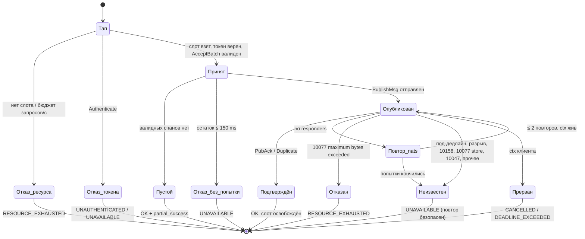

# Шаг 3 — журнал, чекпоинт и надёжный приём: дизайн-контракт и спека

| Поле | Значение |
|---|---|
| Шаг плана | 3 (с 30 ноября 2026), [`development-plan.md`](../development-plan.md); по D-25 делится на **шаг 3 «надёжный путь»** (журнал + чекпоинт) и **шаг 3b «укрепление приёма»** (токены, слоты, OTLP/HTTP, mTLS) |
| Требования | Шаг 3: FR-ING-003, FR-ING-005 (gRPC), FR-STR-003 (из шага 5, D-25), FR-ING-004 (механизм дедупа журнала), NFR-REL-001 (определение «подтверждено»), NFR-REL-002 (kill-тест «агрегаты = непрерывный прогон»), NFR-PERF-001/004 (сквозной замер R3). Шаг 3b: FR-SEC-002, FR-ING-005 (HTTP), FR-ING-001 (OTLP/HTTP для трейсов), NFR-SEC-001 (NATS). Частично FR-STR-002 (минимум по партициям — шаг 11, D-2) |
| Основа | шаг 1: [`step-01-walking-skeleton.md`](step-01-walking-skeleton.md), шаг 2: [`step-02-windows-and-red.md`](step-02-windows-and-red.md); их инварианты I1–I12, порты и жизненный цикл действуют, если ниже не сказано иное |
| Термины | [`glossary.md`](../glossary.md); новые — «Глоссарий шага», переносятся в последнем срезе |
| Закреплённые версии | `nats-server` **v2.15.2** (2026-10-26, образ `nats:2.15.2-alpine`), `github.com/nats-io/nats.go` **v1.55.0** (2026-10-23); `github.com/testcontainers/testcontainers-go` **v0.44.0** (2026-08-07, только тесты). Все вышли не позже 29.10 |
| Приоритет | решение пользователя 12.11: **качество и работа под высокой нагрузкой важнее сроков**; линии отсечения нет (D-24). Целевая нагрузка продукта — **до 1 млн спанов/с на тенанта через OTel Collector-gateway** (D-27) |
| Статус | ред. 3 — на апрув. Ред. 2 → 3: второй круг внешнего ревью (идея и цель плана; pocock — «пересмотреть направление», osmani и pstack — «держится после правок») и четыре решения пользователя 12.11: партиция = стрим (D-17'), журнал + чекпоинт одним шагом (D-25), до 1 млн спанов/с через Collector-gateway (D-27), профили надёжности (D-7'). Ред. 1 → 2: первый круг внешнего ревью. Ред. 0 → 1: самопроверка |

Цель шага 3 — **надёжный путь от OK клиенту до эффекта в агрегатах**: OK означает, что пакет закоммичен кворумом реплик стрима NATS JetStream; процессор периодически сохраняет **чекпоинт** своего состояния вместе с позицией журнала; журнал хранит записи, пока их не покрыл чекпоинт; после `SIGKILL` процессор восстанавливает состояние из чекпоинта и переигрывает журнал с позиции — и получает **те же финалы, что непрерывный прогон** (I14 становится наблюдаемой гарантией, а не обещанием). Топология журнала с первого дня рассчитана на масштаб продукта: P стримов-партиций по хэшу `trace_id`, общих для всех тенантов (в шаге 3 P = 1 у процессора, имена, ключи и идентификаторы — уже под P).

Цель шага 3b — защищённый и справедливый приём: ingest-токены (проверка до разбора тела), слоты приёма и много соединений, OTLP/HTTP, mTLS и учётка к NATS.

**Почему порядок изменён (D-25).** Ред. 2 строила в шаге 3 временную механику — отсечку журнала по «освобождено − хвост 2 min», повтор хвоста, неполные финалы после рестарта, правило «шаг 4 ждёт `feed_caught_up`» — которую шаг 5 выбросил бы (ревью pocock и osmani, второй круг). Пока чекпоинта нет, «надёжный OK» не даёт «надёжного эффекта»: подтверждённые записи отсекаются, а построенное из них состояние живёт только в памяти. Объединение убирает временную механику целиком: горизонт отсечки журнала с первого дня — позиция чекпоинта; `Release` возвращается к смыслу шага 1 (только кредит памяти).

**Сознательно НЕ входит в шаги 3 и 3b** (приходит позже, а не «забыто»):
- несколько процессоров и партиций в работе (назначение P партиций N процессорам, слияние частичных агрегатов, «минимум по партициям» FR-STR-002, watermark по источнику — обещание шага 2) — шаг 11 (D-2, D-28); шаг 3 закрепляет топологию, имена, ключи и идентификаторы так, чтобы шаг 11 не менял ни формат записи, ни формат чекпоинта;
- ClickHouse и идемпотентная запись — шаг 4 (эпоха аренды и позиция чекпоинта уже входят в версию финала, D-26); сырые события — второй группой читателей журнала (ADR-4 оставляет для этого место);
- устаревание рёбер FR-TOP-005 и поток `graph watch` FR-API-003 — шаг 5 (бывший «чекпоинты и живой поток» без чекпоинтов);
- метрики Prometheus, Helm — шаг 6; мульти-тенантность целиком, OIDC, тенант по namespace события — шаг 18 (здесь тенант — метка данных, D-3');
- журналы для логов и метрик — свои стримы своего семейства с теми же механизмами (шаги логов и метрик; D-29), не общий стрим со спанами;
- E1 на профиле L — шаг 6; E8 на kind R3 — шаг 11.

---

## Глоссарий шага

Переносится в [`glossary.md`](../glossary.md) в последнем срезе шага 3b. Коллизии с NATS разведены явно: «пульс» — только запись журнала faultline; сигнал простоя консьюмера NATS называется иначе; «пакет» — доменный `batch.Batch`, «запись журнала» — сообщение NATS; `Release` — **только** кредит памяти доставки (шаг 1), подтверждение консьюмеру — «фиксация чекпоинта».

| Термин | Код | Определение | Не путать с |
|---|---|---|---|
| Партиция | стрим `FAULTLINE_SPANS_P<n>` | Единица порядка, записи и обработки: отдельный стрим JetStream (своя Raft-группа и свой лидер), subject `faultline.spans.p<n>`. Спан попадает в партицию `hash(trace_id) mod P`; P фиксируется при установке. Партиции общие для всех тенантов | тенант |
| Тенант | поле заголовка записи | Метка данных: кому принадлежат спаны записи. Единица изоляции (квоты на входе, ключ состояния), а не единица хранения (D-3') | партиция |
| Запись журнала | `record` (`natsjs/record`) | Сообщение NATS в стриме партиции: закодированные спаны одной партиции одного запроса или пульс; заголовок с версией, видом, тенантом, весом, меткой писателя, версией правил нормализации и CRC32C всей записи | пакет, OTLP-запрос |
| Позиция | `journal.Position{Partition, Sequence}` | Номер записи в стриме партиции, назначенный лидером | `ReceivedAt` |
| Личность стрима | `StreamInfo.Created` | Время создания стрима партиции; позиция имеет смысл только внутри одной личности; хранится в чекпоинте | позиция |
| Подтверждение записи | `PubAck` | Ответ лидера после применения записи, закоммиченной кворумом Raft. Единственное основание для OK клиенту | `Release`, фиксация чекпоинта |
| Ключ дедупа | `Nats-Msg-Id` = `record.MsgID` | 32 hex: первые 128 бит SHA-256 от `тенант ‖ 0x00 ‖ партиция ‖ 0x00 ‖ тело записи` | `CallKey`, tombstone |
| Окно дедупа | `Duplicates` стрима | 5 min (D-8) | `tombstoneTTL` (15 s с шага 3, D-30) |
| Метка лидера / писателя | `MsgMetadata.Timestamp` / поле заголовка | Часы лидера при предложении в Raft / часы того, кто публикует (ингестер — пакет, процессор — пульс) | — |
| Время приёма | `Batch.ReceivedAt` | `max(предыдущее, min(метка лидера, метка писателя))` вдоль стрима партиции в порядке позиций; монотонизирует читатель; предыдущее значение хранится в чекпоинте | событийное время |
| Пульс | `batch.Heartbeat` | Пишет держатель аренды партиции условной записью (CAS по последней позиции) и только догнав стрим | сигнал простоя NATS |
| Чекпоинт | объект Object Store `faultline_checkpoints/p<n>/<эпоха>-<позиция>` | Байт-в-байт образ состояния `topology.Builder` партиции + позиция последней применённой записи + `ReceivedAt` + личность стрима + эпоха аренды + версии форматов; пишется раз в 10 s (FR-STR-003) | снимок графа (`Snapshot`) |
| Указатель чекпоинта | ключ KV `faultline_checkpoints_ptr` / `p<n>` | Имя последнего **полностью загруженного** чекпоинта партиции; меняется CAS по ревизии с проверкой эпохи — атомарная граница «чекпоинт существует» | объект чекпоинта |
| Фиксация чекпоинта | `checkpointStore.Commit` → удержание журнала | После CAS указателя: журнал партиции может удалить записи с позицией ≤ позиции чекпоинта (ADR-4) | `Release` |
| Аренда партиции | ключ KV `faultline_leases` / `processor.p<n>` | Право единственного процессора читать партицию, писать её пульсы, чекпоинты и фиксировать удержание; `kv.Create` при старте, CAS-продление 5 s, TTL 15 s | консьюмер NATS |
| Эпоха | ревизия ключа аренды при `kv.Create` | Монотонный номер держателя аренды (fencing-токен): входит в имя чекпоинта, в CAS указателя и (шаг 4) в версию строк финалов — устаревший держатель не может перезаписать результат нового (D-26) | ревизия окна |
| Ингестер / процессор | роли `faultline ingester` / `processor` | приём → публикация / держатель аренд партиций: чтение → `Pipeline` → снимок → чекпоинт → `GetGraph` | — |
| Слот приёма (3b) | `otlp.admission` | Один из слотов «декодируемый запрос в полёте» на экземпляр, общий для gRPC и HTTP | бюджет ожидания подтверждений |
| Бюджет ожидания подтверждений | `journal.InflightBytes` | Байты закодированных записей, опубликованных и ещё не подтверждённых (`PublishAsync`); отдельно от слотов декодирования (D-27) | слот приёма |
| Ingest-токен (3b) | `credential.IngestToken` | `flt_<id>_<секрет>`, хранится только SHA-256 секрета | токен API (OIDC, шаг 18) |
| Справочник токенов (3b) | `natsjs/tokens.Directory` | Снимок KV `faultline_ingest_tokens` в памяти; свежесть — последняя успешная проверка `LastSeq` KV | — |

---

## Поток данных и слои

```
РОЛЬ ingester ───────────────────────────────────────────────────────────────────────────────────────────
[3b] interfaces/otlp: InTapHandle — слот декодирования → бюджет запросов/с → Authenticate (до разбора тела)
   ──► decodelimit + spanmap ──► ingest.AcceptBatch (без изменений) ──► [spanJournal].Append(ctx, spans)
            └─ natsjs/journal.Journal:
               спаны → партиции по hash(trace_id) mod P (в шаге 3 P = 1 → одна запись)
               record.Encode(тенант, партиция, спаны, метка писателя) → PublishAsync(Msg-Id, Expect-Stream)
               слот декодирования свободен сразу после кодирования; ожидание подтверждений — из бюджета байтов (D-27)
               все PubAck / Duplicate ≤ min(publish_timeout, остаток дедлайна − 100 ms) → nil → OK
               10077 «maximum bytes exceeded» → ErrOverloaded → RESOURCE_EXHAUSTED + RetryInfo (с разбросом)
               таймаут / нет ответа / разрыв / прочее → ErrUnavailable → UNAVAILABLE
[3b] interfaces/otlp/otlphttp: POST /v1/traces (4318) ── тот же порядок до чтения тела → 200 / 429 / 503 / 401 / 413

NATS JetStream: P стримов FAULTLINE_SPANS_P<n> (Limits или Interest — по спайку, ADR-4; DiscardNew + MaxBytes;
                MaxAge 0); R1 (dev) / R3 + sync_interval 1 s (ha) / R3 + always (ha-strict) (D-7');
                Object Store faultline_checkpoints; KV faultline_checkpoints_ptr, faultline_leases; FAULTLINE_DLQ;
                [3b] KV faultline_ingest_tokens

РОЛЬ processor (на каждую свою партицию; в шаге 3 — одна) ──────────────────────────────────────────────
аренда processor.p<n> (kv.Create → эпоха) ──► checkpointStore.Latest(p<n>) ──► topology.RestoreBuilder (или пустой)
natsjs/feed.Feed: чтение с позиции чекпоинта + 1 ── насос: заголовок → кредит → Decode → ReceivedAt → доставка
     обслуживание: аренда, личность стрима, пульс (CAS, только догнав стрим)
processing.Pipeline ◄── [spanFeed].Receive ── Apply → Fire → Snapshot → Publish → Release (только кредит)
   │  раз в 10 s после Publish: Builder.WriteCheckpoint → spool на диск (пауза конвейера ≤ бюджета) → продолжение
   ▼  фоновая загрузка spool → Object Store → CAS указателя (эпоха) → [spanFeed].Commit(позиция) → удержание журнала
topology.Builder ──► memgraph ──► connectapi GetGraph

РОЛЬ all = ingester + processor в одном процессе с внешним NATS; FAULTLINE_JOURNAL=memory — memjournal без durability (явный опт-ин, без чекпоинтов)
```

Три соединения NATS на процесс (публикация, чтение, служебное: KV, Object Store, удержание) — публикации сериализуются под мьютексом соединения и большие записи уходят в сокет внутри вызова (`nats.go:2361–2363`). Типы `nats.go` не выходят из `internal/infrastructure/natsjs/**` (depguard, I16). Путь приёма и обработки не трассируется.

### Пакеты

| Пакет | Содержит | Импортирует (depguard) |
|---|---|---|
| `internal/domain/topology` | **+** `Builder.WriteCheckpoint(w)`, `RestoreBuilder(limits, r)`, `ErrCheckpointIncompatible`, `CheckpointVersion` (D-26: новая возможность FR-STR-003, не замена журнала) | как в шаге 2 |
| `internal/domain/topology/*`, `pkg/stream`, `pkg/sketch` | **+** детерминированная сериализация состояния каждого агрегата (`matcher`, `tombstone`, `graph`, `traffic`, `cardinality`, `stream.Windows`, `sketch.Arena`) — внутренние `encodeTo`/`decodeFrom`, экспортируемые только для `topology` | как в шаге 2 |
| `internal/application/processing` | **+** порт `checkpointStore`, `Delivery.Position()` (D-26, обещано шагом 1: «порт расширится методом позиции»), `spanFeed.Commit`, каденс чекпоинта в `Cadence` | `topology` |
| `internal/application/ingest` | без изменений | как в шаге 2 |
| `internal/domain/credential`, `internal/application/ingestauth` (3b) | токены и аутентификация | stdlib / `credential` |
| `internal/infrastructure/idlerule` | правило простоя, общее для `memjournal` и `natsjs/feed` | `batch` |
| `internal/infrastructure/natsjs/record` | формат записи v1 (заголовок 32 B), `Encode` (заём буфера), `ReadHeader`, `Decode`, `MsgID`, `PartitionOf` | `domain/telemetry/*`; без `nats.go` |
| `internal/infrastructure/natsjs` | `Dial` (три соединения), `Topology` (P, R, лимиты), `EnsureTopology` / `VerifyTopology`, `classify` | `nats.go`, `jetstream` |
| `internal/infrastructure/natsjs/journal` | `Journal` (порт `spanJournal`): разбиение по партициям, `PublishAsync`, бюджет ожидания | `natsjs`, `record`, `ingest` |
| `internal/infrastructure/natsjs/feed` | `Feed` (порт `spanFeed`): чтение партиции, насос, кредит, `ReceivedAt`, пульс, личность стрима, DLQ; `Commit` → удержание | `natsjs`, `record`, `idlerule`, `processing`, `x/sync/semaphore` |
| `internal/infrastructure/natsjs/lease` | аренда партиции и эпоха | `natsjs` |
| `internal/infrastructure/natsjs/checkpoint` | `Store` (порт `checkpointStore`): spool на диск, загрузка в Object Store, CAS указателя с эпохой, `Latest` | `natsjs`, `processing` |
| `internal/infrastructure/natsjs/tokens` (3b) | справочник и администрирование токенов | `natsjs`, `credential` |
| `internal/interfaces/otlp`, `otlp/otlphttp` (3b) | тап, слоты, OTLP/HTTP | как в шаге 1 + `ingestauth` через порт |
| `internal/infrastructure/journaltest` | `RunFeedContract`, `RunCheckpointContract` — общие контрактные тесты адаптеров | `processing` |
| `cmd/faultline` | роли, `tokens` (3b), env, бюджеты ролей, восстановление при старте, шов `drainSource` | всё |
| `test/natsjs`, `test/natscluster` | встроенный NATS (`make verify`) / testcontainers R3 (тег `integration`) | `nats-server/v2` / `testcontainers-go` только здесь |

**depguard:** `nats-in-adapter-only` (`nats-io` — только `natsjs/**`, `cmd/**`, `test/nats*`); `no-self-tracing-on-ingest` + `natsjs/**`, `idlerule`, `credential`, `otlphttp`; `natsjs-record-pure`; `credential` — лист. **forbidigo:** исключение «only a journal adapter stamps ReceivedAt» — на `natsjs/feed`; `nats.ReconnectBufSize` — только `natsjs/conn.go`.

---

## Ядро шага: семантика подтверждения

### Что означает OK клиенту (FR-ING-003, A-08, I13)

OK на `Export` отдаётся **только** после того, как `natsjs/journal.Journal.Append` получил `PubAck` (или `PubAck.Duplicate`) на **каждую** запись этого запроса (по одной на затронутую партицию; в шаге 3 P = 1 — одна запись). По исходникам закреплённой версии:

| Факт | Источник |
|---|---|
| В кластере лидер стрима ставит метку времени и предлагает запись в Raft (`node.Propose`) | `nats-server/v2@v2.15.2/server/jetstream_batching.go:1077` (`commitSingleMsg`) |
| Ответ PubAck шлёт только лидер и только при применении записи, то есть после коммита в Raft-лог кворумом (2 из 3 при R3), а не после записи на все R реплик | `stream.go:6560` (`canRespond := doAck && len(reply) > 0 && isLeader`), применение — `jetstream_cluster.go:5947` (`applyStreamMsgOp`) |
| `Duplicate` приходит только на позицию > 0 — на уже применённую и закоммиченную запись; повтор, пока оригинал ещё в полёте, получает ошибку **10158** «duplicate message id is in process», а не OK | `jetstream_cluster.go:13190–13197`; `jetstream_batching.go:614–621`; проба ревью pstack |
| При R > 1 хранилище стрима переводит `SyncAlways` в `SyncOnFlush` (fsync блока при сбросе), а fsync каждой записи делает Raft WAL с `SyncAlways` | `filestore.go:686–704` (`updateDurabilitySettingsLocked(cfg.Replicas > 1)`), `jetstream_cluster.go:4068` |
| fsync по умолчанию раз в 2 min (`defaultSyncInterval`), вариант `sync_interval: always` | `filestore.go:339`; [docs: sync_interval](https://docs.nats.io/reference/config/jetstream/sync_interval) |
| PubAck **не** ждёт fsync при ленивом режиме: подтверждённая запись лежит в page cache у ≥ 2 узлов | [Jepsen NATS 2.12.1](https://jepsen.io/analyses/nats-2.12.1), issue nats-server#7564 (открыт на 12.11.2026) |

**Профили надёжности (D-7', решение пользователя 12.11).** `sync_interval` в NATS — настройка **сервера** (`stream.go:1107–1108`, `jetstream.go:47–48`), а не стрима, поэтому уровень надёжности — профиль кластера NATS, записанный контрактом RPO в README:

| Профиль | R | `sync_interval` | Что гарантирует OK | Что НЕ гарантирует |
|---|---|---|---|---|
| `dev` | 1 | по умолчанию (2 min) | запись в page cache одного узла | потерю узла, OS crash (до 2 min подтверждённого) |
| `ha` (**по умолчанию**, если подтвердит C7) | 3 | 1 s | коммит кворумом 2 из 3; отказ пода, процесса, узла (`docker stop`, kill) — без потерь (Raft); fsync WAL раз в секунду | одновременный OS crash двух узлов в пределах 1 s; порча `.blk` меньшинства (#7549); split-brain при OS crash + паузах (#7567) — честная граница |
| `ha-strict` | 3 | `always` | то же + fsync Raft WAL на каждую запись (блоки стрима при R > 1 — `SyncOnFlush`, `filestore.go:686–704`) | #7549 (от fsync не зависит), #7567/#7545 (Jepsen видел потери и при `always` в сценариях с членством); **Jepsen режим `always` не проверял** — гарантия от OS crash не верифицирована |

**Честная формулировка RPO (ревью pstack, второй круг):** «RPO = 0 при отказе процесса, пода или узла (kill, `docker stop`, eviction) в профилях `ha` и `ha-strict`; при OS crash одного узла — в `ha-strict` (не верифицировано Jepsen); при порче диска меньшинства узлов — не гарантируется (#7549)». Свой тест: `TestABlockFileCorruptionOnOneReplicaIsDetected` (testcontainers R3: усечение `.blk` на одной реплике под потоком, затем сверка журнала подтверждённых ключей) — фиксирует факт, а не обещание.

**Цена `always` — по кривой, а не по одной точке** (ревью pstack, проба второго круга, встроенный R3, M1, `F_FULLFSYNC`): 27 KiB при 1 параллельной публикации — 81 запись/с, p50 12 ms; при 10 — 210 записей/с, p50 45 ms, p99 92 ms (≈ 107 000 событий/с, **не** 441 000, как ошибочно считала ред. 2 формулой «10 × 512 / задержка одиночной публикации»); при 160 — 380 записей/с, p50 449 ms; 1 KiB при 160 — потолок 746 записей/с; ленивый fsync при 10 — 5 600 записей/с, p50 0,9 ms (в 27 раз больше). Поэтому C7 (срез 0) — **кривая «записей/с × p50/p99 от параллелизма» (1, 10, 40, 160) на целевом PV** (Linux NVMe + `fio --fsync=1` как база); профиль по умолчанию — `ha`, если `ha-strict` на целевом диске даёт меньше 2× запаса к расчётной скорости партиции. Ёмкость считается **в записях/с одной Raft-группы**, а не в событиях.

`docker stop` узла kind (условие NFR-REL-001) — остановка контейнера; ядро Linux-ВМ Docker и его page cache общие для всех узлов kind и переживают остановку. Потерю даёт только падение самой ВМ или хоста. **ПРОВЕРИТЬ В СРЕЗЕ 0** тестом `TestDockerStopOfAReplicaLosesNoAcknowledgedRecord` (testcontainers, R3, ленивый fsync, 10 прогонов).

### Таймаут ожидания PubAck = исход неизвестен

Запись могла закоммититься после того, как мы перестали ждать (замер спайка: лидер жив, обе реплики остановлены — `PublishMsg` висит до дедлайна 3 s; после возврата реплик Raft-запись может закоммититься). Поэтому:
- клиент получает **`UNAVAILABLE`** (истёк наш под-дедлайн при живом дедлайне клиента) или `DEADLINE_EXCEEDED` / `CANCELLED` (истёк или отменён дедлайн клиента) — **никогда OK**;
- повтор безопасен: тот же OTLP-запрос → те же спаны → то же тело записи → тот же ключ дедупа → `PubAck.Duplicate` в окне 5 min (метка писателя в заголовке у повтора другая, но в ключ не входит);
- повтор позже окна дедупа (или после смены правил маршрутов) создаёт вторую запись — её гасят tombstones матчера 60 s, дальше **принятый риск** двойного счёта (как в шаге 1), виден по `pairing.duplicate`. Collector не повторяет дольше `max_elapsed_time` 300 s < окна 5 min;
- **дубли, не потери, ещё в двух случаях** (ревью pstack, проба P3 и `stream.go:7020`): (а) карта дедупа для **отсечённых** записей не восстанавливается после рестарта узла или снапшота (`rebuildDedupe` строит её только из хранилища, `stream.go:1634–1666`); (б) повтор после stepdown лидера без реплик может дать две записи с одним ключом (кластерное применение дедуп не перепроверяет). Оба случая гасят tombstones в пределах 60 s; тест FR-ING-003 проверяет «≥ 1 запись, финалы как при одной», а не «ровно одна».

**Ключ дедупа (D-8).** У OTLP нет ключа идемпотентности, поэтому ключ — содержимое: `hex(SHA-256(тенант ‖ 0x00 ‖ партиция u16 LE ‖ 0x00 ‖ тело записи)[:16])` (как в глоссарии; метка писателя и версия правил в ключ не входят).
- **после валидации, а не от сырого OTLP**: сырые байты зависят от порядка атрибутов и сжатия клиента; тело записи — канонический образ принятых спанов. Схлопнуться могут только спаны с теми же id — а это и есть дубли по определению OTLP (атака 2 pstack: SURVIVES);
- **SHA-256, а не xxhash64**: коллизия 64 бит = молчаливая потеря подтверждённого пакета; 128 бит снимают вопрос и устойчивы к подбору клиентом с токеном. Цена — 11,3 µs на запись 512 спанов (замер);
- дедуп переживает отсечку на живом узле (`purgeLocked` не трогает карту, `stream.go:3141`; замер) и смену лидера на живых репликах (`stream.go:7446`, ревью pstack) — C4 закрыт по исходнику, тест остаётся.

### Потеря кворума, выборы, `no responders`, разрыв

| Ситуация | Что делает `nats.go` / сервер | Что видит клиент OTLP | Через сколько |
|---|---|---|---|
| Лидер стрима потерян, кворума нет | `ErrNoResponders`; публикация сама повторяет `retryAttempts` раз через `retryWait` (синхронная — `jetstream/publish.go:281–293`, асинхронная — `:496`), затем `ErrNoStreamResponse` | `UNAVAILABLE` | замер: **502 ms** |
| Лидер жив, обе реплики недоступны | предложение без коммита, ответа нет | `UNAVAILABLE` по под-дедлайну | `publish_timeout` 2 s |
| Выборы при живом кворуме | `no responders` до выборов, скрытый повтор 250 ms; запись в полёте при смене лидера может получить 10077 с описанием «store closed» | OK после выборов, иначе `UNAVAILABLE` | спайк в процессе: 0 отказов на 200 публикаций; **ПРОВЕРИТЬ В СРЕЗЕ 0** по сети (C5) |
| Повтор, пока оригинал в полёте | ошибка **10158** | `UNAVAILABLE` (причина `in_process`) → следующий повтор получит `Duplicate` | мгновенно |
| Разрыв соединения | `ReconnectBufSize(-1)`: `nats.ErrReconnectBufExceeded` сразу | `UNAVAILABLE` | замер: 55 µs |
| Нет ресурсов JetStream / JetStream выключен сервером (ошибка диска) | APIError **10047** и подобные | `UNAVAILABLE` (причина `insufficient_resources`) + Error-лог | мгновенно |
| Стрим отсутствует | `ErrNoStreamResponse` | `UNAVAILABLE` + Error `journal.stream_missing` | ≈ 500 ms |

**Классификация ответов сервера — одна функция `natsjs.classify`** (ревью pstack: R3 под потоком отвечает не так, как R1 спайка):

| Ответ | Смысл | Перевод |
|---|---|---|
| `ErrorCode 10077` с описанием `maximum bytes exceeded` | стрим полон (`DiscardNew`) | `ingest.ErrOverloaded` |
| `ErrorCode 10077` с другим описанием (`store closed` и пр.) | сбой хранилища, смена лидера | `ingest.ErrUnavailable` (причина `store_failed`) |
| `ErrorCode 10071` или **`10164`** | CAS-конфликт «wrong last sequence» (10164 — запись в полёте на subject, `jetstream_batching.go:782–791`; проба: `map[10164:200]` под потоком R3) | для пульса — «конфликт», не ошибка |
| `ErrorCode 10158` | дубль в полёте | `ingest.ErrUnavailable` (причина `in_process`) |
| `ErrorCode 10047` | нет ресурсов | `ingest.ErrUnavailable` (причина `insufficient_resources`) |
| `ErrNoStreamResponse`, наш под-дедлайн, `ErrReconnectBufExceeded`, `ErrConnectionClosed` | недоступность | `ingest.ErrUnavailable` |
| `nats.ErrMaxPayload`, `record.ErrTooLarge` | слишком велик | `ingest.ErrBatchTooLarge` |
| ctx клиента | отмена / дедлайн | ошибка ctx (обёрнута) |
| прочее | неизвестно | `ingest.ErrUnavailable` (причина `unexpected`) + Error-лог (дросселирован) |

Описание сравнивается с текстом константы сервера закреплённой версии; тест `TestEveryNATSErrorMapsToOneIngestSentinel` собирает ответы с живого встроенного R3, а не из литералов, и падает, если сервер сменит текст.

**Скрытый повтор `nats.go` входит в бюджет явно** (D-9): `jetstream.WithRetryAttempts(2)`, `jetstream.WithRetryWait(250 * time.Millisecond)` в каждой публикации; таймаут подтверждения асинхронной публикации — `jetstream.WithPublishAsyncTimeout(publish_timeout)` (`jetstream_options.go:72`): зависшее подтверждение завершается ошибкой и удаляется из таблицы клиента (`publish.go:365`), поэтому бюджет ожидания не утекает.

### Буфер переподключения `nats.go` выключен (D-9)

По умолчанию 8 MiB (`nats.go:63`): публикация во время разрыва уходит на сервер после переподключения — возможно после того, как клиент повторил запрос, и тогда позже окна дедупа появится дубль; плюс 8 MiB неучтённой памяти. Поэтому `nats.ReconnectBufSize(-1)` на всех трёх соединениях (`natsjs/conn.go`, единственная точка; forbidigo).

**Доказательство «ни один путь не отвечает OK до PubAck» (ред. 3, асинхронная публикация).** `Journal.Append` возвращает `nil` только когда **каждое** `PubAckFuture` записи запроса отдало значение из `Ok()` — канала, в который клиент пишет только разобранный ответ с непустым `PubAck` (`publish.go:74–82`); ошибка любой записи, истечение под-дедлайна или ctx → ошибка, и тогда OK нет, даже если другие записи подтверждены (их повтор целого запроса даст `Duplicate`). `AcceptBatch.Execute` (`ingest.go:81`) без ошибки возвращает только при `nil` от `enqueue`; `Export` (`receiver.go:22`) отвечает OK только без ошибки. **Один путь к OK без `Append` есть и он правильный**: запрос без валидных спанов (`ingest.go:92–94`) получает OK с `partial_success` — данных нет; в I17 — корзина «пустой». Тест `TestNoPathAnswersOKWithoutAPubAck` (fake будущих подтверждений: часть ок, часть ошибка, часть висит) + мутации «вернуть nil на таймауте» и «вернуть nil, когда подтверждена первая запись» обязаны его ронять.

### `max_payload` и «всё или ничего» (I4)

| Вариант | Цена | Решение |
|---|---|---|
| Поднять `max_payload` сервера до 8 MiB | память буферов; 8 MiB — порог предупреждения сервера (`const.go:96–99`, `server.go:2385`) | **принято**: одна запись на запрос, атомарность даёт один PubAck |
| Резать запрос на части | ломает I4 | отвергнуто |
| Атомарная пачка (ADR-50) | дубль отклоняет пачку ошибкой 10201 — повтор записанного превращался бы в отказ; отдельная библиотека | отвергнуто: не нужна при одной записи |

**Граница размера записи.** Запись — часть спанов запроса, попавших в одну партицию; худший случай — все спаны в одной. Принятый спан стоит на проводе ≥ 30 B (ненулевые `trace_id` и `span_id` проверяет `span.New`, `span.go:73–76`), значит в запросе 4 MiB ≤ 139 810 принятых спанов. Запись кодирует спан не длиннее 3 B флагов + 16 + 8 + [8] + [8] + [≤ 10] + 3 индекса (≤ 3 B), и каждый необязательный элемент соответствует полю на проводе не меньшего размера; таблица строк не длиннее строк на проводе плюс длины. Итого ≤ 1,2 × 4 MiB + 64 KiB ≈ **4,9 MiB**. Нормализация может удлинить имя (`U+FFFD`), поэтому граница закрепляется **стражем**: `record.MaxRecordBytes = 6 MiB` → `record.ErrTooLarge` → `ingest.ErrBatchTooLarge` → `INVALID_ARGUMENT`; стрим `MaxMsgSize` 8 MiB; `Dial` отказывает при `nc.MaxPayload() < MaxRecordBytes + 4 KiB`. Проба `TestWorstRecordStaysUnderTheGuard` (срез 1). Требование к клиенту (ревью osmani): `send_batch_max_size` Collector'а обязателен — дефолт `send_batch_size` 8 192 при ≈ 740 B/спан OTLP даёт ≈ 6 MB > 4 MiB `MaxRecvMsgBytes`; демо-values ставят `send_batch_max_size: 2048`, README шага 3 — требование к клиентам.

---

---

## Ядро шага: формат записи

### Формат v1 (ADR-2)

```
заголовок 32 B : 'F' 'J' | версия u8 (=1) | вид u8 (0 — пакет, 1 — пульс) | флаги u8 (все биты зарезервированы = 0)
                 | длина тенанта u8 (1…63) | партиция u16 LE | вес u32 LE (Footprint декодированного пакета, у пульса 0)
                 | метка писателя i64 LE (Unix ns) | версия правил нормализации u32 LE | CRC32C u32 LE (всей записи с нулями на месте CRC)
                 | резерв u32
тенант         : байты тенанта (DNS-метка ≤ 63 B)
тело пакета    : uvarint число строк, строки (uvarint длина + байты) в порядке первого появления
                 uvarint число спанов, на спан: флаги u8 (1 родитель, 2 конец известен, 4 латентность известна,
                 8 Failed, 16 CallsExternalSystem) | kind u8 | протокол операции u8 | trace_id 16 | span_id 8 | [parent 8]
                 | [end u64 LE] | [латентность uvarint] | индексы namespace, имени сервиса, имени операции (uvarint)
тело пульса    : пусто
```

- **Порядок проверки**: длина ≥ 32 → магия → CRC всей записи → версия → вид, флаги, тенант → партиция = партиция стрима → вес ≤ `min(кредит, MaxBatchFootprint)` → тело. CRC до версии: переворот бита в байте версии — порча (DLQ), а не вечный стоп. Незнакомые вид, бит флагов заголовка или спана при верном CRC — **стоп** (`ErrUnknownVersion`): это будущий формат.
- **Тенант в записи** (D-3'): метка данных для шага 18 (ключ состояния и квоты); в шаге 3 — константа установки, процессор проверяет, что известна, и учитывает спаны по тенанту в `pipeline.stats`.
- **Партиция в записи и в ключе дедупа**: запись, попавшая не в тот стрим (ошибка wiring, ручная публикация), — `ErrCorrupt`; ключ дедупа включает партицию с первого дня, поэтому шаг 11 не меняет формулу ключа (нет «границы дедупа» при выкладке — ревью pocock).
- **Версия правил нормализации** (ревью pocock): номер набора `FAULTLINE_ROUTE_RULES_FILE` (хэш содержимого, усечённый до u32) — отладка «какими правилами сделано» и честное объяснение, почему повтор после смены правил не дедупится.
- **Вес** считает кодировщик (`batch.Footprint`, `batch.go:67`); насос берёт кредит **до** декодирования; декодер сверяет вес с фактическим `Footprint`.
- **Метка писателя** — второй источник времени для `ReceivedAt` (D-20); в ключ дедупа не входит.
- **Детерминизм тела**, **восстановление спана без правки домена** (`eventtime.FromUnixNanos`, проверки `resource.Validate`, `operation.Validate`, ненулевые id), **строки на каждую запись**, **заём буфера** `record.Encode(..., publish)` — как в ред. 2 (приложение А) (разделы ниже не повторяются; Go-API — срез 1).
- **Эволюция (D-22', упрощено по ревью pocock)**: правило N−1 на уровне релиза — релиз K читает v1..v2, но пишет v1 по умолчанию (`FAULTLINE_RECORD_WRITE_VERSION`); релиз K+1 переключает запись по умолчанию. «Стоп на неизвестной версии» остаётся страховкой. Реестра объявлений читателей в KV (ред. 2) нет: он добавлял зависимость старта ингестера от живости процессоров. Откат процессора при наличии vN+1 в стриме — runbook README.
- **Что журнал НЕ хранит** (ревью pstack, второй круг): атрибуты спана, кроме нужных текущей модели (сервис, операция, время, коды → `Failed`). Новые признаки детекторов и RCA (шаги 6–16: статус-коды, под, peer) потребуют формата v2 и не переиграются на старых записях. Журнал транзиентный (до чекпоинта); переобработка истории — задача ClickHouse (шаг 4), а не журнала. Нормализация до записи — требование (FR-ING-006, сырые пути и PII не хранятся), а не только оптимизация.
- **Вес сэмплирования** (ревью osmani): поля adjusted count в v1 нет; README — требование «в faultline идёт 100 % спанов, сэмплирование головы — после faultline или в tail-sampling шага 4». Если продукт решит иначе, вес — флаг + uvarint в v2 по правилу N−1.

### Сравнение форматов (замер среза 0, M1 Pro, Go 1.27.4, 512 спанов дампа OTel Demo)

| Кандидат | Размер | Кодирование (ингестер) | Декодирование (процессор) | Почему |
|---|---|---|---|---|
| **v1 компактный** | 26 920 B (52,6 B/спан) + 32 B заголовка + тенант | 39,0 µs, 0 аллокаций | 20,0 µs, 0 аллокаций на спан | **принят** |
| сырые байты OTLP | 379 113 B (513 спанов с атрибутами демо) | 0 | 1 124 µs, 1 430 340 B, 29 785 аллокаций + повторная нормализация | отвергнут: в 56 раз медленнее на горячей горутине процессора, в 14 раз больше байт R3; PII и сырые пути на диске |
| protobuf внутренней схемы | — | кодоген + `proto.Marshal` | аллокация на сообщение | отвергнут без замера |

Оговорка: 448 спанов дампа повторяются; проба среза 1 повторяет замер на синтетике 500 сервисов × 200 операций.

### Сжатие (D-13)

Без сжатия по умолчанию; S2 у клиента отвергнут (CPU приёма); S2 стрима — опция `FAULTLINE_STREAM_COMPRESSION=s2`; сжатие маршрутов NATS между узлами `compression: s2_auto` (`server.go:457`) — в манифесте `ha` (межзональный трафик репликации; ревью osmani), CPU — проба среза 0.

---

## Ядро шага: топология журнала (ADR-1, D-17', D-2)

**Партиция = стрим, общий для тенантов** (решение пользователя 12.11 по второму кругу ревью). Три отвергнутых варианта и почему:

| Вариант | Что ломается | Источник |
|---|---|---|
| стрим на тенанта (ред. 2, D-17) | тенант = набор namespaces (FR-SEC-003, A-06), ребро между тенантами видят оба: половинки вызова уходят в разные стримы к разным процессорам и не встречаются; пакет eBPF-агента (DaemonSet, все поды узла — FR-AGT-004/005) содержит спаны многих тенантов; при 100+ тенантах — 100+ Raft-групп R3 и процессоров по ≈ 846 MiB | ревью pstack и pocock, второй круг |
| один стрим, партиции = subject'ы (ред. 2, «путь до шага 11») | одна Raft-группа = один лидер, один последовательный конвейер fsync, один `MaxBytes`: партиции дают параллелизм обработки, но не записи; лидер пишет порции WAL ≤ 256 KiB последовательно (`raft.go:3571–3573`, `:3644`, `storeToWAL` `:5369`) | ревью osmani и pocock |
| стрим на тенанта × партицию | снова разводит половинки межтенантных вызовов по стримам | ревью pstack |

Принятая топология:
- P стримов `FAULTLINE_SPANS_P<n>`, subject `faultline.spans.p<n>`, P фиксируется при установке (`FAULTLINE_PARTITIONS`; смена P — миграция, README); лидеры групп разносятся по узлам NATS;
- спан → партиция `hash(trace_id) mod P` (`record.PartitionOf`, FNV-1a 64 по 16 байтам `trace_id` — детерминированно, без аллокаций): обе половинки любого вызова и все спаны трассы — в одной партиции, у одного процессора;
- запрос OTLP → по записи на каждую затронутую партицию; OK — когда подтверждены все; повтор целого: подтверждённые части отвечают `Duplicate`, недостающие пишутся — **идемпотентный повтор целого** вместо «всё или ничего» (I4 уточняется); при P = 1 — одна запись, как в ред. 2 (приложение А);
- тенант — метка в записи (D-3'); изоляция тенантов — квоты на входе (шаг 3b — справедливая доля слотов по токену, шаг 18 — token bucket FR-SEC-005), а не отдельное хранение;
- **в шаге 3 процессор обслуживает P = 1** (валидатор: `FAULTLINE_PARTITIONS` = 1 до шага 11); ингестер, формат записи, ключ дедупа, имена стримов, ключи аренды и чекпоинта, идентификатор финала (D-26) — уже под P. Шаг 11 добавляет только назначение партиций процессорам и слияние частичных агрегатов (счётчики и DDSketch сливаемы; id финала включает партицию) — без смены формата записи и чекпоинта.

**Ёмкость партиции** (ревью osmani и pstack, второй круг) — считается в записях/с одной Raft-группы и в спанах/с процессора:
- запись: `ha` (ленивый fsync) — тысячи записей/с; `ha-strict` — 210 записей/с при 10 параллельных на ноутбуке (кривая C7 на целевом PV — срез 0);
- процессор: `Builder` ≈ 2,18 млн спанов/с на ядре M1 (`BenchmarkIteration50kEdges`), ≈ 1 млн на vCPU x86;
- **первый потолок — сопоставление** (osmani, расчёт по `config.go:52–60` и дампу: вызовов/с ≈ 0,43 × спанов/с): tombstones 1 млн при TTL 60 s держат точность до ≈ 39 000 спанов/с — **ниже NFR-PERF-001**; буфер ожидания 100 000 половинок при разбросе прихода 2,5 s (SDK `BatchSpanProcessor` 5 s) — до ≈ 93 000 спанов/с. Гипотеза H6 (D-30, решает E0.3 против оракула): журнал теперь дедупит повторы 5 min (`Msg-Id`), поэтому `tombstoneTTL` 60 → **15 s** (точность до ≈ 155 000 спанов/с, −63 MiB); `max_pending` процессора 100 000 → **200 000** (+96 MiB в роли `processor`; `all` остаётся 100 000); self-alert на вытеснения (`pairing.evicted`, `tombstone_evicted`). **Гипотеза H5/H3 (решает E0): ёмкость партиции — 125 000 спанов/с; 1 млн спанов/с на тенанта = P = 8 (шаг 11).**

**Цель 1 млн спанов/с на тенанта через Collector-gateway (D-27)**: перед faultline — OTel Collector-gateway (по зоне, `loadbalancing` exporter, батчи ≥ 512 спанов, `file_storage` в `sending_queue`, `retry_on_failure`); требование README и демо. Прямые SDK — не поддерживаемый сценарий высокой нагрузки (мелкие запросы упираются в записи/с; склейка в ингестере не делается — она сломала бы ключ дедупа).

---

## Ядро шага: время приёма и пульс (D-5, D-20, ADR-5)

**`ReceivedAt = max(предыдущее, min(метка лидера, метка писателя))`** в порядке позиций партиции. Метку ставит лидер при предложении (`jetstream_batching.go:1077`), реплики применяют её из Raft-записи (`jetstream_cluster.go:5958`); метка писателя — в заголовке записи. Сбитые часы одного из двух не проходят через `min`; часы позади «замораживают» время максимумом не дольше величины сдвига. Видно: `feed.clock_skew_max_ms`, self-alert `journal.clock_skew` > 5 s (A-03 становится проверкой). **Предыдущее значение хранится в чекпоинте** — после восстановления повтор продолжает ту же функцию, и I14 держится на границе рестарта.

**Пульс** пишет только держатель аренды партиции (D-19) и только когда насос догнал стрим (`NumPending` последней записи = 0, насос не ждёт кредит, не стоит на DLQ, не в «стопе»): правило `idlerule` (общее с `memjournal`) — была запись с данными; наибольший кандидат не рос `idle_advance_after` (35 s). Публикация — пустая запись «пульс» с `Nats-Expected-Last-Subject-Sequence` = последняя прочитанная позиция; конфликт **10071 или 10164** — пульса нет, правило проверится снова. Голодание CAS засчитывается только при прочитанных между попытками записях без роста кандидата; после 3 таких конфликтов — безусловный пульс (`feed.heartbeat_unconditional`). Состояние правила простоя после восстановления начинается заново («до первой записи с данными») — пульсы — записи журнала, детерминизм от этого не зависит, а первый пульс после рестарта приходит не раньше `idle_advance_after`.

Гипотеза шага 2 «пульсы пишет процесс приёма» **опровергнута** (N ингестеров → N пульсов и пульс перед чужой записью); «`ReceivedAt` ставит журнал NATS» — **подтверждена с уточнением** (`min` двух меток).

---

## Ядро шага: потребитель, чекпоинт и удержание журнала

### Потребитель (ADR-3)

Чтение партиции — `Messages()` + насос с собственным каналом (контракт `spanFeed.Receive` шага 2: ждать первый ≤ `maxWait`, добрать готовые ≤ `limit`); `Fetch` отвергнут (закрывает пачку только по числу или `expires`, `pull.go:1031`, `:1043`; в 11 раз медленнее, замер). Настройки: `PullMaxMessagesWithBytesLimit(256, 8 MiB)` (граница сырых байт у клиента 2 × 8 MiB + одна запись = 22 MiB, `pull.go:444, 462, 468–470`), `PullHeartbeat(5 s)`, уникальное имя на экземпляр, `FilterSubject` партиции. Кредит декодированных байтов (`FAULTLINE_FEED_MAX_BYTES`, 64 MiB) берётся **до** декодирования по весу из заголовка. `Release` — **только** возврат кредита (смысл шага 1 восстановлен: D-6 ред. 2 отменён).

**Тип консьюмера — по спайку среза 0 (КТ-0, ADR-4)**, два кандидата с одинаковым внешним контрактом:

| | (а) ordered consumer + удержание процессором (ред. 2) | (б) durable consumer + удержание сервером (ревью pocock) |
|---|---|---|
| Консьюмер | эфемерный, `AckNone`, `OptStartSeq` = позиция чекпоинта + 1 | durable `processor-p<n>` (создаёт `EnsureTopology`), `AckAll`, `PriorityPolicyPinned` (`consumer_config.go:363`) — сервер держит одного активного читателя |
| Старт | `OptStartSeq` | `ResetConsumerToSequence(позиция + 1)` (менеджер консьюмеров стрима, `stream.go:125–133`) — убирает ожидание `AckWait` и переупорядочивание |
| Удержание | стрим `Limits` + `DiscardNew` + `MaxBytes` + `MaxAge 0`; процессор после фиксации чекпоинта: `Purge(WithPurgeSubject, WithPurgeSequence(позиция + 1))` | стрим `Interest` + `DiscardNew` + `MaxBytes`; процессор после фиксации чекпоинта: `AckAll(позиция)`; сервер удаляет запись, когда её подтвердили **все** группы читателей (шаг 4: сырые события — вторая группа). `Interest` не хранит записи только при **нуле** консьюмеров (`stream.go:7256–7259`); durable существует и пока процесс лежит |
| Пересоздание стрима | проверка личности перед `Purge` | durable исчезает вместе со стримом → ошибка насоса; личность стрима сверяется с чекпоинтом при восстановлении |
| Что мерить в спайке | — | порядок доставки после `ResetConsumerToSequence` и смены лидера; задержка `AckAll`; аллокации; поведение при `DiscardNew` и отстающей группе; что делает `Interest`, если durable удалён руками |

Решение КТ-0: (б), если спайк не покажет измеримого проигрыша (аллокации > 1,5× (а), переупорядочивание, потеря записи при удалённом durable без ошибки); иначе (а) с записанной причиной. Внешний контракт `Feed` и `checkpointStore` одинаков — тесты (`journaltest`) пишутся до решения.

### Чекпоинт (FR-STR-003, D-25, D-26)

**Что входит.** Байт-в-байт образ состояния `topology.Builder` партиции: буфер ожидания матчера (пул половинок и очередь — в порядке прихода), tombstones (кольцо и карта), граф (узлы, рёбра, хэндлы, счётчики, ревизия), `traffic` (watermark, `CoverageStart`, `MaxReceivedAt`, три движка `stream.Windows` с занятыми слотами, корзинами, `late`, свободными номерами серий), арена скетчей (блоки, свободные списки buddy, битовые карты — иначе слияние скетчей после восстановления пошло бы иначе и финалы разошлись), реестр кардинальности (операции, ссылки, свободные ID, «сверх лимита»). Плюс метаданные: партиция, позиция последней применённой записи, `ReceivedAt` последней записи, личность стрима (`Created`), эпоха аренды, `CheckpointVersion`, версия формата записи, хэш лимитов (`topology.Limits`) и правил нормализации.

**Почему байт-в-байт.** Цель — `восстановление + повтор с позиции + 1 = непрерывный прогон`, вплоть до финалов (I14). Детерминизм всего состояния уже доказан шагом 2 (I8, slices without pointers, buddy-арена зависит только от последовательности выделений); сериализация переносит его через рестарт. Это и есть ответ ред. 2 на вопрос «финалы повтора хвоста ≠ исходным» (pstack `wm_test`): повтор начинается не со свежего состояния, а с точного.

**Формат.** Детерминированный бинарный поток (тот же стиль, что запись журнала: версия, длины, CRC32C по секциям), секция на агрегат; в домене — `WriteCheckpoint(io.Writer)` / `RestoreBuilder(limits, io.Reader)`; несовместимые лимиты (меньше узлов, рёбер, серий, арены, `max_pending`) — `ErrCheckpointIncompatible`.

**Каденс и пауза конвейера.** Раз в `checkpoint_interval` (10 s, FR-STR-003) **после** успешного `Publish` итерации (состояние согласовано с опубликованным снимком) `Pipeline` вызывает `checkpointStore.Begin(ctx, meta)` → `io.Writer` на spool-файл (`FAULTLINE_CHECKPOINT_DIR`, `emptyDir` пода — корневая ФС только для чтения) → `Builder.WriteCheckpoint` → `Close` → итерации продолжаются. Пауза = время сериализации живого состояния на локальный диск: живое состояние на демо — единицы MiB, худший случай по бюджету — ≈ 450 MiB при ≈ 1 GiB/s записи ≈ 0,5 s (**проба среза 3c**, `BenchmarkWriteCheckpointWorstCase`; бюджет паузы — ≤ 1 s при худшем состоянии, иначе инкрементальный чекпоинт — D-* по результату). Пауза не держит ни памяти (spool — диск), ни подтверждений клиентов (ингестер независим); процессор после паузы догоняет (коэффициент догона ≥ 2× при целевой ёмкости — проверяется сквозным замером).

**Загрузка и фиксация** (фоновая горутина `checkpoint.Store`, владелец spool):
1. spool-файл → Object Store `faultline_checkpoints`, объект `p<n>/<эпоха>-<позиция>` (чанки 128 KiB, `ObjectStore.Put(ctx, meta, reader)`; R = R стрима);
2. CAS указателя: `kv.Update("p<n>", имя, ревизия)` с проверкой, что эпоха в указателе ≤ своей (устаревший держатель аренды проигрывает CAS и не может «откатить» чекпоинт нового);
3. только после CAS — `spanFeed.Commit(позиция)` → удержание журнала (ADR-4: `Purge` ниже позиции + 1 или `AckAll(позиция)`);
4. старые объекты чекпоинта удаляются после успешного CAS (хранится последний и предыдущий);
5. если предыдущая загрузка ещё идёт — новый чекпоинт пропускается (`checkpoint.skipped`), а не копится; возраст последнего зафиксированного — `checkpoint.age_seconds`, self-alert `checkpoint.stale` при > 60 s (NFR-SELF-003 «чекпоинт старше 60 s»).

Порядок «загружен → указатель → удержание» — единственный: обратный удалил бы из журнала записи, не покрытые надёжным чекпоинтом.

**Восстановление при старте процессора:** аренда → эпоха → `checkpointStore.Latest(p<n>)` → проверка: личность стрима совпадает, версии совместимы, лимиты совместимы, позиция ∈ [первая позиция стрима − 1, последняя] → `RestoreBuilder` → `Feed.Open(с позиции + 1, ReceivedAt)` → `Pipeline`. Указателя нет (первый старт) — пустое состояние, чтение с первой позиции стрима. Любая проверка не прошла — **fail-closed**: выход с кодом 1 и Error `checkpoint.restore_failed` с причиной; оператор осознанно запускает с `FAULTLINE_CHECKPOINT_RECOVERY=discard` — тогда пустое состояние с первой оставшейся позиции и Error `checkpoint.discarded` (явная, учтённая потеря состояния, а не молчаливая).

**Эпоха как fencing-токен (D-26, ревью pocock).** Эпоха (ревизия ключа аренды при `kv.Create`) входит в имя чекпоинта, проверяется CAS указателя и (шаг 4) входит в версию строк финалов: `ReplacingMergeTree(version = (эпоха, ревизия окна))` — финал устаревшего держателя после паузы GC не перезапишет финал нового. Аренда без эпохи (ред. 2) давала «последний победил».

### Удержание журнала и ёмкость

- Удаляет записи только удержание после фиксации чекпоинта, и только ниже его позиции (I15); `MaxAge = 0`, `DiscardNew` — сервер сам не удаляет необработанное (ADR-4: отвергнуты `DiscardOld`, `MaxAge`, `WorkQueue`; `Interest` — только с durable, вариант (б)).
- Размер стрима в норме ≈ данные за `checkpoint_interval` + время загрузки (≈ 10–20 s); «стрим полон» ⇔ процессор или загрузка чекпоинта отстают на `MaxBytes`. Время до заполнения при стоящем процессоре: 125 000 спанов/с × 52,6 B ≈ 6,3 MiB/s на партицию → `ha` 32 GiB на партицию ≈ 87 min, `dev` 2 GiB ≈ 5,4 min при той же скорости (на демо — часы). Хвост повтора, кольцо выборок, валидатор `DESIGN_EVENTS_PER_SEC` ред. 2 — **удалены** (D-23 отменён).
- Отсечка не больше 256 MiB за цикл (после долгого простоя `compactLocked` удаляет блоки под блокировкой хранилища — шаг ограничивает всплеск PubAck).

### Восстановление после `SIGKILL` — что получает пользователь

| Что | Поведение |
|---|---|
| Подтверждённое, но не обработанное | в стриме (I15) — переигрывается |
| Состояние (половинки, окна, граф, скетчи, кардинальность) | из чекпоинта ≤ 10 s давности + повтор с его позиции = **то же состояние, что у непрерывного прогона** |
| Финалы окон | те же, что у непрерывного прогона (I14 на границе рестарта) — kill-тест `TestKilledProcessorProducesTheSameFinalsAsAnUninterruptedRun` |
| Финалы, выданные между чекпоинтом и падением | выдаются повторно с тем же id и той же ревизией (детерминизм) — идемпотентная запись шага 4 сводит их к одной строке; более новая эпоха — более старшая версия |
| Время восстановления | аренда освобождается при штатной остановке сразу, при `SIGKILL` — ≤ 15 s TTL; загрузка чекпоинта (≤ 450 MiB при ≈ 200 MiB/s ≈ 2,3 s); повтор ≤ 10–20 s записей + накопленного за простой при коэффициенте догона ≥ 2×: при 125 000 спанов/с на партицию ≈ 15 + 2,3 + ≈ 20 ≈ 40 s ≤ 60 s NFR-REL-002 — **проба среза 3c** `TestRecoveryTime` |
| Метрика | Info `lifecycle.feed_resumed` (позиция, эпоха, возраст чекпоинта), Info `lifecycle.feed_caught_up` (длительность) |

### Пробелы, poison pill, системная порча, стрим пересоздан

Как в ред. 2 (DLQ для одиночной порчи с PubAck перед завершением позиции; 3 подряд или > 1 %/min — стоп; неизвестная версия — стоп; пробел — счётчик и alert; личность стрима — сверка при восстановлении и раз в 30 s, нарушение — стоп без удержания, код 1; `MaxResetAttempts` 5). Новое: позиция повреждённой записи, ушедшей в DLQ, «применена» для чекпоинта (повтор после восстановления её не переиграет, DLQ-публикация идемпотентна по `Msg-Id` = SHA-256 байтов). `/healthz` (liveness) остаётся 200 при стопе насоса — граф в памяти отдаётся; `/readyz` → 503.

### Аренда партиции (D-19, ADR-6)

KV `faultline_leases` (TTL 15 s, история 1, R = R стрима), ключ `processor.p<n>`: старт — `kv.Create` (атомарно; занято → ожидание, readiness 503, повтор раз в 5 s); продление раз в 5 s `kv.Update(ревизия)`; провал или возраст продления ≥ 10 s → аренда потеряна: прекращаются пульс, загрузка чекпоинта и удержание, насос останавливается, процесс выходит с кодом 1; штатная остановка — `kv.Delete` (новый держатель не ждёт TTL). Остаточный вред «зомби»-держателя после паузы GC (проверил аренду, уснул, проснулся): устаревший держатель может отправить пульс (его гасит CAS по позиции, если новый держатель что-то записал) и загрузить объект чекпоинта (его отвергает CAS указателя по эпохе) — удержание идёт только после CAS указателя, поэтому записи, не покрытые чекпоинтом нового держателя, не удаляются (ред. 2 считала вред иначе — ревью pstack LOW).

---

## E0 — лаборатория нагрузки в изолированных условиях (до решений о масштабе)

**Решение пользователя 12.11:** решения о числе партиций, памяти и ёмкости процессора, распределении нагрузки, профиле fsync и бюджетах ингестера **не принимаются по оценкам**. Сначала — изолированный стенд с реальной нагрузкой, который подсветит настоящие узкие места; решения принимаются по его числам. Все числа ёмкости в этом документе (125 000 спанов/с на партицию, P = 8 для 1 млн, `max_pending` 200 000, `tombstoneTTL` 15 s, бюджет ожидания 64 MiB, `ha` = 1 s по умолчанию, `MaxBytes`) — **гипотезы H1–H9 с порогом**, а не решения. E0 — контрольная точка КТ-0 перед срезами 2–3.

**Изолированность.** Отдельный Docker-контекст без OTel Demo и kind; фиксированные ресурсы через cgroup (`--cpus`, `--memory`, `--cpuset-cpus` — генератор, NATS и измеряемый компонент на непересекающихся ядрах, как требует раздел 5.0 требований); прогрев 5 min; каждый замер 5 раз, медиана и разброс; Docker VM 15,6 GiB — матрица подобрана под неё, профиль L (20 GiB) — повтор в шаге 6. Код стенда — вне репозитория (рабочая копия в scratchpad, чтобы использовать настоящие `topology.Builder`, кодек и `natsjs` по мере появления), выбрасывается; в документ — только числа и протокол.

**Нагрузка — реальная по форме.** Генератор трасс с параметрами из дампа OTel Demo и шага 2: 500 сервисов × 200 операций (NFR-PERF-002), глубина трасс 3–8, доля CLIENT/SERVER ≈ 0,43 вызова на спан, разброс прихода половинок как у SDK (`BatchSpanProcessor` 5 s → равномерно 0–5 s), ошибки 1–5 %, батчи Collector'а 512 / 2 048 спанов (и 16 / 128 — для честной картины мелких запросов), 1–5 % досылки старше минуты.

**Матрица (по слоям, каждый — отдельный изолированный прогон):**

| Слой | Переменные | Что меряем | Решает |
|---|---|---|---|
| E0.1 NATS-запись | R1 / R3; `sync_interval` 2 min / 1 s / `always`; P = 1, 2, 4, 8 стримов; размер записи 27 / 107 / 430 KiB; параллельных публикаций 1, 10, 40, 160 | записей/с и MiB/s до насыщения, PubAck p50/p99/p999 на кривой, CPU и RSS узлов NATS, запись на диск (WAL + блоки), распределение лидеров | H1 (ёмкость партиции в записях/с), H2 (профиль `ha` по умолчанию), H3 (P на 1 млн спанов/с) |
| E0.2 NATS-чтение | ordered vs durable `Interest` + `AckAll` (ADR-4); окно pull 8 / 16 MiB; отставание консьюмера | записей/с чтения, аллокации клиента, сырые байты в куче при стоящем читателе, поведение при `DiscardNew` | ADR-4 (а/б), H4 (окно pull и память) |
| E0.3 Процессор | настоящий `topology.Builder` + декодер v1 на одном ядре; скорость входа до насыщения; разброс половинок; `max_pending`, `tombstoneTTL` | спанов/с до насыщения, занятость буфера ожидания, `evicted`, `tombstone_evicted`, доля неверных/потерянных пар против оракула генератора, куча и паузы GC при `GOMEMLIMIT` 1 600 MiB | H5 (ёмкость партиции в спанах/с), H6 (`max_pending`, `tombstoneTTL`, размер пода процессора) |
| E0.4 Ингестер | декодирование OTLP + `AcceptBatch` + кодек + публикация на 2 vCPU; формы запросов 16 / 128 / 512 / 2 048 спанов; синхронная vs асинхронная публикация | спанов/с и запросов/с на vCPU, p99 подтверждения, куча при ожидании (C13) | H7 (D-27: развязка слотов и бюджет ожидания), H8 (число экземпляров ингестера на 1 млн) |
| E0.5 Сквозной и отказы | весь путь при 50 000 и при найденном потолке, R3; kill лидера, `docker stop` реплики, kill процессора-модели | подтверждено ⊆ в стриме ∪ прочитано; время восстановления выборов; лаг | I13, H9 (RPO профилей на реальном отказе) |

**Гипотезы и пороги (что подтверждаем или опровергаем):**

| # | Гипотеза | Подтверждено, если | Если нет |
|---|---|---|---|
| H1 | одна партиция `ha` (1 s) держит ≥ 2 000 записей/с по 107 KiB с p99 PubAck ≤ 50 ms | кривая E0.1 | ёмкость партиции = измеренная / 2; P пересчитывается |
| H2 | `ha` (1 s) — профиль по умолчанию; `ha-strict` даёт < 2× запаса к цели партиции | E0.1 | по умолчанию — тот, что даёт ≥ 2× запаса при приемлемом RPO; решение пользователя |
| H3 | 1 млн спанов/с на тенанта = P = 8 | H1 × H5 | P = ⌈1 млн / min(ёмкость записи, ёмкость процессора) × 2⌉ |
| H4 | окно pull 8 MiB даёт ≤ 22 MiB сырых байт и не снижает чтение > 10 % против 16 MiB | E0.2 | окно и строка бюджета — по замеру |
| H5 | процессор держит ≥ 125 000 спанов/с на ядро без вытеснений при разбросе 5 s | E0.3 | ёмкость партиции = измеренная / 2 (запас на детекторы шагов 13–16) |
| H6 | `tombstoneTTL` 15 s и `max_pending` 200 000 дают 0 ложных и потерянных пар при H5 | E0.3 против оракула | лимиты и размер пода по замеру; если не помещается в 1 600 MiB — D-* на размер пода процессора |
| H7 | асинхронная публикация с бюджетом 64 MiB даёт ≥ 2× спанов/с ингестера против синхронной на запросах по 128 спанов, а куча декодирования освобождается до PubAck (C13) | E0.4 | остаётся синхронная модель ред. 2; требование «батчи ≥ 512» в README |
| H8 | ингестер на 2 vCPU — ≥ 250 000 спанов/с на батчах 512 | E0.4 | число экземпляров по замеру |
| H9 | `docker stop` / kill узла в `ha` не теряет подтверждённого | E0.5, 10 прогонов | `ha` → `ha-strict` по умолчанию |

**Что E0 не решает:** формат записи, чекпоинт (его цена — проба среза 3c), токены — их решения не зависят от масштаба. **Протокол** — в документ (раздел «E0: результаты», заполняется в КТ-0), с командами воспроизведения.

---

## Ядро шага: ингестер и обратное давление

### Источники перегрузки и коды (FR-ING-005) — одна функция карты

| Источник | Ошибка → sentinel порта | Код клиенту |
|---|---|---|
| стрим тенанта полон | 10077 «maximum bytes exceeded» → `ingest.ErrOverloaded` | `RESOURCE_EXHAUSTED` + `RetryInfo` (1 … 5 s, разброс, ниже) |
| [3b] слоты приёма экземпляра заняты (D-18) | тап, до создания потока | `RESOURCE_EXHAUSTED` + `RetryInfo` (1 … 5 s, разброс, ниже) |
| [3b] бюджет запросов/с экземпляра исчерпан (D-21) | тап, до создания потока | `RESOURCE_EXHAUSTED` + `RetryInfo` (1 … 5 s, разброс, ниже) |
| NATS недоступен, нет кворума, выборы, разрыв, сбой хранилища, нет ресурсов, дубль в полёте, неизвестное | `natsjs.classify` → `ingest.ErrUnavailable` (с причиной) | `UNAVAILABLE` — **не** `INTERNAL`: исход неизвестен, повтор безопасен по дедупу, а `INTERNAL` клиент OTLP не повторяет и выбросил бы данные |
| запись > `MaxRecordBytes` или > `max_payload` | `ingest.ErrBatchTooLarge` | `INVALID_ARGUMENT` |
| дедлайн или отмена клиента | ошибка ctx | `DEADLINE_EXCEEDED` / `CANCELLED` |
| лимит тенанта (FR-SEC-005) | точка расширения: тенант — метка записи; справедливая доля слотов по токену — шаг 3b; token bucket тенанта — шаг 18 | — |

Правок существующих правил `failureOf` (`failure.go:35`) нет: все ошибки журнала укладываются в три sentinel'а `ingest` (`ingest.go:17–21`). В тот же файл добавляется **новая** функция `authStatus` для ответов тапа (ред. 1 противоречила себе: «правки нет» и «тот же файл» — ревью pocock).


**Разброс `RetryInfo` (ревью osmani, второй круг).** Фиксированная 1 s синхронизирует повторы всех Collector'ов (thundering herd). Задержка = `min(5 s, 1 s + случайное [0, 1 s) + 1 s × заполнение стрима)`; случайность — `math/rand/v2` (не криптография), источник инжектируется (детерминизм тестов). Отказ, который Collector в итоге выбросит из `sending_queue`, faultline не видит — README требует `file_storage` + `retry_on_failure` и указывает метрики Collector'а `otelcol_exporter_send_failed_spans`, `otelcol_exporter_queue_size`.

### Публикация: слоты декодирования отдельно от ожидания подтверждений (D-27)

**Гипотеза H7 (решает E0.4):** механизм ниже принимается, только если E0.4 покажет ≥ 2× спанов/с ингестера против синхронной публикации на запросах по 128 спанов и подтвердит C13; иначе остаётся синхронная модель ред. 2 с требованием «батчи ≥ 512».

Ред. 2 держала слот запроса (44 MiB бюджета памяти декодирования) всё время ожидания PubAck — ≈ 90 % времени слот ждёт fsync, и при запросах по 50 спанов экземпляр давал ≈ 20 000–39 000 спанов/с (закон Литтла, ревью osmani). Ред. 3:
- `Append` кодирует записи по партициям и публикует их `PublishAsync` (подтверждения склеивает сам Raft: предложения, накопившиеся за fsync, уходят одной порцией — `raft.go:3627–3651`);
- байты закодированных записей занимают **бюджет ожидания подтверждений** `FAULTLINE_PUBLISH_INFLIGHT_BYTES` (`semaphore.Weighted`, по умолчанию 64 MiB в роли `ingester`, 32 MiB в `all`); нет бюджета — `ErrOverloaded` сразу (не ждём);
- хэндлер ждёт все `PubAckFuture` записи запроса или под-дедлайн; бюджет освобождается **по завершению каждого подтверждения** (успех, ошибка, `WithPublishAsyncTimeout`), а не по возврату хэндлера — этим владеет одна горутина `journal.settler` (читает канал «отправлено», ждёт `Ok()/Err()`, отпускает байты; канал ограничен числом записей в полёте; останавливается в `Close` после того, как все подтверждения завершились или истёк `publish_timeout`);
- слот декодирования (шаг 3b; в шаге 3 — граница `MaxConcurrentStreams`) отпускается сразу после кодирования — **если** декодированный запрос перестаёт быть достижимым до возврата хэндлера. В grpc-go сообщение запроса живёт в кадре стека `processUnaryRPC` до возврата хэндлера: **ПРОВЕРИТЬ В СРЕЗЕ 2** (C13, проба кучи «слот отпущен, хэндлер ждёт PubAck»). Не подтвердится — граница памяти декодирования считается по потокам, ожидающим подтверждения (как в ред. 2 (приложение А)), а выигрыш D-27 сводится к раннему освобождению закодированных байт; для нагрузки Collector-gateway (батчи ≥ 512 спанов) это не потолок: 10 потоков × 512 / средний PubAck при ленивом fsync (0,9 ms) ≫ 1 млн спанов/с на экземпляр;
- `PublishAsyncMaxPending` = 4 096 записей (по умолчанию 4 000, `jetstream.go:500`) — вторая граница, всегда выше байтовой.

Ключ дедупа и «одна запись на партицию запроса» сохраняются; склейки разных запросов в одну запись **нет** (D-27: клиенты — Collector-gateway).

### Дедлайн: вниз идёт остаток

```
remaining := deadline(ctx) − now            (без дедлайна — publish_timeout)
если remaining ≤ publish_reserve (100 ms) + min_attempt (50 ms): ErrUnavailable сразу
waitCtx := WithTimeout(ctx, min(publish_timeout (2 s), remaining − publish_reserve))
для каждой партиции запроса: record.Encode(тенант, партиция, спаны, now, publishAsync)  — слот декодирования отпущен
ждать все Ok() / Err() или waitCtx.Done()
```

### Остановка ингестера

`GracefulStop` gRPC (и `Shutdown` HTTP в 3b) ждёт хэндлеры (каждый ≤ под-дедлайна 2 s) → `otlp_grace` 3,5 s (D-15) → `Journal.Close` (`settler` дожидается завершения всех подтверждений ≤ `publish_timeout`) → `Drain` соединения публикации ≤ 0,5 s → HTTP. Ни один хэндлер не отвечает OK без PubAck.

---

## Шаг 3b: укрепление приёма

Разделы ниже — дизайн шага 3b (D-25): реализуется сразу после шага 3, без линии отсечения. Ред. 3 меняет в них только то, что вытекает из решений 12.11: справедливая доля слотов по токену (ревью osmani), тенант токена = метка записи (D-3').

**Справедливая доля слотов (ревью osmani, второй круг).** 10 слотов и бюджет запросов/с — общие на экземпляр: один болтливый Collector забирает всё. Тап учитывает занятые слоты по id токена: один токен — не больше `max(2, ⌈слоты / активные токены⌉)` слотов (простая справедливая очередь без ожидания: сверх доли — `RESOURCE_EXHAUSTED`), счётчики отказов с меткой id токена (≤ 1 024 — кардинальность ограничена). Балансировку долгих HTTP/2-соединений между экземплярами ингестера даёт `MaxConnectionAge` 5 min (README).

### Слоты приёма вместо одного соединения (D-18)

Ред. 1 держала границу «≤ 10 запросов в полёте» на `MaxConnections = 1` (`otlp.go:14`, `LimitListener(1)`, `server.go:27`). В проде Collector'ов много (DaemonSet, gateway): все, кроме одного, висят в backlog листенера до `MaxConnectionAge` 5 min, а любой клиент без токена держит единственный слот, переподключаясь (ревью osmani и pstack). Решение — граница по запросам, а не по соединениям:
- `otlp.admission`: 10 слотов на экземпляр (`semaphore.Weighted`, вес слота = `MaxRecvMsgBytes × ExportHeapRatio`, то есть бюджет памяти I5 прежний: 10 × 44 MiB);
- тап берёт слот `TryAcquire` **до** создания потока и до аутентификации: нет слота — `RESOURCE_EXHAUSTED` + `RetryInfo` без расхода кучи;
- слот освобождается в `stats.Handler.HandleRPC(*stats.End)` — он вызывается для каждого RPC, прошедшего тап, включая упавшие при декодировании (до интерсепторов). Связь тапа и `stats.Handler` — значение в ctx по **неэкспортируемому ключу внутри пакета `otlp`** (разрешено CLAUDE.md как деталь реализации адаптера; наружу пакета не выходит). **ПРОВЕРИТЬ В СРЕЗЕ 4** (`TestEveryAdmittedRPCReleasesItsSlot`: декодирование упало, клиент отменил, паника, успех — счётчик слотов вернулся к 10);
- после этого `MaxConnections` поднимается до 64 без изменения бюджета памяти (соединение без потоков стоит ≈ 64 KiB буферов HTTP/2 — 4 MiB на 64 соединения, строка бюджета).

Цена: 0,5 дня; входит в шаг (D-24). Слоты общие для gRPC и OTLP/HTTP — граница памяти одна на экземпляр.

### Бюджет запросов в секунду (D-21)

Карта дедупа сервера стоит ≈ 153 B кучи на запись (проба P5 ревью pstack) и живёт окно 5 min. При 512 спанах на запрос и 50 000 событий/с — 29 400 ключей ≈ 4,5 MB; при запросах по 1 спану от SDK без Collector'а ≈ 40 000 запросов/с на один ингестер — 12 млн ключей ≈ 1,8 GB на каждой реплике, OOM пода NATS. Поэтому тап держит token bucket экземпляра `FAULTLINE_INGEST_MAX_REQUESTS_PER_SEC` (по умолчанию 2 000; карта дедупа ≤ 2 000 × 300 × 153 B ≈ 92 MB на реплику на каждый экземпляр ингестера), превышение — `RESOURCE_EXHAUSTED`. Ред. 3: предел выводится из ёмкости стрима в записях/с (кривая C7), а не задаётся числом наугад — при `ha-strict` одна Raft-группа коммитит меньше 750 записей/с, и тогда реальную границу держат слоты (ревью pstack); бюджет ограничивает карту дедупа в профиле `ha`, где записи/с на порядок выше. Формула размера пода NATS — в README (`Σ лимитов ингестеров × окно × 153 B + 2 × Σ MaxBytes` на диске).

### OTLP/HTTP (D-14 — входит в шаг)

Второй входной адаптер `interfaces/otlp/otlphttp` поверх того же `ingest.AcceptBatch` (FR-ING-001, FR-ING-005 — `429 + Retry-After`). Отдельный порт `FAULTLINE_OTLP_HTTP_ADDR` (по умолчанию `127.0.0.1:4318`, стандарт OTLP), `POST /v1/traces`, `Content-Type` `application/x-protobuf` и `application/json`, `Content-Encoding: gzip`.

Порядок — тот же, что у тапа gRPC, и **до чтения тела** (тело не читается, пока хэндлер его не запросил):
1. слот приёма (`otlp.admission`, общий с gRPC) → иначе `429` + `Retry-After: 1`;
2. бюджет запросов/с (общий) → иначе `429` + `Retry-After: 1`;
3. `ingestauth.Authenticate(r.Header.Get("Authorization"))` → `401` / `503` + `Retry-After: 5` (справочник устарел);
4. `Content-Length` > 4 MiB → `413` без чтения; тело — `http.MaxBytesReader(4 MiB)` и тот же предел на **распакованное** gzip (иначе gzip-бомба), превышение по ходу чтения → `413`;
5. protobuf — тот же `decodelimit.Weigher` (вес дерева до декодирования, `MaxDecodedBytes` 32 MiB); у JSON вес заранее не посчитать, поэтому JSON-тело ограничено `MaxJSONBytes` так, чтобы куча декодирования помещалась в слот (`ExportHeapRatio × 4 MiB`): **проба среза 4c** `TestHeldJSONRequestStaysWithinTheSlot` на минимальных спанах задаёт число (гипотеза 1 MiB);
6. `AcceptBatch` → `200` + `ExportTraceServiceResponse` (с `partial_success`) в формате запроса; `ErrOverloaded` → `429` + `Retry-After: 1`; `ErrUnavailable` и ошибки ctx → `503` + `Retry-After: 1`; `ErrBatchTooLarge` → `413`; паника → `500` (recovery, процесс жив). **Никогда `200` без PubAck** (I13).

Статусы — одна функция `otlphttp.statusOf`; она и `failureOf` выводятся из одной таблицы правил (тест сверяет каждую пару gRPC-код ↔ HTTP-статус со спецификацией OTLP/HTTP: retryable — 429, 502, 503, 504). Сервер: `ReadHeaderTimeout` 5 s, `ReadTimeout` 30 s, `IdleTimeout` 2 min, `MaxHeaderBytes` 16 KiB; HTTP/1.1 и h2c. Остановка — `Shutdown` в этапе OTLP с тем же `otlp_grace`. Путь не трассируется (depguard `no-self-tracing-on-ingest` — на `otlphttp`).

### Ingest-токены (FR-SEC-002)

#### Формат и хэш

`flt_<id>_<секрет>`: id — 12 символов base32 нижнего регистра (60 бит, для поиска, не секрет); секрет — 32 байта `crypto/rand`, base64url без дополнения (43 символа). Длина — 60 символов. Хранится **только** `SHA-256(секрет)`.

Почему SHA-256, а не bcrypt/argon2 (отступление от CLAUDE.md «Безопасность», обоснованное): bcrypt и argon2 нужны для **паролей** — низкоэнтропийных секретов, которые подбирают по словарю; медленный хэш поднимает цену попытки. У секрета 256 бит энтропии: перебор невозможен при любой скорости хэша. Медленная функция стоила бы ≈ 50–100 ms CPU на запрос (5–10 ядер при 98 запросах/с), SHA-256 32 байт — ≈ 0,2 µs. Сравнение — `subtle.ConstantTimeCompare` по дайджесту. Перец HMAC не нужен: он защищает низкоэнтропийные секреты при утечке базы.

#### Справочник: проверка `LastSeq` KV, перечитывание только при изменении (D-10)

- KV bucket `faultline_ingest_tokens`: ключ — id, значение — JSON `{"tenant":…, "digest":"<hex>", "created_at":…}`; история 1, R = R стрима, `MaxValueSize` 1 KiB, не больше 1 024 **живых** ключей; маркеры удаления чистятся `PurgeDeletes` командой `faultline tokens revoke` (иначе копились бы к лимиту — ревью pstack);
- раз в `token_reload_interval` (15 s) — `Stream.Info` потока KV (один запрос к лидеру KV, без создания консьюмера; ред. 1 создавала эфемерный консьюмер `WatchAll` каждые 15 s, то есть зависела от meta-лидера JetStream и создавала N × 4 консьюмеров в минуту; ревью osmani и pstack). Если `LastSeq` вырос (новый ключ или удаление — тоже сообщение), снимок перечитывается `WatchAll(IgnoreDeletes)` до маркера конца и `Stop`; иначе снимок остаётся;
- **свежесть** = время последнего успешного `Info`. Старше `token_max_staleness` (45 s) — все запросы получают **`UNAVAILABLE`** (fail-closed, ретраемо), не OK по старому снимку и не `UNAUTHENTICATED`. Отозванный токен перестаёт приниматься не позже 15 s при живом NATS и не позже 45 s при мёртвом — оба ≤ 60 s (FR-SEC-002);
- **почему не постоянный watcher**: его тихая смерть даёт снимок, «свежий» по последнему событию, но слепой к отзывам. Проверка `LastSeq` делает свежесть измеримой и тестируемой в `synctest`. Доступность: справочнику нужен только лидер группы KV (как стриму — свой лидер); при его потере дольше 45 s приём отказывает, хотя стрим может быть жив — это **честная цена fail-closed**, записана в «Рисках» (ред. 1 утверждала, что цены нет — ревью pstack);
- снимок `map[id]Grant` в `atomic.Pointer`; порт отдаёт снимок целиком: свежесть — свойство снимка, а не поиска (ревью pocock);
- старт: справочник обязан загрузиться за `nats_connect_timeout` (10 s), иначе exit 1;
- KV токенов — единственное состояние NATS, которое нужно бэкапить (потеря = все клиенты `UNAUTHENTICATED`): README «Шаг 3» описывает `nats kv` бэкап и восстановление; стрим спанов транзиентный, бэкап не нужен.

#### Ротация, тенант, выпуск

- Два действующих токена тенанта — два ключа KV; ротация = выпустить новый, переключить клиента, отозвать старый;
- **один тенант на установку (D-3)**: `FAULTLINE_TENANT` (по умолчанию `default`); токен другого тенанта → `UNAUTHENTICATED` (причина `tenant`). Тенант задаёт стрим и subject из конфигурации `cmd`, а не из запроса; порты `spanJournal` и `AcceptBatch` не меняются, тенант **не** идёт через ctx. Путь шага 18 записан сейчас (ревью pocock): хэндлер заново определяет тенант по тем же метаданным запроса через `ingestauth.Authenticate` (≈ 2 µs) и передаёт его параметром порта — отдельный `D-*` шага 18 (≈ 1 день: `Append`, `AcceptBatch`, фейки);
- выпуск и отзыв — подкоманда серверного бинарника: `faultline tokens issue [--tenant default]` печатает токен **один раз**, `faultline tokens revoke <id>`, `faultline tokens list` (id, тенант, дата — без дайджестов). `credential.Generate` создаёт токен, `tokens.Admin.Register` его сохраняет (`kv.Create`).

#### Аутентификация до декодирования 4 MiB тела

Унарный интерсептор получает уже декодированный запрос (кодек `decodelimit`, `codec.go:43–63`). Поэтому проверка — в `grpc.InTapHandle(tap)`: выполняется **до создания потока**, получает `Info.Header`, а ошибка со статусом уходит клиенту этим статусом (`go doc google.golang.org/grpc/tap.ServerInHandle`, grpc v1.85.0). Ограничения той же документации: I/O-горутина соединения, не параллельно, блокировать нельзя — `Authenticate` работает только со снимком в памяти (бюджет ≤ 2 µs, 0 аллокаций); требование «не блокировать» записано в контракте порта `authenticator`. Заголовок `authorization` разбирает `ingestauth` целиком (`Bearer ` + токен; все причины — `missing`, `malformed`, `unknown`, `mismatch`, `tenant` — в одном модуле; ревью pocock). Тап в ctx кладёт только слот приёма (неэкспортируемый ключ пакета `otlp`, для его освобождения), значения аутентификации — нет.

Риск: `InTapHandle` помечен **EXPERIMENTAL**. Страховка: `TestAnUnauthenticatedRequestIsRejectedBeforeDecoding` (кодек не вызван) ломается при смене семантики; запасной вариант — проверка в интерсепторе (цена — декодирование неаутентифицированного запроса в пределах слота).

Частота неудачных попыток: отказ в тапе ≈ 1 µs, куча не тратится; слоты и бюджет запросов/с ограничивают поток; Warn `otlp.auth.rejected` дросселирован (10 s).

Токен не попадает ни в логи, ни в тексты ошибок, ни в `pipeline.stats`: `credential.Secret` печатается как `[redacted]` (`String`, `GoString`, `LogValue`, `Format`); ошибки несут только причину. Тест `TestTheTokenNeverAppearsInLogsErrorsOrStats` — маркер ищется во всех строках лога, текстах ошибок и статусов, в `pipeline.stats`.

---

---

## 1. Задача и инварианты

**Задача шага 3:** OK ⇔ запись закоммичена кворумом; эффект подтверждённого (состояние процессора) переживает `SIGKILL` через чекпоинт и повтор журнала с его позиции; журнал удерживает всё, что не покрыто чекпоинтом. **Шага 3b:** приём аутентифицирован, справедлив и защищён до разбора тела.

Инварианты шагов 1–2 действуют. I4 уточняется: при P > 1 «всё или ничего» заменяется «идемпотентным повтором целого»; при P = 1 (шаг 3) — прежнее.

- **I13 — нет OK без durability.** Каждый OK по запросу с валидными спанами ⇒ PubAck (или `Duplicate` — только на закоммиченную запись) **каждой** записи запроса. Запрос без валидных спанов — OK с `partial_success` без записи. Ни один путь (под-дедлайн, отмена, разрыв, буфер переподключения — выключен, скрытый повтор, 10158, частично подтверждённый запрос, `GracefulStop`) не даёт OK раньше. Тесты: `TestNoPathAnswersOKWithoutAPubAck`, `TestTwoOfThreeReplicasDownGivesRetryableErrorNotOK`, `TestEveryAcknowledgedKeyIsInAStreamOrACheckpoint`.
- **I14 — финалы — функция журнала, в том числе через рестарт.** (а) Два прочтения партиции с одной позиции в новых процессах дают байт-в-байт одинаковые финалы; (б) **восстановление из чекпоинта на позиции k + повтор с k + 1 даёт те же финалы, что непрерывный прогон** (kill-тест `TestKilledProcessorProducesTheSameFinalsAsAnUninterruptedRun`: `SIGKILL` в случайный момент 100 раз, включая момент записи spool и загрузки). Golden шага 2 — тест ядра на синтетических часах.
- **I15 — нет потери подтверждённого из-за удержания.** Запись удаляется из стрима только после фиксации чекпоинта (CAS указателя) с позицией ≥ её позиции; `MaxAge = 0`, `DiscardNew`; смена личности стрима — стоп без удержания. Тесты: `TestAFullStreamRejectsNewRecordsAndKeepsEveryAcknowledgedOne`, `TestRetentionNeverPassesTheCommittedCheckpoint` (property), `TestAStaleLeaseHolderCannotMoveTheCheckpointPointer`, `TestARecreatedStreamStopsTheFeedWithoutRetention`.
- **I16 — изоляция типов и честный счёт правок ядра.** Типы NATS — только `natsjs/**`, `cmd/`, тесты NATS (depguard). **Правки ядра из-за замены журнала = 0 строк** (`hack/core-diff-check.sh`). Правки ядра как новые возможности перечислены поимённо: D-26 (чекпоинт домена, `Delivery.Position`, `spanFeed.Commit`, порт `checkpointStore`, каденс), D-10 (3b: `credential`, `ingestauth`), D-12 (строки `selfalert`), D-30 (дефолты `tombstoneTTL`, `max_pending` — `cmd`). Метрика-заместитель, а не цель (ревью pstack): шаги 4, 5, 18 тоже правят порты.
- **I17 — учёт приёма.** `RPC/запросов, прошедших тап = подтверждено + дубли + пустые + отказано(стрим полон / бюджет ожидания) + отказано(недоступно, по причинам) + отказано(слишком велик) + прервано(ctx) + отказано(декодирование)`; [3b] `проверено тапом = пропущено + отказано(слоты, доля токена, скорость, аутентификация по причинам)`.
- **I18 — учёт чтения и чекпоинтов.** `прочитано = доставлено пакетов + пульсов + завершено через DLQ + удерживается до стопа`; `доставлено = освобождено + удерживается Pipeline`; `зафиксированная позиция чекпоинта ≤ последняя применённая ≤ последняя прочитанная`; пропущенное пробелом — отдельно.

## 2. Владелец каждого мутируемого состояния

| Состояние | Единственный писатель | Как исключаются конкуренты |
|---|---|---|
| содержимое стрима, позиции, метки лидера | лидер стрима партиции | Raft |
| уникальность записи по ключу дедупа | лидер стрима | `Nats-Msg-Id`, атомарно на сервере |
| право на партицию (чтение, пульс, чекпоинт, удержание) | держатель аренды `processor.p<n>` | `kv.Create`, CAS-продление, TTL 15 s; эпоха = ревизия создания |
| указатель чекпоинта партиции | `checkpoint.Store` держателя аренды | CAS `kv.Update(ревизия)` + эпоха в указателе не больше своей |
| объекты чекпоинта | `checkpoint.Store` | имя содержит эпоху и позицию — разные держатели не пишут в один объект |
| удержание журнала (`Purge` / `AckAll`) | `checkpoint.Store` → `Feed.Commit` | только после успешного CAS указателя |
| пульс партиции | обслуживание `Feed` держателя аренды | CAS `Nats-Expected-Last-Subject-Sequence` (10071/10164) |
| позиция чтения, `ReceivedAt` | насос `Feed` | single-writer |
| кредит декодированных байтов | `semaphore.Weighted` `Feed` | `Acquire` — насос, `Release` — доставка (`sync.OnceFunc`) |
| spool-файл чекпоинта | `Pipeline` пишет (пауза), `checkpoint.Store` читает и удаляет | передача владения через `Close` писателя; новый `Begin`, пока загрузка идёт, — пропуск |
| бюджет ожидания подтверждений | `Journal.Append` берёт, `settler` отпускает | `semaphore.Weighted`; одна горутина-владелец отпускания |
| `topology.Builder`, `held` | горутина `Pipeline.Run` | как в шаге 2; `WriteCheckpoint` — в той же горутине между итерациями |
| изменяемые поля конфигурации стримов | роль `processor` (`EnsureTopology`) | ингестер — `VerifyTopology`, расхождение — exit 1 |
| [3b] слоты, доли токенов, справочник, KV токенов | тап / `stats.Handler` / `tokens.Directory.Run` / `faultline tokens` | как в ред. 2 (приложение А) |

## 3. Форма каждого порта

**Что меняется в ядре из-за замены журнала: ничего.** Что добавляется как новая возможность (D-26, FR-STR-003):

| Порт (пакет) | Метод | Форма и контракт |
|---|---|---|
| `spanJournal` (ingest, `ingest.go:25`) | `Append(ctx, spans)` | без изменений; `natsjs/journal`: запись на партицию, OK только когда подтверждены все |
| `spanFeed` (processing, `pipeline.go:18`) | `Receive(ctx, limit, maxWait)` | без изменений; `natsjs/feed` (насос) и `memjournal`; один контрактный тест `journaltest.RunFeedContract` |
| `spanFeed` | **+ `Commit(ctx, position Position) error`** | удержание журнала до позиции включительно (ADR-4); `memjournal` — no-op; вызывает только `checkpoint.Store` после CAS — Pipeline его не зовёт |
| `Delivery` (`processing.go:14`) | `Batch()`, `Bytes()`, `Release()` **+ `Position() Position`** | `Release` — только кредит (смысл шага 1); `Position` — `{Partition uint16; Sequence uint64}`, у `memjournal` — порядковый номер в очереди. Обещано шагом 1: «порт расширится методом позиции» |
| `checkpointStore` (processing, **новый**) | `Begin(ctx, meta CheckpointMeta) (io.WriteCloser, error)`; `Latest(ctx, partition) (CheckpointMeta, io.ReadCloser, error)` | `Begin` — spool на диск; `Close` передаёт владение `Store`, который загружает, фиксирует CAS и вызывает `Commit`; `ErrCheckpointBusy` — предыдущая загрузка идёт (пропуск); `Latest` — по указателю, `ErrNoCheckpoint` при первом старте |
| `Builder` (topology, домен) | **+ `WriteCheckpoint(w io.Writer) error`**, **`RestoreBuilder(limits, r io.Reader) (*Builder, error)`** | детерминированный байт-в-байт образ; `ErrCheckpointIncompatible`; не I/O-порт — пишет в переданный `io.Writer` |
| `graphPublisher`, `graphReader`, `clock` | как в шаге 2 | без изменений |
| [3b] `authenticator`, `tokenDirectory`, `clock` | как в ред. 2 (приложение А) | без изменений |

`CheckpointMeta{Partition, Position, ReceivedAt, StreamCreated, Epoch, CheckpointVersion, RecordVersion, LimitsHash, RulesHash}` — значение с публичными полями (правило проекта).

**Проверка архитектуры.** `hack/core-diff-check.sh <v0.1.2>`: правки существующих файлов `internal/domain`, `internal/application`, `pkg/` — только в списке D-26 (сериализация агрегатов, `Delivery.Position`, `spanFeed.Commit`, `checkpointStore`, каденс), D-12, [3b] D-10; иначе — провал DoD.

## 4. Бюджет дедлайнов

| Вызов | Бюджет | Механизм |
|---|---|---|
| [3b] тап | ≤ 3 µs, без I/O | память |
| публикация записей запроса | ожидание всех подтверждений ≤ `min(publish_timeout 2 s, остаток − 100 ms)`; не стартует при остатке ≤ 150 ms; `WithPublishAsyncTimeout(2 s)` | `WithTimeout` от ctx запроса |
| пауза конвейера на сериализацию чекпоинта | ≤ 1 s при худшем состоянии (проба среза 3c) | в горутине Pipeline между итерациями |
| загрузка чекпоинта + CAS + удержание | ≤ `checkpoint_interval` (10 s); дольше — следующий пропускается, `checkpoint.age_seconds` растёт | ctx `Store`, на чанк 5 s |
| восстановление: аренда → `Latest` → `RestoreBuilder` | ≤ 30 s (иначе exit 1) | ctx старта |
| продление аренды / пульс / проверка личности | 2 s / 2 s / 5 s | ctx обслуживания |
| остановка `processor` | `Feed.Close` 0,5 s → дренаж 2,5 + 0,5 s → **финальный чекпоинт** (spool ≤ 1 s + загрузка ≤ 5 s, иначе пропуск — повтор с прошлого) → аренда `kv.Delete` 0,5 s → `Drain` 0,5 s → HTTP 2 s → 0,3 s = **≤ 12,8 s** | `terminationGracePeriodSeconds` 20 |
| остановка `ingester` | OTLP 3,5 s → `Journal.Close` ≤ 2 s → `Drain` 0,5 s → HTTP 2 s → 0,3 s = **8,3 s** | — |
| остановка `all` | OTLP 3,5 → `Journal.Close` 2 → процессор как выше без HTTP ≈ 10,8 → HTTP 2 → 0,3 ≈ **18,6 s** | `terminationGracePeriodSeconds` 25 |

## 5. Классификация ретраев + карта ошибок OTLP

| Вызов | Идемпотентен? | Политика |
|---|---|---|
| OTLP `Export` | да (ключ дедупа из тела записи и партиции) | повторяет клиент; повтор целого запроса — `Duplicate` на записанные части |
| публикация записи | да (Msg-Id) | скрытый повтор `nats.go` на `no responders`; своих повторов нет |
| загрузка объекта чекпоинта | да (имя = эпоха + позиция) | повтор с backoff до следующего чекпоинта; потом — пропуск |
| CAS указателя | да (CAS) | конфликт ревизии → перечитать указатель: эпоха больше своей → аренда потеряна (выход 1); иначе повтор |
| удержание (`Purge` / `AckAll`) | да (идемпотентно по позиции) | следующий цикл |
| пульс, аренда, DLQ, справочник [3b] | как в ред. 2 (приложение А) | как в ред. 2 (приложение А) |

Circuit breaker не нужен: зависимость одна (NATS), отказ виден за микросекунды, клиент OTLP отступает сам; ретраи с разбросом `RetryInfo`.

**Карта ошибок OTLP** — `failureOf` (`failure.go:35`, правила без изменений) + [3b] `authStatus` и `otlphttp.statusOf` из одной таблицы правил (как в ред. 2 (приложение А)).

## 6. Порядок «ресурс → state» и компенсация

1. **Приём**: [3b тап] → декодирование → `AcceptBatch` → `Append`: по партициям кодирование → ключ → `PublishAsync` (бюджет ожидания) → все PubAck → OK. Сбой после публикации до PubAck — исход неизвестен, повтор идемпотентен.
2. **Обработка**: насос → `Pipeline` (`Apply → Fire → Snapshot → Publish → Release`).
3. **Чекпоинт** (раз в 10 s после `Publish`): сериализация в spool (пауза) → загрузка объекта → CAS указателя (эпоха) → `Commit(позиция)` → удержание. Обратный порядок (удержание до CAS) удалил бы записи, не покрытые надёжным чекпоинтом; CAS до полной загрузки указал бы на неполный объект.
4. **Восстановление**: аренда (эпоха) → указатель → объект → проверки → `RestoreBuilder` → чтение с позиции + 1.
5. **Потеря аренды**: сначала прекращаются пульс, загрузка, CAS и удержание (флаг под мьютексом), затем насос, затем выход процесса.

## 7. Что проверит тест

| Что | Уровень | Как |
|---|---|---|
| I13, классификация | unit + встроенный R3 | fake будущих подтверждений (часть ок, часть ошибка, часть висит, `Duplicate`, 10158); ответы живого R3 |
| FR-ING-003 | встроенный R3 + testcontainers | две реплики остановлены → `UNAVAILABLE`; после возврата повтор → OK, финалы как при одной записи |
| **I14 через рестарт** | встроенный R1 | `TestKilledProcessorProducesTheSameFinalsAsAnUninterruptedRun`: дамп OTel Demo + синтетика 500 сервисов; `SIGKILL`-модель (отмена всех горутин без дренажа) в случайной точке, в т. ч. посреди spool и загрузки; 100 сценариев; финалы и `Snapshot` (без времени генерации) = непрерывный прогон |
| Чекпоинт домена | unit | `RestoreBuilder(WriteCheckpoint(b))` эквивалентен `b` для каждого агрегата (property: случайные журналы шага 2, сравнение дальнейших финалов, а не байтов); `ErrCheckpointIncompatible` на каждый уменьшенный лимит; fuzz декодера чекпоинта (порча → ошибка, не паника) |
| I15 | встроенный R1/R3 | удержание никогда не выше зафиксированной позиции (property); зомби-держатель не двигает указатель; пересозданный стрим — стоп без удержания; ADR-4 (а) и (б) — один контрактный тест |
| Дедуп и партиции | встроенный R1/R3 | повтор → `Duplicate`; запрос на 2 партиции (проба P = 2 только для ингестера), одна подтверждена, другая — нет → клиент `UNAVAILABLE`, повтор целого → одна запись на партицию |
| Время, пульс, потребитель | как в ред. 2 (приложение А) | + `ReceivedAt` после восстановления продолжает функцию |
| Публикация | unit + встроенный | бюджет ожидания освобождается по завершению подтверждения, а не по возврату хэндлера; зависшее подтверждение истекает через `publish_timeout`; проба C13 (куча после кодирования) |
| [3b] токены, слоты, HTTP | как в ред. 2 (приложение А) | + справедливая доля слотов по токену |
| Роли, бюджет, жизненный цикл | e2e `cmd` | восстановление при старте; финальный чекпоинт при остановке; бюджеты ролей |

**Пирамида, goleak, fresh-context ревью** — как в ред. 2 (приложение А); ревью `concurrency-reviewer` добавляется срезам 3c (чекпоинт) и 2 (асинхронная публикация, `settler`).

---

## Матрица отказов (FMEA)

Уровни тестов: U — unit, E — встроенный NATS в `make verify`, C — testcontainers, K — kind, L — стенд E0. Строки 1–6, 9–11, 13–21, 23, 25–33 ред. 2 действуют (тесты переименованы под ред. 3 там, где изменился механизм); ниже — полная таблица ред. 3.

| # | Сценарий | Клиент OTLP видит | Данные | Инвариант | Тест |
|---|---|---|---|---|---|
| 1 | PubAck пришёл, ответ клиенту потерян | ошибку транспорта → повтор → OK | одна запись на партицию (`Duplicate`) | I13 | E `TestRetryOfAnAcknowledgedRequestIsADuplicate` |
| 2 | публикация ушла, PubAck не пришёл до под-дедлайна | `UNAVAILABLE` ≤ 2 s → повтор → OK | одна запись в окне 5 min | I13 | U `TestTimeoutAfterApplyIsUnavailableAndTheRetryIsADuplicate` |
| 3 | 2 из 3 реплик недоступны (FR-ING-003) | `UNAVAILABLE` 0,5 s / 2 s | не подтверждено ничего | I13 | E `TestTwoOfThreeReplicasDownGivesRetryableErrorNotOK`; C `TestDockerStopOfTwoReplicasGivesUnavailable` |
| 4 | смена лидера посреди потока | OK или `UNAVAILABLE` | закоммиченное не теряется | I13 | E `TestLeaderChangeKeepsAcknowledgedRecords`; L E0.5 |
| 5 | стрим партиции полон | `RESOURCE_EXHAUSTED` + `RetryInfo` с разбросом | подтверждённое не удалено | I15 | E `TestAFullStreamRejectsNewRecordsAndKeepsEveryAcknowledgedOne` |
| 6a–c | NATS недоступен при старте / во время / при остановке | exit 1 / `UNAVAILABLE` за 55 µs / `UNAVAILABLE` | — | I13 | E (как в ред. 2 (приложение А)) |
| 7 | **процессор убит `SIGKILL`** | ничего | состояние из чекпоинта ≤ 10 s + повтор с его позиции; финалы = непрерывный прогон | I14, I15 | E `TestKilledProcessorProducesTheSameFinalsAsAnUninterruptedRun`; C `TestKillLeaderAndProcessorTogether` |
| 8 | процессор медленнее входа 30 min | OK, пока стрим не полон, затем `RESOURCE_EXHAUSTED` | ничего не удалено; чекпоинты идут, удержание отстаёт; `feed.lag_seconds`, `journal.time_to_full_low` | I15, NFR-SELF-003 | E `TestASlowProcessorTurnsIntoBackpressureNotLoss`; L E0.3 |
| 9 | недекодируемая запись / неизвестная версия | ничего | DLQ и пропуск / стоп | I18 | E (как в ред. 2 (приложение А)) |
| 10 | пробел в последовательности | ничего | учтён, alert | I18 | E `TestASequenceGapIsCountedAndAlerted` |
| 11 | партиция без трафика | ничего | пульсы держателя аренды | I9 | E `TestAnIdlePartitionGetsHeartbeatsFromItsProcessor` |
| 12 | **запрос с трейсами двух партиций, подтверждена одна** | `UNAVAILABLE` → повтор целого → OK | одна запись на партицию (`Duplicate` на записанную) | I13, I4' | E `TestAPartiallyAcknowledgedRequestIsRetriedWhole` (ингестер с P = 2) |
| 13a–e | [3b] токены: отзыв, ротация, устаревший справочник, KV при старте, неаутентифицированные 4 MiB | как в ред. 2 (приложение А) | — | FR-SEC-002 | как в ред. 2 (приложение А) |
| 14 | два экземпляра стартуют одновременно; конфиг расходится | — | процессор создаёт/обновляет, ингестер проверяет; расхождение — exit 1 | fail fast | E `TestConcurrentStartsConvergeOrFailWithADiff` |
| 15 | клиент отменил запрос посреди ожидания PubAck | `CANCELLED` | бюджет ожидания отпускает `settler` по завершению подтверждения | I13 | U `TestClientCancelReleasesTheBudgetOnlyWhenTheAckSettles` |
| 16a | остановка ингестера с публикациями в полёте | каждая — OK после PubAck или ошибка | — | I13 | E `TestIngesterStopAnswersEveryInFlightRequest` |
| 16b | остановка процессора | — | финальный чекпоинт; не покрытое им остаётся в стриме | I15 | E `TestProcessorStopWritesAFinalCheckpoint` |
| 17 | запись больше стража | `INVALID_ARGUMENT` | ничего не записано | I4 | U, проба `TestWorstRecordStaysUnderTheGuard` |
| 18 | медленный NATS (fsync) | OK, если ≤ под-дедлайна; иначе `UNAVAILABLE`; таймауты в +Inf | — | NFR-PERF-004 | U; L E0.1 |
| 19 | `no responders` на старте / при выборах | скрытый повтор в пределах под-дедлайна | — | бюджет | U |
| 20 | повтор уже записанного | OK (`Duplicate`) | одна запись | I13 | E (= строка 1) |
| 21 | OS crash / `docker stop` узла + смена лидера | `docker stop` — потерь нет; OS crash — граница профиля (D-7') | — | I13 (граница) | C `TestDockerStopOfAReplicaLosesNoAcknowledgedRecord`; L E0.5 |
| 22 | стрим партиции удалён и создан заново | ингестер: OK в новый стрим | процессор: личность не совпала с чекпоинтом → стоп без удержания, код 1; оператор — `CHECKPOINT_RECOVERY=discard` | I15 | E `TestARecreatedStreamStopsTheFeedWithoutRetention` |
| 23 | часы лидера впереди на 10 min | ничего | `ReceivedAt` по метке писателя; `journal.clock_skew` | I14 | U `TestAFastLeaderClockDoesNotMoveReceivedAt` |
| 24 | **два процессора / зомби-держатель после паузы GC** | ничего | второй ждёт аренду; зомби не проходит CAS указателя по эпохе; удержание только после CAS нового | I15, I14 | E `TestAStaleLeaseHolderCannotMoveTheCheckpointPointer`, `TestOnlyTheLeaseHolderWritesHeartbeatsAndCheckpoints` |
| 25 | системная порча | ничего | стоп после 3 подряд | I15 | E `TestSystemicCorruptionHaltsInsteadOfDraining` |
| 26–27 | [3b] поток мелких запросов; N клиентов и злой клиент | `RESOURCE_EXHAUSTED`; справедливая доля по токену | — | I5 | как в ред. 2 (приложение А) + `TestOneTokenCannotTakeAllSlots` |
| 29 | [3b] лидер KV токенов потерян > 45 s | `UNAVAILABLE` всем | — | FR-SEC-002 | E |
| 30–33 | [3b] OTLP/HTTP перегрузка, без токена / gzip-бомба, недоступность; NATS без сертификата | `429` / `401`, `413` / `503` / отказ соединения | — | FR-ING-005, NFR-SEC-001 | как в ред. 2 (приложение А) |
| 34 | **загрузка чекпоинта падает (Object Store недоступен)** | ничего (до заполнения стрима) | удержание стоит, стрим растёт; `checkpoint.age_seconds` → self-alert `checkpoint.stale` > 60 s | I15, NFR-SELF-003 | E `TestCheckpointUploadOutageStopsRetentionNotProcessing` |
| 35 | **`SIGKILL` посреди записи spool или загрузки объекта** | ничего | указатель смотрит на прежний полный чекпоинт; неполный объект не используется (CAS не было) | I14, I15 | E часть kill-теста строки 7 |
| 36 | **чекпоинт повреждён / несовместимая версия или лимиты** | ничего | fail-closed: код 1, `checkpoint.restore_failed`; `CHECKPOINT_RECOVERY=discard` — пустое состояние с первой позиции и Error `checkpoint.discarded` | I15 (явная потеря состояния, не данных) | U `FuzzCheckpointDecode`, E `TestAnIncompatibleCheckpointFailsClosed` |
| 37 | **пауза конвейера на сериализацию дольше бюджета** | ничего | лаг на время паузы; `checkpoint.pause_max_ms`; превышение 1 s — Warn | NFR-PERF-003 | проба 3c `BenchmarkWriteCheckpointWorstCase` |
| 38 | **порча `.blk` на одной реплике R3 под потоком** | — | фиксируем факт: сколько подтверждённого пропало (#7549) | граница D-7' | C `TestABlockFileCorruptionOnOneReplicaIsDetected` |

FSM ингестера — как в ред. 2 (приложение А) с заменой «Опубликован» на «все записи опубликованы асинхронно» и переходом «часть подтверждена, часть нет → Неизвестен». FSM процессора: `[*] → Ждёт аренду → Восстанавливает (указатель → объект → проверки → RestoreBuilder) → Читает ⇄ (Кредит, DLQ, Пробел) → [каждые 10 s] Чекпоинт (пауза → spool) → Читает`; фон: `Загрузка → CAS → Commit → удержание`; `Стоп` (версия, порча), `Фатал` (личность, аренда, несовместимый чекпоинт) — как в ред. 2 (приложение А).

---

## Изоляция, перегрузка и защита от злоумышленника

Как в ред. 2 с заменами: шумный тенант ограничивается справедливой долей слотов по токену (3b) и token bucket тенанта (шаг 18), а не стримом; два процессора — аренда с эпохой; зомби-держатель — CAS указателя по эпохе; повреждённый чекпоинт — fail-closed. Бэкпрешер: `RetryInfo` с разбросом.

---

## Бюджет памяти по ролям (I5, I12)

Порог 0,85 × `GOMEMLIMIT` = 1 360 MiB, `GOMEMLIMIT` 1 600 MiB и лимит пода 2 GiB не меняются без апрува. **Строки, зависящие от масштаба, — гипотезы E0** (H4, H6, H7): окончательная таблица — после КТ-0.

| Вклад | Источник | `all` + memory | `all` + NATS | `ingester` | `processor` |
|---|---|---|---|---|---|
| OTLP-запросы в полёте (10 × 4 MiB × 11) | проба 8d шага 2 | 440 | 440 | 440 | 0 |
| бюджет ожидания подтверждений (закодированные записи) | D-27, H7 | 0 | 32 | 64 | 0 |
| буфер соединения публикации (ёмкость самой большой записи, `nats.go:2361`) | ≤ 6 MiB | 0 | 6 | 6 | 0 |
| журнал в памяти | шаг 1 | 64,4 | 0 | 0 | 0 |
| кредит `Feed` + канал 256 доставок | 64 MiB | 0 | 64,1 | 0 | 64,1 |
| сырые байты pull (2 × 8 MiB + запись) | H4 | 0 | 22 | 0 | 22 |
| соединения чтения и служебное, Object Store (чанки 128 KiB) | проба среза 2 | 0 | 3 | 1 | 3 |
| pairing, граф, traffic (арена 8 Mi; `max_pending` 100 000 в `all`, **200 000 в `processor`**, `tombstoneTTL` 15 s — tombstones 1 млн остаются лимитом) | шаг 2, D-30, H6 | 450,4 | 450,4 | 0 | 546,4 |
| снимки | шаг 2 | 23,5 | 23,5 | 0 | 23,5 |
| `Builder.Apply` | шаг 2 | 27,8 | 27,8 | 0 | 27,8 |
| ответы API | `api_response_budget` | 256 | 256 | 0 | 256 |
| сериализация чекпоинта (буфер `bufio` к spool; сам образ — на диске) | 1 MiB | 0 | 1 | 0 | 1 |
| [3b] соединения HTTP/2 и OTLP/HTTP, справочник токенов | ред. 2 | 0 | 6 | 6 | 0 |
| **итого** | | **1 262,1** | **1 332,3** | **517,0** | **943,8** |
| **запас до 1 360** | | 97,9 | **27,7** | 843,0 | 416,2 |

`all` + NATS остаётся в бюджете с запасом 27,7 MiB — узко; уступка по порядку: бюджет ожидания 32 → 16 MiB (−16), арена 8 → 4 Mi записей (−32, проверено шагом 2). Диск процессора: spool чекпоинта ≤ 2 × живое состояние (≤ 1 GiB `emptyDir`).

---

## Наблюдаемость

Как в ред. 2 (группы `journal`, `feed`, `ingest`, `auth`; self-alert D-12) с заменами: `feed.replay_tail_truncated` удалён; добавлены `checkpoint.age_seconds`, `checkpoint.position`, `checkpoint.bytes`, `checkpoint.pause_max_ms`, `checkpoint.upload_seconds`, `checkpoint.skipped`, `checkpoint.epoch`, `journal.retained_records`; насыщение сопоставления `pairing.pending / max_pending`, `pairing.evicted`, `pairing.tombstone_evicted` (ревью osmani). Новые self-alert: `checkpoint.stale` (> 60 s, NFR-SELF-003), `pairing.saturated` (Δ`evicted` > 0 или `pending` > 90 % два отчёта подряд), `pairing.tombstones_evicting` (Δ`tombstone_evicted` > 0). Info `lifecycle.feed_resumed` (позиция, эпоха, возраст чекпоинта), `lifecycle.feed_caught_up`.

Минимум для эксплуатации под нагрузкой до шага 6 (ревью osmani): runbook на каждый self-alert в README; метрики сервера NATS (`/jsz`: байты стримов, лидеры, отстающие реплики) — в README как обязательный источник; `/metrics` Prometheus — шаг 6.

---

## Конфигурация (env, только в `cmd/`, валидация, exit 2)

Как в ред. 2, с изменениями:
- **+** `FAULTLINE_PARTITIONS` (`1`; 1 … 1 024, в шаге 3 процессор принимает только 1 — exit 2 иначе), `FAULTLINE_CHECKPOINT_INTERVAL` (`10s`; 1 s … 60 s, FR-STR-003), `FAULTLINE_CHECKPOINT_DIR` (обязателен при `nats`, каталог с записью — `emptyDir`), `FAULTLINE_CHECKPOINT_RECOVERY` (`fail` | `discard`, по умолчанию `fail`), `FAULTLINE_PUBLISH_INFLIGHT_BYTES` (`64MiB` ingester / `32MiB` all; 8 MiB … 1 GiB), `FAULTLINE_TOMBSTONE_TTL` по умолчанию `15s` (D-30, H6), `FAULTLINE_PAIRING_MAX_PENDING` по умолчанию 200 000 у роли `processor` (H6);
- **−** `FAULTLINE_REPLAY_TAIL`, `FAULTLINE_PURGE_INTERVAL`, `FAULTLINE_DESIGN_EVENTS_PER_SEC`, `FAULTLINE_TENANT` как имя стрима (тенант — метка записи, по-прежнему `FAULTLINE_TENANT` = тенант установки);
- `FAULTLINE_STREAM_MAX_BYTES` — **на партицию**: `dev` 2 GiB, `ha` 32 GiB (H1/H3 уточнят); профиль надёжности — конфигурация сервера NATS (D-7'), `faultline` его не задаёт.

---

## Жизненный цикл ролей

Как в ред. 2, с изменениями для `processor`: `Starting → WaitingLease → Restoring (указатель → объект → проверки → RestoreBuilder, ≤ 30 s) → Serving`; ошибка восстановления — `Exit1` (fail-closed). Остановка `processor`: `Feed.Close` → дренаж Pipeline → **финальный чекпоинт** (spool + загрузка ≤ 6 s, иначе пропуск — следующий старт повторит с прошлого) → `kv.Delete` аренды → `Drain` → HTTP. `terminationGracePeriodSeconds`: `processor` 20, `all` 25. Шов `drainSource` (`memjournal` — `drain_incomplete`; `natsjs` — `feed_unprocessed`, код 0), `roles.go`, `/healthz` против `/readyz`, владение конфигурацией стримов процессором — как в ред. 2 (приложение А).

---

## Демо `make demo-3`

Как в ред. 2 (NATS R1, `faultline ingester` + `processor`, OTel Demo через Collector-gateway c `send_batch_max_size`), с заменами: шаг 5 — `kubectl delete pod` процессора → `lifecycle.feed_resumed` с эпохой N+1 и возрастом чекпоинта ≤ 10 s, финалы required-рёбер продолжаются без провала; `hack/democheck -journal` дополнительно проверяет `checkpoint.age_seconds < 30`. Токены и OTLP/HTTP — `make demo-3b`.

---

## Допущения

| # | Допущение | Статус |
|---|---|---|
| C1–C4 | PubAck после коммита кворумом; метка лидера одинакова на репликах; дедуп переживает отсечку на живом узле и смену лидера | подтверждено исходниками и замерами (ред. 2) |
| C5 | выборы лидера по сети ≤ 2 s | **E0.5** |
| C6 | `docker stop` узла не теряет подтверждённого при ленивом fsync | **E0.5** (H9) |
| C7 | кривая PubAck × параллелизм на целевом PV | **E0.1** (H1, H2) |
| C8 | консьюмер продолжает без пробела после рестарта сервера | **E0.2** + срез 3 |
| C9 | клиентские аллокации чтения ≤ 25 на запись | **E0.2** |
| C10 | [3b] тап отдаёт статус и не вызывает кодек; `stats.Handler` End на каждый RPC | срез 3b-2 |
| C12 | аренда `kv.Create`/`kv.Update` без двух держателей | срез 3b… — срез 3 (аренда) |
| C13 | декодированный запрос недостижим после кодирования, пока хэндлер ждёт PubAck | **E0.4** (H7) |
| C14 | сериализация худшего состояния ≤ 1 s, восстановление ≤ 60 s при ёмкости партиции | срез 3c (пробы) |

## Команды

| Цель | Команда |
|---|---|
| Всё, что гоняет CI | `make verify` (+ `test/natsjs`, fuzz-корпуса, `hack/core-diff-check.sh`) |
| Интеграция R3 | `make test-integration` |
| Лаборатория нагрузки | протокол E0 в разделе «E0: результаты» (код стенда вне репозитория) |
| Бенчмарки / профиль | `make bench` / `make profile` |
| Демо | `make demo-3`, `make demo-3b` |

## Строгий бенчмаркинг и профилирование

Как в ред. 2 (на запись: 1, 64, 512 спанов; 0 аллокаций на спан в декодере — `AllocsPerRun`), плюс: `BenchmarkExport{16,128,512,2048}` (gRPC + gzip, декодирование OTLP — главная статья CPU ингестера, ревью osmani) — в базу в срезе 1; `BenchmarkWriteCheckpoint` (демо-состояние и худший случай), `BenchmarkRestoreBuilder`; бюджеты — по E0 и пробам 3c. Регрессия > 10 % — предупреждение ночной job (правило шага 2).

---

## Границы

- **Всегда:** OK только после PubAck всех записей запроса; удержание журнала только после CAS указателя чекпоинта; чекпоинт только держателем аренды с эпохой; восстановление fail-closed; решения о масштабе — только по числам E0.
- **Сначала спросить:** новая зависимость; лимит пода, `GOMEMLIMIT`; новая версия формата записи или чекпоинта; число партиций по умолчанию; профиль надёжности по умолчанию; политика хранения стримов.
- **Никогда:** OK без PubAck; удержание до фиксации чекпоинта; `DiscardOld`; пропуск неизвестной версии; молчаливое восстановление с пустым состоянием; токен в логах.

**Что шаг 3 честно не гарантирует:** OS crash двух узлов в пределах интервала fsync профиля `ha`; порча диска меньшинства (#7549), split-brain #7567 — граница профиля; повтор клиента позже окна дедупа 5 min (tombstones 15 s); работу P > 1 (шаг 11); пауза конвейера на чекпоинт (≤ 1 s, проба).

---

## Спайк среза 0 (выполнено 12.11, scratchpad, код выброшен)

Среда: M1 Pro, macOS (APFS), Go 1.27.4, `nats-server` v2.15.2 встроен в процесс теста (R1 и кластер R3 из трёх серверов с маршрутами на localhost), `nats.go` v1.55.0; данные — 448 спанов дампа OTel Demo (`test/demo/otel-demo/traces.otlp.json.gz`), пакеты по 512 с изменёнными `span_id`.

| Замер | Результат |
|---|---|
| PubAck R1, `sync_interval` по умолчанию / `always` (2 000 публикаций по 26,9 KB) | p50 78 µs / p99 206 µs; p50 4,85 ms / p99 8,06 ms |
| PubAck R3, по умолчанию / S2 стрима / `always` | p50 383 µs, p99 2,04 ms / p50 393 µs, p99 4,02 ms / p50 11,6 ms, p99 20,3 ms |
| Кодек v1, 512 спанов | 26 920 B; кодирование 39,0 µs, 0 аллокаций; декодирование 20,0 µs, 0 аллокаций |
| OTLP тех же спанов | 379 113 B; `UnmarshalProto` 1 124 µs, 1 430 340 B, 29 785 аллокаций |
| S2 записи / OTLP | 16 175 B (22,4 µs) / 45 910 B |
| SHA-256 записи / 4 MiB | 11,3 µs / 1,81 ms |
| Формы ошибок | повтор Msg-Id → `PubAck{Sequence: 1, Duplicate: true}`; CAS → `APIError{Code: 400, ErrorCode: 10071}`; стрим полон → `APIError{Code: 503, ErrorCode: 10077}`; нет стрима → `jetstream.ErrNoStreamResponse`; > `max_payload` → `nats: maximum payload exceeded` (клиент); сервер недоступен при `ReconnectBufSize(-1)` → `nats.ErrReconnectBufExceeded` за 55 µs |
| Потеря кворума: лидер потерян / лидер жив без реплик | `ErrNoStreamResponse` за 502 ms / `context.DeadlineExceeded` по дедлайну 3 s, записи нет |
| Остановка лидера под потоком | 0 отказов на 200 публикаций (скрытый повтор) |
| Чтение: ordered `Messages()` / `Fetch(64)` | 101 ms / 1 137 ms на 4 000 записей; 19,3 / 25,1 аллокации и 37 / 34 KB на запись (с сервером) |
| `Fetch(64, maxWait 500ms)` на пустом стриме | 0 сообщений через 501 ms, без ошибки |
| Отсечка ниже 1 500 из 2 000 | 6,7 ms; дедуп после отсечки оригинала — `Duplicate: true` |

Не измерено (нужна сеть между узлами или внешний сервер) — гипотезы C4–C9 с порогом и запасным решением в «Допущениях»; выполняются в первый день среза 0 на testcontainers.

**Пробы внешнего ревью (ред. 2, pstack; `scratchpad/pstack-review`, встроенный сервер v2.15.2):** P1 — константный префикс консьюмера даёт один общий консьюмер на два процессора («consumers listed: 1; A read 1, B read 200»); P2 — CAS-пульс под потоком ингестера в R3 с `always` получает **10164**, а не 10071 (`map[10164:200]`); P3 — после рестарта узла повтор с ключом отсечённой записи — не дубль (`dup=false seq=3`); P4 — пересозданный стрим: ordered consumer продолжает с позиции 101, записи 1…100 нового стрима молча пропущены; P5 — 153 B кучи сервера на ключ дедупа; `wm_test` — повтор хвоста даёт другое решение `late_dropped`, чем исходный прогон.

---

**Пробы второго круга ревью (pstack, `scratchpad/pstack-premise/conc_test.go`):** пропускная способность R3 против параллелизма (таблица в разделе «Профили надёжности»); вывод — ёмкость считается в записях/с одной Raft-группы, `always` до 27× дороже ленивого fsync.

---

## ADR

| # | Решение | Контекст и альтернативы | Последствия |
|---|---|---|---|
| ADR-1 | Партиция = стрим `FAULTLINE_SPANS_P<n>`, общий для тенантов, ключ — `hash(trace_id) mod P`, P фиксируется при установке; тенант — метка записи | стрим на тенанта ломает межтенантные рёбра и пакеты агента; subject'ы одного стрима не масштабируют запись | шаг 11 — только назначение партиций и слияние; число P — по E0 (H3) |
| ADR-2 | Формат записи v1, заголовок 32 B + тенант (версия, вид, флаги, партиция, вес, метка писателя, версия правил, CRC всей записи) | сырой OTLP в 56× медленнее и хранит PII; protobuf — то же с кодогеном | проекция без атрибутов; эволюция по правилу N−1 |
| ADR-3 | Чтение `Messages()` + насос с кредитом; позиция в чекпоинте | `Fetch` не совпадает с `Receive` и в 11× медленнее | `spanFeed.Receive` без изменений; `Delivery.Position` |
| ADR-4 | Удержание журнала только после фиксации чекпоинта; (а) ordered + `Purge` или (б) durable `Interest` + `AckAll` + `ResetConsumerToSequence` + `PriorityPolicyPinned` — выбор по E0.2 | `DiscardOld` теряет подтверждённое; `MaxAge` удаляет непрочитанное; `WorkQueue` удаляет при ack; хвост повтора ред. 2 — временная механика | (б) даёт удержание по всем группам читателей (шаг 4) |
| ADR-5 | `ReceivedAt = max(prev, min(лидер, писатель))`, `prev` в чекпоинте; пульс — запись держателя аренды по CAS, только догнав стрим | только метка лидера — сбитый узел замораживает время | I14 через рестарт |
| ADR-6 | Аренда партиции в KV с эпохой как fencing-токеном (имя чекпоинта, CAS указателя, версия финалов шага 4) | список консьюмеров слеп; аренда без эпохи — «последний победил» | один писатель пульсов, чекпоинтов и финалов |
| ADR-7 | Чекпоинт — детерминированный байт-в-байт образ домена, spool на диск при паузе конвейера, загрузка в Object Store в фоне, CAS указателя, затем удержание | инкрементальный чекпоинт — сложнее, нужен только если пауза > 1 s (проба 3c); снимок в памяти — сотни MiB вне бюджета | восстановление = непрерывный прогон; FR-STR-003 в шаге 3 |

## Решения на апрув (`D-*`)

Решения ред. 2 D-1, D-4, D-5, D-8, D-9, D-10 (3b), D-11, D-12, D-13, D-14 (3b), D-15, D-16 (3b), D-18 (3b), D-19, D-20, D-21 (3b), D-24 действуют. Изменённые и новые:

| # | Решение | Статус |
|---|---|---|
| D-2 | «Минимум по партициям» FR-STR-002 и watermark по источнику (обещание шага 2, `step-02-windows-and-red.md:191`) — шаг 11 | рекомендовано |
| D-3' | Тенант — метка записи (константа установки до шага 18); изоляция — квоты на входе | рекомендовано |
| D-6 | **отменён**: `Release` — только кредит (смысл шага 1); удержание — по чекпоинту | — |
| D-7' | Профили `dev` / `ha` (R3, 1 s) / `ha-strict` (R3, `always`); по умолчанию — по E0 (H2); честная формулировка RPO | **принято пользователем 12.11** (выбор — по замеру) |
| D-17' | Партиция = стрим, общий для тенантов (ADR-1) | **принято пользователем 12.11** |
| D-22' | Эволюция формата — правило N−1 на уровне релиза, без реестра в KV | рекомендовано |
| D-23 | **отменён** (хвост повтора) | — |
| D-25 | Шаг 3 = журнал + чекпоинт («надёжный путь»), шаг 3b = токены, слоты, OTLP/HTTP, mTLS; FR-STR-003 переходит из шага 5 в шаг 3; шаг 5 = FR-TOP-005 + FR-API-003; перенос в `development-plan.md` — последний срез шага 3b | **принято пользователем 12.11** |
| D-26 | Правки ядра как новая возможность FR-STR-003: детерминированная сериализация агрегатов домена, `Builder.WriteCheckpoint` / `RestoreBuilder`, `Delivery.Position`, `spanFeed.Commit`, порт `checkpointStore`, каденс чекпоинта; эпоха и позиция — в версии финалов шага 4 | рекомендовано |
| D-27 | Целевая нагрузка — до 1 млн спанов/с на тенанта через Collector-gateway; развязка слотов декодирования и бюджета ожидания подтверждений (`PublishAsync`) — **гипотеза H7, по E0.4** | цель **принята пользователем 12.11**; механизм — по E0 |
| D-28 | Шаг 11 — назначение P партиций процессорам, слияние частичных агрегатов (id финала с партицией), watermark по партициям и источнику | рекомендовано |
| D-29 | Логи и метрики — свои семейства стримов с теми же механизмами, не общий стрим со спанами | рекомендовано |
| D-30 | `tombstoneTTL` 60 → 15 s (журнал дедупит 5 min), `max_pending` процессора 200 000, self-alert насыщения сопоставления — **гипотеза H6, по E0.3** | по E0 |
| **D-31** | **E0 — лаборатория нагрузки в изолированных условиях до решений о масштабе (КТ-0)**; числа ёмкости — гипотезы H1–H9 | **решение пользователя 12.11** |

## Открытые вопросы

1. Результаты E0 (H1–H9) — КТ-0; по ним — P по умолчанию, профиль `ha`, `max_pending`/`tombstoneTTL`, бюджеты ингестера, размер пода процессора (D-* на апрув, если вне 1 600 MiB).
2. ADR-4 (а/б) — по E0.2.
3. Инкрементальный чекпоинт — только если проба 3c покажет паузу > 1 s.
4. [3b] Агент-DaemonSet и тенант по namespace события (FR-SEC-002 «токен ↔ тенант» против FR-SEC-003) — дизайн шага 8/18; в шаге 3 тенант — константа установки.
5. Нужны ли INTERNAL-спаны после шага 4 (фильтрация на приёме экономит до 15–50 % записи) — решение шага 4 о сырых событиях.

---

## Срезы и контрольные точки (risk-first)

Сроки не ограничивают (D-24); КТ — остановки по качеству. Пользователь пишет прод-код и манифесты; агент — тесты, хелперы, стенд E0 (вне репозитория), `hack/`, `Makefile`, `.golangci.yml`, документацию.

| # | Срез | Проверка | Ревью |
|---|---|---|---|
| **E0** | **Лаборатория нагрузки** E0.1–E0.5 в изолированных условиях (раздел E0); протокол и числа — в документ | H1–H9 подтверждены или опровергнуты; решения по таблице | osmani (протокол) |
| **КТ-0** | **Решения о масштабе по числам E0** (P, профиль, лимиты сопоставления, бюджеты, размер пода, ADR-4) | апрув пользователя | |
| 1 | `natsjs/record` (заголовок 32 B, партиция, `PartitionOf`), `idlerule`, `BenchmarkExport*` | round-trip, CRC до версии, fuzz, 0 аллокаций на спан | pocock |
| 2 | `natsjs` (`Dial`, `EnsureTopology`/`VerifyTopology`, `classify`) + `natsjs/journal` (партиции, `PublishAsync` или синхронно — по H7, `settler`); FR-ING-003 на встроенном R3 | FMEA 1–6, 12, 14, 15, 17–20 | **concurrency-reviewer** |
| 3 | `natsjs/feed` (насос, кредит, `ReceivedAt`, пульс, личность, DLQ, стоп), `natsjs/lease` (эпоха), `Commit` по варианту ADR-4 | FMEA 8–11, 22–25 | **concurrency-reviewer** |
| 3c | Чекпоинт: сериализация агрегатов домена (D-26), `Builder.WriteCheckpoint`/`RestoreBuilder`, `natsjs/checkpoint` (spool, Object Store, CAS, удержание), каденс в `Pipeline`, восстановление в `cmd` | I14 через рестарт (kill-тест 100 сценариев), FMEA 7, 16b, 34–37; пробы паузы и восстановления | **concurrency-reviewer**, pocock |
| **КТ-1** | **I14 через рестарт на дампе OTel Demo и синтетике E0** | иначе — стоп, разбор до продолжения | |
| 4 | `cmd`: роли, восстановление, шов `drainSource`, бюджеты ролей по КТ-0 | e2e ролей, остановка по бюджету | **concurrency-reviewer** |
| 5 | `pipeline.stats` (`journal`, `feed`, `checkpoint`, `pairing`), self-alert | I17, I18 по строке | osmani |
| 6 | `make demo-3`, README (профили RPO, runbook, Collector-gateway, размеры NATS) | демо в kind | — |
| 7 | Сквозной замер R3 по целевым числам КТ-0 (testcontainers, 30 min × 3) + kill лидера и процессора под нагрузкой | p99 ≤ 200 ms; подтверждено ⊆ стрим ∪ чекпоинт; лаг не растёт | osmani |
| 3b-1…3b-4 | Шаг 3b: токены; слоты, справедливая доля и бюджет запросов/с; OTLP/HTTP; mTLS к NATS (как срезы 4, 4b, 4c, 2b ред. 2) | FMEA 13, 26–33 | concurrency, security |
| 3b-5 | Глоссарий, уточнения FR, 9.3, перенос D-25/D-28 в `development-plan.md`, теги `v0.1.3` (шаг 3) и `v0.1.4` (3b) | — | — |

### Go-API (контракт тестов)

Контракты `natsjs/record`, `natsjs`, `natsjs/journal`, `natsjs/feed`, `natsjs/tokens`, `credential`, `ingestauth`, `cmd` — как в ред. 2 (приложение А) с заменами: `StreamSpec` → `Topology{Partitions int; Replicas int; MaxBytesPerPartition int64; DuplicateWindow time.Duration; Compression Compression; ConfigVersion int}`; `natsjs/record` — по срезу 1 (ниже); `record.PartitionOf(traceID ids.TraceID, partitions int) uint16`; `journal.Options.InflightBytes int64`; `feed.Open(ctx, conn, lease, from processing.Position, receivedAt time.Time, options)`; `feed.Feed.Commit(ctx, position processing.Position) error`; `lease.Acquire(ctx, conn, partition uint16, instance string) (*Lease, error)` с полем `Epoch uint64`. Новое:

```go
// internal/application/processing (D-26)
type Position struct {
	Partition uint16
	Sequence  uint64
}

type Delivery interface {
	Batch() batch.Batch
	Bytes() int64
	Position() Position
	Release()
}

type spanFeed interface {
	Receive(ctx context.Context, limit int, maxWait time.Duration) ([]Delivery, error)
	Commit(ctx context.Context, through Position) error
}

var (
	ErrNoCheckpoint   = errors.New("no checkpoint for partition")
	ErrCheckpointBusy = errors.New("previous checkpoint is still uploading")
)

type CheckpointMeta struct {
	Partition         uint16
	Position          Position
	ReceivedAt        time.Time
	StreamCreated     time.Time
	Epoch             uint64
	CheckpointVersion uint32
	RecordVersion     uint8
	LimitsHash        uint64
	RulesHash         uint32
}

type checkpointStore interface {
	Begin(ctx context.Context, meta CheckpointMeta) (io.WriteCloser, error)
	Latest(ctx context.Context, partition uint16) (CheckpointMeta, io.ReadCloser, error)
}

type Cadence struct {
	FirePeriod         time.Duration
	MaxHeldBytes       int64
	CheckpointInterval time.Duration
}

func NewPipeline(feed spanFeed, builder *topology.Builder, publisher graphPublisher, checkpoints checkpointStore,
	clock clock, cadence Cadence) (*Pipeline, error)

// internal/domain/topology (D-26)
const CheckpointVersion uint32 = 1

var ErrCheckpointIncompatible = errors.New("checkpoint is incompatible with the current limits")

func (b *Builder) WriteCheckpoint(w io.Writer) error
func RestoreBuilder(limits *Limits, startedAt time.Time, r io.Reader) (*Builder, error)
func (l *Limits) Hash() uint64

// internal/infrastructure/natsjs/checkpoint
type Options struct {
	SpoolDir   string
	ChunkBytes int
	Clock      Clock
	Logger     *slog.Logger
}

func NewStore(ctx context.Context, conn *natsjs.Conn, lease *lease.Lease, feed *feed.Feed, options Options) (*Store, error) // порт checkpointStore
func (s *Store) Close(ctx context.Context) error
func (s *Store) Stats() Stats // Committed, Skipped, Failed, AgeSeconds, LastBytes, LastUploadSeconds, Epoch
```

**`internal/infrastructure/natsjs/record` (срез 1, уточнено реализацией и ревью pocock/pstack/osmani 13.11):**

```go
type Encoder struct{ /* sync.Pool буферов; нулевое значение готово, один на адаптер */ }

func (e *Encoder) Encode(tenant string, partition uint16, spans []span.Span, writtenAt time.Time, rulesVersion uint32,
	publish Publish) error // ErrInvalidTenant, ErrEmpty, ErrTooLarge; data живёт только внутри publish
func EncodeHeartbeat(tenant string, partition uint16, writtenAt time.Time) ([]byte, error)
func ReadHeader(data []byte, partition uint16, maxFootprint int64) (Header, error) // ErrCorrupt | ErrUnknownVersion
func Decode(data []byte, header Header) ([]span.Span, error)                        // ErrCorrupt | ErrUnknownVersion
func MsgID(tenant string, partition uint16, body []byte) string
func PartitionOf(traceID ids.TraceID, partitions int) uint16
```

- `Encode` — метод `*Encoder`, а не функция пакета: пул буферов не может быть глобальной переменной (CLAUDE.md). Адаптер журнала держит **один** `record.Encoder` на процесс.
- **Контракт `Publish` для среза 2:** `data` действительна только во время вызова. `jetstream.PublishMsgAsync` хранит `*nats.Msg` в будущем подтверждении и переотправляет его при `no responders` (nats.go v1.55.0 `jetstream/publish.go:357`, `:503`), поэтому асинхронная публикация **обязана копировать** `data`; тест среза 2 — «повтор асинхронной публикации отправляет байты своей записи».
- `maxFootprint` в `ReadHeader` — статический потолок (`MaxBatchFootprint`), а не свободный кредит: ожидание кредита — забота насоса; вес выше потолка — порча (DLQ).
- **Вес и память:** вес = число спанов × 256 + Σ длин строк таблицы; для записей кодировщика это ровно `batch.Footprint` (таблица различна по значению), что закреплено тестами и fuzz. Декодер требует **каноничную** таблицу (каждая строка используется, индексы в порядке первого появления), неминимальные varint — порча, число строк и спанов и байты строк ограничены весом **до** выделения памяти: запись не заставит процессор выделить больше заявленного кредита (пробы pstack: до правки 117 MB на записи с весом 257 B).
- Страж размера проверяется в цикле кодирования с учётом заголовка, тенанта и таблицы (точные длины varint): отказ от пакета больше 6 MiB не строит запись целиком.
- Замер (M1 Pro, синтетика 500 сервисов × 200 операций, запись 512 спанов): кодирование 134 ns/спан, 6 аллокаций; декодирование 148 ns/спан, ≈ 1,7 аллокации на спан — по одной на различную строку (на дампе OTel Demo их почти нет, отсюда 39 ns спайка); вес записи 82 B/спан (не 52,6 B дампа).

**`internal/infrastructure/idlerule` (срез 1, 13.11):** `type Rule struct{ After time.Duration; Started bool; Candidate, Since time.Time }` с методами `Due(now)`, `DueBefore(next batch.Batch)`, `Record(batch.Batch)` — правило простоя, вынесенное из `memjournal` без изменения его поведения (ревью pocock/pstack/osmani: пульс в `memjournal` возможен только после старта правила, все пути записи сверены). Уточнение по спеке: правило запускает **только запись с данными**, а пульс до первой записи с данными не меняет состояние (пульс прежнего держателя с убежавшей меткой лидера не сдвигает кандидата). **Требования к срезу 3 (`natsjs/feed`):** (1) `After > 0` проверяется при открытии feed — у `Rule` нет конструктора, нулевое `After` давало бы пульс перед каждой записью; (2) открытый вопрос — после восстановления хвост простаивающей партиции может состоять из одних пульсов: правило не стартует, новых пульсов нет, и окна, открытые в чекпоинте, не закроются до первых данных; решение (старт правила по позиции восстановления или по `ReceivedAt` чекпоинта) — в дизайне среза 3 с тестом контракта `journaltest.RunFeedContract` для обоих адаптеров.

**`BenchmarkExport*` (срез 1, M1 Pro, дамп OTel Demo, 740 B/спан OTLP, 119 B/спан gzip):** весь путь gRPC + gzip в одном процессе ≈ 9,5–10,9 µs/спан (вместе с клиентом); доля ингестера без стека gRPC (`BenchmarkExportServerSide`) ≈ 5,3 µs/спан на 512 спанах; параллельно (`BenchmarkExportServerSideParallel`, без журнала): **169 000 спанов/с на 1 CPU, 305 000 на 2 CPU**. Раскладка по стадиям (замер osmani): разбор pdata 37 %, gunzip 33 %, `Weigh` 22 %, `spanmap` + `AcceptBatch` 7 %; GC и `madvise` не доминируют (профиль macOS засчитывает простаивающие потоки). **Для H8** (≥ 250 000 спанов/с на 2 vCPU с журналом): запас до кодирования записи, CRC и публикации — 1,2×, на vCPU Linux меньше; решение — по E0.4 в Linux-контейнере. Дешёвый рычаг, проверенный прототипом: gzip `klauspost/compress` (уже косвенная зависимость), зарегистрированный под именем `gzip` в composition root, −0,5 µs/спан (≈ +10 % пропускной способности) — D-* на апрув после E0.4.

Тесты среза 3c: `TestRestoredAggregatesContinueLikeTheOriginal` (property на каждый агрегат: `matcher`, `tombstone`, `graph`, `traffic`, `cardinality`, `stream.Windows`, `sketch.Arena`), `TestEveryShrunkLimitIsIncompatible`, `FuzzCheckpointDecode`, `TestKilledProcessorProducesTheSameFinalsAsAnUninterruptedRun`, `TestCheckpointUploadOutageStopsRetentionNotProcessing`, `TestRetentionNeverPassesTheCommittedCheckpoint`, `TestAStaleLeaseHolderCannotMoveTheCheckpointPointer`, `TestAnIncompatibleCheckpointFailsClosed`, `TestDiscardRecoveryIsExplicitAndCounted`, `TestProcessorStopWritesAFinalCheckpoint`, `TestCheckpointIsSkippedWhileThePreviousUploads`, `BenchmarkWriteCheckpoint`, `BenchmarkRestoreBuilder`, `TestRecoveryTime`; `journaltest.RunCheckpointContract` для `natsjs/checkpoint` и in-memory fake.

---

## Критерии приёмки (Definition of Done)

**Шаг 3:** `make verify` зелёный; goleak; E0 проведён, протокол и решения КТ-0 в документе; I13 (FR-ING-003 встроенный R3 + testcontainers); **I14 через рестарт** (kill-тест); I15 (удержание после фиксации, зомби-держатель); I16 (`hack/core-diff-check.sh` — только D-26, D-12); I17, I18 в демо; FMEA 1–12, 14–25, 34–38 — тесты; бюджет памяти по ролям по КТ-0; сквозной замер R3 по целевым числам; `make demo-3`; fresh-context ревью срезов 2, 3, 3c, 4; тег `v0.1.3`.

**Шаг 3b:** FMEA 13, 26–33; FR-SEC-002, FR-ING-005 (HTTP), FR-ING-001 (HTTP трейсов), NFR-SEC-001 (NATS); `make demo-3b`; статусы 9.3, глоссарий, перенос D-25/D-28 в план; тег `v0.1.4`.

## Зависимости в `go.mod`

Как в ред. 2: `nats.go` v1.55.0 (Apache 2.0, прод); `nats-server/v2` v2.15.2 (Apache 2.0, только тесты); `testcontainers-go` v0.44.0 (MIT, только `test/natscluster`); `golang.org/x/sync` (уже есть). Стенд E0 зависимостей в репозиторий не добавляет.

## Риски шага

| Риск | Порог | План |
|---|---|---|
| E0 покажет, что одна партиция или процессор не держат цель на ноутбуке | H1, H5 | решения по фактическим числам (P, размер пода); повтор на профиле L в шаге 6 |
| Пауза конвейера на чекпоинт > 1 s при худшем состоянии | проба 3c | инкрементальный чекпоинт (D-* по результату) |
| Детерминизм сериализации домена (буферы, порядок map) | kill-тест падает | сериализация без обхода map в порядке Go — только по массивам и отсортированным ключам; property на каждый агрегат |
| Открытые дефекты сервера (#7549, #7556, #7567, #7545) | вне контроля | граница профиля; тест порчи `.blk` фиксирует факт |
| Docker VM 15,6 GiB для E0 и демо | E0 не помещает R3 + генератор + процессор | матрица E0 по слоям, не всё сразу; профиль L до шага 6 |
| Сложность шага выросла (чекпоинт) | — | сроки не ограничивают (D-24); КТ-0 и КТ-1 — остановки по качеству |

---

## Разбор ревью

### Ред. 2 → ред. 3 (второй круг: идея, цель и технические решения; решения пользователя 12.11)

Три агента со свежим контекстом атаковали не код, а предпосылки: pocock — «пересмотреть направление» (единица масштабирования, порядок шагов, удержание журнала); osmani — «держится после правок» (потолки под нагрузку продукта); pstack — «держится после правок» (две предпосылки опровергнуты, одна — прогоном). Утверждения о NATS сверены с исходниками (`ResetConsumer`, `PriorityPolicyPinned`, условие `Interest` — `stream.go:7256–7259`). Решения пользователя: D-17', D-25, D-27, D-7', D-31.

| Находка | Решение |
|---|---|
| [HIGH] pstack: стрим на тенанта ломает рёбра между тенантами (FR-SEC-003) и пакеты агента (FR-AGT-004/005) | партиция = стрим, общий для тенантов (D-17', ADR-1); тенант — метка записи (D-3') |
| [HIGH] pocock + osmani: партиции-subject'ы одного стрима не масштабируют запись (одна Raft-группа, `raft.go:3571–3644`); при 100+ тенантах — сотни групп и процессоров | партиция = стрим с первого дня; P фиксируется при установке; шаг 11 — только назначение и слияние (D-28) |
| [HIGH] pstack (прогон): формула «10 × 512 / задержка одиночной публикации» неверна — при 10 параллельных 210 записей/с, ≈ 107 000 событий/с, а не 441 000 | ёмкость — в записях/с Raft-группы по кривой C7; числа ёмкости — гипотезы E0 (D-31) |
| [HIGH] pocock + osmani: шаг 3 строил временную механику (хвост, отсечка по `Release`, неполные финалы), которую выбросит шаг 5; «надёжный OK» без «надёжного эффекта» | журнал + чекпоинт одним шагом (D-25); удержание только после фиксации чекпоинта; хвост, кольцо, D-6, D-23 удалены |
| [HIGH] osmani: первый потолок — сопоставление (tombstones держат точность до ≈ 39 000 спанов/с, ниже NFR-PERF-001) | `tombstoneTTL` 15 s, `max_pending` 200 000, self-alert насыщения — гипотеза H6, проверяется E0.3 против оракула |
| [HIGH] osmani: слот 44 MiB ждёт fsync ≈ 90 % времени; на мелких запросах экземпляр ниже NFR-PERF-001 | `PublishAsync` с бюджетом ожидания по байтам (D-27) — гипотеза H7 и C13 по E0.4; клиенты — Collector-gateway |
| [MEDIUM→HIGH] pocock: предпосылка ADR-4 против `Interest`/durable неполна (`ResetConsumerToSequence`, `PriorityPolicyPinned`; `Interest` пропускает только при нуле консьюмеров) | ADR-4: (а) ordered + `Purge` против (б) durable `Interest` + `AckAll` — по E0.2; оба только после фиксации чекпоинта |
| [MEDIUM] pocock: у аренды нет fencing — два писателя финалов в шаге 4 дают «последний победил» | эпоха = ревизия `kv.Create`; в имени чекпоинта, CAS указателя, версии финалов (ADR-6, D-26) |
| [MEDIUM] pstack: RPO = 0 сформулирован нечестно (`always` Jepsen не проверял; #7549 от fsync не зависит) | честная формулировка по профилям; тест порчи `.blk` (FMEA 38) |
| [MEDIUM] osmani: `always` — единственный режим и дорогой; настройка серверная | профили `dev` / `ha` (1 s) / `ha-strict` (`always`), выбор по E0 (D-7') |
| [MEDIUM] pstack + pocock: детерминизм в шаге 3 пользователю ничего не давал | с чекпоинтом I14 — наблюдаемая гарантия через рестарт (kill-тест) |
| [MEDIUM] pocock: потеряно обещание шага 2 — watermark по источнику | D-2: шаг 11 вместе с watermark по партициям |
| [MEDIUM] pocock: журнал только для спанов, логи на порядок больше | D-29: семейства стримов по типу сигнала |
| [MEDIUM] pocock: согласование версий через KV — лишняя зависимость старта | D-22': правило N−1 на уровне релиза |
| [MEDIUM] pocock: `natsjs/feed` — четыре оси изменения | удержание вынесено в `natsjs/checkpoint`, аренда — в `natsjs/lease`; `feed` — чтение и пульс |
| [MEDIUM] osmani: фиксированный `RetryInfo{1s}` синхронизирует повторы; нет справедливости между клиентами | разброс 1–5 s от заполнения стрима; доля слотов по токену (3b) |
| [MEDIUM] osmani: главная статья CPU ингестера (декодирование OTLP) не в базе бенчмарков | `BenchmarkExport{16,128,512,2048}` в срезе 1 |
| [MEDIUM] osmani + pstack: формат — проекция без атрибутов и без веса сэмплирования | записано в ADR-2; README — «100 % спанов в faultline»; вес — v2 по N−1 |
| [LOW] pstack: обоснование вреда «зомби»-держателя неточно | с эпохой и CAS указателя зомби не двигает удержание |
| [LOW] osmani: INTERNAL-спаны проходят весь путь R3; межзональный трафик | открытый вопрос шага 4; `compression: s2_auto` маршрутов в `ha` |
| Пользователь 12.11: решения о партициях, памяти и нагрузке — только после изолированного стенда с реальной нагрузкой | E0 — первый срез и КТ-0 (D-31); числа ёмкости — гипотезы H1–H9 |


### Ред. 0 → ред. 1 (самопроверка тремя линзами)

| Находка | Решение |
|---|---|
| [HIGH] Хранение — pstack — два процессора (rolling restart): старый отсекает записи, которые новый ещё не прочитал → потеря подтверждённого | `Recreate` + `replicas: 1`; пропуск отсечки при > 1 консьюмере `faultline-processor-`; `InactiveThreshold` 30 s; тест `TestPurgeIsSkippedWhileAnotherProcessorReads`; открытый вопрос 4 (модель/lease) |
| [HIGH] Формат — pstack — незнакомая версия пропускалась как poison → rolling-обновление «ингестер раньше процессора» теряет всё подтверждённое новой версии | `ErrUnknownVersion` отдельно от `ErrCorrupt`: насос встаёт, отсечка стоит; порядок выкладки processor → ingester |
| [HIGH] Поток — pstack — ред. 0 брал гипотезу шага 2 «пульсы пишет приём»: N ингестеров дают N пульсов и пульс перед чужой записью с растущим кандидатом (late_dropped досылки) | пульс пишет процессор CAS-записью (10071 подтверждён замером); голодание CAS — безусловный пульс после 3 конфликтов с остаточным риском в тексте |
| [HIGH] Ретраи — osmani — неизвестная ошибка NATS отображалась в `INTERNAL`: клиент OTLP её не повторяет и выбрасывает данные | неизвестное → `ErrUnavailable` → `UNAVAILABLE` + Error-лог; исход неизвестен, повтор безопасен по дедупу |
| [MEDIUM] Потребитель — osmani — `Fetch` на итерацию: inbox + горутина + 2 канала + `time.After` на сообщение; замер — 11× медленнее | `Messages()` + насос; `PullMaxMessagesWithBytesLimit(256, 16 MiB)` (иначе канал на 1 000 000) |
| [MEDIUM] Формат — osmani — межзаписевое интернирование строк в декодере: карта растёт с числом различных имён за жизнь процесса | строки на каждую запись; соответствует `Footprint` |
| [MEDIUM] Жизненный цикл — osmani — сумма остановки `all` 10,8 s > 10 s | `otlp_grace` 3,5 s (D-15); таблица бюджета |
| [MEDIUM] Токены — pocock — ред. 0 возвращал тенант из тапа в ctx для `AcceptBatch`: неявный контракт между пакетами (класс резерва `GetGraph` шага 2) | один тенант из конфигурации `cmd` (D-3); тап только пропускает/отказывает |
| [MEDIUM] Токены — pocock — watcher KV с «свежестью по последнему событию» не отличает тихую смерть watcher'а | опрос `WatchAll` до маркера раз в 15 s, свежесть = время полного чтения, fail-closed 45 s |
| [MEDIUM] Хранение — osmani — `MaxAge` 1 h в ред. 0: `DiscardNew` стопорит приём при нулевом лаге после `скорость × MaxAge`, а лаг > 1 h теряет данные (`expireMsgs` не смотрит на discard) | `MaxAge 0` + отсечка процессором (ADR-4) |
| [MEDIUM] Дедуп — pstack — ключ из xxhash64: коллизия = молчаливая потеря подтверждённого пакета | 128 бит SHA-256 (11,3 µs); тенант в хэше |
| [MEDIUM] Рестарт — pstack — финалы окон, начатых до хвоста повтора, после рестарта неполные, но с тем же id → шаг 4 перезапишет полный неполным | записано в «Границы» и открытый вопрос 2 для шага 4/5 |
| [MEDIUM] Память — osmani — запись в полёте не входила в строку OTLP | проба `TestHeldRequestDuringPublishStaysWithinTheBudget` (запас 44 − 38,1 = 5,9 MiB ≥ 4,9 MiB); запасной `ExportHeapRatio` 12 |
| [MEDIUM] Порты — pocock — проверка «ядро не изменилось» в ред. 0 была словами | `hack/core-diff-check.sh` в DoD, список разрешённых путей D-10, D-12 |
| [LOW] Спайк — osmani — аллокации чтения и публикации мерялись с сервером в процессе | помечены верхней границей; клиентские — C9 в срезе 0 |
| [LOW] fsync — osmani — `always` на APFS занижен | C7 на ext4, порог 100 ms |
| [LOW] `docker stop` и ленивый fsync — pstack — ред. 0 считал это потерей для `dev` | page cache ВМ общий для узлов kind; C6 проверяет; потеря — только OS crash ВМ |
| [LOW] Конфигурация — pocock — `memory`-журнал и `AUTH=none` могли случайно попасть в `ha` | только `all`; `none` только с `memory`; exit 2 |

**Финальная проверка (вопрос пользователя), ред. 2.** Под нагрузкой 50 000 событий/с одновременно убиты лидер стрима (R3, `always`) и процессор:
- **клиент** видит для публикаций в полёте `UNAVAILABLE` через ≤ 0,5 s (`no responders` после скрытых повторов), ≤ 2 s (под-дедлайн) или сразу (10077 «store closed», 10158 при повторе, пока оригинал в полёте); новые публикации — OK после выборов (C5 ≤ 2 s, срез 0). Collector повторяет с backoff; повтор закоммиченного отвечает `Duplicate` → OK. Слоты приёма в это время заняты ожиданием ≤ 2 s — лишние запросы получают `RESOURCE_EXHAUSTED`, тоже ретраемо;
- **потеряно подтверждённых: 0** — каждый OK имел PubAck после коммита кворумом 2 из 3 с fsync WAL; новый лидер Raft содержит все закоммиченные записи; убийство процесса — не OS crash (Jepsen: при `kill -9` в 2.12.1 потерь нет; #7564/#7567 требуют OS crash). Процессор: аренда истекает ≤ 15 s (убит без `kv.Delete`), новый процессор получает её, проверяет личность стрима (не менялась) и переигрывает с первой оставшейся позиции; незавершённое и хвост в стриме (I15). Потери — только состояние в памяти старше хвоста; финалы окон на границе хвоста могут отличаться от исходных (граница до шага 5, шаг 4 ждёт `feed_caught_up`). Условия ответа: стрим не пересоздавали (иначе — стоп без отсечки, FMEA 22), C5 подтвердится;
- **тест**: `TestKillLeaderAndProcessorTogether` (testcontainers, срез 8 / ночью): генератор ведёт журнал подтверждённых ключей дедупа, каждый процессор — журнал прочитанных ключей (Error-уровень не нужен — отдельный тестовый наблюдатель `Feed`); после прогона **каждый подтверждённый ключ ∈ прочитанные любым процессором ∪ стрим** (ред. 1 проверяла «всё в стриме» — отсечка удаляет подтверждённое, такой тест не доказывал заявленного; ревью pstack), `feed.read = delivered + DLQ` (I18) у каждого процессора, `feed.sequence_gap_records = 0`; плюс строки FMEA 4, 7, 24 на встроенном кластере в `make verify`.

### Ред. 1 → ред. 2 (внешнее ревью: три агента со свежим контекстом)

pocock — approve after MEDIUM (2 HIGH); osmani — approve after MEDIUM (1 HIGH); pstack — rework точечный (2 HIGH PROVEN пробами). Каждая находка сверена с исходником или пробой до записи; две проверены отдельно (`F_FULLFSYNC` на darwin — `fd_fsync_darwin.go:22`; `SyncOnFlush` при R > 1 — `filestore.go:686–704`).

| Находка | Решение |
|---|---|
| [HIGH] pocock: отсечка, пробелы и защита от второго процессора — по всему стриму `faultline.spans.>`; процессор тенанта `b` удалил бы подтверждённые записи тенанта `a` | стрим на тенанта (D-17); `WithPurgeSubject`; позиция стрима = позиция subject; путь шага 11 — по subject |
| [HIGH] pocock: отставание насоса принималось за простой; безусловный пульс срабатывал при обратном давлении → досылка в `late_dropped` | простой только когда насос догнал стрим и не заблокирован; конфликт CAS в серию — только с прочитанными записями; тесты `TestALaggingFeedWritesNoHeartbeat`, `TestAStalledFeedWritesNoHeartbeat` |
| [HIGH] osmani + pstack: хвост задан только временем — при 200 000/с он сам заполнял стрим (отказ приёма при нулевом лаге); дефолт `MaxBytes` не проходил свой валидатор | хвост `min(2 min, ¼ MaxBytes)`; `MaxBytes` 2 GiB (`dev`) / 8 GiB (`ha`); валидатор от `FAULTLINE_DESIGN_EVENTS_PER_SEC`; время до заполнения пересчитано (11,6 / 52 min) (D-23) |
| [HIGH] pstack PROVEN P4: пересозданный стрим — ordered consumer молча продолжает с `последняя + 1`, пробел не виден, отсечка удаляет необработанное | личность стрима (`Created`, диапазон позиций) перед каждой отсечкой и раз в 30 s → стоп без отсечки, код 1; `MaxResetAttempts` 5; FMEA 22 |
| [HIGH] pstack: лидер со сбитыми часами замораживал `ReceivedAt` → отсечка встаёт, пульсы молчат, пульс этого лидера двигает watermark в будущее | метка писателя в заголовке, `ReceivedAt = max(prev, min(лидер, писатель))` (D-20); `journal.clock_skew`; FMEA 23 |
| [MEDIUM] pstack PROVEN P1: константный префикс консьюмера — общий консьюмер на два процессора, защита слепа; `reset` даёт ложные срабатывания | аренда процессора в KV (D-19, ADR-6), уникальный префикс; отсечка и пульс только при свежей аренде; FMEA 24 |
| [MEDIUM] pstack PROVEN P2: CAS-конфликт в R3 — 10164, дубль в полёте — 10158, 10077 — общий код | `natsjs.classify` по `ErrorCode` + описанию; тест на ответах живого R3 |
| [MEDIUM] pstack PROVEN `wm_test`: финалы повтора хвоста ≠ исходным; правило «меньшее покрытие не заменяет» ненадёжно | граница переписана; шаг 4 — `feed_caught_up`, `Release` после записи финала; шаг 5 — чекпоинт с watermark и `prev` |
| [MEDIUM] pstack + osmani: незнакомая версия — вечный стоп и паралич; бит версии без CRC; незнакомый вид/флаг пропускался; порядок выкладки — договорённость | CRC всей записи до версии; незнакомые вид/флаги — стоп; объявления читателей + флаг версии записи, ингестер не стартует (D-22); runbook отката |
| [MEDIUM] osmani + pstack: системная порча уходит в DLQ `DiscardOld` и вытесняет подтверждённое; остановка DLQ невидима; DLQ-запись может превысить `max_payload` | 3 подряд или > 1 %/min → стоп; `journal.dlq_stalled` + `/readyz`; DLQ `MaxMsgSize` и Msg-Id по хэшу |
| [MEDIUM] osmani: бюджет недосчитан ≈ 63 MiB (декодирование вне кредита, pull 2 × окно, буфер соединения публикации, индекс хвоста) | вес в заголовке, кредит до декодирования; окно 8 MiB; строки бюджета; итог `all` + NATS 1 297,8 MiB (с OTLP/HTTP), запас 62,2 |
| [MEDIUM] pocock + osmani: индекс хвоста на каждую запись — до 96 MiB вне бюджета | кольцо выборок раз в секунду (≈ 6 KiB) |
| [MEDIUM] osmani: нет сигнала отставания по времени (NFR-SELF-003); `pending` замерзает; p99 PubAck слепнет без таймаутов; алерт до 120 s | `feed.lag_seconds`, `pending` из `Stream.Info`, `time_to_full`, таймауты в +Inf, два отчёта |
| [MEDIUM] osmani: порог C7 «p99 ≤ 100 ms» = нулевой запас; насыщение слотов не видно; тезис про APFS неверен | C7: среднее ≤ 25 ms, p99 ≤ 50 ms на Linux NVMe + `fio`; `ingest.slots_*`, `slots_saturated`; текст про `F_FULLFSYNC` исправлен |
| [MEDIUM] osmani + pstack: граница в полёте держится на `MaxConnections = 1`; N Collector'ов в очереди; любой клиент держит слот | слоты приёма в тапе + `MaxConnections` 64 (D-18, меняет решение шага 1; линия отсечения №2) |
| [MEDIUM] pstack PROVEN P5: карта дедупа NATS ≈ 153 B на запись, запросы-крошки → OOM пода NATS | бюджет запросов/с экземпляра (D-21); формула размера NATS в README |
| [MEDIUM] pstack: справочник через `WatchAll` каждые 15 s зависит от meta-лидера; маркеры удаления копятся к лимиту; «fail-closed без цены» неверно | `Stream.Info` KV + перечитывание при росте `LastSeq`; `PurgeDeletes`; цена записана (FMEA 29) |
| [MEDIUM] pocock: D-6 — скрытый пересмотр `Release`, у правила отсечки нет шва | названо пересмотром; внутренний шов `purgeHorizon` (`tailHorizon` / `checkpointHorizon`) |
| [MEDIUM] pocock: остановка в `cmd` прибита к `memjournal` | шов `drainSource`, `roles.go`, этапы из набора компонентов |
| [MEDIUM] pocock + osmani: конфиг стрима разъезжается между ролями, `UpdateStream` по кругу | `UpdateStream` только у процессора, ингестер проверяет; тенант и версия конфига в `Metadata` |
| [MEDIUM] pocock: правило пульса дважды, по-разному, без общего теста | общий пакет `idlerule`; `journaltest.RunFeedContract` для обоих адаптеров |
| [MEDIUM] pocock: время жизни байтов `Encoder` держится на комментарии; третий смысл `Release` | заём буфера `record.Encode(..., publish)`; `Release` у кодека и справочника удалён |
| [LOW] pstack: пустой запрос — OK без `Append`; тест-доказательство финального вопроса не проверял заявленное; дедуп отсечённых после рестарта узла; stepdown без реплик; `DUPLICATE_WINDOW` 1 min; ложный пробел при рестарте; `Acquire(n > size)` | корзина «пустой» в I17; тест `⊆ прочитано ∪ стрим`; границы и C3; FR-ING-003 «≥ 1 запись»; минимум 5 min; база пробела — первая позиция; вес > кредита — `ErrCorrupt` |
| [LOW] osmani: `SyncOnFlush` при R > 1 и диск ×2; отсечка после долгого простоя; одно соединение на всё; эксплуатация NATS (диск, 10047); readiness гасит API; KV-бэкап; `feed_caught_up`; `leader_changed`; `send_batch_max_size`; методология 448 спанов | текст D-7; отсечка ≤ 256 MiB за цикл; три соединения; 10047 → `insufficient_resources`, `max_file_store`; `/healthz` против `/readyz`; README; события; требование к Collector; проба на синтетике |
| [LOW] pocock: `Heartbeat() []byte` изменяем; `ErrFeedHalted` никто не возвращает; противоречие про `failure.go`; `PurgedThrough`; «освобождена» для DLQ; `credential.Issue` против `Admin.Issue`; свежесть в `Lookup` | `EncodeHeartbeat` → `[24]byte`; sentinel удалён; текст исправлен; `PurgedBelow`; термин «завершённая позиция»; `Generate` / `Register`; порт `Snapshot` |
| [LOW] pstack: окно «пересоздали между проверкой и `Purge`» ≤ 5 s | записано в «Границы», п. 5; модель — открытый вопрос 4 |

Вопросы ревьюеров, которые требуют решения пользователя, вынесены в «Открытые вопросы», п. 5: расчётная скорость на тенанта в проде; D-17 (топология стримов); D-18 (слоты приёма в шаге 3 или в шаге 6). Остальные вопросы ревьюеров закрыты решениями выше.

---

## Приложение А. Детали ред. 2, на которые ссылается ред. 3

Действуют, если основной текст ред. 3 их не заменил. Где ред. 3 меняет механизм (стрим на тенанта → партиции-стримы; хвост повтора и отсечка по `Release` → чекпоинт и удержание по нему; синхронная публикация → гипотеза H7; числа ёмкости → гипотезы E0), побеждает основной текст. Заголовки ниже понижены на два уровня.

### А.1 Формат записи ред. 2 (детерминизм тела, восстановление спана, строки, заём буфера)

##### Формат v1 (ADR-2)

```
заголовок 24 B : 'F' 'J' | версия u8 (=1) | вид u8 (0 — пакет, 1 — пульс) | флаги u8 (все биты зарезервированы = 0)
                 | резерв u8 | вес u32 LE (Footprint декодированного пакета, у пульса 0) | метка писателя i64 LE (Unix ns)
                 | CRC32C u32 LE (Castagnoli) по всей записи с нулями на месте поля CRC | резерв u32
тело пакета    : uvarint число строк, строки (uvarint длина + байты) в порядке первого появления
                 uvarint число спанов, на спан: флаги u8 (1 родитель, 2 конец известен, 4 латентность известна,
                 8 Failed, 16 CallsExternalSystem) | kind u8 | протокол операции u8 | trace_id 16 | span_id 8 | [parent 8]
                 | [end u64 LE] | [латентность uvarint] | индексы namespace, имени сервиса, имени операции (uvarint)
тело пульса    : пусто
```

- **Порядок проверки** (ревью pstack MEDIUM-4): длина ≥ 24 → магия → CRC по всей записи → версия → вид и флаги заголовка → вес ≤ `min(кредит, MaxBatchFootprint)` → тело. CRC проверяется **до** версии: переворот бита в байте версии — порча (DLQ), а не вечный стоп. Незнакомый вид или ненулевой бит флагов заголовка, а также незнакомый бит флагов спана при правильном CRC — **стоп** (`ErrUnknownVersion`), а не пропуск: это будущий формат, а не мусор.
- **Вес в заголовке** (ревью osmani и pstack): `Footprint` считает кодировщик ингестера (тот же `batch.Footprint`, `batch.go:67`), насос берёт кредит **до** декодирования — пакет до 36,2 MiB больше не живёт вне кредита. Декодер сверяет вес с фактическим `Footprint` результата; расхождение — `ErrCorrupt`.
- **Метка писателя** — источник второго времени для `ReceivedAt` (D-20, ниже); в ключ дедупа не входит.
- **Детерминизм тела**: таблица строк — в порядке первого появления; один и тот же срез спанов даёт одно и то же тело (`TestEncodingIsAFunctionOfTheSpans`). На этом держится ключ дедупа.
- **Восстановление спана без правки домена**: `span.Span` — публичные поля (правило проекта), `Interval` = `eventtime.FromUnixNanos(end − латентность, end)` при известной латентности (начало ≥ 1, `eventtime.go:13–22`), иначе `FromUnixNanos(0, end)`. Инварианты проверяются существующими функциями домена — `resource.Resource{ServiceName, ServiceNamespace}.Validate()` (`resource.go:42`), `operation.Operation.Validate()`, ненулевые id, `kind ≤ 5` — нарушение → `ErrCorrupt`. Round-trip — `FuzzRecordRoundTrip`.
- **Строки** копируются в новые Go-строки на каждую запись (одна аллокация на различную строку записи — ровно то, что считает `Footprint`); межзаписевого интернирования нет.
- **Заём буфера вместо договорённости** (ревью pocock): `record.Encode(tenant, spans, writtenAt, func(data []byte, msgID string) error) error` — буфер из пула живёт только внутри вызова, ключ дедупа считается там же, в пул возвращаются только буферы ≤ 1 MiB. Ошибка «использовал байты после следующего вызова» непредставима.
- **Эволюция (Tolerant Reader + версионированный конверт + согласование версий, D-22)**: процессор при старте и раз в 30 s объявляет в KV `faultline_control` (`readers.<tenant>.<экземпляр>`, TTL 60 s) максимальную версию, которую читает. Ингестер пишет версию `FAULTLINE_RECORD_WRITE_VERSION` (по умолчанию 1) и **не стартует** (exit 1), если хоть один живой процессор объявил меньшую. Переход на v2: выкатить процессоры, читающие v1..v2 → переключить флаг ингестеров (expand → contract). Откат процессора при наличии v2 в стриме запрещён runbook'ом README: сначала флаг ингестеров назад, дождаться отсечки v2 (≤ хвост), потом откат процессора.

### А.2 Что проверит тест ред. 2

#### 7. Что проверит тест

| Что | Уровень | Как |
|---|---|---|
| I13, классификация | unit (fake публикатора) + встроенный R3 | fake **моделирует** PubAck, дубль (в т. ч. 10158 «в полёте»), `DiscardNew` по байтам, лимит записи, таймаут после «применения», `no responders`; классификация — на ответах **живого** встроенного R3 (10071, 10164, 10077 с двумя описаниями, 10158), а не на литералах |
| FR-ING-003 | встроенный R3 в `make verify` + testcontainers ночью | две реплики остановлены → `Export` через настоящий gRPC → `UNAVAILABLE` за ≤ `publish_timeout`; оба варианта; после возврата реплик повтор → OK; финалы как при одной записи (допускается ≥ 1 запись — stepdown, ревью pstack) |
| I14 | встроенный R1 | дамп OTel Demo → `AcceptBatch` → `Journal` → два новых `Feed` с одной позиции → `Builder` → пульсы далеко вперёд → финалы равны |
| I15 | встроенный R1 | полный стрим не удаляет подтверждённое; отсечка ≤ первой незавершённой (property по случайным порядкам `Release`); пересозданный стрим — стоп без отсечки; без аренды — без отсечки; отсечка ≤ 256 MiB за цикл |
| Дедуп | встроенный R1/R3 | повтор → `Duplicate`; после отсечки оригинала → `Duplicate`; после смены лидера → `Duplicate`; property: разбиения и повторы в окне → тот же журнал и те же финалы |
| Формат | unit + fuzz | round-trip, детерминизм тела, страж 6 MiB, CRC до версии, неизвестные версия/вид/флаг → стоп, вес ≠ фактическому → `ErrCorrupt`; `FuzzRecordDecode`, `FuzzRecordRoundTrip` |
| `ReceivedAt`, часы, пульс | unit + встроенный R1 | `min` меток: лидер впереди на 10 min — `ReceivedAt` по писателю, `journal.clock_skew`; часы назад — прижатие; пульс только после первой записи с данными и только догнав стрим; пульс не встаёт перед непрочитанной записью; голодание CAS засчитывается только с прочитанными записями |
| Потребитель | встроенный R1 | рестарт сервера → без пробела; пробел → счётчик (база — первая позиция); одиночная порча → DLQ; 3 подряд → стоп; DLQ недоступен → стоп и `dlq_stalled`; неизвестная версия → стоп; сырые байты при стоящем Pipeline ≤ 22 MiB (записи ≈ 100 KiB) |
| Аренда | встроенный R1 | два процессора: второй не ready и не читает; потеря аренды (ключ удалён руками) → нет пульса и отсечки, выход 1; `kubectl delete pod`-модель: новый ждёт ≤ 15 s |
| Токены | unit + встроенный R1 + fuzz | формат и границы, `FuzzParseToken`; отзыв ≤ 15 s (synctest); справочник устарел > 45 s → `UNAVAILABLE`; два токена; чужой тенант; отказ до декодирования; маркеры удаления чистятся; токен нигде не напечатан |
| Слоты и скорость | unit + встроенный | 11-й запрос → `RESOURCE_EXHAUSTED` до декодирования; каждый RPC, прошедший тап, возвращает слот (успех, ошибка декодирования, отмена, паника); 2 001-й запрос в секунду → `RESOURCE_EXHAUSTED` |
| Роли и жизненный цикл | e2e `cmd/faultline` со встроенным NATS | `ingester` + `processor`: OTLP-пара → ребро в `GetGraph`; остановка каждой роли ≤ бюджета; `all` + memory = e2e шага 2; ингестер не стартует при объявленной версии процессора меньше своей; goleak |
| Бюджет памяти | пробы | по ролям; запись в полёте в `ExportHeapRatio`; сырые байты pull; буфер соединения публикации |

**Пирамида:** unit с fake журнала, моделирующим сервер → встроенный `nats-server` в процессе (`test/natsjs`, `make verify`, R1 и R3) → testcontainers R3 (`test/natscluster`, тег `integration`, ночью и перед тегом) → kind (`make demo-3`). Toxiproxy не вводится.

**goleak.** `goleak.VerifyTestMain` во всех пакетах с соединениями NATS; соединения гасятся `Drain`/`Close` с ожиданием `ClosedHandler`, встроенный сервер — `Shutdown` + `WaitForShutdown`. Остаточные горутины сервера (если будут) — точечный `IgnoreTopFunction` с причиной **только** в `test/natsjs`. testcontainers — `test/natscluster`, Ryuk выключен, `Terminate` в `t.Cleanup`.

**Fresh-context ревью** (`concurrency-reviewer`) до сдачи кода: срезы 2, 3, 3b (аренда), 4, 5.

### А.3 FMEA ред. 2 и FSM

#### Матрица отказов (FMEA)

Уровни тестов: U — unit, E — встроенный NATS в `make verify`, C — testcontainers, K — kind.

| # | Сценарий | Клиент OTLP видит | Данные | Инвариант | Тест |
|---|---|---|---|---|---|
| 1 | PubAck пришёл, ответ клиенту потерян | ошибку транспорта → повтор → OK | одна запись (`Duplicate`) | I13 | E `TestRetryOfAnAcknowledgedRequestIsADuplicate` |
| 2 | публикация ушла, PubAck не пришёл до под-дедлайна | `UNAVAILABLE` ≤ 2 s → повтор → OK (или 10158 → `UNAVAILABLE`, если оригинал ещё в полёте) | одна запись в окне 5 min; позже — вторая, гасят tombstones ≤ 60 s | I13 | U `TestTimeoutAfterApplyIsUnavailableAndTheRetryIsADuplicate`; E `TestLeaderWithoutReplicasTimesOutUnavailable` |
| 3 | 2 из 3 реплик недоступны (FR-ING-003) | `UNAVAILABLE` за 0,5 s (лидер потерян) или 2 s (лидер жив) | не подтверждено ничего; после возврата реплик повтор → ≥ 1 запись, финалы как при одной | I13 | E `TestTwoOfThreeReplicasDownGivesRetryableErrorNotOK`; C `TestDockerStopOfTwoReplicasGivesUnavailable` |
| 4 | смена лидера посреди потока | OK (скрытый повтор) или `UNAVAILABLE` (10077 «store closed», выборы дольше под-дедлайна) | закоммиченное не теряется (Raft); дедуп на живых репликах сохраняется | I13 | E `TestLeaderChangeKeepsAcknowledgedRecords`; C `TestLeaderKillUnderLoadLosesNoAcknowledgedRecord` |
| 5 | стрим тенанта полон | `RESOURCE_EXHAUSTED` + `RetryInfo{1s}` | подтверждённое не удалено | I15, FR-ING-005 | E `TestAFullStreamRejectsNewRecordsAndKeepsEveryAcknowledgedOne` |
| 6a | NATS недоступен при старте | — | — | fail fast | E `TestIngesterExitsWhenNATSIsUnreachableAtStart` (exit 1 ≤ 10 s) |
| 6b | NATS недоступен во время работы | `UNAVAILABLE` за 55 µs; readiness 503 | ничего не подтверждено во время разрыва, «отложенных» записей после переподключения нет | I13 | E `TestPublishDuringDisconnectFailsFastAndNeverLate` |
| 6c | NATS недоступен при остановке | хэндлеры → `UNAVAILABLE` ≤ 2 s; новые → `UNAVAILABLE` | — | I13 | E `TestStopWhileNATSIsDownAnswersEveryHandlerWithoutOK` |
| 7 | процессор убит `SIGKILL` (до шага 5) | ничего | незавершённое и хвост в стриме; состояние пересобрано из хвоста; **финалы повтора могут отличаться от исходных** (граница; шаг 4 ждёт `feed_caught_up`) | I15, I18 | E `TestProcessorRestartReplaysTheTailAndLosesNoUnprocessedRecord`; C `TestKillLeaderAndProcessorTogether` |
| 8 | процессор медленнее входа 30 min | OK, пока стрим не полон, затем `RESOURCE_EXHAUSTED`; пульсов при лаге нет | ничего не удалено; `feed.lag_seconds` растёт, self-alert `feed.lag_high` > 30 s за ≤ 90 s, `journal.time_to_full` < 10 min | I15, FR-ING-005, NFR-SELF-003 | E `TestASlowProcessorTurnsIntoBackpressureNotLoss`, `TestALaggingFeedWritesNoHeartbeat` |
| 9 | одиночная недекодируемая запись / неизвестная версия | ничего | порча → DLQ и пропуск; версия → стоп, ничего не пропущено | I18, I15 | E `TestCorruptRecordGoesToTheDLQAndIsSkipped`, `TestUnknownVersionHaltsTheFeedWithoutSkipping`, `TestDLQOutageStallsVisibly` |
| 10 | пробел в последовательности | ничего | учтён, Error-лог, self-alert | I18 | E `TestASequenceGapIsCountedAndAlerted`, `TestRestartDoesNotReportAFalseGap` |
| 11 | партиция без трафика держит watermark | ничего | пульс держателя аренды каждые 35 s (только догнав стрим) | I9 | E `TestAnIdlePartitionGetsHeartbeatsFromItsProcessor` |
| 12 | запрос с трейсами нескольких партиций | — (одна партиция) | — | ADR-1 | U `TestOneRequestIsOneRecord` |
| 13a | отзыв токена | `UNAUTHENTICATED` ≤ 15 s | — | FR-SEC-002 | U (synctest) `TestARevokedTokenIsRejectedWithinTheReloadInterval`; E с настоящим KV |
| 13b | ротация (два токена) | оба, затем только новый | — | FR-SEC-002 | U `TestTwoTokensOfATenantWorkDuringRotation` |
| 13c | справочник не может проверить KV | до 45 s — по снимку; затем `UNAVAILABLE` всем | — | fail-closed | U (synctest) `TestAStaleDirectoryRejectsEveryoneAsUnavailable` |
| 13d | KV недоступен при старте | — (exit 1 ≤ 10 s) | — | fail fast | E `TestIngesterExitsWhenTheTokenDirectoryCannotLoad` |
| 13e | поток неаутентифицированных запросов 4 MiB | `UNAUTHENTICATED` до декодирования; при занятых слотах — `RESOURCE_EXHAUSTED` | куча тела не выделяется | I5 | E `TestAnUnauthenticatedRequestIsRejectedBeforeDecoding` |
| 14 | два экземпляра стартуют одновременно; конфиг расходится | — | процессор создаёт и обновляет изменяемые поля, ингестер проверяет; неизменяемые поля, тенант или версия конфига в `Metadata` расходятся → exit 1 с диффом | fail fast | E `TestConcurrentStartsConvergeOrFailWithADiff` |
| 15 | клиент отменил посреди ожидания PubAck | `CANCELLED` | исход неизвестен; повтор → `Duplicate` | I13 | U `TestClientCancelDuringPublishIsCancelledNotOK` |
| 16a | остановка ингестера с публикациями в полёте | каждая — OK после PubAck или ошибка | — | I13 | E `TestIngesterStopAnswersEveryInFlightRequest` |
| 16b | остановка процессора с невыпущенным `held` | — | не завершено → не отсечено → переиграется | I15 | E `TestProcessorStopLeavesUnpublishedRecordsInTheStream` |
| 17 | запись больше стража | `INVALID_ARGUMENT` | ничего не записано | I4 | U `TestARecordOverTheGuardIsTooLarge`; проба `TestWorstRecordStaysUnderTheGuard` |
| 18 | медленный NATS (fsync) | OK, если PubAck ≤ под-дедлайна; иначе `UNAVAILABLE`; таймауты попадают в корзину +Inf гистограммы | — | NFR-PERF-004 | U `TestSlowPubAckBeyondTheSubDeadlineIsUnavailable`, `TestTimeoutsLandInTheTopBucket`; C замер |
| 19 | `no responders` на старте / при выборах | скрытый повтор в пределах под-дедлайна; обречённая публикация не стартует | — | бюджет | U `TestHiddenRetriesStayWithinTheRemainingDeadline`, `TestADoomedPublishIsNotStarted` |
| 20 | повтор уже записанного | OK (`Duplicate`) | одна запись | I13 | E (= строка 1) |
| 21 | OS crash / `docker stop` узла при ленивом fsync + смена лидера | `docker stop` — потерь нет (page cache ВМ общий); OS crash ВМ — в `dev` до 2 min, в `ha` — риск #7567/#7549 | «Риски» | I13 (граница) | C `TestDockerStopOfAReplicaLosesNoAcknowledgedRecord` |
| 22 | **стрим удалён и создан заново** | ингестер: OK в новый стрим после `EnsureStreams` | процессор видит смену `Created` → стоп без отсечки → код 1 → новый процессор читает новую личность с первой позиции; ничего не пропущено | I15 | E `TestARecreatedStreamStopsTheFeedWithoutPurging` (повтор пробы P4) |
| 23 | **часы лидера впереди на 10 min** | ничего | `ReceivedAt` по метке писателя (`min`); watermark и хвост не уходят в будущее; `journal.clock_skew` | I14, I9 | U `TestAFastLeaderClockDoesNotMoveReceivedAt`; E с подменой метки писателя |
| 24 | **два процессора** (`kubectl delete pod`, eviction, NotReady узла) | ничего | второй ждёт аренду (≤ 15 s), не читает и не отвечает ready; один писатель пульсов, одна отсечка, один `GetGraph` | I15, I14 | E `TestOnlyTheLeaseHolderReadsWritesHeartbeatsAndPurges`, `TestALostLeaseStopsPurgeBeforeAnythingElse` |
| 25 | **системная порча** (баг кодировщика) | ничего (до заполнения стрима) | 3 повреждённые подряд → стоп, ничего не вытеснено из DLQ, записи в стриме | I15, I18 | E `TestSystemicCorruptionHaltsInsteadOfDraining` |
| 26 | **поток крошечных запросов** (SDK по 1 спану) | сверх 2 000 запросов/с экземпляра — `RESOURCE_EXHAUSTED` | карта дедупа сервера ограничена | I5 (NATS) | U `TestRequestRateBudgetRejectsBeforeDecoding` |
| 27 | **N Collector'ов и злой клиент без токена** | 11-й одновременный запрос — `RESOURCE_EXHAUSTED`; соединений до 64 | бюджет памяти прежний (10 слотов) | I5 | E `TestManyClientsShareTheSlotsAndEveryRPCReturnsItsSlot` |
| 28 | **rolling upgrade: ингестер с v2, живой процессор читает только v1** | — | ингестер не стартует (exit 1) по объявлениям `faultline_control` | I15 | E `TestIngesterRefusesAWriteVersionNoReaderSupports` |
| 29 | **лидер группы KV токенов потерян > 45 s при живом стриме** | `UNAVAILABLE` всем (цена fail-closed) | — | FR-SEC-002 | E `TestLostKVLeaderMakesTheDirectoryStale` |
| 30 | **OTLP/HTTP: перегрузка** (стрим полон, слоты, скорость) | `429` + `Retry-After: 1` | ничего не записано | FR-ING-005 | E `TestHTTPOverloadIs429WithRetryAfter` |
| 31 | **OTLP/HTTP: без токена, тело > 4 MiB, gzip-бомба** | `401` без чтения тела; `413` по `Content-Length` или по ходу чтения распакованного | куча сверх предела не выделяется | I5, FR-SEC-002 | E `TestHTTPRejectsBeforeReadingTheBody`, `TestHTTPGzipBombIsTooLarge`; `FuzzHTTPExport` |
| 32 | **OTLP/HTTP: NATS недоступен, исход неизвестен** | `503` + `Retry-After: 1`, никогда `200` | — | I13 | E `TestHTTPNeverAnswers200WithoutAPubAck` |
| 33 | **клиент без сертификата / с чужими правами к NATS (`ha`)** | — | соединение отклонено; публикация в чужой subject — `permissions violation` | NFR-SEC-001 | E `TestNATSRejectsAClientWithoutACertificate`, `TestACredentialCannotPublishToAnotherTenant` |

**FSM ингестера:**



**FSM процессора (аренда + насос):**

```mermaid
stateDiagram-v2
  [*] --> Ждёт_аренду: kv.Create занято
  [*] --> Читает: kv.Create успешно; OpenFeed запомнил Created
  Ждёт_аренду --> Читает: аренда освободилась
  Читает --> Пробел: позиция > последняя + 1 (не первая)
  Пробел --> Читает: счётчик
  Читает --> Кредит: заголовок верен
  Кредит --> Кредит: нет кредита (Pipeline отстаёт)
  Кредит --> Читает: Acquire → Decode → доставка
  Читает --> DLQ: ErrCorrupt (одиночная)
  DLQ --> DLQ: нет PubAck (backoff, dlq_stalled)
  DLQ --> Читает: PubAck → позиция завершена
  Читает --> Стоп: ErrUnknownVersion / 3 порчи подряд
  Читает --> Фатал: Created изменился, позиция вне FirstSeq..LastSeq, reset × 5, аренда потеряна
  Стоп --> Закрыт: Close
  Читает --> Закрыт: Close (SIGTERM) → аренда отпущена
  Фатал --> [*]: без отсечки; close(deliveries); Receive → ошибка; код 1
  Закрыт --> [*]: close(deliveries); ErrFeedClosed
```



Неочевидные гонки и как они закрыты: (а) пульс против публикации ингестера — CAS сервера (10071/10164), одна атомарная операция; (б) отсечка против чтения тем же процессом — горизонт ≤ первой незавершённой; (в) два процессора — аренда CAS + TTL, отсечка и пульс только при продлении моложе 10 s, потеря аренды сначала гасит отсечку и пульс; (г) отсечка против пересоздания стрима — проверка `Created` и диапазона позиций в том же цикле перед отсечкой; остаточное окно «пересоздали между проверкой и `Purge`» ≤ 5 s и требует удаления стрима оператором — записано в «Границах». Модель TLA+ для (в)+(г) — открытый вопрос 4 (не блокирует: аренда закрывает класс по построению).

### А.4 Изоляция и защита ред. 2

#### Изоляция, перегрузка и защита от злоумышленника

| Угроза / перегрузка | Мера | Что видно |
|---|---|---|
| поток выше пропускной способности обработки | стрим тенанта растёт до `MaxBytes` → `RESOURCE_EXHAUSTED` | `feed.lag_seconds`, `journal.time_to_full_seconds`, Warn `feed.lag_high`, `journal.time_to_full_low` |
| шумный тенант (шаг 18) | стрим на тенанта: заполняет только свой `MaxBytes` | по стриму |
| много клиентов / захват соединения | 10 слотов на экземпляр в тапе, до 64 соединений; слот берётся до аутентификации | `ingest.slots_*`, `otlp.connections_*` |
| запросы-крошки раздувают карту дедупа NATS | бюджет 2 000 запросов/с экземпляра | `ingest.rate_rejections` |
| запрос без токена / с чужим токеном | отказ в тапе до декодирования | `auth.rejected_*`, Warn `otlp.auth.rejected` (дросселирован) |
| подбор токена | 256 бит энтропии, константное сравнение | `auth.rejected_mismatch` |
| утечка токена в логах / базы токенов | `[redacted]`; в KV только SHA-256 | тест-маркер |
| повреждённая или чужая запись в стриме | CRC всей записи, вес, инварианты спана; одиночная → DLQ, серия → стоп; доступ к NATS — учётка (D-16) | `feed.poison_skipped`, `journal.systemic_corruption` |
| пересоздание стрима | личность `Created` + диапазон позиций → стоп без отсечки | `journal.stream_identity_changed` |
| два процессора | аренда KV | `feed.lease_*` |
| часы лидера или писателя сбиты | `ReceivedAt = max(prev, min(лидер, писатель))` | `journal.clock_skew` |
| новая версия формата у старого процессора | объявления версий, ингестер не стартует; процессор на неизвестной версии — стоп | `journal.unknown_record_version` |
| паника на кривом входе декодера | fuzz декодера и парсера токена; `recover` в Pipeline нет (шаг 1) | рестарт k8s, повтор хвоста |

### А.5 Наблюдаемость ред. 2

#### Наблюдаемость

Без Prometheus (шаг 6): группы `journal`, `feed`, `auth`, `ingest` в `pipeline.stats` (Info раз в 30 s) и self-alert с гистерезисом в таблице `internal/application/selfalert` (D-12). Сигнал простоя NATS в логах и метриках не появляется.

| Вопрос дежурного | Сигнал (группа.поле) |
|---|---|
| Подтверждаем ли и как быстро? | `journal.published`, `journal.duplicates`, `journal.empty`, гистограмма `journal.puback_le_ms` (1 … 500, +Inf; **таймауты и отмены — в +Inf** со значением `publish_timeout`, иначе при остановке диска p99 «слепнет» — ревью osmani), `journal.puback_p99_ms` |
| Почему отказываем? | `journal.overloaded`, `journal.unavailable_{no_responders,timeout,disconnected,store_failed,in_process,insufficient_resources,unexpected}`, `journal.too_large`, `journal.interrupted`, `ingest.slot_rejections`, `ingest.rate_rejections` |
| Хватает ли слотов? | `ingest.slots_in_use_max`, `ingest.slots_busy_ratio` (взвешенная по времени занятость), `otlp.connections_open`, `otlp.connections_closed_by_age` |
| Аутентификация | `auth.accepted`, `auth.rejected_{missing,malformed,unknown,mismatch,tenant}`, `auth.stale_rejections`, `auth.directory_age_seconds`, `auth.tokens` |
| Отстаёт ли обработка? | **`feed.lag_seconds`** = время процессора − `ReceivedAt` последней завершённой записи; **`feed.pending_records`** = `LastSeq` стрима − позиция насоса (из `Stream.Info` раз в 30 s — у ред. 1 значение из `NumPending` последней записи замерзало, когда процессор стоял); `journal.stream_bytes`, **`journal.time_to_full_seconds`** = свободно / Δбайт за интервал |
| Сходится ли учёт чтения (I18)? | `feed.read`, `feed.delivered_batches`, `feed.heartbeats`, `feed.poison_skipped`, `feed.released`, `feed.held`, `feed.sequence_gap_records` |
| Пульс, отсечка, аренда, часы | `feed.heartbeat_conflicts`, `feed.heartbeat_unconditional`, `feed.purged_below`, `feed.replay_tail_truncated`, `feed.received_at_clamped`, `feed.clock_skew_max_ms`, `feed.consumer_resets`, `feed.lease_held`, `feed.lease_renew_failures` |
| Смена лидера стрима | Info `journal.leader_changed` (старый/новый лидер из `Stream.Info` раз в 30 s) |
| Восстановление после рестарта | Info `lifecycle.feed_resumed` (первая позиция, объём хвоста), Info `lifecycle.feed_caught_up` (длительность, переиграно) |

**Self-alert (новые строки таблицы, D-12):**

| Событие | Возникает | Снимается |
|---|---|---|
| `feed.lag_high` | `feed.lag_seconds` > 30 s два отчёта подряд (NFR-SELF-003: «отставание обработки > 30 s» не позже 2 min) | два отчёта подряд ≤ 30 s |
| `journal.time_to_full_low` | время до заполнения стрима < 10 min | два отчёта подряд ≥ 20 min |
| `journal.puback_slow` | p99 PubAck (с таймаутами в +Inf) > 200 ms **два** отчёта подряд (ред. 1 — три, до 120 s; ревью osmani) | два отчёта подряд ≤ 200 ms |
| `ingest.slots_saturated` | занятость слотов ≥ 8 из 10 весь интервал два отчёта подряд | два отчёта подряд < 6 |
| `journal.sequence_gap` | Δ`feed.sequence_gap_records` > 0 | два отчёта подряд без новых |
| `journal.poison_records` | Δ`feed.poison_skipped` > 0 | два отчёта подряд без новых |
| `journal.dlq_stalled` | DLQ не принимает > 30 s | DLQ принял |
| `journal.systemic_corruption` / `journal.unknown_record_version` | насос в «стопе» | только перезапуском |
| `journal.stream_identity_changed` | смена `Created` / позиция вне диапазона | (процесс выходит; событие пишет старт следующего) |
| `journal.clock_skew` | `feed.clock_skew_max_ms` > 5 000 | два отчёта подряд ≤ 1 000 |
| `feed.lease_lost` | аренда потеряна | (процесс выходит) |
| `auth.token_directory_stale` | возраст справочника > `token_max_staleness` | два отчёта подряд свежий |

Логи — `slog` на границах (тап, насос, обслуживание, репортёр, `run`); Error `journal.poison_record`, `journal.sequence_gap`, `journal.publish_unexpected`, `journal.stream_missing`, `journal.stream_identity_changed`; Warn `otlp.auth.rejected`, `feed.replay_tail_truncated` — дросселированы; ни одного лога на запись или на запрос в штатном режиме.

### А.6 Конфигурация ред. 2

#### Конфигурация (env, только в `cmd/`, валидация, exit 2)

| Переменная | По умолчанию | Допустимо |
|---|---|---|
| `FAULTLINE_JOURNAL` | `nats` | `nats`; `memory` — только с ролью `all`, Warn `config.journal_not_durable` |
| `FAULTLINE_NATS_URL` | — (обязательна при `nats`) | список `nats://host:port` через запятую |
| `FAULTLINE_NATS_CREDS_FILE`, `FAULTLINE_NATS_TLS_CA_FILE`, `FAULTLINE_NATS_TLS_CERT_FILE`, `FAULTLINE_NATS_TLS_KEY_FILE` | не задано | пути к файлам из Secret; в `ha` все четыре обязательны (exit 2 без них): `.creds` (nkey + JWT, публикация только в свой subject и KV) и mTLS (NFR-SEC-001); `dev` — без TLS, только внутри кластера |
| `FAULTLINE_OTLP_HTTP_ADDR` | `127.0.0.1:4318` | `host:port`; пустое значение — HTTP-приём выключен |
| `FAULTLINE_NATS_CONNECT_TIMEOUT` | `10s` | 1 s … 60 s |
| `FAULTLINE_TENANT` | `default` | DNS-метка ≤ 63 B `[a-z0-9-]`; задаёт стрим и subject |
| `FAULTLINE_STREAM_REPLICAS` | `1` | `1`, `3` |
| `FAULTLINE_STREAM_MAX_BYTES` | `2GiB` (`dev`); манифест `ha` — `8GiB` | 1 GiB … 256 GiB; валидатор: ¼ `MaxBytes` ≥ хвост повтора при `FAULTLINE_DESIGN_EVENTS_PER_SEC` × 52,6 B × 2 min (при 50 000/с — 300 MiB ⇒ ≥ 1,2 GiB) |
| `FAULTLINE_DESIGN_EVENTS_PER_SEC` | `50000` | 1 000 … 10 000 000 — расчётная скорость тенанта; только для валидатора и README-формулы размеров |
| `FAULTLINE_STREAM_DUPLICATE_WINDOW` | `5m` | **5 min** … 15 min (ред. 1 допускала 1 min < 300 s повторов Collector — ревью pstack) |
| `FAULTLINE_STREAM_COMPRESSION` | `none` | `none`, `s2` |
| `FAULTLINE_PUBLISH_TIMEOUT` | `2s` | 100 ms … 10 s; `< otlp_grace − 0,5 s` |
| `FAULTLINE_INGEST_MAX_REQUESTS_PER_SEC` | `2000` | 10 … 100 000 |
| `FAULTLINE_RECORD_WRITE_VERSION` | `1` | версии, которые знает бинарник |
| `FAULTLINE_FEED_MAX_BYTES` | `64MiB` | 48 MiB … 512 MiB |
| `FAULTLINE_REPLAY_TAIL` | `2m` | ≥ `PAIRING_TTL + WATERMARK_DELAY + ALLOWED_LATENESS + IDLE_ADVANCE_AFTER`, ≤ 30 min; по байтам всегда ≤ ¼ `MaxBytes` (константа) |
| `FAULTLINE_PURGE_INTERVAL` | `10s` | 1 s … 5 min |
| `FAULTLINE_AUTH` | `token` | `token`; `none` — только с `FAULTLINE_JOURNAL=memory` |
| `FAULTLINE_TOKEN_RELOAD_INTERVAL` | `15s` | 1 s … 30 s |
| `FAULTLINE_TOKEN_MAX_STALENESS` | `45s` | `> TOKEN_RELOAD_INTERVAL` и `≤ 60 s`: отозванный токен принимается не дольше этого значения |

Имена в NATS — константы: стрим `FAULTLINE_SPANS_<TENANT>` (верхний регистр, `-` → `_`), `FAULTLINE_DLQ` (`faultline.dlq.>`), KV `faultline_ingest_tokens`, `faultline_leases`, `faultline_control`. Аренда: TTL 15 s, продление 5 s, порог свежести 10 s — константы. Конфигурация сервера NATS (манифесты): `max_payload: 8MB`; `jetstream { sync_interval: always; max_file_store: ≥ 2 × Σ MaxBytes }` в `ha`; `Dial` проверяет `max_payload`, остальное стережёт `test/demo/manifests_test.go`.

### А.7 Жизненный цикл ролей ред. 2

#### Жизненный цикл ролей

```mermaid
stateDiagram-v2
  [*] --> Starting
  Starting --> Exit2: невалидный конфиг, бюджет роли
  Starting --> Exit1: NATS недоступен 10 s, дрейф стрима, справочник не загружен, версия формата не поддержана читателями, bind
  Starting --> WaitingLease: processor, аренда занята (readiness 503)
  WaitingLease --> Serving: аренда получена, Feed открыт
  Starting --> Serving: ingester — соединения, VerifyStreams, справочник, листенеры; processor — аренда, EnsureStreams, Feed
  Serving --> Draining: SIGINT/SIGTERM
  Serving --> Draining: компонент вышел до сигнала (в т. ч. аренда потеряна, личность стрима) → итоговый код 1
  Draining --> Stopped: этапы роли; код 0 или 1
  Stopped --> [*]
```

`faultline ingester | processor | all | tokens <issue|revoke|list>` (`app.go:15` расширяется).



| | `ingester` | `processor` | `all` |
|---|---|---|---|
| Компоненты | OTLP gRPC (тап, слоты, `stats.Handler`), `tokens.Directory.Run`, HTTP (`/healthz`, `/readyz`), репортёр | аренда, `Feed` (насос + обслуживание), `Pipeline`, HTTP (API, `/healthz`, `/readyz`), репортёр | все |
| Листенеры | 4317, 8080 | 8080 | 4317, 8080 |
| Чей ctx | `signalCtx` — только `run`; OTLP/HTTP — явные `GracefulStop`/`Shutdown`; `Run` справочника — `WithCancel(WithoutCancel(signalCtx))` | `pipelineCtx` — как в шаге 1; насос и обслуживание — свой ctx внутри `Feed` (хранится только cancel — `containedctx`), отменяет `Feed.Close`; ctx `OpenFeed` — только для старта | объединение |
| `/healthz` (liveness) | Serving | Serving (граф в памяти отдаётся и при стопе насоса) | Serving |
| `/readyz` | Serving ∧ соединение публикации живо ∧ справочник свеж | Serving ∧ аренда держится ∧ насос не в «стопе» | обе |
| Остановка | OTLP `GracefulStop` 3,5 s → `Stop` → справочник → `Drain` 0,5 s → HTTP 2 s | `Feed.Close` 0,5 s → `Pipeline` дочитывает канал → `ErrFeedClosed` → `Publish` ≤ 2,5 s (+ 0,5) → аренда `kv.Delete` → `Drain` → HTTP | OTLP → справочник → `Feed.Close` → дренаж → аренда → `Drain` → HTTP |
| Остаток при выходе | — | Info `lifecycle.feed_unprocessed` (доставлено, но не завершено — в стриме, переиграется) | только при `memory` — `drain_incomplete`, как в шаге 2 |
| Неожиданный выход | OTLP/справочник → Draining, код 1 | `Pipeline`, насос (личность, аренда, `reset`) → Draining без дренажа, код 1 | `Pipeline` вышел → OTLP остановить; подтверждённое в стриме переживёт процесс |

**Шов остановки в `cmd`** (ревью pocock): `drainSource { Close(); Remainder() remainder }` с двумя реализациями — `memjournal` (`Stats`, `drain_incomplete`, код 1) и `natsjs/feed` (`feed_unprocessed`, код 0). `cmd/faultline/roles.go` — таблица «роль → компоненты»; этапы остановки выводятся из набора компонентов, а не из `switch role` в `stop.go`. Текущий `spanJournal{Close(); Stats() memjournal.Stats}` (`system.go:40–43`) заменяется этим швом.

**Кто создаёт стрим и KV** (ревью pocock и osmani): `EnsureStreams` (создание и `UpdateStream` изменяемых полей: `MaxBytes`, окно дедупа, сжатие) вызывает **только роль `processor`** (и `all`); ингестер вызывает `VerifyStreams` — только сравнение, расхождение → exit 1 с диффом «ожидалось / в NATS». В `StreamConfig.Metadata` хранятся `faultline.tenant` и `faultline.config_version` — расхождение тенанта или версии между ролями ловится при старте. «Неизменяемые» поля (subjects, retention, storage, replicas, discard, `MaxAge`, `MaxMsgSize`) — политика проекта (replicas NATS умеет менять), их смена — ручная операция по README. Ред. 1 позволяла `UpdateStream` каждой роли — при rolling-смене конфига старый и новый поды по кругу ставили бы разные `MaxBytes`.

**Развёртывание.** Связь с NATS: `.creds` и TLS из Secret. Манифест `processor`: `replicas: 1`, `strategy: Recreate` (вместе с арендой). kind: Docker VM сейчас **15,6 GiB** (`docker info`: 16 787 681 280 B, 12.11). Оценка: OTel Demo ≈ 6,9 GiB + узел ≈ 1 GiB + ингестер 2 GiB + процессор 2 GiB + NATS R1 0,5 GiB = **12,4 GiB**; с R3 (+1 GiB) — 13,4 GiB, на грани. `make demo-3` — NATS R1; R3 — testcontainers без OTel Demo (D-13). До E1 (шаг 6) Docker VM — 20 GiB.

### А.8 Демо ред. 2

#### Демо `make demo-3`

1. Как `make demo-2`, манифест `deploy/dev/step3/`: StatefulSet NATS R1 (`nats:2.15.2-alpine`, `max_payload: 8MB`, PVC 4 GiB = 2 × `MaxBytes`), Deployment `faultline ingester` и `faultline processor` (`replicas: 1`, `strategy: Recreate`), Service ingester 4317, processor 8080.
2. Job `faultline tokens issue` → Secret `otel-demo/faultline-ingest-token`; overlay Collector: `headers: {authorization: "Bearer ${env:FAULTLINE_TOKEN}"}`, `send_batch_max_size: 2048`.
3. `hack/democheck -red -journal`: проверки шага 2 + I17 и I18 по `pipeline.stats` обеих ролей; `journal.published > 0`; `auth.rejected_* = 0`; `feed.poison_skipped = 0`; `feed.sequence_gap_records = 0`; `feed.lag_seconds < 30`.
4. Отрицательные проверки: `telemetrygen` без токена → `UNAUTHENTICATED`; отозванный токен через 20 s → `UNAUTHENTICATED`.
5. `kubectl delete pod` процессора → новый под получает аренду ≤ 15 s; `lifecycle.feed_caught_up` ≤ 60 s; все required-рёбра снова с `final`.
6. `deploy/dev/README.md` — раздел «Шаг 3» (в т. ч. бэкап KV токенов, формула размера NATS, runbook отката формата).

### А.9 Go-API ред. 2

##### Go-API (контракт тестов)

Стиль: без `else if`; публичные поля экспортируемых типов; литералы — по полю на строку; функции ≤ 30 строк, сложность ≤ 5; ошибки — sentinel + `%w` / `errors.Join`; `errors.AsType` для `*jetstream.APIError`.

**`internal/infrastructure/natsjs/record`** (срез 1)

```go
type Kind uint8

const (
	KindBatch     Kind = 0
	KindHeartbeat Kind = 1
)

const (
	Version        uint8 = 1
	HeaderBytes          = 24
	MaxRecordBytes       = 6 << 20
	MsgIDLength          = 32
	pooledBufferMax      = 1 << 20
)

var (
	ErrCorrupt        = errors.New("journal record corrupt")
	ErrUnknownVersion = errors.New("journal record version unknown")
	ErrTooLarge       = errors.New("journal record too large")
)

type Header struct {
	Version   uint8
	Kind      Kind
	Weight    int64     // Footprint декодированного пакета; у пульса 0
	WrittenAt time.Time // метка писателя
}

type Publish func(data []byte, msgID string) error

func Encode(tenant string, spans []span.Span, writtenAt time.Time, publish Publish) error // ErrTooLarge; data живёт только внутри publish
func EncodeHeartbeat(writtenAt time.Time) [HeaderBytes]byte
func ReadHeader(data []byte, maxWeight int64) (Header, error) // магия → CRC всей записи → версия → вид/флаги → вес ≤ maxWeight
func Decode(data []byte, header Header) ([]span.Span, error)  // ErrCorrupt (причина через %w), вес сверяется с Footprint результата
func MsgID(tenant string, body []byte) string
```

Тесты: `TestEncodingIsAFunctionOfTheSpans`, `TestDecodeReturnsTheEncodedSpans` (таблица), `TestEveryCorruptionIsErrCorrupt` (магия, CRC, обрезка на каждой границе, индекс строки, нулевой `trace_id`, `__overflow__`, вес ≠ фактическому, вес > максимума), `TestAFlippedVersionByteIsCorruptNotUnknown`, `TestUnknownVersionKindOrFlagIsUnknown`, `TestARecordOverTheGuardIsTooLarge`, `TestWorstRecordStaysUnderTheGuard`, `TestMsgIDIgnoresTheWriterTimestamp`, `TestMsgIDSeparatesTenants`, `TestEncodeBufferNeverOutlivesPublish` (мутация «вернуть data наружу» ловится `-race` + повторным вызовом), `FuzzRecordDecode`, `FuzzRecordRoundTrip`, `TestDecodeAllocatesNothingPerSpan`, бенчмарки.

**`internal/infrastructure/natsjs`, `natsjs/journal`, `natsjs/feed`, `natsjs/tokens`** (срезы 2–4)

```go
// natsjs
var (
	ErrInvalidSpec  = errors.New("invalid journal stream spec")
	ErrStreamDrift  = errors.New("journal stream configuration drifted")
	ErrPayloadLimit = errors.New("nats max_payload is below the journal record limit")
)

type ConnOptions struct {
	URLs           []string
	CredsFile      string
	TLSCAFile      string
	Name           string
	ConnectTimeout time.Duration
}

func Dial(ctx context.Context, options ConnOptions) (*Conn, error) // три соединения: Publish, Feed, Control; ReconnectBufSize(-1)
func (c *Conn) Connected() bool
func (c *Conn) Close(ctx context.Context) error

type StreamSpec struct {
	Tenant          string
	Replicas        int
	MaxBytes        int64
	DuplicateWindow time.Duration
	Compression     Compression
	ConfigVersion   int
}

func (s StreamSpec) Validate() error
func (s StreamSpec) Stream() string  // FAULTLINE_SPANS_<TENANT>
func (s StreamSpec) Subject() string // faultline.spans.<tenant>.0
func (c *Conn) EnsureStreams(ctx context.Context, spec StreamSpec) error // processor: создать, обновить изменяемые поля; ErrStreamDrift
func (c *Conn) VerifyStreams(ctx context.Context, spec StreamSpec) error // ingester: только сравнить; ErrStreamDrift

type Reason uint8 // ReasonNoResponders, ReasonTimeout, ReasonDisconnected, ReasonStoreFailed, ReasonInProcess, ReasonInsufficientResources, ReasonUnexpected

// journal
type Options struct {
	Spec           natsjs.StreamSpec
	PublishTimeout time.Duration
	WriteVersion   uint8
	Clock          Clock
}

func New(conn *natsjs.Conn, options Options) (*Journal, error)
func (j *Journal) Append(ctx context.Context, spans []span.Span) error // порт ingest.spanJournal
func (j *Journal) Stats() Stats // Published, Duplicates, Overloaded, TooLarge, Interrupted, Unavailable [reasons]uint64, AckLatency [buckets]uint64

// feed
var ErrStreamIdentity = errors.New("journal stream identity changed")
var ErrLeaseLost = errors.New("processor lease lost")

type Options struct {
	Spec          natsjs.StreamSpec
	Instance      string        // id экземпляра: префикс консьюмера и значение аренды
	MaxBytes      int64
	IdleAfter     time.Duration
	ReplayTail    time.Duration
	PurgeInterval time.Duration
	ReadVersion   uint8
	Clock         Clock
	Logger        *slog.Logger
}

func AcquireLease(ctx context.Context, conn *natsjs.Conn, spec natsjs.StreamSpec, instance string) (*Lease, error) // занято — ErrLeaseHeld
func (l *Lease) Release(ctx context.Context) error // kv.Delete при штатной остановке
func Open(ctx context.Context, conn *natsjs.Conn, lease *Lease, options Options) (*Feed, error) // ctx — только для старта
func (f *Feed) Receive(ctx context.Context, limit int, maxWait time.Duration) ([]processing.Delivery, error)
func (f *Feed) Close()
func (f *Feed) Wait(ctx context.Context) error
func (f *Feed) Halted() bool
func (f *Feed) Stats() Stats // Read, DeliveredBatches, Heartbeats, Poison, Released, Held, GapRecords, HeartbeatConflicts,
                             // HeartbeatUnconditional, Clamped, ClockSkewMax, PurgedBelow, TailTruncated, ConsumerResets,
                             // Position, StreamLastSeq, LagSeconds, LeaseRenewFailures

// tokens
type DirectoryOptions struct {
	ReloadInterval time.Duration
	Clock          Clock
}

func OpenDirectory(ctx context.Context, conn *natsjs.Conn, options DirectoryOptions) (*Directory, error)
func (d *Directory) Run(ctx context.Context) error
func (d *Directory) Snapshot(ctx context.Context) ingestauth.Directory // порт ingestauth.tokenDirectory

func NewAdmin(conn *natsjs.Conn) *Admin
func (a *Admin) Register(ctx context.Context, grant credential.Grant) error // kv.Create
func (a *Admin) Revoke(ctx context.Context, id string) error                // kv.Delete + PurgeDeletes
func (a *Admin) List(ctx context.Context) ([]credential.Grant, error)
```

Тесты среза 2 (`test/natsjs`): `TestAppendWaitsForThePubAck`, `TestRetryOfAnAcknowledgedRequestIsADuplicate`, `TestTwoOfThreeReplicasDownGivesRetryableErrorNotOK`, `TestLeaderWithoutReplicasTimesOutUnavailable`, `TestLeaderChangeKeepsAcknowledgedRecords`, `TestAFullStreamRejectsNewRecordsAndKeepsEveryAcknowledgedOne`, `TestPublishDuringDisconnectFailsFastAndNeverLate`, `TestIngesterExitsWhenNATSIsUnreachableAtStart`, `TestConcurrentStartsConvergeOrFailWithADiff`, `TestStopWhileNATSIsDownAnswersEveryHandlerWithoutOK`, `TestHeldRequestDuringPublishStaysWithinTheBudget`, `TestEveryNATSErrorMapsToOneIngestSentinel` (ответы живого R3); unit: `TestNoPathAnswersOKWithoutAPubAck`, `TestTimeoutAfterApplyIsUnavailableAndTheRetryIsADuplicate`, `TestClientCancelDuringPublishIsCancelledNotOK`, `TestHiddenRetriesStayWithinTheRemainingDeadline`, `TestADoomedPublishIsNotStarted`, `TestSlowPubAckBeyondTheSubDeadlineIsUnavailable`, `TestTimeoutsLandInTheTopBucket`.

Тесты среза 3–3b: `journaltest.RunFeedContract` (оба адаптера), `TestAFastLeaderClockDoesNotMoveReceivedAt`, `TestAClockStepBackIsClampedToTheLastReceivedAt`, `TestAHeartbeatIsWrittenOnlyAfterTheFirstDataRecord`, `TestALaggingFeedWritesNoHeartbeat`, `TestAStalledFeedWritesNoHeartbeat`, `TestAHeartbeatNeverLandsBeforeAnUnreadRecord`, `TestStarvedHeartbeatNeedsReadRecordsBetweenConflicts`, `TestPurgeNeverPassesTheFirstUnfinishedPosition` (property), `TestPurgeKeepsTheReplayTailBoundedByBytes`, `TestPurgeIsChunked`, `TestARecreatedStreamStopsTheFeedWithoutPurging`, `TestOnlyTheLeaseHolderReadsWritesHeartbeatsAndPurges`, `TestALostLeaseStopsPurgeBeforeAnythingElse`, `TestProcessorRestartReplaysTheTailAndLosesNoUnprocessedRecord`, `TestCorruptRecordGoesToTheDLQAndIsSkipped`, `TestSystemicCorruptionHaltsInsteadOfDraining`, `TestDLQOutageStallsVisibly`, `TestUnknownVersionHaltsTheFeedWithoutSkipping`, `TestASequenceGapIsCountedAndAlerted`, `TestRestartDoesNotReportAFalseGap`, `TestFeedResumesWithoutAGapAfterServerRestart`, `TestAStoppedPipelineBoundsTheRawBytesInTheClient`, `TestASlowProcessorTurnsIntoBackpressureNotLoss`, `TestProcessorStopLeavesUnpublishedRecordsInTheStream`, `TestTailReplayTime`, `TestReleaseIsIdempotentAndReturnsTheCredit`, `TestAWeightAboveTheCreditIsCorrupt`; **КТ-2**: `TestTwoReadsOfOneStreamGiveTheSameFinals`.

**`internal/domain/credential`** (срез 4)

```go
const (
	Prefix      = "flt_"
	IDLength    = 12
	SecretBytes = 32
	TokenLength = len(Prefix) + IDLength + 1 + 43
)

var ErrMalformed = errors.New("malformed ingest token")

type Secret [SecretBytes]byte // String, GoString, Format, LogValue → "[redacted]"
type Digest [sha256.Size]byte

type IngestToken struct {
	ID     string
	Secret Secret
}

type Grant struct {
	ID     string
	Tenant string
	Digest Digest
}

func Parse(raw string) (IngestToken, error)
func Generate(random io.Reader, tenant string) (IngestToken, Grant, error)
func (t IngestToken) Digest() Digest
func (t IngestToken) Reveal() string // только для вывода `faultline tokens issue`
func (g Grant) Admits(token IngestToken) bool
```

**`internal/application/ingestauth`** (срез 4)

```go
var (
	ErrUnauthenticated = errors.New("ingest token rejected")
	ErrDirectoryStale  = errors.New("ingest token directory is stale")
)

type Reason uint8 // ReasonMissing, ReasonMalformed, ReasonUnknown, ReasonMismatch, ReasonTenant

type Rejection struct{ Reason Reason } // Error() без значения токена; Unwrap → ErrUnauthenticated

type Policy struct {
	Tenant       string
	MaxStaleness time.Duration
}

type Directory struct {
	Grants    map[string]credential.Grant
	CheckedAt time.Time
}

type tokenDirectory interface {
	Snapshot(ctx context.Context) Directory
}

type clock interface{ Now() time.Time }

func NewAuthenticator(directory tokenDirectory, clock clock, policy Policy) (*Authenticator, error)
func (a *Authenticator) Authenticate(ctx context.Context, authorization string) error // не блокирует; *Rejection или ErrDirectoryStale
func (a *Authenticator) Stats() Stats
```

`interfaces/otlp`: `Options.Authenticator` — nil только при `FAULTLINE_AUTH=none` (тап без аутентификации, Warn `config.auth_disabled`); `Options.Admission{Slots int; MaxRequestsPerSecond int}`; тап: слот → скорость → `Authenticate(md["authorization"])` → `authStatus`; слот освобождает `stats.Handler` на `*stats.End`.

Тесты среза 4–4b: `TestParseAcceptsOnlyTheExactFormat`, `FuzzParseToken`, `TestGenerateUsesTheInjectedRandomness`, `TestTheSecretPrintsRedactedEverywhere`, `TestAuthenticateTable` (каждая причина, включая отсутствующий и кривой заголовок), `TestARevokedTokenIsRejectedWithinTheReloadInterval`, `TestAStaleDirectoryRejectsEveryoneAsUnavailable`, `TestTwoTokensOfATenantWorkDuringRotation`, `TestRevokePurgesDeleteMarkers`, `TestAnUnauthenticatedRequestIsRejectedBeforeDecoding`, `TestTheTokenNeverAppearsInLogsErrorsOrStats`, `TestIngesterExitsWhenTheTokenDirectoryCannotLoad`, `TestLostKVLeaderMakesTheDirectoryStale`, `TestEveryAdmittedRPCReleasesItsSlot`, `TestManyClientsShareTheSlotsAndEveryRPCReturnsItsSlot`, `TestRequestRateBudgetRejectsBeforeDecoding`, `BenchmarkTap`.

**`cmd/faultline`** (срез 5) — меняются: `app.go` (команды), `config.go` / `env.go`, `budget.go` (`contributionsFor(role, cfg)`), `system.go` (`provideJournal`/`provideFeed` по `FAULTLINE_JOURNAL`; `spanJournal` → шов `drainSource`; `pipelineCadence` от `feed_max_bytes`), `run.go` (`startComponents` из `roles.go`; `otlpGrace` 3,5 s), `stop.go` (этапы из набора компонентов), `lifecycle.go` (`/readyz`). Новые: `tokens.go`, `roles.go`, `drain.go`. Тесты: `TestRolesStartTheirComponents`, `TestIngesterAndProcessorBuildAnEdgeThroughNATS`, `TestEachRoleStopsWithinItsBudget`, `TestAllWithTheMemoryJournalPassesTheStep2EndToEnd`, `TestJournalMemoryIsOnlyAllowedForAll`, `TestAuthNoneIsOnlyAllowedWithTheMemoryJournal`, `TestDefaultWorstCaseIsPinnedPerRole`, `TestTokensIssuePrintsTheTokenOnce`, `TestReadinessFollowsTheRole`, `TestIngesterRefusesAWriteVersionNoReaderSupports`, `TestOnlyTheProcessorUpdatesTheStream`.

