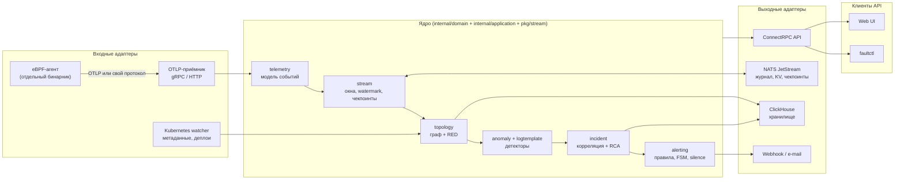
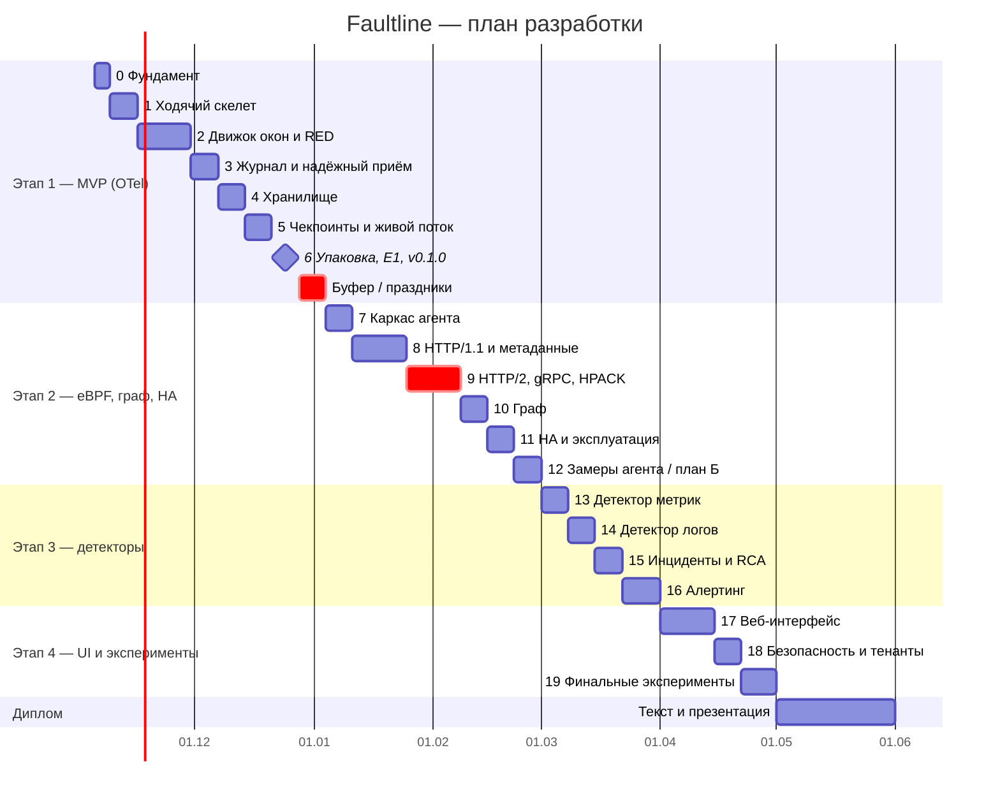

# Faultline — план разработки

| Поле | Значение |
|---|---|
| Версия | 1.0 |
| Дата | 2026-11-05 |
| Основа | [`requirements.md`](requirements.md) — ID требований ссылаются на него |
| Период | 2026-11-05 — 2027-04-30 (разработка), май 2027 — текст диплома |

---

## 1. Принцип: ядро + адаптеры, рост «ходячим скелетом»

### 1.1. Что такое «ядро»

Ядро — это чистый Go без инфраструктуры: доменная модель и сценарии обработки. Его можно протестировать без Docker, Kubernetes и сети. Всё внешнее подключается к ядру через порты (интерфейсы, объявленные на стороне ядра) — это архитектура «порты и адаптеры» (hexagonal).



**Правило зависимостей:** ядро не импортирует ни NATS, ни ClickHouse, ни ConnectRPC, ни cilium/ebpf. Замена хранилища или транспорта меняет только адаптер и wiring в `cmd/`.

**Почему CLI и UI не «прикручиваются к ядру»:** они ходят в API по сети и не знают о внутренностях. Благодаря этому один и тот же `faultctl` работает и с локальным all-in-one процессом на ноутбуке, и с HA-установкой в кластере.

### 1.2. Почему «ходячий скелет», а не «сначала всё ядро»

| Подход | Что произойдёт |
|---|---|
| Сначала ядро целиком (ноябрь), потом адаптеры (декабрь) | Ядро тестируется на выдуманных данных; в декабре OTLP-спаны окажутся не такими (время в наносекундах, `service.name` в ресурсе, а не в спане, пары client/server в разных пакетах) — переделка ядра под конец этапа |
| **Ходячий скелет** (принятый) | На 2-й неделе работает тонкий сквозной путь «OTel Demo → OTLP → ребро графа → `faultctl graph export`». Дальше каждый шаг углубляет одну часть, а система всё время запускается целиком |

Скелет строится в памяти (без NATS и ClickHouse) и затем постепенно получает настоящую инфраструктуру. Ядро при этом не меняется — меняются только адаптеры за портами. Это заодно проверяет, что порты нарисованы правильно.

### 1.3. Бинарники

| Бинарник | Роли | Почему так |
|---|---|---|
| `faultline` | `ingester`, `processor`, `api`, `alerter`, `all` | Один образ для бэкенда; режим `all` — всё в одном процессе для ноутбука и MVP; в Helm-профиле `ha` роли запускаются отдельными Deployment'ами |
| `faultline-agent` | — | Другие привилегии (capabilities), другой жизненный цикл (DaemonSet), встроенные eBPF-объекты |
| `faultctl` | — | CLI-клиент API; распространяется отдельно (brew/go install/релиз) |

---

## 2. Структура репозитория

Один Go-модуль (`go 1.27`), монорепозиторий.

```
faultline/
├── api/proto/faultline/v1/        # контракт API (buf): graph, signals, incidents, alerting, ingest
├── bpf/                           # eBPF-программы на C (Dual BSD/GPL), общие заголовки
├── cmd/
│   ├── faultline/                 # composition root бэкенда: провайдеры по ролям
│   ├── faultline-agent/           # composition root агента
│   └── faultctl/                  # CLI
├── internal/
│   ├── domain/                    # ЯДРО: сущности и правила, без тегов json/db
│   │   ├── telemetry/             #   Span, Batch, ServiceRef, CallKey; позже Event, Exchange, LogRecord
│   │   ├── topology/              #   Graph, Node, Edge, EdgeStats (RED), Revision, Diff
│   │   ├── anomaly/               #   RobustBaseline, SeasonalProfile, Detector, Anomaly
│   │   ├── logtemplate/           #   Masker, Miner (Drain), Template
│   │   ├── incident/              #   Incident, Correlator, RCA-стратегии
│   │   ├── alerting/              #   Rule, Alert (FSM firing/resolved/silenced), Silence
│   │   └── tenant/                #   Tenant, Role, Scope
│   ├── application/               # ЯДРО: сценарии + consumer-side порты
│   │   ├── ingest/                #   AcceptBatch: валидация, тенант, публикация в журнал
│   │   ├── processing/            #   конвейер: события → окна → граф → детекторы → инциденты
│   │   ├── query/                 #   чтение графа, сигналов, инцидентов
│   │   └── notification/          #   оценка правил, доставка через порт
│   ├── infrastructure/            # АДАПТЕРЫ ВЫХОДА
│   │   ├── natsjs/                #   журнал, KV, Object Store (чекпоинты)
│   │   ├── clickhouse/            #   репозитории, миграции, перевод ошибок драйвера
│   │   ├── kube/                  #   informers: поды, владельцы, деплои
│   │   ├── notify/                #   webhook, smtp
│   │   └── ebpf/                  #   загрузка программ, ringbuf-читатель, парсеры (только агент)
│   └── interfaces/                # АДАПТЕРЫ ВХОДА
│       ├── otlp/                  #   OTLP gRPC/HTTP → application/ingest
│       ├── connectapi/            #   ConnectRPC-хэндлеры, маппинг domain ↔ proto
│       └── agentingest/           #   приём пакетов агента (если OQ-04 решится в пользу своего протокола)
├── pkg/
│   └── stream/                    # движок окон: watermark, опоздания, ранние результаты, снимки
├── web/                           # React + TypeScript + Vite + Cytoscape.js
├── deploy/helm/faultline/         # чарт, профили values-dev.yaml / values-ha.yaml
├── test/
│   ├── e2e/                       # сценарии на kind
│   └── experiments/               # E1–E10: скрипты, конфиги, генераторы
└── docs/
```

`pkg/stream` лежит в `pkg/`, потому что движок окон не содержит бизнес-логики: он не знает, что агрегирует. Конкретные агрегаты (RED, частоты шаблонов) — в `domain`.

### 2.1. Готовые библиотеки вместо велосипедов

Всё перечисленное снимает риск без потери научной новизны: новизна в агенте, движке окон, детекторах и RCA, а не в кодировании протоколов.

| Задача | Библиотека | Лицензия | Снимает риск |
|---|---|---|---|
| Декодирование HPACK | `golang.org/x/net/http2/hpack` | BSD-3 | FR-AGT-002: остаётся только правильно скармливать header-блоки по соединениям |
| Квантили с гарантией относительной ошибки | `github.com/DataDog/sketches-go` (DDSketch) | Apache 2.0 | FR-TOP-002, FR-STO-002: ошибка ≤ 2% и слияние скетчей при downsampling |
| Модель и декодирование OTLP | `go.opentelemetry.io/collector/pdata` | Apache 2.0 | FR-ING-001 |
| eBPF | `github.com/cilium/ebpf` + `bpf2go` | MIT | FR-AGT-* |
| Журнал, KV, Object Store | `github.com/nats-io/nats.go` | Apache 2.0 | FR-ING-003, FR-STR-003 |
| ClickHouse | `github.com/ClickHouse/clickhouse-go/v2` | Apache 2.0 | FR-STO-* |
| Kubernetes | `k8s.io/client-go` (informers) | Apache 2.0 | FR-AGT-005, FR-TOP-003, FR-RCA-004 |
| API | `connectrpc.com/connect`, `buf` | Apache 2.0 | FR-API-* |
| CLI | stdlib `flag` в шаге 1 (одна команда); `github.com/spf13/cobra` — когда появится дерево команд (`graph watch`, шаг 5) | Apache 2.0 | FR-CLI-* |
| Тесты | `github.com/google/go-cmp`, `go.uber.org/goleak`, `testcontainers-go` | BSD-3 / MIT / MIT | NFR-MAINT-001 |

Drain пишем сами (FR-LAD-005/006 требуют лимитов, стабильных ID и чекпоинта), а Go-порт Drain3 используем только как эталон в E5.

---

## 3. Общее определение готовности шага (DoD)

Шаг закрыт, только если:

1. `make verify` зелёный: `golangci-lint` по `~/.claude/golangci-reference.yml`, `go test -race ./...`, `buf lint` + `buf breaking`.
2. В пакетах с долгоживущими горутинами есть `goleak.VerifyTestMain`.
3. Демо шага воспроизводится одной командой `make demo-<шаг>` и описано в версионируемой инструкции рядом с манифестами (шаг 1 — `deploy/dev/README.md`; `docs/` не публикуется).
4. В матрице трассировки (`requirements.md`, раздел 9) у закрытых FR отмечен статус.
5. Покрытие пакетов шага ≥ порогов NFR-MAINT-001.
6. Тег `v0.<этап>.<шаг>` на ветке `dev`; слияние в `main` — на границе этапа.

---

## 4. Этап 1 — MVP на OpenTelemetry (5 ноября — 27 декабря 2026)

Цель этапа: сквозной конвейер без eBPF; проверка НФТ бэкенда (пропускная способность, свежесть, восстановление) до появления агента.

### Шаг 0. Фундамент — 5–8 ноября

| | |
|---|---|
| **Делаем** | `go.mod` с `go 1.27`; `Makefile` (`verify`, `test-race`, `demo-*`, `kind-up`); `.golangci.yml` из эталона; `buf.yaml`; CI в GitHub Actions (матрица Go 1.27); `kind`-конфиг; Linux-ВМ для eBPF |
| **Проверяем** | OQ-02: есть ли `/sys/kernel/btf/vmlinux` в ВМ Docker Desktop. Если нет — Lima/Colima с Ubuntu 24.04 |
| **Готово, когда** | Пустой скелет проходит `make verify` в CI; `kind-up` поднимает кластер; в ВМ виден BTF |

### Шаг 1. Ходячий скелет — 9–15 ноября

| | |
|---|---|
| **Ядро** | `domain/telemetry`: Span, Batch, ServiceRef, CallKey. `domain/topology`: фасад Builder (внутри — сопоставление половинок с tombstones и агрегат графа), Snapshot, Node, Edge, PairingStats/GraphStats; сопоставление client/server-спанов в ребро; ошибка вызова по коду ответа любой из сторон; вызовы без ответа на узле вызывающего; ревизии графа. Термины — [`glossary.md`](glossary.md) |
| **Адаптеры** | `interfaces/otlp` (только traces, gRPC); in-memory журнал за портами `spanJournal` / `spanFeed`, ограниченный по байтам (доставка с `Release` — освобождение кредита памяти, не подтверждение durability); `interfaces/connectapi`: `GetGraph`; `faultctl graph export -o dot\|json`; образ и манифесты для kind |
| **Режим запуска** | `faultline all` — всё в одном процессе |
| **FR (частично)** | FR-ING-001, FR-ING-005, FR-ING-006, FR-TOP-001, FR-TOP-002 (признак ошибки), FR-API-001, FR-API-002, FR-API-007 (дедлайн; `GetGraph` вне пагинации), FR-CLI-002 |
| **Дизайн** | [`design/step-01-walking-skeleton.md`](design/step-01-walking-skeleton.md) |
| **Демо** | Срез 0 (до 9.11): дамп реальных трейсов OTel Demo и эталон рёбер в `test/demo/otel-demo/`. Итог: OTel Demo в kind → `faultctl graph export -o dot` показывает рёбра сервисов; `demo-check` проверяет `required ⊆ граф ⊆ required ∪ optional` |
| **Риск** | Неочевидная модель OTLP (пары спанов приходят в разных пакетах и с задержкой) — именно его этот шаг и вскрывает рано |

### Шаг 2. Движок окон и RED — 16–29 ноября (2 недели)

| | |
|---|---|
| **Ядро** | `pkg/stream`: tumbling-окна, ранние результаты (1 с), watermark, allowed lateness, `late_dropped`, переназначение событий «из будущего». `domain/topology`: EdgeStats на DDSketch. Нормализация путей и лимит кардинальности |
| **FR** | FR-STR-001, FR-STR-002, FR-STR-006, FR-STR-007, FR-TOP-002 |
| **Тесты** | Property-based: результат окна = пакетный пересчёт по тем же событиям в любом порядке прихода в пределах lateness. Фейковые часы вместо `time.Now()` |
| **Демо** | `faultctl graph export -o json` показывает rate / error rate / p95 у рёбер |
| **Риск** | Самый сложный по корректности шаг этапа. При отставании: упростить FR-STR-007 до счётчика без `__overflow__` |

### Шаг 3. Журнал и надёжный приём — 30 ноября — 6 декабря

| | |
|---|---|
| **Адаптеры** | `infrastructure/natsjs`: публикация с подтверждением, потребитель с позицией; in-memory журнал заменяется NATS за тем же портом. Разделение ролей `ingester` / `processor` |
| **Ядро** | `application/ingest`: подтверждение только после записи (FR-ING-003); backpressure → `RESOURCE_EXHAUSTED`; проверка ingest-токена |
| **FR** | FR-ING-003, FR-ING-005, FR-SEC-002 |
| **Тесты** | testcontainers NATS: остановка реплик → retryable-ошибка, а не успех |
| **Проверка архитектуры** | Ядро не изменилось при замене журнала — только wiring в `cmd/` |

### Шаг 4. Хранилище — 7–13 декабря

| | |
|---|---|
| **Адаптеры** | `infrastructure/clickhouse`: схема сырых событий и агрегатов, TTL, версионированные миграции с блокировкой от параллельного запуска, идемпотентная запись результатов окон |
| **FR** | FR-STO-001, FR-STO-004, FR-STR-004 |
| **Тесты** | Повторная запись того же отрезка журнала не меняет `sum(requests)`; две реплики применяют миграцию ровно один раз |

### Шаг 5. Чекпоинты и живой поток — 14–20 декабря

| | |
|---|---|
| **Ядро + адаптеры** | Снимок состояния движка + позиции журнала в NATS Object Store; восстановление после `SIGKILL`. Устаревание рёбер. Серверный поток изменений графа с ревизиями и возобновлением |
| **FR** | FR-STR-003, FR-TOP-005, FR-API-003 |
| **Тесты** | Kill-тест: агрегаты после рестарта = пакетный пересчёт (основа NFR-REL-002). Разрыв потока на 30 с → догоняем без полного снимка |
| **Демо** | `faultctl graph watch` — живые изменения графа в терминале |

### Шаг 6. Упаковка и замер MVP — 21–27 декабря

| | |
|---|---|
| **Делаем** | Helm-профиль `dev`, liveness/readiness, метрики Prometheus. Эксперимент E1 на профиле L |
| **FR** | FR-OPS-001 (`dev`), FR-OPS-002, FR-OPS-004 |
| **НФТ** | NFR-PERF-001, -002, -003; NFR-REL-002; NFR-COMPAT-001 |
| **Решение** | OQ-04: протокол агента — OTLP или свой (по замерам E1) |
| **Результат этапа** | Релиз `v0.1.0`, слияние в `main` |

**28 декабря — 3 января — буфер и праздники.** Если этап 1 отстаёт, неделя уходит на его закрытие.

---

## 5. Этап 2 — eBPF, граф, HA (4 января — 28 февраля 2027)

| Шаг | Даты | Что делаем | FR | Готово, когда |
|---|---|---|---|---|
| **7. Каркас агента** | 4–10 янв | `bpf2go`, проверка ядра и BTF, загрузка/отсоединение программ, ringbuf, счётчики потерь, фильтр по cgroup своего узла | FR-AGT-004, FR-AGT-006, FR-AGT-010 | Агент стартует и останавливается без следов в `bpftool`; на kind с 2 узлами нет дублей (NFR-AGT-005) |
| **8. HTTP/1.1 и метаданные** | 11–24 янв | Захват `read`/`write`/`sendmsg`/`recvmsg`, парсер HTTP/1.1 (fuzz), метаданные подов через informer только своего узла, allowlist заголовков, отправка в приём с буфером и дедупликацией | FR-AGT-001, FR-AGT-005, FR-AGT-008, FR-AGT-009, FR-ING-002, FR-ING-004 | Неинструментированный HTTP-сервис виден на графе; остановка приёма на 30 с — 0 потерь |
| **9. HTTP/2, gRPC, HPACK** | 25 янв — 7 фев | Разбор кадров HTTP/2, HPACK-декодер на соединение и направление (`x/net/http2/hpack`), трейлеры `grpc-status`, деградация до L4 | FR-AGT-002, FR-AGT-003 | Online Boutique: ≥ 99% gRPC-вызовов с верными методом и статусом; соединения, открытые до старта агента, видны как L4 |
| **10. Граф: время и источники** | 8–14 фев | Разрешение IP с интервалами владения, внешние узлы, слияние источников OTLP/агент, граф на момент времени, downsampling, лимиты API и валидация входа | FR-TOP-003, FR-TOP-004, FR-TOP-006, FR-STO-002, FR-API-004 (граф, RED), FR-API-007, FR-ING-006 | Тест переиспользования IP проходит; смешанное инструментирование не удваивает rate |
| **11. HA и эксплуатация** | 15–21 фев | Профиль `ha`, шардирование ключей между процессорами, хаос-эксперименты E8, JSON Schema для values, `faultctl doctor` | FR-OPS-001 (`ha`), FR-OPS-003, FR-STR-005, FR-CLI-003 | NFR-REL-001 и NFR-REL-003 пройдены на профиле L |
| **12. Замеры агента** | 22–28 фев | E2 и E3, сравнение с OBI, адаптивная выборка при перегрузке | FR-AGT-007 | NFR-AGT-001…005, NFR-ACC-005, NFR-COMPAT-002 замерены. **Контрольная точка:** если NFR-COMPAT-002 не выполнен — демо-стенд переходит на OBI (план Б из раздела 7.1 требований) |

Шаг 9 — главный риск этапа. Если к 7 февраля HPACK не готов, шаг 10 сдвигается на неделю за счёт шага 12. Замеры агента при этом урезаются до E2 без сравнения с OBI.

---

## 6. Этап 3 — детекторы, корреляция, алерты (1–31 марта 2027)

Весь этап — работа в ядре (`domain/anomaly`, `domain/logtemplate`, `domain/incident`, `domain/alerting`). Адаптеры почти не меняются, поэтому этап хорошо покрывается быстрыми модульными тестами.

| Шаг | Даты | Что делаем | FR | Готово, когда |
|---|---|---|---|---|
| **13. Детектор метрик** | 1–7 мар | Робастная базовая линия (медиана/MAD) + EWMA, сезонный профиль по часу суток и недели, холодный старт, пороги значимости; состояние детекторов в чекпоинте. Базовая линия z-score — для сравнения | FR-MAD-001…004 | Внесённая задержка +300 мс обнаружена ≤ 60 с; одиночный выброс не создаёт аномалию |
| **14. Детектор логов** | 8–14 мар | Маскирование переменных и PII, Drain, новый шаблон, всплеск/исчезновение, LRU-лимит, стабильные ID через чекпоинт | FR-LAD-001…006, FR-SEC-006 | E5 на LogHub-2k: GA ≥ 0.84; рестарт процессора не создаёт ложный `new_template` |
| **15. Инциденты и RCA** | 15–21 мар | Корреляция аномалий по времени и графу, две RCA-стратегии за одним интерфейсом (эвристика и PageRank), доказательства, события деплоя из Kubernetes | FR-RCA-001…004, FR-API-004 (инциденты) | `faultctl incidents get` показывает кандидатов с доказательствами |
| **16. Алертинг** | 22–31 мар | Правила трёх типов, гистерезис, дедупликация и группировка, silence, webhook, повторы с ключом идемпотентности, поиск логов, защита диска | FR-ALR-001…006, FR-API-005, FR-API-006, FR-STO-003 | Первый проход E4 и E6: TTD и точность RCA замерены |

Порядок шагов 13 → 14 → 15 → 16 выбран по зависимостям: инциденты собираются из аномалий обоих детекторов, а алерты — из инцидентов.

---

## 7. Этап 4 — UI, безопасность, эксперименты (1–30 апреля 2027)

| Шаг | Даты | Что делаем | FR | Готово, когда |
|---|---|---|---|---|
| **17. Веб-интерфейс** | 1–14 апр | Живой граф (Cytoscape.js) на потоке FR-API-003, фильтры, панели узла и ребра, страница инцидента, логи по шаблонам, алерты и silence; CLI для инцидентов | FR-UI-001…007, FR-CLI-001 | Сценарий UC-01 проходится за ≤ 3 клика; NFR-PERF-006 замерен в Playwright |
| **18. Безопасность и тенанты** | 15–21 апр | OIDC (Dex в тестах), тенанты как наборы namespaces, роли, лимиты на тенант | FR-SEC-001, FR-SEC-003, FR-SEC-004, FR-SEC-005 | Тест изоляции по всем методам API (NFR-SEC-006) проходит |
| **19. Финальные эксперименты** | 22–30 апр | Повтор E1–E10 на замороженной версии, протоколы замеров, таблицы и графики для диплома | — | Релиз `v1.0.0`; все Must-НФТ имеют протокол замера |

Шаг 18 содержит только Should-требования. Если к 15 апреля есть отставание, он сокращается первым: остаётся один тенант и токен-аутентификация. Порядок сокращений — в разделе 10.2 требований.

**Май 2027** — текст диплома. Новых функций нет, только исправление дефектов.

---

## 8. Сводная диаграмма



---

## 9. Контрольные точки и решения по ходу

| Дата | Контрольная точка | Решение, которое принимается |
|---|---|---|
| 8 ноября | BTF в Linux-ВМ ноутбука | Docker Desktop или Lima/Colima (OQ-02) |
| 15 ноября | Ходячий скелет работает | Подтверждение границ портов; при проблемах — правка до шага 2 |
| 27 декабря | E1 пройден, `v0.1.0` | Протокол агента: OTLP или свой (OQ-04) |
| 7 февраля | HPACK готов | Сдвиг шага 10 или сокращение шага 12 |
| 28 февраля | E2/E3 пройдены | Свой агент или план Б на OBI для демо-стенда |
| 31 марта | Первый проход E4/E6 | Алгоритм RCA по умолчанию (OQ-06) |
| 15 апреля | UI готов | Объём шага 18 (полная мультитенантность или один тенант) |
| 30 апреля | `v1.0.0` | Заморозка кода |
